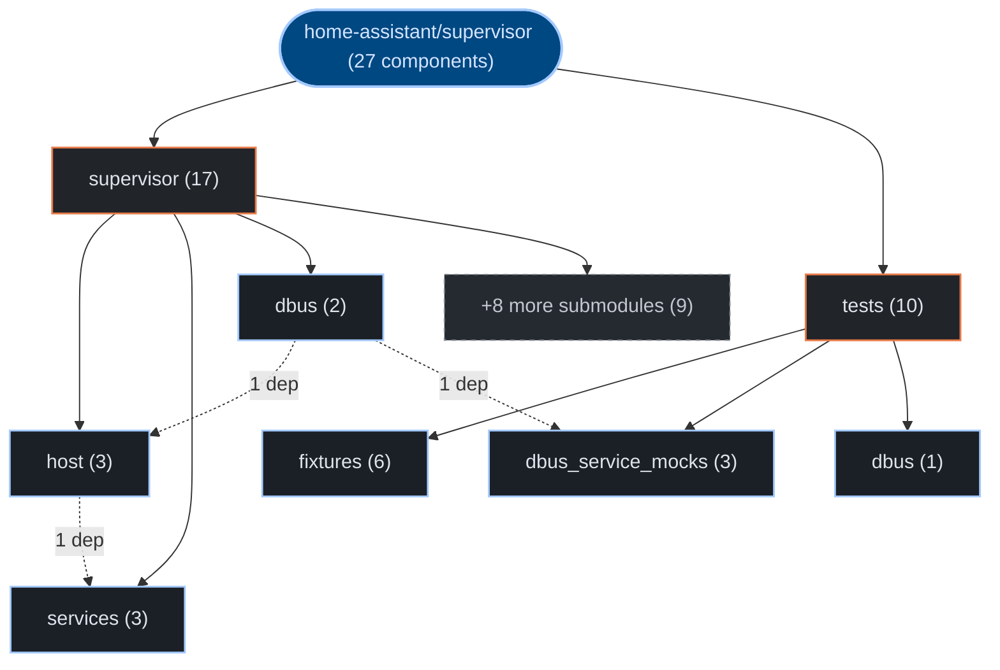
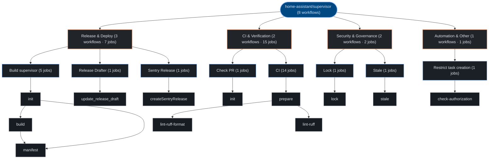

# Repository Architecture Analysis: home-assistant/supervisor

## Metadata
- **SHA**: `98a2322374ae3d0c248079d11f7435ad759935fa`
- **Primary Ecosystem**: Python

## Quality Metrics
- **ast_engine**: tree-sitter
- **avg_cognitive_complexity**: 0.96
- **avg_cyclomatic_complexity**: 1.75
- **component_count**: 27
- **dead_code_count**: 5
- **dead_code_symbols**: 5 entry(ies)
- **duplication_pct**: 89.01
- **file_complexities**: 25 entry(ies)
- **files_analyzed**: 616
- **fitness_passed**: False
- **fitness_violation_count**: 3
- **framework**: Django
- **import_edges**: 100 entry(ies)
- **loc**: 140787
- **max_cognitive_complexity**: 55
- **max_cyclomatic_complexity**: 40
- **sloc**: 112842
- **test_file_count**: 360

# Architecture: home-assistant/supervisor

## Context
- **Repository**: `home-assistant/supervisor`
- **SHA**: `98a2322374ae3d0c248079d11f7435ad759935fa`
- **Ecosystem**: Python
- **Framework**: Django

## Building Block View

## Component Details
- **CpuArchManager** (`supervisor/arch.py`): SERVICE
- **BackupManager** (`supervisor/backups/manager.py`): SERVICE
- **DBusManager** (`supervisor/dbus/manager.py`): SERVICE (deps: NetworkManager, UDisks2Manager)
- **BoardManager** (`supervisor/dbus/agent/boards/__init__.py`): SERVICE
- **HardwareManager** (`supervisor/hardware/manager.py`): SERVICE
- **FirewallManager** (`supervisor/host/firewall.py`): SERVICE
- **HostManager** (`supervisor/host/manager.py`): SERVICE (deps: FirewallManager, NetworkManager, ServiceManager)
- **NetworkManager** (`supervisor/host/network.py`): SERVICE
- **JobManager** (`supervisor/jobs/__init__.py`): SERVICE
- **PluginManager** (`supervisor/plugins/manager.py`): SERVICE
- **ResolutionManager** (`supervisor/resolution/module.py`): SERVICE
- **EvaluateNetworkManager** (`supervisor/resolution/evaluations/network_manager.py`): SERVICE
- **ServiceManager** (`supervisor/services/__init__.py`): SERVICE (deps: MQTTService, MySQLService)
- **MQTTService** (`supervisor/services/modules/mqtt.py`): SERVICE
- **MySQLService** (`supervisor/services/modules/mysql.py`): SERVICE
- **StoreManager** (`supervisor/store/__init__.py`): SERVICE
- **BlockBusterManager** (`supervisor/utils/blockbuster.py`): SERVICE
- **NoPropertiesService** (`tests/dbus/test_interface.py`): SERVICE
- **DnsManager** (`tests/dbus_service_mocks/network_dns_manager.py`): SERVICE
- **NetworkManager** (`tests/dbus_service_mocks/network_manager.py`): SERVICE
- **UDisks2Manager** (`tests/dbus_service_mocks/udisks2_manager.py`): SERVICE
- **build** (`tests/fixtures/apps/local/example/build.yaml`): module
- **config** (`tests/fixtures/apps/local/example/config.yaml`): module
- **build** (`tests/fixtures/apps/local/example_image/build.yaml`): module
- **config** (`tests/fixtures/apps/local/example_image/config.yaml`): module
- **build** (`tests/fixtures/apps/local/ssh/build.yaml`): module
- **config** (`tests/fixtures/apps/local/ssh/config.yaml`): module

## 6-Dimension Repository Scorecard

- **Overall Grade**: `D` (62.80/100)
- **Technical Debt Score**: 37.20
- **Estimated Remediation Effort**: 58.35h

| Dimension | Grade | Score | Weight | Details |
| :--- | :---: | :---: | :---: | :--- |
| Code Quality | `F` | 40.00 | 0.20 | avg_cc=1.75, max_cc=40, duplication=89.01%, dead_code=5 |
| Dependency Health | `B` | 85.00 | 0.15 | dependencies=42, outdated=0, vulnerable=0, has_lockfile=False |
| Maintainability | `F` | 37.00 | 0.15 | avg_cognitive=0.96, max_cognitive=55, fitness_violations=3, oversized_files=17 |
| Pipeline Health | `F` | 40.00 | 0.15 | workflows=0 |
| Security | `A` | 100.00 | 0.20 | vulnerabilities=0, secrets=0, pipeline_security_findings=0 |
| Test Coverage | `C` | 70.00 | 0.15 | coverage=unavailable, ci_test_job=False, test_files_detected=True |

## Architecture Fitness & Workspace Boundaries

- **[MEDIUM] `ATRUSS-ARCH-005` (COMPLEXITY_THRESHOLD)**: Repository duplication_pct (89.01) exceeds policy threshold (15.0).
- **[MEDIUM] `ATRUSS-ARCH-005` (COMPLEXITY_THRESHOLD)**: Repository max_cognitive_complexity (55.0) exceeds policy threshold (25.0).
- **[MEDIUM] `ATRUSS-ARCH-005` (COMPLEXITY_THRESHOLD)**: Repository max_cyclomatic_complexity (40.0) exceeds policy threshold (20.0).

## Supply Chain Dependencies, Vulnerabilities & Secrets

- **Dependencies Parsed**: 42 | **Vulnerabilities**: 0 | **Secrets**: 0

### Inventory Sample
- `PyYAML` `6.0.3` (PyPI, `requirements.txt`)
- `aiodns` `4.0.4` (PyPI, `requirements.txt`)
- `aiodocker` `0.27.0` (PyPI, `requirements.txt`)
- `aiohttp` `3.14.5` (PyPI, `requirements.txt`)
- `astroid` `4.3.4` (PyPI, `requirements_tests.txt`)
- `atomicwrites-homeassistant` `1.4.1` (PyPI, `requirements.txt`)
- `attrs` `26.1.0` (PyPI, `requirements.txt`)
- `awesomeversion` `25.8.0` (PyPI, `requirements.txt`)
- `blockbuster` `1.5.29` (PyPI, `requirements.txt`)
- `brotli` `1.2.1` (PyPI, `requirements.txt`)
- `ciso8601` `2.3.3` (PyPI, `requirements.txt`)
- `colorlog` `6.12.0` (PyPI, `requirements.txt`)
- `coverage` `7.17.2` (PyPI, `requirements_tests.txt`)
- `cpe` `1.3.1` (PyPI, `requirements.txt`)
- `cryptography` `50.0.2` (PyPI, `requirements.txt`)
- `dbus-fast` `5.2.0` (PyPI, `requirements.txt`)
- `debugpy` `1.8.22` (PyPI, `requirements.txt`)
- `deepmerge` `4.0.0` (PyPI, `requirements.txt`)
- `gitpython` `3.2.1` (PyPI, `requirements.txt`)
- `jinja2` `3.1.6` (PyPI, `requirements.txt`)
- `log-rate-limit` `1.4.2` (PyPI, `requirements.txt`)
- `mypy` `2.4.1` (PyPI, `requirements_tests.txt`)
- `orjson` `3.13.0` (PyPI, `requirements.txt`)
- `pre-commit` `4.7.0` (PyPI, `requirements_tests.txt`)
- `pulsectl` `24.12.0` (PyPI, `requirements.txt`)
- `pyjournalexport` `0.1.2` (PyPI, `requirements.txt`)
- `pylint` `4.1.3` (PyPI, `requirements_tests.txt`)
- `pytest` `9.2.0` (PyPI, `requirements_tests.txt`)
- `pytest-aiohttp` `1.1.1` (PyPI, `requirements_tests.txt`)
- `pytest-asyncio` `1.4.1.post1` (PyPI, `requirements_tests.txt`)
- ... (+12 more dependencies)

## CI/CD Pipeline Topology

