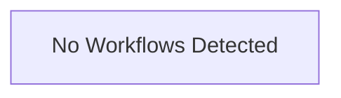

# Repository Architecture Analysis: httpie/cli

## Metadata
- **SHA**: `5b604c37c6c67e18e7c3e9aee6c88a8c22b98345`
- **Primary Ecosystem**: Python

## Quality Metrics
- **avg_cyclomatic_complexity**: 2.76
- **component_count**: 12
- **files_analyzed**: 133
- **framework**: Unknown
- **loc**: 19002
- **max_cyclomatic_complexity**: 27
- **sloc**: 14800

# Architecture: httpie/cli

## Context
- **Repository**: `httpie/cli`
- **SHA**: `5b604c37c6c67e18e7c3e9aee6c88a8c22b98345`
- **Ecosystem**: Python
- **Framework**: Unknown

## Building Block View

```mermaid
graph TD;
    PluginManager["PluginManager : SERVICE"]
    test_password_prompt["test_password_prompt : API_ROUTE"]
    test_auth_plugin_prompt_password_false["test_auth_plugin_prompt_password_false : API_ROUTE"]
    test_unique_filename["test_unique_filename : API_ROUTE"]
    test_error["test_error : API_ROUTE"]
    test_error_traceback["test_error_traceback : API_ROUTE"]
    test_error_custom_dns["test_error_custom_dns : API_ROUTE"]
    test_main_entry_point_keyboard_interrupt["test_main_entry_point_keyboard_interrupt : API_ROUTE"]
    test_quiet_on_python_warnings["test_quiet_on_python_warnings : API_ROUTE"]
    test_quiet_with_password_prompt["test_quiet_with_password_prompt : API_ROUTE"]
    test_password_protected_cert_prompt["test_password_protected_cert_prompt : API_ROUTE"]
    test_password_protected_cert_prompt_invalid["test_password_protected_cert_prompt_invalid : API_ROUTE"]
    repo_root(["httpie/cli"])
    repo_root --> PluginManager
    repo_root --> test_auth_plugin_prompt_password_false
    repo_root --> test_error
    repo_root --> test_error_custom_dns
    repo_root --> test_error_traceback
    repo_root --> test_main_entry_point_keyboard_interrupt
    repo_root --> test_password_prompt
    repo_root --> test_password_protected_cert_prompt
    repo_root --> test_password_protected_cert_prompt_invalid
    repo_root --> test_quiet_on_python_warnings
    repo_root --> test_quiet_with_password_prompt
    repo_root --> test_unique_filename
```

## Component Details
- **PluginManager** (`httpie/plugins/manager.py`): SERVICE
- **test_password_prompt** (`tests/test_auth.py`): API_ROUTE
- **test_auth_plugin_prompt_password_false** (`tests/test_auth_plugins.py`): API_ROUTE
- **test_unique_filename** (`tests/test_downloads.py`): API_ROUTE
- **test_error** (`tests/test_errors.py`): API_ROUTE
- **test_error_traceback** (`tests/test_errors.py`): API_ROUTE
- **test_error_custom_dns** (`tests/test_errors.py`): API_ROUTE
- **test_main_entry_point_keyboard_interrupt** (`tests/test_httpie.py`): API_ROUTE
- **test_quiet_on_python_warnings** (`tests/test_output.py`): API_ROUTE
- **test_quiet_with_password_prompt** (`tests/test_output.py`): API_ROUTE
- **test_password_protected_cert_prompt** (`tests/test_ssl.py`): API_ROUTE
- **test_password_protected_cert_prompt_invalid** (`tests/test_ssl.py`): API_ROUTE

## CI/CD Pipeline Topology

