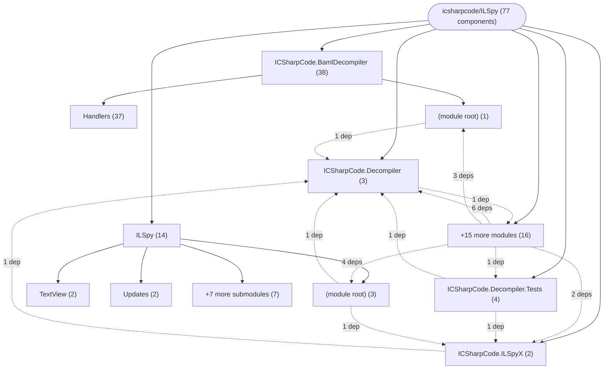

# Repository Architecture Analysis: icsharpcode/ILSpy

## Metadata
- **SHA**: `caff1a9549afc1a97b5319454fe602bfbde5ccde`
- **Primary Ecosystem**: .NET

## Quality Metrics
- **avg_cyclomatic_complexity**: 14.29
- **component_count**: 77
- **files_analyzed**: 3846
- **framework**: ASP.NET Core
- **loc**: 810837
- **max_cyclomatic_complexity**: 748
- **sloc**: 589197

# Architecture: icsharpcode/ILSpy

## Context
- **Repository**: `icsharpcode/ILSpy`
- **SHA**: `caff1a9549afc1a97b5319454fe602bfbde5ccde`
- **Ecosystem**: .NET
- **Framework**: Unknown

## Building Block View

## Component Details

Showing top 60 representative components out of 77 across 20 module group(s):

- **Module `ICSharpCode.BamlDecompiler`** (38 components — SERVICE: 37, MODULE: 1)
- **Module `ILSpy`** (14 components — SERVICE: 12, MODULE: 1, API_ROUTE: 1)
- **Module `ICSharpCode.Decompiler.Tests`** (4 components — SERVICE: 3, MODULE: 1)
- **Module `ICSharpCode.Decompiler`** (3 components — SERVICE: 2, MODULE: 1)
- **Module `ICSharpCode.ILSpyX`** (2 components — MODULE: 2)
- **Module `TestFixtures.Resources`** (2 components — MODULE: 2)
- **Module `ICSharpCode.Decompiler.AotTest`** (1 components — MODULE: 1)
- **Module `ICSharpCode.Decompiler.Generators`** (1 components — MODULE: 1)
- **Module `ICSharpCode.Decompiler.PowerShell`** (1 components — MODULE: 1)
- **Module `ICSharpCode.Decompiler.TestRunner`** (1 components — MODULE: 1)
- **Module `ICSharpCode.ILSpyCmd`** (1 components — MODULE: 1)
- **Module `ICSharpCode.ILSpyCmd.Tests`** (1 components — MODULE: 1)

- **ICSharpCode.ILSpyCmd** (`ICSharpCode.ILSpyCmd/ICSharpCode.ILSpyCmd.csproj`): MODULE (deps: ICSharpCode.BamlDecompiler, ICSharpCode.Decompiler, ICSharpCode.ILSpyX)
- **ILSpy** (`ILSpy/ILSpy.csproj`): MODULE (deps: ICSharpCode.BamlDecompiler, ICSharpCode.Decompiler, ICSharpCode.ILSpyX)
- **ILSpy.ReadyToRun** (`ILSpy.ReadyToRun/ILSpy.ReadyToRun.csproj`): MODULE (deps: ICSharpCode.Decompiler, ICSharpCode.ILSpyX, ILSpy)
- **ICSharpCode.Decompiler.Tests** (`ICSharpCode.Decompiler.Tests/ICSharpCode.Decompiler.Tests.csproj`): MODULE (deps: ICSharpCode.Decompiler, ICSharpCode.ILSpyX)
- **ILSpy.BamlDecompiler.Tests.Windows** (`ILSpy.BamlDecompiler.Tests.Windows/ILSpy.BamlDecompiler.Tests.Windows.csproj`): MODULE (deps: ICSharpCode.BamlDecompiler, ICSharpCode.Decompiler.Tests)
- **ILSpy.Tests** (`ILSpy.Tests/ILSpy.Tests.csproj`): MODULE (deps: ILSpy, TestPlugin)
- **ILSpy.Tests.Windows** (`ILSpy.Tests.Windows/ILSpy.Tests.Windows.csproj`): MODULE (deps: ILSpy, ILSpy.Tests)
- **TestPlugin** (`TestPlugin/TestPlugin.csproj`): MODULE (deps: ICSharpCode.Decompiler, ILSpy)
- **AppUpdateService** (`ILSpy/Updates/UpdateService.cs`): SERVICE (deps: UpdateService)
- **ICSharpCode.BamlDecompiler** (`ICSharpCode.BamlDecompiler/ICSharpCode.BamlDecompiler.csproj`): MODULE (deps: ICSharpCode.Decompiler)
- **ICSharpCode.Decompiler** (`ICSharpCode.Decompiler/ICSharpCode.Decompiler.csproj`): MODULE (deps: ICSharpCode.Decompiler.Generators)
- **ICSharpCode.Decompiler.AotTest** (`ICSharpCode.Decompiler.AotTest/ICSharpCode.Decompiler.AotTest.csproj`): MODULE (deps: ICSharpCode.Decompiler)
- **ICSharpCode.Decompiler.PowerShell** (`ICSharpCode.Decompiler.PowerShell/ICSharpCode.Decompiler.PowerShell.csproj`): MODULE (deps: ICSharpCode.Decompiler)
- **ICSharpCode.ILSpyCmd.Tests** (`ICSharpCode.ILSpyCmd.Tests/ICSharpCode.ILSpyCmd.Tests.csproj`): MODULE (deps: ICSharpCode.ILSpyCmd)
- **ICSharpCode.ILSpyX** (`ICSharpCode.ILSpyX/ICSharpCode.ILSpyX.csproj`): MODULE (deps: ICSharpCode.Decompiler)
- **ILSpy.BamlDecompiler.Tests** (`ILSpy.BamlDecompiler.Tests/ILSpy.BamlDecompiler.Tests.csproj`): MODULE (deps: ICSharpCode.BamlDecompiler)
- **ILSpy.Installer** (`ILSpy.Installer/ILSpy.Installer.csproj`): MODULE (deps: ICSharpCode.Decompiler)
- **KeyElementStartHandler** (`ICSharpCode.BamlDecompiler/Handlers/Blocks/KeyElementStartHandler.cs`): SERVICE (deps: ElementHandler)
- **LanguageService** (`ILSpy/Languages/LanguageService.cs`): SERVICE (deps: SettingsService)
- **PropertyWithConverterHandler** (`ICSharpCode.BamlDecompiler/Handlers/Records/PropertyWithConverterHandler.cs`): SERVICE (deps: PropertyHandler)
- **SettingsService** (`ILSpy/SettingsService.cs`): SERVICE (deps: LanguageService)
- **TextHandler** (`ICSharpCode.BamlDecompiler/Handlers/Records/TextHandler.cs`): SERVICE (deps: TextWithIdHandler)
- **TextWithConverterHandler** (`ICSharpCode.BamlDecompiler/Handlers/Records/TextWithConverterHandler.cs`): SERVICE (deps: TextHandler)
- **TextWithIdHandler** (`ICSharpCode.BamlDecompiler/Handlers/Records/TextHandler.cs`): SERVICE (deps: TextHandler)
- **TypeInfoHandler** (`ICSharpCode.BamlDecompiler/Handlers/Records/TypeInfoHandler.cs`): SERVICE (deps: TypeSerializerInfoHandler)
- **TypeSerializerInfoHandler** (`ICSharpCode.BamlDecompiler/Handlers/Records/TypeInfoHandler.cs`): SERVICE (deps: TypeInfoHandler)
- **UpdateService** (`ILSpy/Updates/UpdateService.cs`): SERVICE (deps: AppUpdateService)
- **AssemblyInfoHandler** (`ICSharpCode.BamlDecompiler/Handlers/Records/AssemblyInfoHandler.cs`): SERVICE
- **AssemblyRowDropHandler** (`ILSpy/AssemblyTree/AssemblyRowDropHandler.cs`): SERVICE
- **AsyncSteppingCatchHandler** (`ICSharpCode.Decompiler.Tests/TestCases/PdbGen/AsyncSteppingCatchHandler.cs`): SERVICE
- **AttributeInfoHandler** (`ICSharpCode.BamlDecompiler/Handlers/Records/AttributeInfoHandler.cs`): SERVICE
- **BamlResourceFileHandler** (`ILSpy/TreeNodes/BamlResourceNodeFactory.cs`): SERVICE
- **ConnectionIdHandler** (`ICSharpCode.BamlDecompiler/Handlers/Records/ConnectionIdHandler.cs`): SERVICE
- **ConstructorParameterTypeHandler** (`ICSharpCode.BamlDecompiler/Handlers/Records/ConstructorParameterTypeHandler.cs`): SERVICE
- **ConstructorParametersStartHandler** (`ICSharpCode.BamlDecompiler/Handlers/Blocks/ConstructorParametersHandler.cs`): SERVICE
- **ContentPropertyHandler** (`ICSharpCode.BamlDecompiler/Handlers/Records/ContentPropertyHandler.cs`): SERVICE
- **DefAttributeHandler** (`ICSharpCode.BamlDecompiler/Handlers/Records/DefAttributeHandler.cs`): SERVICE
- **DefAttributeStringHandler** (`ICSharpCode.BamlDecompiler/Handlers/Records/DefAttributeKeyStringHandler.cs`): SERVICE
- **DefAttributeTypeHandler** (`ICSharpCode.BamlDecompiler/Handlers/Records/DefAttributeKeyTypeHandler.cs`): SERVICE
- **DeferableContentStartHandler** (`ICSharpCode.BamlDecompiler/Handlers/Records/DeferableContentStartHandler.cs`): SERVICE
- **DocumentHandler** (`ICSharpCode.BamlDecompiler/Handlers/Blocks/DocumentHandler.cs`): SERVICE
- **EWSService** (`ICSharpCode.Decompiler.Tests/TestCases/Correctness/InitializerTests.cs`): SERVICE
- **ElementHandler** (`ICSharpCode.BamlDecompiler/Handlers/Blocks/ElementHandler.cs`): SERVICE
- **Generate** (`TestFixtures.Resources/Generate.csproj`): MODULE
- **GlobalExceptionHandler** (`ILSpy/AppEnv/GlobalExceptionHandler.cs`): SERVICE
- **HighlightingService** (`ILSpy/TextView/HighlightingService.cs`): SERVICE
- **ICSharpCode.Decompiler.Generators** (`ICSharpCode.Decompiler.Generators/ICSharpCode.Decompiler.Generators.csproj`): MODULE
- **ICSharpCode.Decompiler.TestRunner** (`ICSharpCode.Decompiler.TestRunner/ICSharpCode.Decompiler.TestRunner.csproj`): MODULE
- **ILSpy.AddIn.VS2022** (`ILSpy.AddIn.VS2022/ILSpy.AddIn.VS2022.csproj`): MODULE
- **LineNumberAndPositionHandler** (`ICSharpCode.BamlDecompiler/Handlers/Records/LineNumberAndPositionHandler.cs`): SERVICE
- **LinePositionHandler** (`ICSharpCode.BamlDecompiler/Handlers/Records/LinePositionHandler.cs`): SERVICE
- **LiteralContentHandler** (`ICSharpCode.BamlDecompiler/Handlers/Records/LiteralContentHandler.cs`): SERVICE
- **MetadataProtocolHandler** (`ILSpy/Metadata/MetadataProtocolHandler.cs`): SERVICE
- **OptimizedStaticResourceHandler** (`ICSharpCode.BamlDecompiler/Handlers/Records/OptimizedStaticResourceHandler.cs`): SERVICE
- **PIMappingHandler** (`ICSharpCode.BamlDecompiler/Handlers/Records/PIMappingHandler.cs`): SERVICE
- **PresentationOptionsAttributeHandler** (`ICSharpCode.BamlDecompiler/Handlers/Records/PresentationOptionsAttributeHandler.cs`): SERVICE
- **PropertyArrayHandler** (`ICSharpCode.BamlDecompiler/Handlers/Blocks/PropertyArrayHandler.cs`): SERVICE
- **PropertyComplexHandler** (`ICSharpCode.BamlDecompiler/Handlers/Blocks/PropertyComplexHandler.cs`): SERVICE
- **PropertyCustomHandler** (`ICSharpCode.BamlDecompiler/Handlers/Records/PropertyCustomHandler.cs`): SERVICE
- **PropertyDictionaryHandler** (`ICSharpCode.BamlDecompiler/Handlers/Blocks/PropertyDictionaryHandler.cs`): SERVICE

## CI/CD Pipeline Topology

