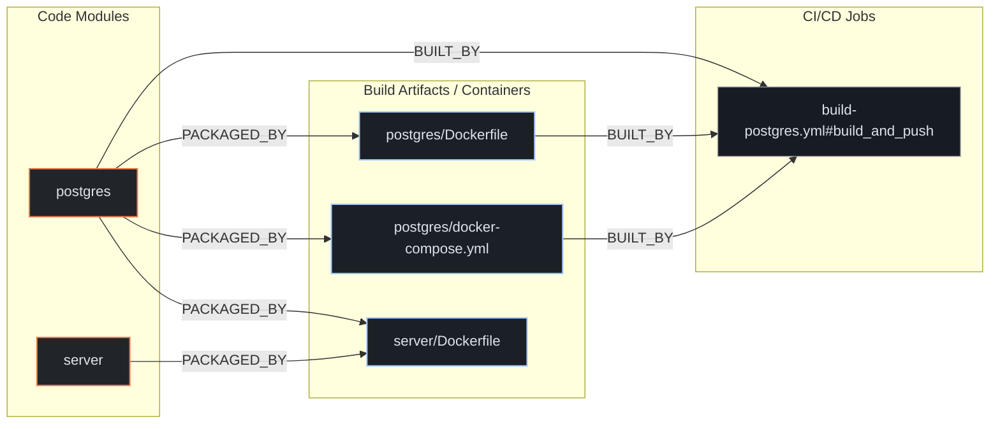
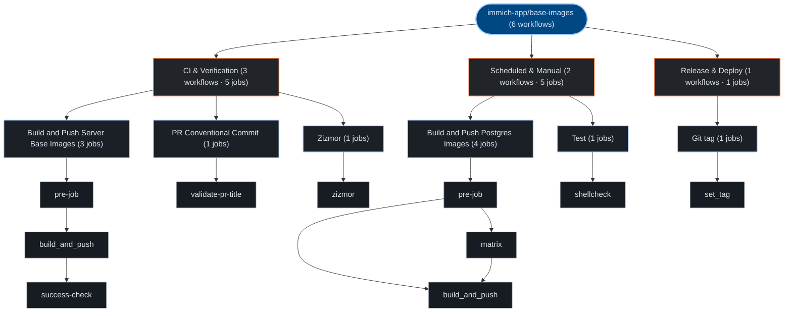

# Repository Architecture Analysis: immich-app/base-images

## Metadata
- **SHA**: `1e95d65c6d4c34906b78eb064e06644515d24e6e`
- **Primary Ecosystem**: Container / Helm / IaC

## Quality Metrics
- **ast_engine**: fallback
- **avg_cognitive_complexity**: 0.0
- **avg_cyclomatic_complexity**: 0.0
- **component_count**: 2
- **dead_code_count**: 0
- **dead_code_symbols**: 0 entry(ies)
- **duplication_pct**: 0.0
- **file_complexities**: 0 entry(ies)
- **files_analyzed**: 2
- **fitness_passed**: True
- **fitness_violation_count**: 0
- **framework**: Docker Compose
- **import_edges**: 0 entry(ies)
- **loc**: 42
- **max_cognitive_complexity**: 0
- **max_cyclomatic_complexity**: 0
- **sloc**: 39

# Architecture: immich-app/base-images

## Context
- **Repository**: `immich-app/base-images`
- **SHA**: `1e95d65c6d4c34906b78eb064e06644515d24e6e`
- **Ecosystem**: Container / Helm / IaC
- **Framework**: Docker Compose

## Building Block View

## Component Details
- **docker-compose** (`postgres/docker-compose.yml`): module
- **versions** (`postgres/versions.yaml`): module

## 6-Dimension Repository Scorecard

- **Overall Grade**: `B` (82.75/100)
- **Technical Debt Score**: 17.25
- **Estimated Remediation Effort**: 14.81h

| Dimension | Grade | Score | Weight | Details |
| :--- | :---: | :---: | :---: | :--- |
| Code Quality | `A` | 100.00 | 0.20 | avg_cc=0.00, max_cc=0, duplication=0.00%, dead_code=0 |
| Dependency Health | `A` | 90.00 | 0.15 | dependencies=0 (no manifests parsed) |
| Maintainability | `A` | 100.00 | 0.15 | avg_cognitive=0.00, max_cognitive=0, fitness_violations=0, oversized_files=0 |
| Pipeline Health | `F` | 57.00 | 0.15 | workflows=6, operational_antipatterns=13, parallel_branches=True |
| Security | `C` | 76.00 | 0.20 | vulnerabilities=0, secrets=0, pipeline_security_findings=2 |
| Test Coverage | `C` | 70.00 | 0.15 | coverage=unavailable, ci_test_job=True, test_files_detected=False |

## Section 7: Code-to-Cloud Deployment Traceability

- `postgres` (code_module) --[BUILT_BY]--> `build-postgres.yml#build_and_push` (ci_job)
- `postgres` (code_module) --[PACKAGED_BY]--> `postgres/Dockerfile` (container)
- `postgres` (code_module) --[PACKAGED_BY]--> `postgres/docker-compose.yml` (container)
- `postgres` (code_module) --[PACKAGED_BY]--> `server/Dockerfile` (container)
- `server` (code_module) --[PACKAGED_BY]--> `server/Dockerfile` (container)
- `postgres/Dockerfile` (container) --[BUILT_BY]--> `build-postgres.yml#build_and_push` (ci_job)
- `postgres/docker-compose.yml` (container) --[BUILT_BY]--> `build-postgres.yml#build_and_push` (ci_job)

## CI/CD Pipeline Topology

