# Repository Architecture Analysis: immich-app/immich

## Metadata
- **SHA**: `e5d6eb7be67834f59d90e4b7a86f5dec7ac9af86`
- **Primary Ecosystem**: JavaScript/TypeScript

## Quality Metrics
- **ast_engine**: tree-sitter
- **avg_cognitive_complexity**: 6.72
- **avg_cyclomatic_complexity**: 7.2
- **component_count**: 238
- **dead_code_count**: 232
- **dead_code_symbols**: 50 entry(ies)
- **duplication_pct**: 86.63
- **file_complexities**: 25 entry(ies)
- **files_analyzed**: 1280
- **fitness_passed**: False
- **fitness_violation_count**: 3
- **framework**: React (Vite)
- **import_edges**: 100 entry(ies)
- **loc**: 195859
- **max_cognitive_complexity**: 142
- **max_cyclomatic_complexity**: 101
- **sloc**: 166179
- **test_file_count**: 568

# Architecture: immich-app/immich

## Context
- **Repository**: `immich-app/immich`
- **SHA**: `e5d6eb7be67834f59d90e4b7a86f5dec7ac9af86`
- **Ecosystem**: JavaScript/TypeScript
- **Framework**: React (Vite)

## Building Block View

```mermaid
graph TD;
  classDef atlasRoot fill:#004882,stroke:#a3c9ff,stroke-width:2px,color:#d3e4ff
  classDef atlasCategory fill:#212428,stroke:#E87A48,stroke-width:1.5px,color:#dfe3eb
  classDef atlasWorkflow fill:#1b2026,stroke:#a3c9ff,stroke-width:1.5px,color:#dfe3eb
  classDef atlasJob fill:#171c22,stroke:#8d9199,stroke-width:1px,color:#dfe3eb
  classDef atlasTarget fill:#005227,stroke:#8bd99b,stroke-width:1.5px,color:#a7f6b6
  classDef atlasAlert fill:#93000a,stroke:#ffb4ab,stroke-width:1.5px,color:#ffdad6
  classDef atlasMore fill:#252a31,stroke:#8d9199,stroke-dasharray:4 4,color:#c3c6cf
    repo_root(["immich-app/immich (238 components)"]):::atlasRoot
    subgraph sg_dir_0_server["server (180)"]
      direction TB
      dir_0_server["server (180)"]:::atlasCategory
      sub_0_0_src["src (179)"]:::atlasWorkflow
      dir_0_server --> sub_0_0_src
      sub_0_1__module_root_["(module root) (1)"]:::atlasWorkflow
      dir_0_server --> sub_0_1__module_root_
    end
    repo_root --> dir_0_server
    subgraph sg_dir_1_native["native (23)"]
      direction TB
      dir_1_native["native (23)"]:::atlasCategory
      sub_1_0_crates_codecs["crates/codecs (10)"]:::atlasWorkflow
      dir_1_native --> sub_1_0_crates_codecs
      sub_1_1_crates_native_core_ffi["crates/native_core_ffi (8)"]:::atlasWorkflow
      dir_1_native --> sub_1_1_crates_native_core_ffi
      sub_1_2_crates_native_core["crates/native_core (5)"]:::atlasWorkflow
      dir_1_native --> sub_1_2_crates_native_core
    end
    repo_root --> dir_1_native
    subgraph sg_dir_2_packages["packages (9)"]
      direction TB
      dir_2_packages["packages (9)"]:::atlasCategory
      sub_2_0_scripts["scripts (4)"]:::atlasWorkflow
      dir_2_packages --> sub_2_0_scripts
      sub_2_1_cli["cli (1)"]:::atlasWorkflow
      dir_2_packages --> sub_2_1_cli
      sub_2_2_e2e_auth_server["e2e-auth-server (1)"]:::atlasWorkflow
      dir_2_packages --> sub_2_2_e2e_auth_server
      sub_2_more["+3 more submodules (3)"]:::atlasMore
      dir_2_packages --> sub_2_more
    end
    repo_root --> dir_2_packages
    dir_3_docker["docker (7)"]:::atlasCategory
    repo_root --> dir_3_docker
    dir_4_machine_learning["machine-learning (7)"]:::atlasCategory
    repo_root --> dir_4_machine_learning
    dir_other_modules["+6 more modules (12)"]:::atlasMore
    repo_root --> dir_other_modules
```



## Component Details

Showing top 60 representative components out of 238 across 11 module group(s):

- **Module `server`** (180 components — DATA_ACCESS_LAYER: 62, SERVICE: 57, API_ROUTE: 51)
- **Module `native`** (23 components — module: 23)
- **Module `packages`** (9 components — MODULE: 6, SERVICE: 3)
- **Module `docker`** (7 components — module: 7)
- **Module `machine-learning`** (7 components — DATA_ACCESS_LAYER: 7)
- **Module `web`** (4 components — SERVICE: 2, MODULE: 1, UI_COMPONENT: 1)
- **Module `docs`** (3 components — UI_COMPONENT: 2, MODULE: 1)
- **Module `.mise`** (2 components — MODULE: 2)
- **Module `(root)`** (1 components — MODULE: 1)
- **Module `.github`** (1 components — MODULE: 1)
- **Module `e2e`** (1 components — MODULE: 1)

- **@immich/cli** (`packages/cli/package.json`): MODULE
- **@immich/e2e-auth-server** (`packages/e2e-auth-server/package.json`): MODULE
- **@immich/plugin-core** (`packages/plugin-core/package.json`): MODULE
- **@immich/plugin-sdk** (`packages/plugin-sdk/package.json`): MODULE
- **@immich/scripts** (`packages/scripts/package.json`): MODULE
- **@immich/sdk** (`packages/sdk/package.json`): MODULE
- **AccessRepository** (`server/src/repositories/access.repository.ts`): DATA_ACCESS_LAYER
- **ActivityController** (`server/src/controllers/activity.controller.ts`): API_ROUTE
- **ActivityRepository** (`server/src/repositories/activity.repository.ts`): DATA_ACCESS_LAYER
- **ActivityService** (`server/src/services/activity.service.ts`): SERVICE
- **AdminTestController** (`server/src/middleware/auth.guard.spec.ts`): API_ROUTE
- **AlbumController** (`server/src/controllers/album.controller.ts`): API_ROUTE
- **AlbumInviteEmail** (`server/src/emails/album-invite.email.tsx`): UI_COMPONENT
- **AlbumRepository** (`server/src/repositories/album.repository.ts`): DATA_ACCESS_LAYER
- **AlbumService** (`server/src/services/album.service.ts`): SERVICE
- **AlbumUpdateEmail** (`server/src/emails/album-update.email.tsx`): UI_COMPONENT
- **AlbumUserRepository** (`server/src/repositories/album-user.repository.ts`): DATA_ACCESS_LAYER
- **ApiKeyController** (`server/src/controllers/api-key.controller.ts`): API_ROUTE
- **ApiKeyRepository** (`server/src/repositories/api-key.repository.ts`): DATA_ACCESS_LAYER
- **ApiKeyService** (`server/src/services/api-key.service.ts`): SERVICE
- **ApiService** (`server/src/services/api.service.ts`): SERVICE
- **AppController** (`server/src/controllers/app.controller.ts`): API_ROUTE
- **AppRepository** (`server/src/repositories/app.repository.ts`): DATA_ACCESS_LAYER
- **AssetController** (`server/src/controllers/asset.controller.ts`): API_ROUTE
- **AssetEditRepository** (`server/src/repositories/asset-edit.repository.ts`): DATA_ACCESS_LAYER
- **AssetFileRepository** (`server/src/repositories/asset-file.repository.ts`): DATA_ACCESS_LAYER
- **AssetFileService** (`server/src/services/asset-file.service.ts`): SERVICE
- **AssetFilesController** (`server/src/controllers/asset-file.controller.ts`): API_ROUTE
- **AssetJobRepository** (`server/src/repositories/asset-job.repository.ts`): DATA_ACCESS_LAYER
- **AssetMediaController** (`server/src/controllers/asset-media.controller.ts`): API_ROUTE
- **AssetMediaService** (`server/src/services/asset-media.service.ts`): SERVICE
- **AssetRepository** (`server/src/repositories/asset.repository.ts`): DATA_ACCESS_LAYER
- **AssetService** (`server/src/services/asset.service.ts`): SERVICE
- **AuthAdminController** (`server/src/controllers/auth-admin.controller.ts`): API_ROUTE
- **AuthAdminService** (`server/src/services/auth-admin.service.ts`): SERVICE
- **AuthChallengeRepository** (`server/src/repositories/auth-challenge.repository.ts`): DATA_ACCESS_LAYER
- **AuthController** (`server/src/controllers/auth.controller.ts`): API_ROUTE
- **AuthService** (`server/src/services/auth.service.ts`): SERVICE
- **BaseService** (`server/src/services/base.service.ts`): SERVICE
- **CliService** (`server/src/services/cli.service.ts`): SERVICE
- **ClipSettings** (`machine-learning/immich_ml/config.py`): DATA_ACCESS_LAYER
- **ClusterGroupController** (`server/src/controllers/cluster-group.controller.ts`): API_ROUTE
- **ClusterGroupRepository** (`server/src/repositories/cluster-group.repository.ts`): DATA_ACCESS_LAYER
- **ClusterGroupService** (`server/src/services/cluster-group.service.ts`): SERVICE
- **ConfigAdminController** (`server/src/controllers/config-admin.controller.ts`): API_ROUTE
- **ConfigPublicController** (`server/src/controllers/config-public.controller.ts`): API_ROUTE
- **ConfigRepository** (`server/src/repositories/config.repository.ts`): DATA_ACCESS_LAYER
- **ConfigUserController** (`server/src/controllers/config-user.controller.ts`): API_ROUTE
- **CronRepository** (`server/src/repositories/cron.repository.ts`): DATA_ACCESS_LAYER
- **CryptoRepository** (`server/src/repositories/crypto.repository.ts`): DATA_ACCESS_LAYER
- **DEFAULT_DECODING_INFO** (`web/src/lib/managers/media-capabilities-manager.svelte.ts`): UI_COMPONENT
- **DatabaseBackupController** (`server/src/controllers/database-backup.controller.ts`): API_ROUTE
- **DatabaseBackupService** (`server/src/services/database-backup.service.ts`): SERVICE
- **DatabaseRepository** (`server/src/repositories/database.repository.ts`): DATA_ACCESS_LAYER
- **DatabaseService** (`server/src/services/database.service.ts`): SERVICE
- **DownloadController** (`server/src/controllers/download.controller.ts`): API_ROUTE
- **DownloadRepository** (`server/src/repositories/download.repository.ts`): DATA_ACCESS_LAYER
- **DownloadService** (`server/src/services/download.service.ts`): SERVICE
- **DuplicateController** (`server/src/controllers/duplicate.controller.ts`): API_ROUTE
- **DuplicateRepository** (`server/src/repositories/duplicate.repository.ts`): DATA_ACCESS_LAYER

## 6-Dimension Repository Scorecard

- **Overall Grade**: `F` (32.92/100)
- **Technical Debt Score**: 67.08
- **Estimated Remediation Effort**: 282.60h

| Dimension | Grade | Score | Weight | Details |
| :--- | :---: | :---: | :---: | :--- |
| Code Quality | `F` | 13.20 | 0.20 | avg_cc=7.20, max_cc=101, duplication=86.63%, dead_code=232 |
| Dependency Health | `A` | 100.00 | 0.15 | dependencies=634, outdated=0, vulnerable=0, has_lockfile=True |
| Maintainability | `F` | 31.84 | 0.15 | avg_cognitive=6.72, max_cognitive=142, fitness_violations=3, oversized_files=20 |
| Pipeline Health | `F` | 0.00 | 0.15 | workflows=27, operational_antipatterns=88, parallel_branches=True |
| Security | `F` | 0.00 | 0.20 | vulnerabilities=0, secrets=49, pipeline_security_findings=1 |
| Test Coverage | `C` | 70.00 | 0.15 | coverage=unavailable, ci_test_job=True, test_files_detected=True |

## Architecture Fitness & Workspace Boundaries

- **[MEDIUM] `ATRUSS-ARCH-005` (COMPLEXITY_THRESHOLD)**: Repository duplication_pct (86.63) exceeds policy threshold (15.0).
- **[MEDIUM] `ATRUSS-ARCH-005` (COMPLEXITY_THRESHOLD)**: Repository max_cognitive_complexity (142.0) exceeds policy threshold (25.0).
- **[MEDIUM] `ATRUSS-ARCH-005` (COMPLEXITY_THRESHOLD)**: Repository max_cyclomatic_complexity (101.0) exceeds policy threshold (20.0).

### Workspace Packages
- **documentation** (`docs`, react_ts_js, pnpm)
- **immich-e2e** (`e2e`, react_ts_js, pnpm) -> internal deps: `@immich/cli, @immich/e2e-auth-server, @immich/sdk`
- **@immich/cli** (`packages/cli`, react_ts_js, pnpm) -> internal deps: `@immich/sdk`
- **@immich/e2e-auth-server** (`packages/e2e-auth-server`, react_ts_js, pnpm)
- **@immich/plugin-core** (`packages/plugin-core`, react_ts_js, pnpm) -> internal deps: `@immich/plugin-sdk, @immich/sdk`
- **@immich/plugin-sdk** (`packages/plugin-sdk`, react_ts_js, pnpm) -> internal deps: `@immich/sdk`
- **@immich/scripts** (`packages/scripts`, react_ts_js, pnpm)
- **@immich/sdk** (`packages/sdk`, react_ts_js, pnpm)
- **immich** (`server`, react_ts_js, pnpm) -> internal deps: `@immich/plugin-sdk`
- **immich-web** (`web`, react_ts_js, pnpm) -> internal deps: `@immich/sdk`

## Supply Chain Dependencies, Vulnerabilities & Secrets

- **Dependencies Parsed**: 634 | **Vulnerabilities**: 0 | **Secrets**: 49

### Secret Findings (Redacted)
- **[HIGH] `ATRUSS-SEC-005`** at `docs/docs/administration/oauth.md:161` (`client_secret: '$pbk***REDACTED***'`)
- **[HIGH] `ATRUSS-SEC-005`** at `i18n/ja.json:49` (`"authentication_settings_disable_all": "本当にす***REDACTED***",`)
- **[HIGH] `ATRUSS-SEC-005`** at `i18n/ja.json:50` (`"authentication_settings_reenable": "再度有効***REDACTED***",`)
- **[HIGH] `ATRUSS-SEC-005`** at `i18n/ja.json:297` (`"oauth_account_management_url_description": "ユーザー***REDACTED***",`)
- **[HIGH] `ATRUSS-SEC-005`** at `i18n/ja.json:301` (`"oauth_auto_launch_description": "ログイン***REDACTED***",`)
- **[HIGH] `ATRUSS-SEC-005`** at `i18n/ja.json:303` (`"oauth_auto_register_description": "OAut***REDACTED***",`)
- **[HIGH] `ATRUSS-SEC-005`** at `i18n/ja.json:307` (`"oauth_end_session_url_description": "ログアウ***REDACTED***",`)
- **[HIGH] `ATRUSS-SEC-005`** at `i18n/ja.json:313` (`"oauth_role_claim_description": "このクレ***REDACTED***",`)
- **[HIGH] `ATRUSS-SEC-005`** at `i18n/ja.json:316` (`"oauth_settings_more_details": "この機能***REDACTED***",`)
- **[HIGH] `ATRUSS-SEC-005`** at `i18n/ja.json:318` (`"oauth_storage_label_claim_description": "ユーザー***REDACTED***",`)
- **[HIGH] `ATRUSS-SEC-005`** at `i18n/ja.json:320` (`"oauth_storage_quota_claim_description": "ユーザー***REDACTED***",`)
- **[HIGH] `ATRUSS-SEC-005`** at `i18n/ja.json:322` (`"oauth_storage_quota_default_description": "クレーム***REDACTED***",`)
- **[HIGH] `ATRUSS-SEC-005`** at `i18n/ja.json:439` (`"transcoding_max_keyframe_interval_description": "キーフレ***REDACTED***"0\" に設定すると、この値が自動的に設定されます。",`)
- **[HIGH] `ATRUSS-SEC-005`** at `i18n/ja.json:480` (`"unlink_all_oauth_accounts_description": "新しいプ***REDACTED***",`)
- **[HIGH] `ATRUSS-SEC-005`** at `i18n/ja.json:491` (`"user_password_reset_description": "ユーザー***REDACTED***",`)
- **[HIGH] `ATRUSS-SEC-005`** at `i18n/ja.json:715` (`"change_password_form_log_out_description": "他のすべ***REDACTED***",`)
- **[HIGH] `ATRUSS-SEC-005`** at `i18n/ja.json:982` (`"enable_biometric_auth_description": "生体認証***REDACTED***",`)
- **[HIGH] `ATRUSS-SEC-005`** at `i18n/ja.json:1365` (`"login_form_failed_get_oauth_server_config": "OAut***REDACTED***",`)
- **[HIGH] `ATRUSS-SEC-005`** at `i18n/ja.json:1855` (`"reset_pin_code_with_password": "PINコ***REDACTED***",`)
- **[HIGH] `ATRUSS-SEC-005`** at `i18n/ja.json:2084` (`"sharing_enter_password": "このペー***REDACTED***",`)
- **[HIGH] `ATRUSS-SEC-005`** at `i18n/th.json:283` (`"notification_email_password_description": "รหัส***REDACTED***",`)
- **[HIGH] `ATRUSS-SEC-005`** at `i18n/th.json:316` (`"oauth_storage_label_claim": "สิทธ***REDACTED***",`)
- **[HIGH] `ATRUSS-SEC-005`** at `i18n/th.json:317` (`"oauth_storage_label_claim_description": "ตั้ง***REDACTED***",`)
- **[HIGH] `ATRUSS-SEC-005`** at `i18n/th.json:318` (`"oauth_storage_quota_claim": "สิทธ***REDACTED***",`)
- **[HIGH] `ATRUSS-SEC-005`** at `i18n/th.json:319` (`"oauth_storage_quota_claim_description": "ตั้ง***REDACTED***",`)
- **[HIGH] `ATRUSS-SEC-005`** at `i18n/th.json:340` (`"require_password_change_on_login": "บังค***REDACTED***",`)
- **[HIGH] `ATRUSS-SEC-005`** at `i18n/th.json:477` (`"user_password_reset_description": "รหัส***REDACTED***",`)
- **[HIGH] `ATRUSS-SEC-005`** at `i18n/th.json:659` (`"biometric_auth_enabled": "การพ***REDACTED***",`)
- **[HIGH] `ATRUSS-SEC-005`** at `i18n/th.json:700` (`"change_password_form_log_out_description": "แนะน***REDACTED***",`)
- **[HIGH] `ATRUSS-SEC-005`** at `i18n/th.json:1748` (`"purchase_remove_product_key_prompt": "คุณแ***REDACTED***",`)
- **[HIGH] `ATRUSS-SEC-005`** at `i18n/th.json:1750` (`"purchase_remove_server_product_key_prompt": "คุณแ***REDACTED***",`)
- **[HIGH] `ATRUSS-SEC-005`** at `i18n/th.json:2040` (`"shared_link_password_description": "ต้อง***REDACTED***",`)
- **[HIGH] `ATRUSS-SEC-005`** at `i18n/yue_Hant.json:327` (`"passkey_additional_domains_description": "新增受信***REDACTED***",`)
- **[HIGH] `ATRUSS-SEC-005`** at `i18n/yue_Hant.json:491` (`"user_password_reset_description": "請將臨時***REDACTED***",`)
- **[HIGH] `ATRUSS-SEC-005`** at `i18n/yue_Hant.json:572` (`"api_key_description": "呢個密匙***REDACTED***",`)
- **[HIGH] `ATRUSS-SEC-005`** at `i18n/yue_Hant.json:711` (`"change_password_description": "呢個一喺***REDACTED***",`)
- **[HIGH] `ATRUSS-SEC-005`** at `i18n/zh_Hans.json:297` (`"oauth_account_management_url_description": "外部身份***REDACTED***",`)
- **[HIGH] `ATRUSS-SEC-005`** at `i18n/zh_Hans.json:299` (`"oauth_allow_insecure_requests_description": "警告：这***REDACTED***",`)
- **[HIGH] `ATRUSS-SEC-005`** at `i18n/zh_Hans.json:313` (`"oauth_role_claim_description": "根据此声***REDACTED***",`)
- **[HIGH] `ATRUSS-SEC-005`** at `i18n/zh_Hans.json:327` (`"passkey_additional_domains_description": "追加受信***REDACTED***",`)

### Inventory Sample
- `fastapi` `0.162.0` (PyPI, `machine-learning/uv.lock`)
- `fastapi` `0.95.2` (PyPI, `machine-learning/pyproject.toml`)
- `gunicorn` `21.1.0` (PyPI, `machine-learning/pyproject.toml`)
- `gunicorn` `26.2.0` (PyPI, `machine-learning/uv.lock`)
- `httpx` `0.24.1` (PyPI, `machine-learning/pyproject.toml`)
- `httpx` `0.28.1` (PyPI, `machine-learning/uv.lock`)
- `huggingface-hub` `1.0` (PyPI, `machine-learning/pyproject.toml`)
- `huggingface-hub` `1.33.0` (PyPI, `machine-learning/uv.lock`)
- `immich-model` `*` (PyPI, `machine-learning/pyproject.toml`)
- `immich-model` `0.2.0` (PyPI, `machine-learning/uv.lock`)
- `locust` `2.15.1` (PyPI, `machine-learning/pyproject.toml`)
- `locust` `2.47.0` (PyPI, `machine-learning/uv.lock`)
- `mypy` `1.3.0` (PyPI, `machine-learning/pyproject.toml`)
- `mypy` `2.4.1` (PyPI, `machine-learning/uv.lock`)
- `numpy` `2.4.0` (PyPI, `machine-learning/pyproject.toml`)
- `numpy` `2.5.4` (PyPI, `machine-learning/uv.lock`)
- `nvidia-cublas-cu12` `12.2.5.6` (PyPI, `machine-learning/pyproject.toml`)
- `nvidia-cublas-cu12` `12.2.5.6` (PyPI, `machine-learning/uv.lock`)
- `nvidia-cuda-nvrtc-cu12` `12.2.140` (PyPI, `machine-learning/pyproject.toml`)
- `nvidia-cuda-nvrtc-cu12` `12.2.140` (PyPI, `machine-learning/uv.lock`)
- `nvidia-cuda-runtime-cu12` `12.2.140` (PyPI, `machine-learning/pyproject.toml`)
- `nvidia-cuda-runtime-cu12` `12.2.140` (PyPI, `machine-learning/uv.lock`)
- `nvidia-cudnn-cu12` `9.10.2.21` (PyPI, `machine-learning/pyproject.toml`)
- `nvidia-cudnn-cu12` `9.10.2.21` (PyPI, `machine-learning/uv.lock`)
- `nvidia-cufft-cu12` `11.0.8.103` (PyPI, `machine-learning/pyproject.toml`)
- `nvidia-cufft-cu12` `11.0.8.103` (PyPI, `machine-learning/uv.lock`)
- `nvidia-curand-cu12` `10.3.3.141` (PyPI, `machine-learning/pyproject.toml`)
- `nvidia-curand-cu12` `10.3.3.141` (PyPI, `machine-learning/uv.lock`)
- `onnx` `1.22.0` (PyPI, `machine-learning/pyproject.toml`)
- `onnx` `1.23.2` (PyPI, `machine-learning/uv.lock`)
- ... (+604 more dependencies)

## Section 7: Code-to-Cloud Deployment Traceability

```mermaid
flowchart LR
    classDef atlasCategory fill:#212428,stroke:#E87A48,stroke-width:1.5px,color:#dfe3eb
    classDef atlasWorkflow fill:#1b2026,stroke:#a3c9ff,stroke-width:1.5px,color:#dfe3eb
    classDef atlasJob fill:#171c22,stroke:#8d9199,stroke-width:1px,color:#dfe3eb
    classDef atlasTarget fill:#005227,stroke:#8bd99b,stroke-width:1.5px,color:#a7f6b6
    subgraph code_modules["Code Modules"]
        mod__github[".github"]:::atlasCategory
        mod_docker["docker"]:::atlasCategory
        mod_docs["docs"]:::atlasCategory
        mod_e2e["e2e"]:::atlasCategory
        mod_machine_learning["machine-learning"]:::atlasCategory
        mod_mobile_android["mobile/android"]:::atlasCategory
        mod_mobile_android_app["mobile/android/app"]:::atlasCategory
        mod_mobile_ios["mobile/ios"]:::atlasCategory
        mod_native["native"]:::atlasCategory
        mod_packages_cli["packages/cli"]:::atlasCategory
        mod_packages_e2e_auth_server["packages/e2e-auth-server"]:::atlasCategory
        mod_packages_plugin_core["packages/plugin-core"]:::atlasCategory
        mod_packages_plugin_sdk["packages/plugin-sdk"]:::atlasCategory
        mod_packages_sdk["packages/sdk"]:::atlasCategory
        mod_server["server"]:::atlasCategory
        mod_web["web"]:::atlasCategory
        mod_web_test["web/test"]:::atlasCategory
    end
    subgraph build_artifacts["Build Artifacts / Containers"]
        art_deployment_modules_cloudflare_docs_release_config_tf["deployment/modules/cloudflare/docs-release/config.tf"]:::atlasWorkflow
        art_deployment_modules_cloudflare_docs_release_domain_tf["deployment/modules/cloudflare/docs-release/domain.tf"]:::atlasWorkflow
        art_deployment_modules_cloudflare_docs_release_providers_tf["deployment/modules/cloudflare/docs-release/providers.tf"]:::atlasWorkflow
        art_deployment_modules_cloudflare_docs_release_remote_state_tf["deployment/modules/cloudflare/docs-release/remote-state.tf"]:::atlasWorkflow
        art_deployment_modules_cloudflare_docs_release_variables_tf["deployment/modules/cloudflare/docs-release/variables.tf"]:::atlasWorkflow
        art_deployment_modules_cloudflare_docs_config_tf["deployment/modules/cloudflare/docs/config.tf"]:::atlasWorkflow
        art_deployment_modules_cloudflare_docs_domain_tf["deployment/modules/cloudflare/docs/domain.tf"]:::atlasWorkflow
        art_deployment_modules_cloudflare_docs_locals_tf["deployment/modules/cloudflare/docs/locals.tf"]:::atlasWorkflow
        art_deployment_modules_cloudflare_docs_providers_tf["deployment/modules/cloudflare/docs/providers.tf"]:::atlasWorkflow
        art_deployment_modules_cloudflare_docs_remote_state_tf["deployment/modules/cloudflare/docs/remote-state.tf"]:::atlasWorkflow
        art_deployment_modules_cloudflare_docs_variables_tf["deployment/modules/cloudflare/docs/variables.tf"]:::atlasWorkflow
        art_docker_docker_compose_dev_yml["docker/docker-compose.dev.yml"]:::atlasWorkflow
        art_docker_docker_compose_prod_yml["docker/docker-compose.prod.yml"]:::atlasWorkflow
        art_docker_docker_compose_rootless_yml["docker/docker-compose.rootless.yml"]:::atlasWorkflow
        art_docker_docker_compose_yml["docker/docker-compose.yml"]:::atlasWorkflow
        art_e2e_docker_compose_dev_yml["e2e/docker-compose.dev.yml"]:::atlasWorkflow
        art_e2e_docker_compose_yml["e2e/docker-compose.yml"]:::atlasWorkflow
        art_machine_learning_Dockerfile["machine-learning/Dockerfile"]:::atlasWorkflow
        art_packages_cli_Dockerfile["packages/cli/Dockerfile"]:::atlasWorkflow
        art_packages_e2e_auth_server_Dockerfile["packages/e2e-auth-server/Dockerfile"]:::atlasWorkflow
        art_server_Dockerfile["server/Dockerfile"]:::atlasWorkflow
        art_server_Dockerfile_dev["server/Dockerfile.dev"]:::atlasWorkflow
    end
    subgraph ci_jobs["CI/CD Jobs"]
        job_auto_close_yml_close_template["auto-close.yml#close_template"]:::atlasJob
        job_auto_close_yml_close_translations["auto-close.yml#close_translations"]:::atlasJob
        job_auto_close_yml_parse_template["auto-close.yml#parse_template"]:::atlasJob
        job_build_mobile_yml_build_sign_android["build-mobile.yml#build-sign-android"]:::atlasJob
        job_build_mobile_yml_build_sign_ios["build-mobile.yml#build-sign-ios"]:::atlasJob
        job_check_openapi_yml_check_mobile_patches["check-openapi.yml#check-mobile-patches"]:::atlasJob
        job_cli_yml_docker["cli.yml#docker"]:::atlasJob
        job_cli_yml_publish["cli.yml#publish"]:::atlasJob
        job_docker_yml_mirror["docker.yml#mirror"]:::atlasJob
        job_docker_yml_retag_ml["docker.yml#retag_ml"]:::atlasJob
        job_docker_yml_retag_server["docker.yml#retag_server"]:::atlasJob
        job_docs_build_yml_build["docs-build.yml#build"]:::atlasJob
        job_docs_deploy_yml_deploy["docs-deploy.yml#deploy"]:::atlasJob
        job_docs_destroy_yml_deploy["docs-destroy.yml#deploy"]:::atlasJob
        job_draft_release_yml_draft_release["draft-release.yml#draft_release"]:::atlasJob
        job_draft_release_yml_publish["draft-release.yml#publish"]:::atlasJob
        job_draft_release_yml_tag["draft-release.yml#tag"]:::atlasJob
        job_merge_translations_yml_merge["merge-translations.yml#merge"]:::atlasJob
        job_migration_order_yml_migration_order["migration-order.yml#migration-order"]:::atlasJob
        job_prepare_release_yml_bump_version["prepare-release.yml#bump_version"]:::atlasJob
        job_static_analysis_yml_mobile_dart_analyze["static_analysis.yml#mobile-dart-analyze"]:::atlasJob
        job_test_yml_cli_unit_tests["test.yml#cli-unit-tests"]:::atlasJob
        job_test_yml_cli_unit_tests_win["test.yml#cli-unit-tests-win"]:::atlasJob
        job_test_yml_e2e_tests_lint["test.yml#e2e-tests-lint"]:::atlasJob
        job_test_yml_e2e_tests_ml["test.yml#e2e-tests-ml"]:::atlasJob
        job_test_yml_e2e_tests_server_cli["test.yml#e2e-tests-server-cli"]:::atlasJob
        job_test_yml_e2e_tests_web["test.yml#e2e-tests-web"]:::atlasJob
        job_test_yml_github_files_formatting["test.yml#github-files-formatting"]:::atlasJob
        job_test_yml_ml_unit_tests["test.yml#ml-unit-tests"]:::atlasJob
        job_test_yml_native_tests["test.yml#native-tests"]:::atlasJob
        job_test_yml_server_medium_tests["test.yml#server-medium-tests"]:::atlasJob
        job_test_yml_server_unit_tests["test.yml#server-unit-tests"]:::atlasJob
        job_test_yml_sql_schema_up_to_date["test.yml#sql-schema-up-to-date"]:::atlasJob
        job_test_yml_web_lint["test.yml#web-lint"]:::atlasJob
        job_test_yml_web_medium_tests["test.yml#web-medium-tests"]:::atlasJob
        job_test_yml_web_unit_tests["test.yml#web-unit-tests"]:::atlasJob
    end
    subgraph runtime_envs["Runtime Environments"]
        env_release["release"]:::atlasTarget
    end
    job_draft_release_yml_publish -->|DEPLOYS_TO| env_release
    mod__github -->|BUILT_BY| job_auto_close_yml_close_template
    mod__github -->|BUILT_BY| job_auto_close_yml_parse_template
    mod__github -->|BUILT_BY| job_check_openapi_yml_check_mobile_patches
    mod__github -->|BUILT_BY| job_prepare_release_yml_bump_version
    mod__github -->|BUILT_BY| job_test_yml_github_files_formatting
    mod__github -->|PACKAGED_BY| art_docker_docker_compose_dev_yml
    mod_docker -->|BUILT_BY| job_docker_yml_mirror
    mod_docker -->|BUILT_BY| job_docker_yml_retag_ml
    mod_docker -->|BUILT_BY| job_docker_yml_retag_server
    mod_docker -->|BUILT_BY| job_test_yml_e2e_tests_server_cli
    mod_docker -->|BUILT_BY| job_test_yml_e2e_tests_web
    mod_docker -->|DEPLOYED_BY| job_draft_release_yml_draft_release
    mod_docker -->|PACKAGED_BY| art_docker_docker_compose_dev_yml
    mod_docker -->|PACKAGED_BY| art_docker_docker_compose_prod_yml
    mod_docker -->|PACKAGED_BY| art_docker_docker_compose_rootless_yml
    mod_docker -->|PACKAGED_BY| art_docker_docker_compose_yml
    mod_docker -->|PACKAGED_BY| art_e2e_docker_compose_dev_yml
    mod_docker -->|PACKAGED_BY| art_e2e_docker_compose_yml
    mod_docs -->|BUILT_BY| job_docs_build_yml_build
    mod_docs -->|DEPLOYED_BY| job_docs_deploy_yml_deploy
    mod_docs -->|PACKAGED_BY| art_docker_docker_compose_dev_yml
    mod_docs -->|PACKAGED_BY| art_docker_docker_compose_prod_yml
    mod_docs -->|PACKAGED_BY| art_docker_docker_compose_rootless_yml
    mod_docs -->|PACKAGED_BY| art_docker_docker_compose_yml
    mod_docs -->|PACKAGED_BY| art_e2e_docker_compose_dev_yml
    mod_docs -->|PACKAGED_BY| art_server_Dockerfile_dev
    mod_docs -->|PACKAGED_BY| art_deployment_modules_cloudflare_docs_release_domain_tf
    mod_docs -->|PACKAGED_BY| art_deployment_modules_cloudflare_docs_release_providers_tf
    mod_docs -->|PACKAGED_BY| art_deployment_modules_cloudflare_docs_release_remote_state_tf
    mod_docs -->|PACKAGED_BY| art_deployment_modules_cloudflare_docs_domain_tf
    mod_docs -->|PACKAGED_BY| art_deployment_modules_cloudflare_docs_providers_tf
    mod_e2e -->|BUILT_BY| job_test_yml_e2e_tests_lint
    mod_e2e -->|BUILT_BY| job_test_yml_e2e_tests_server_cli
    mod_e2e -->|BUILT_BY| job_test_yml_e2e_tests_web
    mod_e2e -->|PACKAGED_BY| art_docker_docker_compose_dev_yml
    mod_e2e -->|PACKAGED_BY| art_e2e_docker_compose_dev_yml
    mod_e2e -->|PACKAGED_BY| art_e2e_docker_compose_yml
    mod_e2e -->|PACKAGED_BY| art_packages_e2e_auth_server_Dockerfile
    mod_e2e -->|PACKAGED_BY| art_server_Dockerfile_dev
    mod_machine_learning -->|BUILT_BY| job_test_yml_e2e_tests_ml
    mod_machine_learning -->|BUILT_BY| job_test_yml_ml_unit_tests
    mod_machine_learning -->|PACKAGED_BY| art_docker_docker_compose_dev_yml
    mod_machine_learning -->|PACKAGED_BY| art_docker_docker_compose_prod_yml
    mod_machine_learning -->|PACKAGED_BY| art_docker_docker_compose_rootless_yml
    mod_machine_learning -->|PACKAGED_BY| art_docker_docker_compose_yml
    mod_machine_learning -->|PACKAGED_BY| art_machine_learning_Dockerfile
    mod_mobile_android -->|BUILT_BY| job_build_mobile_yml_build_sign_android
    mod_mobile_android -->|BUILT_BY| job_build_mobile_yml_build_sign_ios
    mod_mobile_android -->|BUILT_BY| job_check_openapi_yml_check_mobile_patches
    mod_mobile_android -->|BUILT_BY| job_static_analysis_yml_mobile_dart_analyze
    mod_mobile_android_app -->|BUILT_BY| job_build_mobile_yml_build_sign_android
    mod_mobile_android_app -->|BUILT_BY| job_build_mobile_yml_build_sign_ios
    mod_mobile_android_app -->|BUILT_BY| job_check_openapi_yml_check_mobile_patches
    mod_mobile_android_app -->|BUILT_BY| job_static_analysis_yml_mobile_dart_analyze
    mod_mobile_android_app -->|PACKAGED_BY| art_docker_docker_compose_dev_yml
    mod_mobile_android_app -->|PACKAGED_BY| art_docker_docker_compose_prod_yml
    mod_mobile_android_app -->|PACKAGED_BY| art_docker_docker_compose_rootless_yml
    mod_mobile_android_app -->|PACKAGED_BY| art_docker_docker_compose_yml
    mod_mobile_android_app -->|PACKAGED_BY| art_e2e_docker_compose_dev_yml
    mod_mobile_android_app -->|PACKAGED_BY| art_e2e_docker_compose_yml
    mod_mobile_android_app -->|PACKAGED_BY| art_machine_learning_Dockerfile
    mod_mobile_android_app -->|PACKAGED_BY| art_packages_cli_Dockerfile
    mod_mobile_android_app -->|PACKAGED_BY| art_packages_e2e_auth_server_Dockerfile
    mod_mobile_android_app -->|PACKAGED_BY| art_server_Dockerfile
    mod_mobile_android_app -->|PACKAGED_BY| art_server_Dockerfile_dev
    mod_mobile_android_app -->|PACKAGED_BY| art_deployment_modules_cloudflare_docs_release_domain_tf
    mod_mobile_android_app -->|PACKAGED_BY| art_deployment_modules_cloudflare_docs_release_remote_state_tf
    mod_mobile_android_app -->|PACKAGED_BY| art_deployment_modules_cloudflare_docs_domain_tf
    mod_mobile_android_app -->|PACKAGED_BY| art_deployment_modules_cloudflare_docs_locals_tf
    mod_mobile_ios -->|BUILT_BY| job_build_mobile_yml_build_sign_android
    mod_mobile_ios -->|BUILT_BY| job_build_mobile_yml_build_sign_ios
    mod_mobile_ios -->|BUILT_BY| job_check_openapi_yml_check_mobile_patches
    mod_mobile_ios -->|BUILT_BY| job_static_analysis_yml_mobile_dart_analyze
    mod_native -->|BUILT_BY| job_test_yml_native_tests
    mod_packages_cli -->|BUILT_BY| job_cli_yml_docker
    mod_packages_cli -->|BUILT_BY| job_test_yml_cli_unit_tests
    mod_packages_cli -->|BUILT_BY| job_test_yml_cli_unit_tests_win
    mod_packages_cli -->|DEPLOYED_BY| job_cli_yml_publish
    mod_packages_cli -->|PACKAGED_BY| art_docker_docker_compose_dev_yml
    mod_packages_cli -->|PACKAGED_BY| art_packages_cli_Dockerfile
    mod_packages_cli -->|PACKAGED_BY| art_server_Dockerfile
    mod_packages_e2e_auth_server -->|PACKAGED_BY| art_e2e_docker_compose_yml
    mod_packages_e2e_auth_server -->|PACKAGED_BY| art_packages_e2e_auth_server_Dockerfile
    mod_packages_plugin_core -->|PACKAGED_BY| art_docker_docker_compose_dev_yml
    mod_packages_plugin_core -->|PACKAGED_BY| art_server_Dockerfile
    mod_packages_plugin_sdk -->|PACKAGED_BY| art_server_Dockerfile
    mod_packages_sdk -->|PACKAGED_BY| art_docker_docker_compose_dev_yml
    mod_packages_sdk -->|PACKAGED_BY| art_packages_cli_Dockerfile
    mod_packages_sdk -->|PACKAGED_BY| art_server_Dockerfile
    mod_server -->|BUILT_BY| job_draft_release_yml_tag
    mod_server -->|BUILT_BY| job_migration_order_yml_migration_order
    mod_server -->|BUILT_BY| job_test_yml_server_medium_tests
    mod_server -->|BUILT_BY| job_test_yml_server_unit_tests
    mod_server -->|BUILT_BY| job_test_yml_sql_schema_up_to_date
    mod_server -->|PACKAGED_BY| art_docker_docker_compose_dev_yml
    mod_server -->|PACKAGED_BY| art_docker_docker_compose_prod_yml
    mod_server -->|PACKAGED_BY| art_docker_docker_compose_rootless_yml
    mod_server -->|PACKAGED_BY| art_docker_docker_compose_yml
    mod_server -->|PACKAGED_BY| art_e2e_docker_compose_dev_yml
    mod_server -->|PACKAGED_BY| art_e2e_docker_compose_yml
    mod_server -->|PACKAGED_BY| art_machine_learning_Dockerfile
    mod_server -->|PACKAGED_BY| art_packages_cli_Dockerfile
    mod_server -->|PACKAGED_BY| art_packages_e2e_auth_server_Dockerfile
    mod_server -->|PACKAGED_BY| art_server_Dockerfile
    mod_server -->|PACKAGED_BY| art_server_Dockerfile_dev
    mod_server -->|PACKAGED_BY| art_deployment_modules_cloudflare_docs_release_domain_tf
    mod_server -->|PACKAGED_BY| art_deployment_modules_cloudflare_docs_release_remote_state_tf
    mod_server -->|PACKAGED_BY| art_deployment_modules_cloudflare_docs_domain_tf
    mod_server -->|PACKAGED_BY| art_deployment_modules_cloudflare_docs_locals_tf
    mod_web -->|BUILT_BY| job_auto_close_yml_close_translations
    mod_web -->|BUILT_BY| job_merge_translations_yml_merge
    mod_web -->|BUILT_BY| job_test_yml_e2e_tests_server_cli
    mod_web -->|BUILT_BY| job_test_yml_e2e_tests_web
    mod_web -->|BUILT_BY| job_test_yml_web_lint
    mod_web -->|BUILT_BY| job_test_yml_web_medium_tests
    mod_web -->|BUILT_BY| job_test_yml_web_unit_tests
    mod_web -->|PACKAGED_BY| art_docker_docker_compose_dev_yml
    mod_web -->|PACKAGED_BY| art_e2e_docker_compose_dev_yml
    mod_web -->|PACKAGED_BY| art_server_Dockerfile
    mod_web -->|PACKAGED_BY| art_server_Dockerfile_dev
    mod_web_test -->|PACKAGED_BY| art_docker_docker_compose_dev_yml
    mod_web_test -->|PACKAGED_BY| art_docker_docker_compose_prod_yml
    mod_web_test -->|PACKAGED_BY| art_docker_docker_compose_rootless_yml
    mod_web_test -->|PACKAGED_BY| art_docker_docker_compose_yml
    mod_web_test -->|PACKAGED_BY| art_e2e_docker_compose_dev_yml
    mod_web_test -->|PACKAGED_BY| art_e2e_docker_compose_yml
    mod_web_test -->|PACKAGED_BY| art_machine_learning_Dockerfile
    mod_web_test -->|PACKAGED_BY| art_packages_cli_Dockerfile
    mod_web_test -->|PACKAGED_BY| art_packages_e2e_auth_server_Dockerfile
    mod_web_test -->|PACKAGED_BY| art_server_Dockerfile
    art_docker_docker_compose_dev_yml -->|DEPLOYED_BY| job_draft_release_yml_draft_release
    art_docker_docker_compose_prod_yml -->|DEPLOYED_BY| job_draft_release_yml_draft_release
    art_docker_docker_compose_rootless_yml -->|DEPLOYED_BY| job_draft_release_yml_draft_release
    art_docker_docker_compose_yml -->|DEPLOYED_BY| job_draft_release_yml_draft_release
    art_e2e_docker_compose_dev_yml -->|BUILT_BY| job_test_yml_e2e_tests_server_cli
    art_e2e_docker_compose_dev_yml -->|BUILT_BY| job_test_yml_e2e_tests_web
    art_e2e_docker_compose_yml -->|BUILT_BY| job_test_yml_e2e_tests_server_cli
    art_e2e_docker_compose_yml -->|BUILT_BY| job_test_yml_e2e_tests_web
    art_packages_cli_Dockerfile -->|BUILT_BY| job_cli_yml_docker
    art_server_Dockerfile -->|BUILT_BY| job_test_yml_sql_schema_up_to_date
    art_server_Dockerfile_dev -->|BUILT_BY| job_test_yml_sql_schema_up_to_date
    art_deployment_modules_cloudflare_docs_release_config_tf -->|DEPLOYED_BY| job_docs_deploy_yml_deploy
    art_deployment_modules_cloudflare_docs_release_domain_tf -->|DEPLOYED_BY| job_docs_deploy_yml_deploy
    art_deployment_modules_cloudflare_docs_release_providers_tf -->|DEPLOYED_BY| job_docs_deploy_yml_deploy
    art_deployment_modules_cloudflare_docs_release_remote_state_tf -->|DEPLOYED_BY| job_docs_deploy_yml_deploy
    art_deployment_modules_cloudflare_docs_release_variables_tf -->|DEPLOYED_BY| job_docs_deploy_yml_deploy
    art_deployment_modules_cloudflare_docs_config_tf -->|DEPLOYED_BY| job_docs_deploy_yml_deploy
    art_deployment_modules_cloudflare_docs_config_tf -->|DEPLOYED_BY| job_docs_destroy_yml_deploy
    art_deployment_modules_cloudflare_docs_domain_tf -->|DEPLOYED_BY| job_docs_deploy_yml_deploy
    art_deployment_modules_cloudflare_docs_domain_tf -->|DEPLOYED_BY| job_docs_destroy_yml_deploy
    art_deployment_modules_cloudflare_docs_locals_tf -->|DEPLOYED_BY| job_docs_deploy_yml_deploy
    art_deployment_modules_cloudflare_docs_locals_tf -->|DEPLOYED_BY| job_docs_destroy_yml_deploy
    art_deployment_modules_cloudflare_docs_providers_tf -->|DEPLOYED_BY| job_docs_deploy_yml_deploy
    art_deployment_modules_cloudflare_docs_providers_tf -->|DEPLOYED_BY| job_docs_destroy_yml_deploy
    art_deployment_modules_cloudflare_docs_remote_state_tf -->|DEPLOYED_BY| job_docs_deploy_yml_deploy
    art_deployment_modules_cloudflare_docs_remote_state_tf -->|DEPLOYED_BY| job_docs_destroy_yml_deploy
    art_deployment_modules_cloudflare_docs_variables_tf -->|DEPLOYED_BY| job_docs_deploy_yml_deploy
    art_deployment_modules_cloudflare_docs_variables_tf -->|DEPLOYED_BY| job_docs_destroy_yml_deploy
```

- `draft-release.yml#publish` (ci_job) --[DEPLOYS_TO]--> `release` (environment)
- `.github` (code_module) --[BUILT_BY]--> `auto-close.yml#close_template` (ci_job)
- `.github` (code_module) --[BUILT_BY]--> `auto-close.yml#parse_template` (ci_job)
- `.github` (code_module) --[BUILT_BY]--> `check-openapi.yml#check-mobile-patches` (ci_job)
- `.github` (code_module) --[BUILT_BY]--> `prepare-release.yml#bump_version` (ci_job)
- `.github` (code_module) --[BUILT_BY]--> `test.yml#github-files-formatting` (ci_job)
- `.github` (code_module) --[PACKAGED_BY]--> `docker/docker-compose.dev.yml` (container)
- `docker` (code_module) --[BUILT_BY]--> `docker.yml#mirror` (ci_job)
- `docker` (code_module) --[BUILT_BY]--> `docker.yml#retag_ml` (ci_job)
- `docker` (code_module) --[BUILT_BY]--> `docker.yml#retag_server` (ci_job)
- `docker` (code_module) --[BUILT_BY]--> `test.yml#e2e-tests-server-cli` (ci_job)
- `docker` (code_module) --[BUILT_BY]--> `test.yml#e2e-tests-web` (ci_job)
- `docker` (code_module) --[DEPLOYED_BY]--> `draft-release.yml#draft_release` (ci_job)
- `docker` (code_module) --[PACKAGED_BY]--> `docker/docker-compose.dev.yml` (container)
- `docker` (code_module) --[PACKAGED_BY]--> `docker/docker-compose.prod.yml` (container)
- `docker` (code_module) --[PACKAGED_BY]--> `docker/docker-compose.rootless.yml` (container)
- `docker` (code_module) --[PACKAGED_BY]--> `docker/docker-compose.yml` (container)
- `docker` (code_module) --[PACKAGED_BY]--> `e2e/docker-compose.dev.yml` (container)
- `docker` (code_module) --[PACKAGED_BY]--> `e2e/docker-compose.yml` (container)
- `docs` (code_module) --[BUILT_BY]--> `docs-build.yml#build` (ci_job)
- `docs` (code_module) --[DEPLOYED_BY]--> `docs-deploy.yml#deploy` (ci_job)
- `docs` (code_module) --[PACKAGED_BY]--> `docker/docker-compose.dev.yml` (container)
- `docs` (code_module) --[PACKAGED_BY]--> `docker/docker-compose.prod.yml` (container)
- `docs` (code_module) --[PACKAGED_BY]--> `docker/docker-compose.rootless.yml` (container)
- `docs` (code_module) --[PACKAGED_BY]--> `docker/docker-compose.yml` (container)
- `docs` (code_module) --[PACKAGED_BY]--> `e2e/docker-compose.dev.yml` (container)
- `docs` (code_module) --[PACKAGED_BY]--> `server/Dockerfile.dev` (container)
- `docs` (code_module) --[PACKAGED_BY]--> `deployment/modules/cloudflare/docs-release/domain.tf` (iac)
- `docs` (code_module) --[PACKAGED_BY]--> `deployment/modules/cloudflare/docs-release/providers.tf` (iac)
- `docs` (code_module) --[PACKAGED_BY]--> `deployment/modules/cloudflare/docs-release/remote-state.tf` (iac)
- `docs` (code_module) --[PACKAGED_BY]--> `deployment/modules/cloudflare/docs/domain.tf` (iac)
- `docs` (code_module) --[PACKAGED_BY]--> `deployment/modules/cloudflare/docs/providers.tf` (iac)
- `e2e` (code_module) --[BUILT_BY]--> `test.yml#e2e-tests-lint` (ci_job)
- `e2e` (code_module) --[BUILT_BY]--> `test.yml#e2e-tests-server-cli` (ci_job)
- `e2e` (code_module) --[BUILT_BY]--> `test.yml#e2e-tests-web` (ci_job)
- `e2e` (code_module) --[PACKAGED_BY]--> `docker/docker-compose.dev.yml` (container)
- `e2e` (code_module) --[PACKAGED_BY]--> `e2e/docker-compose.dev.yml` (container)
- `e2e` (code_module) --[PACKAGED_BY]--> `e2e/docker-compose.yml` (container)
- `e2e` (code_module) --[PACKAGED_BY]--> `packages/e2e-auth-server/Dockerfile` (container)
- `e2e` (code_module) --[PACKAGED_BY]--> `server/Dockerfile.dev` (container)


## CI/CD Pipeline Topology

```mermaid
graph TD;
  classDef atlasRoot fill:#004882,stroke:#a3c9ff,stroke-width:2px,color:#d3e4ff
  classDef atlasCategory fill:#212428,stroke:#E87A48,stroke-width:1.5px,color:#dfe3eb
  classDef atlasWorkflow fill:#1b2026,stroke:#a3c9ff,stroke-width:1.5px,color:#dfe3eb
  classDef atlasJob fill:#171c22,stroke:#8d9199,stroke-width:1px,color:#dfe3eb
  classDef atlasTarget fill:#005227,stroke:#8bd99b,stroke-width:1.5px,color:#a7f6b6
  classDef atlasAlert fill:#93000a,stroke:#ffb4ab,stroke-width:1.5px,color:#ffdad6
  classDef atlasMore fill:#252a31,stroke:#8d9199,stroke-dasharray:4 4,color:#c3c6cf
  pipeline_root(["immich-app/immich (27 workflows)"]):::atlasRoot
  subgraph sg_grp_0_CI___Verification["CI & Verification (13 workflows · 22 jobs)"]
    direction TB
    subgraph sg_wf_0_Auto_close_PRs["Auto-close PRs (5 jobs)"]
      direction TB
      wf_0_Auto_close_PRs(["Trigger: Auto-close PRs"]):::atlasWorkflow
      job_0_parse_template["parse_template"]:::atlasJob
      job_0_close_template["close_template"]:::atlasJob
      job_0_close_llm["close_llm"]:::atlasJob
      wf_0_Auto_close_PRs --> job_0_parse_template
      job_0_parse_template --> job_0_close_template
      wf_0_Auto_close_PRs --> job_0_close_llm
    end
    pipeline_root --> wf_0_Auto_close_PRs
    subgraph sg_wf_2_Build_Mobile["Build Mobile (3 jobs)"]
      direction TB
      wf_2_Build_Mobile(["Trigger: Build Mobile"]):::atlasWorkflow
      job_2_pre_job["pre-job"]:::atlasJob
      job_2_build_sign_android["build-sign-android"]:::atlasJob
      job_2_build_sign_ios["build-sign-ios"]:::atlasJob
      wf_2_Build_Mobile --> job_2_pre_job
      job_2_pre_job --> job_2_build_sign_android
      job_2_pre_job --> job_2_build_sign_ios
    end
    pipeline_root --> wf_2_Build_Mobile
    subgraph sg_wf_26_Weblate_checks["Weblate checks (3 jobs)"]
      direction TB
      wf_26_Weblate_checks(["Trigger: Weblate checks"]):::atlasWorkflow
      job_26_pre_job["pre-job"]:::atlasJob
      job_26_enforce_lock["enforce-lock"]:::atlasJob
      job_26_success_check_lock["success-check-lock"]:::atlasJob
      wf_26_Weblate_checks --> job_26_pre_job
      job_26_pre_job --> job_26_enforce_lock
      job_26_enforce_lock --> job_26_success_check_lock
    end
    pipeline_root --> wf_26_Weblate_checks
  end
  subgraph sg_grp_1_Release___Deploy["Release & Deploy (8 workflows · 22 jobs)"]
    direction TB
    subgraph sg_wf_5_CLI_Build["CLI Build (2 jobs)"]
      direction TB
      wf_5_CLI_Build(["Trigger: CLI Build"]):::atlasWorkflow
      job_5_publish["publish"]:::atlasJob
      job_5_docker["docker"]:::atlasJob
      wf_5_CLI_Build --> job_5_publish
      job_5_publish --> job_5_docker
    end
    pipeline_root --> wf_5_CLI_Build
    subgraph sg_wf_8_Docker["Docker (8 jobs)"]
      direction TB
      wf_8_Docker(["Trigger: Docker"]):::atlasWorkflow
      job_8_pre_job["pre-job"]:::atlasJob
      job_8_retag_ml["retag_ml"]:::atlasJob
      job_8_retag_server["retag_server"]:::atlasJob
      wf_8_Docker --> job_8_pre_job
      job_8_pre_job --> job_8_retag_ml
      job_8_pre_job --> job_8_retag_server
    end
    pipeline_root --> wf_8_Docker
    subgraph sg_wf_12_Draft_new_release["Draft new release (4 jobs)"]
      direction TB
      wf_12_Draft_new_release(["Trigger: Draft new release"]):::atlasWorkflow
      job_12_tag["tag"]:::atlasJob
      job_12_build_mobile["build_mobile"]:::atlasJob
      wf_12_Draft_new_release --> job_12_tag
      job_12_tag --> job_12_build_mobile
    end
    pipeline_root --> wf_12_Draft_new_release
  end
  subgraph sg_grp_2_Scheduled___Manual["Scheduled & Manual (4 workflows · 27 jobs)"]
    direction TB
    wf_4_Check_OpenAPI["Check OpenAPI (2 jobs)"]:::atlasWorkflow
    pipeline_root --> wf_4_Check_OpenAPI
    wf_25_Test["Test (22 jobs)"]:::atlasWorkflow
    pipeline_root --> wf_25_Test
  end
  subgraph sg_grp_3_Automation___Other["Automation & Other (1 workflows · 4 jobs)"]
    direction TB
    wf_6_Close_likely_duplicates["Close likely duplicates (4 jobs)"]:::atlasWorkflow
    pipeline_root --> wf_6_Close_likely_duplicates
  end
  subgraph sg_grp_4_Security___Governance["Security & Governance (1 workflows · 1 jobs)"]
    direction TB
    wf_7_CodeQL["CodeQL (1 jobs)"]:::atlasWorkflow
    pipeline_root --> wf_7_CodeQL
  end
  wf_more["+17 more workflows"]:::atlasMore
  pipeline_root --> wf_more
```


