# Repository Architecture Analysis: ityouknow/spring-boot-examples

## Metadata
- **SHA**: `53c8c8d6d0b957e9d4ae02f99d5993d5e699d522`
- **Primary Ecosystem**: Java

## Quality Metrics
- **avg_cyclomatic_complexity**: 1.26
- **component_count**: 325
- **files_analyzed**: 850
- **framework**: Spring Boot
- **loc**: 27673
- **max_cyclomatic_complexity**: 9
- **sloc**: 21013

# Architecture: ityouknow/spring-boot-examples

## Context
- **Repository**: `ityouknow/spring-boot-examples`
- **SHA**: `53c8c8d6d0b957e9d4ae02f99d5993d5e699d522`
- **Ecosystem**: Java
- **Framework**: Unknown

## Building Block View

```mermaid
graph TD;
    repo_root(["ityouknow/spring-boot-examples (325 components)"])
    dir_0_n_2_x["2.x (138)"]
    repo_root --> dir_0_n_2_x
    sub_0_0_spring_boot_mybatis["spring-boot-mybatis (16)"]
    dir_0_n_2_x --> sub_0_0_spring_boot_mybatis
    sub_0_1_spring_boot_jpa["spring-boot-jpa (11)"]
    dir_0_n_2_x --> sub_0_1_spring_boot_jpa
    sub_0_2_spring_boot_shiro["spring-boot-shiro (9)"]
    dir_0_n_2_x --> sub_0_2_spring_boot_shiro
    sub_0_more["+27 more submodules (102)"]
    dir_0_n_2_x --> sub_0_more
    dir_1_n_1_x["1.x (82)"]
    repo_root --> dir_1_n_1_x
    sub_1_0_spring_boot_shiro["spring-boot-shiro (9)"]
    dir_1_n_1_x --> sub_1_0_spring_boot_shiro
    sub_1_1_spring_boot_web["spring-boot-web (9)"]
    dir_1_n_1_x --> sub_1_1_spring_boot_web
    sub_1_2_spring_boot_jpa_thymeleaf_curd["spring-boot-jpa-thymeleaf-curd (6)"]
    dir_1_n_1_x --> sub_1_2_spring_boot_jpa_thymeleaf_curd
    sub_1_more["+16 more submodules (58)"]
    dir_1_n_1_x --> sub_1_more
    dir_2_spring_boot_mybatis["spring-boot-mybatis (16)"]
    repo_root --> dir_2_spring_boot_mybatis
    sub_2_0_spring_boot_mybatis_annotation_mulidatasource["spring-boot-mybatis-annotation-mulidatasource (5)"]
    dir_2_spring_boot_mybatis --> sub_2_0_spring_boot_mybatis_annotation_mulidatasource
    sub_2_1_spring_boot_mybatis_xml_mulidatasource["spring-boot-mybatis-xml-mulidatasource (5)"]
    dir_2_spring_boot_mybatis --> sub_2_1_spring_boot_mybatis_xml_mulidatasource
    sub_2_2_spring_boot_mybatis_annotation["spring-boot-mybatis-annotation (3)"]
    dir_2_spring_boot_mybatis --> sub_2_2_spring_boot_mybatis_annotation
    sub_2_more["+1 more submodules (3)"]
    dir_2_spring_boot_mybatis --> sub_2_more
    dir_3_spring_boot_jpa["spring-boot-jpa (11)"]
    repo_root --> dir_3_spring_boot_jpa
    sub_3_0_spring_boot_jpa["spring-boot-jpa (6)"]
    dir_3_spring_boot_jpa --> sub_3_0_spring_boot_jpa
    sub_3_1_spring_boot_multi_Jpa["spring-boot-multi-Jpa (5)"]
    dir_3_spring_boot_jpa --> sub_3_1_spring_boot_multi_Jpa
    dir_4_spring_boot_mongodb["spring-boot-mongodb (8)"]
    repo_root --> dir_4_spring_boot_mongodb
    dir_other_modules["+18 more modules (70)"]
    repo_root --> dir_other_modules
    sub_0_0_spring_boot_mybatis -.->|"12 deps"| sub_0_1_spring_boot_jpa
    sub_0_more -.->|"6 deps"| sub_0_1_spring_boot_jpa
```

## Component Details

Showing top 60 representative components out of 325 across 23 module group(s):

- **Module `2.x`** (138 components — CONFIG: 56, MODULE: 38, API_ROUTE: 30)
- **Module `1.x`** (82 components — CONFIG: 35, MODULE: 21, API_ROUTE: 19)
- **Module `spring-boot-mybatis`** (16 components — CONFIG: 8, MODULE: 4, API_ROUTE: 4)
- **Module `spring-boot-jpa`** (11 components — CONFIG: 4, DATA_ACCESS_LAYER: 4, MODULE: 2)
- **Module `spring-boot-mongodb`** (8 components — CONFIG: 6, MODULE: 2)
- **Module `spring-boot-thymeleaf`** (7 components — API_ROUTE: 3, MODULE: 2, CONFIG: 2)
- **Module `spring-boot-web`** (7 components — API_ROUTE: 3, CONFIG: 2, MODULE: 1)
- **Module `spring-boot-jpa-thymeleaf-curd`** (6 components — API_ROUTE: 2, MODULE: 1, CONFIG: 1)
- **Module `spring-boot-package`** (6 components — MODULE: 2, CONFIG: 2, API_ROUTE: 2)
- **Module `spring-boot-rabbitmq`** (5 components — CONFIG: 4, MODULE: 1)
- **Module `spring-boot-redis`** (5 components — CONFIG: 3, MODULE: 1, API_ROUTE: 1)
- **Module `dockercompose-springboot-mysql-nginx`** (4 components — MODULE: 1, CONFIG: 1, API_ROUTE: 1)

- **MultipleMongoConfig** (`1.x/spring-boot-multi-mongodb/src/main/java/com/neo/config/MultipleMongoConfig.java`): CONFIG (deps: MultipleMongoProperties, PrimaryMongoConfig, SecondaryMongoConfig)
- **SysRole** (`1.x/spring-boot-shiro/src/main/java/com/neo/entity/SysRole.java`): DATA_ACCESS_LAYER (deps: SysPermission, UserInfo)
- **SysRole** (`2.x/spring-boot-shiro/src/main/java/com/neo/model/SysRole.java`): DATA_ACCESS_LAYER (deps: SysPermission, UserInfo)
- **Application** (`1.x/spring-boot-multi-mongodb/src/main/java/com/neo/Application.java`): CONFIG (deps: MultipleMongoProperties)
- **ExampleController** (`2.x/spring-boot-thymeleaf/spring-boot-thymeleaf/src/main/java/com/neo/web/ExampleController.java`): API_ROUTE (deps: User)
- **HelloController** (`2.x/spring-boot-web/src/main/java/com/neo/web/HelloController.java`): API_ROUTE (deps: User)
- **HelloController** (`spring-boot-web/src/main/java/com/neo/web/HelloController.java`): API_ROUTE (deps: User)
- **MultipleMongoConfig** (`2.x/spring-boot-mongodb/spring-boot-multi-mongodb/src/main/java/com/neo/config/MultipleMongoConfig.java`): CONFIG (deps: MultipleMongoProperties)
- **MultipleMongoConfig** (`spring-boot-mongodb/spring-boot-multi-mongodb/src/main/java/com/neo/config/MultipleMongoConfig.java`): CONFIG (deps: MultipleMongoProperties)
- **PrimaryMongoConfig** (`2.x/spring-boot-mongodb/spring-boot-multi-mongodb/src/main/java/com/neo/config/PrimaryMongoConfig.java`): CONFIG (deps: MultipleMongoProperties)
- **PrimaryMongoConfig** (`spring-boot-mongodb/spring-boot-multi-mongodb/src/main/java/com/neo/config/PrimaryMongoConfig.java`): CONFIG (deps: MultipleMongoProperties)
- **SecondaryMongoConfig** (`2.x/spring-boot-mongodb/spring-boot-multi-mongodb/src/main/java/com/neo/config/SecondaryMongoConfig.java`): CONFIG (deps: MultipleMongoProperties)
- **SecondaryMongoConfig** (`spring-boot-mongodb/spring-boot-multi-mongodb/src/main/java/com/neo/config/SecondaryMongoConfig.java`): CONFIG (deps: MultipleMongoProperties)
- **SysPermission** (`1.x/spring-boot-shiro/src/main/java/com/neo/entity/SysPermission.java`): DATA_ACCESS_LAYER (deps: SysRole)
- **SysPermission** (`2.x/spring-boot-shiro/src/main/java/com/neo/model/SysPermission.java`): DATA_ACCESS_LAYER (deps: SysRole)
- **ThymeleafApplication** (`2.x/spring-boot-web-thymeleaf/src/main/java/com/neo/ThymeleafApplication.java`): CONFIG (deps: InMemoryMessageRepository)
- **UserController** (`1.x/spring-boot-jpa-thymeleaf-curd/src/main/java/com/neo/web/UserController.java`): API_ROUTE (deps: User)
- **UserController** (`1.x/spring-boot-web/src/main/java/com/neo/web/UserController.java`): API_ROUTE (deps: User)
- **UserController** (`2.x/spring-boot-jpa-thymeleaf-curd/src/main/java/com/neo/web/UserController.java`): API_ROUTE (deps: User)
- **UserController** (`2.x/spring-boot-mybatis/spring-boot-mybatis-annotation-mulidatasource/src/main/java/com/neo/web/UserController.java`): API_ROUTE (deps: User)
- **UserController** (`2.x/spring-boot-mybatis/spring-boot-mybatis-annotation/src/main/java/com/neo/web/UserController.java`): API_ROUTE (deps: User)
- **UserController** (`2.x/spring-boot-mybatis/spring-boot-mybatis-xml-mulidatasource/src/main/java/com/neo/web/UserController.java`): API_ROUTE (deps: User)
- **UserController** (`2.x/spring-boot-mybatis/spring-boot-mybatis-xml/src/main/java/com/neo/web/UserController.java`): API_ROUTE (deps: User)
- **UserController** (`2.x/spring-boot-redis/src/main/java/com/neo/web/UserController.java`): API_ROUTE (deps: User)
- **UserController** (`2.x/spring-boot-swagger/src/main/java/com/neo/controller/UserController.java`): API_ROUTE (deps: User)
- **UserController** (`2.x/spring-boot-web/src/main/java/com/neo/web/UserController.java`): API_ROUTE (deps: User)
- **UserController** (`spring-boot-jpa-thymeleaf-curd/src/main/java/com/neo/web/UserController.java`): API_ROUTE (deps: User)
- **UserController** (`spring-boot-web/src/main/java/com/neo/web/UserController.java`): API_ROUTE (deps: User)
- **UserDetailServiceImpl** (`2.x/spring-boot-jpa/spring-boot-jpa/src/main/java/com/neo/service/UserDetailServiceImpl.java`): SERVICE (deps: UserDetail)
- **UserDetailServiceImpl** (`spring-boot-jpa/spring-boot-jpa/src/main/java/com/neo/service/UserDetailServiceImpl.java`): SERVICE (deps: UserDetail)
- **UserInfo** (`1.x/spring-boot-shiro/src/main/java/com/neo/entity/UserInfo.java`): DATA_ACCESS_LAYER (deps: SysRole)
- **UserInfo** (`2.x/spring-boot-shiro/src/main/java/com/neo/model/UserInfo.java`): DATA_ACCESS_LAYER (deps: SysRole)
- **UserInfoServiceImpl** (`1.x/spring-boot-shiro/src/main/java/com/neo/sevice/impl/UserInfoServiceImpl.java`): SERVICE (deps: UserInfo)
- **UserInfoServiceImpl** (`2.x/spring-boot-shiro/src/main/java/com/neo/sevice/impl/UserInfoServiceImpl.java`): SERVICE (deps: UserInfo)
- **UserServiceImpl** (`1.x/spring-boot-jpa-thymeleaf-curd/src/main/java/com/neo/service/impl/UserServiceImpl.java`): SERVICE (deps: User)
- **UserServiceImpl** (`2.x/spring-boot-jpa-thymeleaf-curd/src/main/java/com/neo/service/impl/UserServiceImpl.java`): SERVICE (deps: User)
- **UserServiceImpl** (`spring-boot-jpa-thymeleaf-curd/src/main/java/com/neo/service/impl/UserServiceImpl.java`): SERVICE (deps: User)
- **VisitorController** (`2.x/dockercompose-springboot-mysql-nginx/app/src/main/java/com/neo/controller/VisitorController.java`): API_ROUTE (deps: Visitor)
- **VisitorController** (`dockercompose-springboot-mysql-nginx/app/src/main/java/com/neo/controller/VisitorController.java`): API_ROUTE (deps: Visitor)
- **ActuatorApplication** (`1.x/spring-boot-actuator/src/main/java/com/neo/ActuatorApplication.java`): CONFIG
- **ActuatorApplication** (`2.x/spring-boot-actuator/src/main/java/com/neo/ActuatorApplication.java`): CONFIG
- **Address** (`2.x/spring-boot-jpa/spring-boot-jpa/src/main/java/com/neo/model/Address.java`): DATA_ACCESS_LAYER
- **Address** (`spring-boot-jpa/spring-boot-jpa/src/main/java/com/neo/model/Address.java`): DATA_ACCESS_LAYER
- **AdminClientApplication** (`1.x/spring-boot-admin-simple/spring-boot-admin-client/src/main/java/com/neo/AdminClientApplication.java`): CONFIG
- **AdminClientApplication** (`2.x/spring-boot-admin-simple/spring-boot-admin-client/src/main/java/com/neo/AdminClientApplication.java`): CONFIG
- **AdminServerApplication** (`1.x/spring-boot-admin-simple/spring-boot-admin-server/src/main/java/com/neo/AdminServerApplication.java`): CONFIG
- **AdminServerApplication** (`2.x/spring-boot-admin-simple/spring-boot-admin-server/src/main/java/com/neo/AdminServerApplication.java`): CONFIG
- **Application** (`1.x/spring-boot-helloWorld/src/main/java/com/neo/Application.java`): CONFIG
- **Application** (`1.x/spring-boot-mail/src/main/java/com/neo/Application.java`): CONFIG
- **Application** (`1.x/spring-boot-mongodb/src/main/java/com/neo/Application.java`): CONFIG
- **Application** (`1.x/spring-boot-mybatis-annotation-mulidatasource/src/main/java/com/neo/Application.java`): CONFIG
- **Application** (`1.x/spring-boot-mybatis-annotation/src/main/java/com/neo/Application.java`): CONFIG
- **Application** (`1.x/spring-boot-mybatis-mulidatasource/src/main/java/com/neo/Application.java`): CONFIG
- **Application** (`1.x/spring-boot-mybatis-xml/src/main/java/com/neo/Application.java`): CONFIG
- **Application** (`1.x/spring-boot-package-war/src/main/java/com/neo/Application.java`): CONFIG
- **Application** (`1.x/spring-boot-rabbitmq/src/main/java/com/neo/Application.java`): CONFIG
- **Application** (`1.x/spring-boot-scheduler/src/main/java/com/neo/Application.java`): CONFIG
- **Application** (`1.x/spring-boot-web/src/main/java/com/neo/Application.java`): CONFIG
- **Application** (`2.x/spring-boot-helloWorld/src/main/java/com/neo/Application.java`): CONFIG
- **Application** (`2.x/spring-boot-package-war/src/main/java/com/neo/Application.java`): CONFIG

## CI/CD Pipeline Topology

