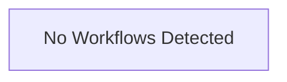

# Repository Architecture Analysis: ityouknow/spring-cloud-examples

## Metadata
- **SHA**: `34df652f2233d6780bbbb6467ec184e87fe20a93`
- **Primary Ecosystem**: Java

## Quality Metrics
- **avg_cyclomatic_complexity**: 1.03
- **component_count**: 130
- **files_analyzed**: 175
- **framework**: Spring Boot
- **loc**: 3083
- **max_cyclomatic_complexity**: 2
- **sloc**: 2359

# Architecture: ityouknow/spring-cloud-examples

## Context
- **Repository**: `ityouknow/spring-cloud-examples`
- **SHA**: `34df652f2233d6780bbbb6467ec184e87fe20a93`
- **Ecosystem**: Java
- **Framework**: Unknown

## Building Block View

```mermaid
graph TD;
    repo_root(["ityouknow/spring-cloud-examples (130 components)"])
    dir_0_gateway_service_zuul["gateway-service-zuul (13)"]
    repo_root --> dir_0_gateway_service_zuul
    sub_0_0_spring_cloud_producer["spring-cloud-producer (3)"]
    dir_0_gateway_service_zuul --> sub_0_0_spring_cloud_producer
    sub_0_1_spring_cloud_producer_2["spring-cloud-producer-2 (3)"]
    dir_0_gateway_service_zuul --> sub_0_1_spring_cloud_producer_2
    sub_0_2_gateway_service_zuul_eureka["gateway-service-zuul-eureka (2)"]
    dir_0_gateway_service_zuul --> sub_0_2_gateway_service_zuul_eureka
    sub_0_more["+3 more submodules (5)"]
    dir_0_gateway_service_zuul --> sub_0_more
    dir_1_hystrix_dashboard_turbine["hystrix-dashboard-turbine (13)"]
    repo_root --> dir_1_hystrix_dashboard_turbine
    sub_1_0_spring_cloud_consumer_hystrix_dashboard["spring-cloud-consumer-hystrix-dashboard (3)"]
    dir_1_hystrix_dashboard_turbine --> sub_1_0_spring_cloud_consumer_hystrix_dashboard
    sub_1_1_spring_cloud_consumer_node1["spring-cloud-consumer-node1 (3)"]
    dir_1_hystrix_dashboard_turbine --> sub_1_1_spring_cloud_consumer_node1
    sub_1_2_spring_cloud_consumer_node2["spring-cloud-consumer-node2 (3)"]
    dir_1_hystrix_dashboard_turbine --> sub_1_2_spring_cloud_consumer_node2
    sub_1_more["+2 more submodules (4)"]
    dir_1_hystrix_dashboard_turbine --> sub_1_more
    dir_2_spring_cloud_zuul["spring-cloud-zuul (13)"]
    repo_root --> dir_2_spring_cloud_zuul
    sub_2_0_spring_cloud_producer["spring-cloud-producer (3)"]
    dir_2_spring_cloud_zuul --> sub_2_0_spring_cloud_producer
    sub_2_1_spring_cloud_producer_2["spring-cloud-producer-2 (3)"]
    dir_2_spring_cloud_zuul --> sub_2_1_spring_cloud_producer_2
    sub_2_2__module_root_["(module root) (2)"]
    dir_2_spring_cloud_zuul --> sub_2_2__module_root_
    sub_2_more["+3 more submodules (5)"]
    dir_2_spring_cloud_zuul --> sub_2_more
    dir_3_spring_cloud_gateway["spring-cloud-gateway (12)"]
    repo_root --> dir_3_spring_cloud_gateway
    sub_3_0_spring_cloud_producer["spring-cloud-producer (3)"]
    dir_3_spring_cloud_gateway --> sub_3_0_spring_cloud_producer
    sub_3_1_spring_cloud_producer_1["spring-cloud-producer-1 (3)"]
    dir_3_spring_cloud_gateway --> sub_3_1_spring_cloud_producer_1
    sub_3_2_cloud_gateway["cloud-gateway (2)"]
    dir_3_spring_cloud_gateway --> sub_3_2_cloud_gateway
    sub_3_more["+2 more submodules (4)"]
    dir_3_spring_cloud_gateway --> sub_3_more
    dir_4_spring_boot_admin_eureka["spring-boot-admin-eureka (11)"]
    repo_root --> dir_4_spring_boot_admin_eureka
    sub_4_0_spring_cloud_producer["spring-cloud-producer (3)"]
    dir_4_spring_boot_admin_eureka --> sub_4_0_spring_cloud_producer
    sub_4_1_spring_cloud_producer_2["spring-cloud-producer-2 (3)"]
    dir_4_spring_boot_admin_eureka --> sub_4_1_spring_cloud_producer_2
    sub_4_2_spring_boot_admin_server["spring-boot-admin-server (2)"]
    dir_4_spring_boot_admin_eureka --> sub_4_2_spring_boot_admin_server
    sub_4_more["+2 more submodules (3)"]
    dir_4_spring_boot_admin_eureka --> sub_4_more
    dir_other_modules["+9 more modules (68)"]
    repo_root --> dir_other_modules
```

## Component Details

Showing top 60 representative components out of 130 across 14 module group(s):

- **Module `gateway-service-zuul`** (13 components — MODULE: 6, CONFIG: 5, API_ROUTE: 2)
- **Module `hystrix-dashboard-turbine`** (13 components — MODULE: 5, CONFIG: 5, API_ROUTE: 3)
- **Module `spring-cloud-zuul`** (13 components — MODULE: 6, CONFIG: 5, API_ROUTE: 2)
- **Module `spring-cloud-gateway`** (12 components — MODULE: 5, CONFIG: 5, API_ROUTE: 2)
- **Module `spring-boot-admin-eureka`** (11 components — MODULE: 5, CONFIG: 4, API_ROUTE: 2)
- **Module `spring-cloud-consul`** (10 components — API_ROUTE: 4, MODULE: 3, CONFIG: 3)
- **Module `spring-cloud-sleuth-zipkin`** (10 components — MODULE: 5, CONFIG: 4, API_ROUTE: 1)
- **Module `eureka-producer-consumer`** (8 components — MODULE: 3, CONFIG: 3, API_ROUTE: 2)
- **Module `spring-cloud-hystrix`** (8 components — MODULE: 3, CONFIG: 3, API_ROUTE: 2)
- **Module `spring-cloud-config-eureka`** (7 components — MODULE: 3, CONFIG: 3, API_ROUTE: 1)
- **Module `spring-cloud-config-eureka-bus`** (7 components — MODULE: 3, CONFIG: 3, API_ROUTE: 1)
- **Module `spring-cloud-config-svn-refresh`** (7 components — MODULE: 3, CONFIG: 3, API_ROUTE: 1)

- **AdminServerApplication** (`spring-boot-admin-eureka/spring-boot-admin-server/src/main/java/com/neo/AdminServerApplication.java`): CONFIG
- **CallHelloController** (`spring-cloud-consul/spring-cloud-consul-consumer/src/main/java/com/neo/consul/web/CallHelloController.java`): API_ROUTE
- **ConfigClientApplication** (`spring-cloud-config-eureka-bus/spring-cloud-config-client/src/main/java/com/neo/ConfigClientApplication.java`): CONFIG
- **ConfigClientApplication** (`spring-cloud-config-eureka/spring-cloud-config-client/src/main/java/com/neo/ConfigClientApplication.java`): CONFIG
- **ConfigClientApplication** (`spring-cloud-config-git/spring-cloud-config-client/src/main/java/com/neo/ConfigClientApplication.java`): CONFIG
- **ConfigClientApplication** (`spring-cloud-config-svn-refresh/spring-cloud-config-client-refresh/src/main/java/com/neo/ConfigClientApplication.java`): CONFIG
- **ConfigClientApplication** (`spring-cloud-config-svn-refresh/spring-cloud-config-client/src/main/java/com/neo/ConfigClientApplication.java`): CONFIG
- **ConfigServerApplication** (`spring-cloud-config-eureka-bus/spring-cloud-config-server/src/main/java/com/neo/ConfigServerApplication.java`): CONFIG
- **ConfigServerApplication** (`spring-cloud-config-eureka/spring-cloud-config-server/src/main/java/com/neo/ConfigServerApplication.java`): CONFIG
- **ConfigServerApplication** (`spring-cloud-config-git/spring-cloud-config-server/src/main/java/com/neo/ConfigServerApplication.java`): CONFIG
- **ConfigServerApplication** (`spring-cloud-config-svn-refresh/spring-cloud-config-server/src/main/java/com/neo/ConfigServerApplication.java`): CONFIG
- **ConsulConsumerApplication** (`spring-cloud-consul/spring-cloud-consul-consumer/src/main/java/com/neo/consul/ConsulConsumerApplication.java`): CONFIG
- **ConsulProducerApplication** (`spring-cloud-consul/spring-cloud-consul-producer-2/src/main/java/com/neo/consul/ConsulProducerApplication.java`): CONFIG
- **ConsulProducerApplication** (`spring-cloud-consul/spring-cloud-consul-producer/src/main/java/com/neo/consul/ConsulProducerApplication.java`): CONFIG
- **ConsumerApplication** (`eureka-producer-consumer/spring-cloud-consumer/src/main/java/com/neo/ConsumerApplication.java`): CONFIG
- **ConsumerApplication** (`hystrix-dashboard-turbine/spring-cloud-consumer-hystrix-dashboard/src/main/java/com/neo/ConsumerApplication.java`): CONFIG
- **ConsumerApplication** (`hystrix-dashboard-turbine/spring-cloud-consumer-node1/src/main/java/com/neo/ConsumerApplication.java`): CONFIG
- **ConsumerApplication** (`hystrix-dashboard-turbine/spring-cloud-consumer-node2/src/main/java/com/neo/ConsumerApplication.java`): CONFIG
- **ConsumerApplication** (`spring-cloud-hystrix/spring-cloud-consumer-hystrix/src/main/java/com/neo/ConsumerApplication.java`): CONFIG
- **ConsumerController** (`eureka-producer-consumer/spring-cloud-consumer/src/main/java/com/neo/controller/ConsumerController.java`): API_ROUTE
- **ConsumerController** (`hystrix-dashboard-turbine/spring-cloud-consumer-hystrix-dashboard/src/main/java/com/neo/controller/ConsumerController.java`): API_ROUTE
- **ConsumerController** (`hystrix-dashboard-turbine/spring-cloud-consumer-node1/src/main/java/com/neo/controller/ConsumerController.java`): API_ROUTE
- **ConsumerController** (`hystrix-dashboard-turbine/spring-cloud-consumer-node2/src/main/java/com/neo/controller/ConsumerController.java`): API_ROUTE
- **ConsumerController** (`spring-cloud-hystrix/spring-cloud-consumer-hystrix/src/main/java/com/neo/controller/ConsumerController.java`): API_ROUTE
- **DashboardApplication** (`hystrix-dashboard-turbine/hystrix-dashboard-turbine/src/main/java/com/neo/DashboardApplication.java`): CONFIG
- **EurekaApplication** (`spring-boot-admin-eureka/spring-cloud-eureka/src/main/java/com/neo/EurekaApplication.java`): CONFIG
- **EurekaApplication** (`spring-cloud-sleuth-zipkin/spring-cloud-eureka/src/main/java/com/neo/EurekaApplication.java`): CONFIG
- **EurekaApplication** (`spring-cloud-zuul/spring-cloud-eureka/src/main/java/com/neo/EurekaApplication.java`): CONFIG
- **GateWayApplication** (`spring-cloud-gateway/cloud-gateway/src/main/java/com/neo/GateWayApplication.java`): CONFIG
- **GateWayServiceApplication** (`spring-cloud-gateway/cloud-gateway-eureka/src/main/java/com/neo/GateWayServiceApplication.java`): CONFIG
- **GatewayServiceZuulApplication** (`gateway-service-zuul/gateway-service-zuul-eureka/src/main/java/com/neo/GatewayServiceZuulApplication.java`): CONFIG
- **GatewayServiceZuulApplication** (`gateway-service-zuul/gateway-service-zuul-simple/src/main/java/com/neo/GatewayServiceZuulApplication.java`): CONFIG
- **HelloController** (`eureka-producer-consumer/spring-cloud-producer/src/main/java/com/neo/controller/HelloController.java`): API_ROUTE
- **HelloController** (`gateway-service-zuul/spring-cloud-producer-2/src/main/java/com/neo/controller/HelloController.java`): API_ROUTE
- **HelloController** (`gateway-service-zuul/spring-cloud-producer/src/main/java/com/neo/controller/HelloController.java`): API_ROUTE
- **HelloController** (`spring-boot-admin-eureka/spring-cloud-producer-2/src/main/java/com/neo/controller/HelloController.java`): API_ROUTE
- **HelloController** (`spring-boot-admin-eureka/spring-cloud-producer/src/main/java/com/neo/controller/HelloController.java`): API_ROUTE
- **HelloController** (`spring-cloud-config-eureka-bus/spring-cloud-config-client/src/main/java/com/neo/web/HelloController.java`): API_ROUTE
- **HelloController** (`spring-cloud-config-eureka/spring-cloud-config-client/src/main/java/com/neo/web/HelloController.java`): API_ROUTE
- **HelloController** (`spring-cloud-config-git/spring-cloud-config-client/src/main/java/com/neo/web/HelloController.java`): API_ROUTE
- **HelloController** (`spring-cloud-config-svn-refresh/spring-cloud-config-client/src/main/java/com/neo/web/HelloController.java`): API_ROUTE
- **HelloController** (`spring-cloud-consul/spring-cloud-consul-producer-2/src/main/java/com/neo/consul/web/HelloController.java`): API_ROUTE
- **HelloController** (`spring-cloud-consul/spring-cloud-consul-producer/src/main/java/com/neo/consul/web/HelloController.java`): API_ROUTE
- **HelloController** (`spring-cloud-gateway/spring-cloud-producer-1/src/main/java/com/neo/controller/HelloController.java`): API_ROUTE
- **HelloController** (`spring-cloud-gateway/spring-cloud-producer/src/main/java/com/neo/controller/HelloController.java`): API_ROUTE
- **HelloController** (`spring-cloud-hystrix/spring-cloud-producer/src/main/java/com/neo/controller/HelloController.java`): API_ROUTE
- **HelloController** (`spring-cloud-sleuth-zipkin/spring-cloud-producer/src/main/java/com/neo/controller/HelloController.java`): API_ROUTE
- **HelloController** (`spring-cloud-zuul/spring-cloud-producer-2/src/main/java/com/neo/controller/HelloController.java`): API_ROUTE
- **HelloController** (`spring-cloud-zuul/spring-cloud-producer/src/main/java/com/neo/controller/HelloController.java`): API_ROUTE
- **Producer2Application** (`spring-boot-admin-eureka/spring-cloud-producer-2/src/main/java/com/neo/Producer2Application.java`): CONFIG
- **ProducerApplication** (`eureka-producer-consumer/spring-cloud-producer/src/main/java/com/neo/ProducerApplication.java`): CONFIG
- **ProducerApplication** (`gateway-service-zuul/spring-cloud-producer-2/src/main/java/com/neo/ProducerApplication.java`): CONFIG
- **ProducerApplication** (`gateway-service-zuul/spring-cloud-producer/src/main/java/com/neo/ProducerApplication.java`): CONFIG
- **ProducerApplication** (`spring-boot-admin-eureka/spring-cloud-producer/src/main/java/com/neo/ProducerApplication.java`): CONFIG
- **ProducerApplication** (`spring-cloud-gateway/spring-cloud-producer-1/src/main/java/com/neo/ProducerApplication.java`): CONFIG
- **ProducerApplication** (`spring-cloud-gateway/spring-cloud-producer/src/main/java/com/neo/ProducerApplication.java`): CONFIG
- **ProducerApplication** (`spring-cloud-hystrix/spring-cloud-producer/src/main/java/com/neo/ProducerApplication.java`): CONFIG
- **ProducerApplication** (`spring-cloud-sleuth-zipkin/spring-cloud-producer/src/main/java/com/neo/ProducerApplication.java`): CONFIG
- **ProducerApplication** (`spring-cloud-zuul/spring-cloud-producer-2/src/main/java/com/neo/ProducerApplication.java`): CONFIG
- **ProducerApplication** (`spring-cloud-zuul/spring-cloud-producer/src/main/java/com/neo/ProducerApplication.java`): CONFIG

## CI/CD Pipeline Topology

