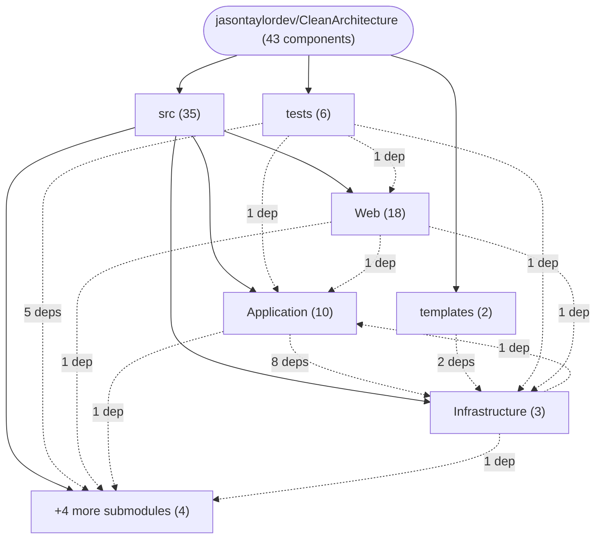
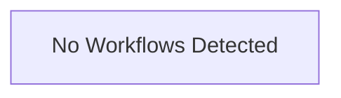

# Repository Architecture Analysis: jasontaylordev/CleanArchitecture

## Metadata
- **SHA**: `e1ab4cc4d5d7b4e25e57bd8b0514b766573b8c04`
- **Primary Ecosystem**: .NET

## Quality Metrics
- **avg_cyclomatic_complexity**: 2.73
- **component_count**: 43
- **files_analyzed**: 282
- **framework**: ASP.NET Core
- **loc**: 10375
- **max_cyclomatic_complexity**: 38
- **sloc**: 8273

# Architecture: jasontaylordev/CleanArchitecture

## Context
- **Repository**: `jasontaylordev/CleanArchitecture`
- **SHA**: `e1ab4cc4d5d7b4e25e57bd8b0514b766573b8c04`
- **Ecosystem**: .NET
- **Framework**: Unknown

## Building Block View

## Component Details
- **AppHost** (`src/AppHost/AppHost.csproj`): MODULE (deps: Shared, Web)
- **Application** (`src/Application/Application.csproj`): MODULE (deps: Domain)
- **Domain** (`src/Domain/Domain.csproj`): MODULE
- **Infrastructure** (`src/Infrastructure/Infrastructure.csproj`): MODULE (deps: Application, Shared)
- **ServiceDefaults** (`src/ServiceDefaults/ServiceDefaults.csproj`): MODULE
- **Shared** (`src/Shared/Shared.csproj`): MODULE
- **Web** (`src/Web/Web.csproj`): MODULE (deps: Application, Infrastructure, ServiceDefaults)
- **Application.FunctionalTests** (`tests/Application.FunctionalTests/Application.FunctionalTests.csproj`): MODULE (deps: Shared, TestAppHost, Web)
- **Application.UnitTests** (`tests/Application.UnitTests/Application.UnitTests.csproj`): MODULE (deps: Application, Infrastructure)
- **Domain.UnitTests** (`tests/Domain.UnitTests/Domain.UnitTests.csproj`): MODULE (deps: Domain)
- **Infrastructure.IntegrationTests** (`tests/Infrastructure.IntegrationTests/Infrastructure.IntegrationTests.csproj`): MODULE
- **TestAppHost** (`tests/TestAppHost/TestAppHost.csproj`): MODULE (deps: Shared)
- **Web.AcceptanceTests** (`tests/Web.AcceptanceTests/Web.AcceptanceTests.csproj`): MODULE (deps: AppHost, Shared)
- **CreateTodoItemCommandHandler** (`src/Application/TodoItems/Commands/CreateTodoItem/CreateTodoItem.cs`): SERVICE (deps: ApplicationDbContext)
- **DeleteTodoItemCommandHandler** (`src/Application/TodoItems/Commands/DeleteTodoItem/DeleteTodoItem.cs`): SERVICE (deps: ApplicationDbContext)
- **UpdateTodoItemCommandHandler** (`src/Application/TodoItems/Commands/UpdateTodoItem/UpdateTodoItem.cs`): SERVICE (deps: ApplicationDbContext)
- **UpdateTodoItemDetailCommandHandler** (`src/Application/TodoItems/Commands/UpdateTodoItemDetail/UpdateTodoItemDetail.cs`): SERVICE (deps: ApplicationDbContext)
- **CreateTodoListCommandHandler** (`src/Application/TodoLists/Commands/CreateTodoList/CreateTodoList.cs`): SERVICE (deps: ApplicationDbContext)
- **DeleteTodoListCommandHandler** (`src/Application/TodoLists/Commands/DeleteTodoList/DeleteTodoList.cs`): SERVICE (deps: ApplicationDbContext)
- **UpdateTodoListCommandHandler** (`src/Application/TodoLists/Commands/UpdateTodoList/UpdateTodoList.cs`): SERVICE (deps: ApplicationDbContext)
- **GetTodosQueryHandler** (`src/Application/TodoLists/Queries/GetTodos/GetTodos.cs`): SERVICE (deps: ApplicationDbContext)
- **GetWeatherForecastsQueryHandler** (`src/Application/WeatherForecasts/Queries/GetWeatherForecasts/GetWeatherForecastsQuery.cs`): SERVICE
- **ApplicationDbContext** (`src/Infrastructure/Data/ApplicationDbContext.cs`): DATA_ACCESS_LAYER
- **IdentityService** (`src/Infrastructure/Identity/IdentityService.cs`): SERVICE
- **ProblemDetailsExceptionHandler** (`src/Web/Infrastructure/ProblemDetailsExceptionHandler.cs`): SERVICE
- **CleanArchitectureUseCaseCommandHandler** (`templates/ca-use-case/FeatureName/Commands/CleanArchitectureUseCase/CleanArchitectureUseCase.cs`): SERVICE (deps: ApplicationDbContext)
- **CleanArchitectureUseCaseQueryHandler** (`templates/ca-use-case/FeatureName/Queries/CleanArchitectureUseCase/CleanArchitectureUseCase.cs`): SERVICE (deps: ApplicationDbContext)
- **cleanarchitecture.web** (`src/Web/ClientApp/package.json`): MODULE
- **cleanarchitecture.web** (`src/Web/ClientApp-React/package.json`): MODULE
- **Counter** (`src/Web/ClientApp-React/src/components/Counter.jsx`): UI_COMPONENT
- **Home** (`src/Web/ClientApp-React/src/components/Home.jsx`): UI_COMPONENT
- **Layout** (`src/Web/ClientApp-React/src/components/Layout.jsx`): UI_COMPONENT (deps: NavMenu)
- **NavMenu** (`src/Web/ClientApp-React/src/components/NavMenu.jsx`): UI_COMPONENT (deps: AuthProvider, ThemeToggle)
- **ThemeProvider** (`src/Web/ClientApp-React/src/components/ThemeContext.jsx`): UI_COMPONENT
- **ThemeToggle** (`src/Web/ClientApp-React/src/components/ThemeToggle.jsx`): UI_COMPONENT (deps: ThemeProvider)
- **Tasks** (`src/Web/ClientApp-React/src/components/Todo.jsx`): UI_COMPONENT
- **Weather** (`src/Web/ClientApp-React/src/components/Weather.jsx`): UI_COMPONENT
- **AuthProvider** (`src/Web/ClientApp-React/src/components/api-authorization/AuthContext.jsx`): UI_COMPONENT
- **LoginPage** (`src/Web/ClientApp-React/src/components/api-authorization/LoginPage.jsx`): UI_COMPONENT (deps: AuthProvider)
- **ProtectedRoute** (`src/Web/ClientApp-React/src/components/api-authorization/ProtectedRoute.jsx`): UI_COMPONENT (deps: AuthProvider)
- **RegisterPage** (`src/Web/ClientApp-React/src/components/api-authorization/RegisterPage.jsx`): UI_COMPONENT (deps: AuthProvider)
- **AuthService** (`src/Web/ClientApp/src/api-authorization/auth.service.ts`): SERVICE
- **ThemeService** (`src/Web/ClientApp/src/app/theme.service.ts`): SERVICE

## CI/CD Pipeline Topology

