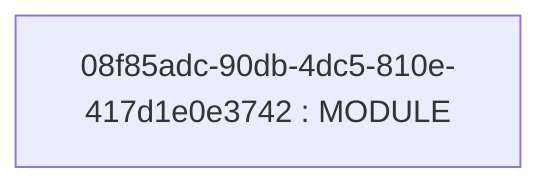
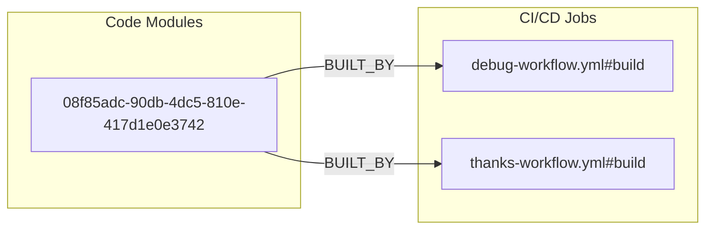
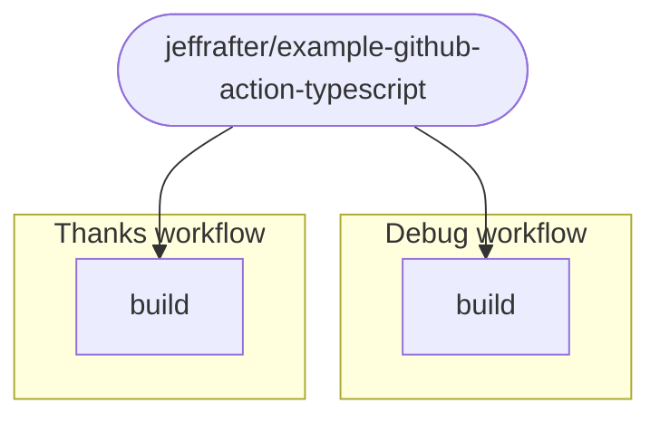

# Repository Architecture Analysis: jeffrafter/example-github-action-typescript

## Metadata
- **SHA**: `38ce4b9ac773d08c7a0254864b0b500b32c7c534`
- **Primary Ecosystem**: JavaScript/TypeScript

## Quality Metrics
- **ast_engine**: tree-sitter
- **avg_cognitive_complexity**: 1.8
- **avg_cyclomatic_complexity**: 2.8
- **component_count**: 1
- **dead_code_count**: 0
- **dead_code_symbols**: 0 entry(ies)
- **duplication_pct**: 43.74
- **file_complexities**: 5 entry(ies)
- **files_analyzed**: 5
- **fitness_passed**: False
- **fitness_violation_count**: 1
- **framework**: TypeScript
- **import_edges**: 17 entry(ies)
- **loc**: 179
- **max_cognitive_complexity**: 6
- **max_cyclomatic_complexity**: 7
- **sloc**: 148
- **test_file_count**: 2

# Architecture: jeffrafter/example-github-action-typescript

## Context
- **Repository**: `jeffrafter/example-github-action-typescript`
- **SHA**: `38ce4b9ac773d08c7a0254864b0b500b32c7c534`
- **Ecosystem**: JavaScript/TypeScript
- **Framework**: TypeScript

## Building Block View

## Component Details
- **08f85adc-90db-4dc5-810e-417d1e0e3742** (`package.json`): MODULE

## 6-Dimension Repository Scorecard

- **Overall Grade**: `B` (82.10/100)
- **Technical Debt Score**: 17.90
- **Estimated Remediation Effort**: 20.72h

| Dimension | Grade | Score | Weight | Details |
| :--- | :---: | :---: | :---: | :--- |
| Code Quality | `C` | 75.00 | 0.20 | avg_cc=2.80, max_cc=7, duplication=43.74%, dead_code=0 |
| Dependency Health | `A` | 100.00 | 0.15 | dependencies=651, outdated=0, vulnerable=0, has_lockfile=True |
| Maintainability | `A` | 94.00 | 0.15 | avg_cognitive=1.80, max_cognitive=6, fitness_violations=1, oversized_files=0 |
| Pipeline Health | `B` | 82.00 | 0.15 | workflows=2, operational_antipatterns=4, parallel_branches=False |
| Security | `C` | 76.00 | 0.20 | vulnerabilities=0, secrets=0, pipeline_security_findings=2 |
| Test Coverage | `C` | 70.00 | 0.15 | coverage=unavailable, ci_test_job=False, test_files_detected=True |

## Architecture Fitness & Workspace Boundaries

- **[MEDIUM] `ATRUSS-ARCH-005` (COMPLEXITY_THRESHOLD)**: Repository duplication_pct (43.74) exceeds policy threshold (15.0).

## Supply Chain Dependencies, Vulnerabilities & Secrets

- **Dependencies Parsed**: 651 | **Vulnerabilities**: 0 | **Secrets**: 0

### Inventory Sample
- `@actions/core` `1.1.0` (npm, `package-lock.json`)
- `@actions/core` `1.1.0` (npm, `package.json`)
- `@actions/github` `1.1.0` (npm, `package-lock.json`)
- `@actions/github` `1.1.0` (npm, `package.json`)
- `@types/jest` `24.0.18` (npm, `package-lock.json`)
- `@types/jest` `24.0.18` (npm, `package.json`)
- `@types/js-yaml` `3.12.1` (npm, `package-lock.json`)
- `@types/js-yaml` `3.12.1` (npm, `package.json`)
- `@types/nock` `11.1.0` (npm, `package-lock.json`)
- `@types/nock` `11.1.0` (npm, `package.json`)
- `@types/node` `12.7.5` (npm, `package-lock.json`)
- `@types/node` `12.7.5` (npm, `package.json`)
- `@typescript-eslint/eslint-plugin` `2.2.0` (npm, `package-lock.json`)
- `@typescript-eslint/eslint-plugin` `2.2.0` (npm, `package.json`)
- `@typescript-eslint/parser` `2.2.0` (npm, `package-lock.json`)
- `@typescript-eslint/parser` `2.2.0` (npm, `package.json`)
- `eslint` `6.3.0` (npm, `package-lock.json`)
- `eslint` `6.3.0` (npm, `package.json`)
- `eslint-config-prettier` `6.3.0` (npm, `package-lock.json`)
- `eslint-config-prettier` `6.3.0` (npm, `package.json`)
- `eslint-plugin-prettier` `3.1.0` (npm, `package-lock.json`)
- `eslint-plugin-prettier` `3.1.0` (npm, `package.json`)
- `jest` `24.9.0` (npm, `package-lock.json`)
- `jest` `24.9.0` (npm, `package.json`)
- `js-yaml` `3.13.1` (npm, `package-lock.json`)
- `js-yaml` `3.13.1` (npm, `package.json`)
- `nock` `11.3.4` (npm, `package-lock.json`)
- `nock` `11.3.4` (npm, `package.json`)
- `prettier` `1.18.2` (npm, `package-lock.json`)
- `prettier` `1.18.2` (npm, `package.json`)
- ... (+621 more dependencies)

## Section 7: Code-to-Cloud Deployment Traceability

- `08f85adc-90db-4dc5-810e-417d1e0e3742` (code_module) --[BUILT_BY]--> `debug-workflow.yml#build` (ci_job)
- `08f85adc-90db-4dc5-810e-417d1e0e3742` (code_module) --[BUILT_BY]--> `thanks-workflow.yml#build` (ci_job)

## CI/CD Pipeline Topology

