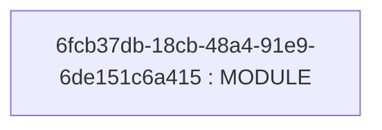
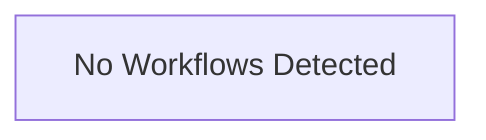

# Repository Architecture Analysis: jeffrafter/example-github-action-typescript

## Metadata
- **SHA**: `38ce4b9ac773d08c7a0254864b0b500b32c7c534`
- **Primary Ecosystem**: JavaScript/TypeScript

## Quality Metrics
- **avg_cyclomatic_complexity**: 3.2
- **component_count**: 1
- **files_analyzed**: 5
- **framework**: TypeScript
- **loc**: 179
- **max_cyclomatic_complexity**: 6
- **sloc**: 148

# Architecture: jeffrafter/example-github-action-typescript

## Context
- **Repository**: `jeffrafter/example-github-action-typescript`
- **SHA**: `38ce4b9ac773d08c7a0254864b0b500b32c7c534`
- **Ecosystem**: JavaScript/TypeScript
- **Framework**: Unknown

## Building Block View

## Component Details
- **6fcb37db-18cb-48a4-91e9-6de151c6a415** (`package.json`): MODULE

## CI/CD Pipeline Topology

