# Repository Architecture Analysis: jellyfin/jellyfin

## Metadata
- **SHA**: `f03253bae0383eaa4a250da59b3b959e424483e5`
- **Primary Ecosystem**: .NET

## Quality Metrics
- **avg_cyclomatic_complexity**: 7.89
- **component_count**: 179
- **files_analyzed**: 4505
- **framework**: ASP.NET Core
- **loc**: 733678
- **max_cyclomatic_complexity**: 952
- **sloc**: 508059

# Architecture: jellyfin/jellyfin

## Context
- **Repository**: `jellyfin/jellyfin`
- **SHA**: `f03253bae0383eaa4a250da59b3b959e424483e5`
- **Ecosystem**: .NET
- **Framework**: Unknown

## Building Block View

```mermaid
graph TD;
    repo_root(["jellyfin/jellyfin (179 components)"])
    dir_0_Jellyfin_Api["Jellyfin.Api (69)"]
    repo_root --> dir_0_Jellyfin_Api
    sub_0_0_Controllers["Controllers (60)"]
    dir_0_Jellyfin_Api --> sub_0_0_Controllers
    sub_0_1_Auth["Auth (7)"]
    dir_0_Jellyfin_Api --> sub_0_1_Auth
    sub_0_2__module_root_["(module root) (2)"]
    dir_0_Jellyfin_Api --> sub_0_2__module_root_
    dir_1_MediaBrowser_Providers["MediaBrowser.Providers (29)"]
    repo_root --> dir_1_MediaBrowser_Providers
    sub_1_0_Music["Music (4)"]
    dir_1_MediaBrowser_Providers --> sub_1_0_Music
    sub_1_1_Folders["Folders (3)"]
    dir_1_MediaBrowser_Providers --> sub_1_1_Folders
    sub_1_2_TV["TV (3)"]
    dir_1_MediaBrowser_Providers --> sub_1_2_TV
    sub_1_more["+16 more submodules (19)"]
    dir_1_MediaBrowser_Providers --> sub_1_more
    dir_2_tests["tests (22)"]
    repo_root --> dir_2_tests
    sub_2_0_Jellyfin_Providers_Tests["Jellyfin.Providers.Tests (4)"]
    dir_2_tests --> sub_2_0_Jellyfin_Providers_Tests
    sub_2_1_Jellyfin_Server_Integration_Tests["Jellyfin.Server.Integration.Tests (3)"]
    dir_2_tests --> sub_2_1_Jellyfin_Server_Integration_Tests
    sub_2_2_Jellyfin_Api_Tests["Jellyfin.Api.Tests (1)"]
    dir_2_tests --> sub_2_2_Jellyfin_Api_Tests
    sub_2_more["+14 more submodules (14)"]
    dir_2_tests --> sub_2_more
    dir_3_Jellyfin_Server_Implementations["Jellyfin.Server.Implementations (17)"]
    repo_root --> dir_3_Jellyfin_Server_Implementations
    sub_3_0_Item["Item (14)"]
    dir_3_Jellyfin_Server_Implementations --> sub_3_0_Item
    sub_3_1__module_root_["(module root) (1)"]
    dir_3_Jellyfin_Server_Implementations --> sub_3_1__module_root_
    sub_3_2_FullSystemBackup["FullSystemBackup (1)"]
    dir_3_Jellyfin_Server_Implementations --> sub_3_2_FullSystemBackup
    sub_3_more["+1 more submodules (1)"]
    dir_3_Jellyfin_Server_Implementations --> sub_3_more
    dir_4_src["src (17)"]
    repo_root --> dir_4_src
    sub_4_0_Jellyfin_LiveTv["Jellyfin.LiveTv (5)"]
    dir_4_src --> sub_4_0_Jellyfin_LiveTv
    sub_4_1_Jellyfin_Database["Jellyfin.Database (4)"]
    dir_4_src --> sub_4_1_Jellyfin_Database
    sub_4_2_Jellyfin_Networking["Jellyfin.Networking (2)"]
    dir_4_src --> sub_4_2_Jellyfin_Networking
    sub_4_more["+6 more submodules (6)"]
    dir_4_src --> sub_4_more
    dir_other_modules["+12 more modules (25)"]
    repo_root --> dir_other_modules
    sub_0_0_Controllers -.->|"60 deps"| sub_0_2__module_root_
    sub_0_0_Controllers -.->|"26 deps"| dir_other_modules
    sub_3_0_Item -.->|"14 deps"| sub_4_1_Jellyfin_Database
    sub_2_more -.->|"9 deps"| dir_other_modules
    sub_4_more -.->|"9 deps"| dir_other_modules
    dir_other_modules -.->|"6 deps"| sub_4_more
    sub_2_more -.->|"5 deps"| sub_4_more
    dir_other_modules -.->|"4 deps"| sub_4_1_Jellyfin_Database
    sub_1_0_Music -.->|"4 deps"| sub_1_more
    sub_4_0_Jellyfin_LiveTv -.->|"4 deps"| dir_other_modules
    sub_1_1_Folders -.->|"3 deps"| sub_1_more
    sub_1_2_TV -.->|"3 deps"| sub_1_more
```

## Component Details

Showing top 60 representative components out of 179 across 17 module group(s):

- **Module `Jellyfin.Api`** (69 components — API_ROUTE: 61, SERVICE: 7, MODULE: 1)
- **Module `MediaBrowser.Providers`** (29 components — SERVICE: 27, MODULE: 1, API_ROUTE: 1)
- **Module `tests`** (22 components — MODULE: 17, SERVICE: 3, API_ROUTE: 2)
- **Module `Jellyfin.Server.Implementations`** (17 components — DATA_ACCESS_LAYER: 10, SERVICE: 6, MODULE: 1)
- **Module `src`** (17 components — MODULE: 10, SERVICE: 5, DATA_ACCESS_LAYER: 2)
- **Module `Emby.Server.Implementations`** (7 components — SERVICE: 5, MODULE: 1, API_ROUTE: 1)
- **Module `Jellyfin.Server`** (5 components — DATA_ACCESS_LAYER: 3, MODULE: 1, SERVICE: 1)
- **Module `MediaBrowser.Controller`** (2 components — MODULE: 1, SERVICE: 1)
- **Module `MediaBrowser.XbmcMetadata`** (2 components — MODULE: 1, SERVICE: 1)
- **Module `fuzz`** (2 components — MODULE: 2)
- **Module `Emby.Naming`** (1 components — MODULE: 1)
- **Module `Emby.Photos`** (1 components — MODULE: 1)

- **Emby.Server.Implementations** (`Emby.Server.Implementations/Emby.Server.Implementations.csproj`): MODULE (deps: Emby.Naming, Emby.Photos, Jellyfin.Api, Jellyfin.Database.Implementations, Jellyfin.Drawing, Jellyfin.Server.Implementations (+7 more))
- **Jellyfin.Server** (`Jellyfin.Server/Jellyfin.Server.csproj`): MODULE (deps: Emby.Server.Implementations, Jellyfin.Database.Implementations, Jellyfin.Drawing, Jellyfin.Drawing.Skia, Jellyfin.LiveTv, Jellyfin.MediaEncoding.Hls (+1 more))
- **Jellyfin.Server.Implementations** (`Jellyfin.Server.Implementations/Jellyfin.Server.Implementations.csproj`): MODULE (deps: Jellyfin.Data, Jellyfin.Database.Implementations, Jellyfin.Database.Providers.Sqlite, MediaBrowser.Controller, MediaBrowser.Model)
- **Jellyfin.Api** (`Jellyfin.Api/Jellyfin.Api.csproj`): MODULE (deps: Jellyfin.MediaEncoding.Hls, Jellyfin.Networking, MediaBrowser.Controller, MediaBrowser.MediaEncoding)
- **Jellyfin.MediaEncoding.Hls** (`src/Jellyfin.MediaEncoding.Hls/Jellyfin.MediaEncoding.Hls.csproj`): MODULE (deps: Jellyfin.MediaEncoding.Keyframes, MediaBrowser.Common, MediaBrowser.Controller, MediaBrowser.Model)
- **Jellyfin.Server.Implementations.Tests** (`tests/Jellyfin.Server.Implementations.Tests/Jellyfin.Server.Implementations.Tests.csproj`): MODULE (deps: Emby.Server.Implementations, Jellyfin.Database.Implementations, Jellyfin.Server.Implementations, Jellyfin.Server.Integration.Tests)
- **MediaBrowser.Controller** (`MediaBrowser.Controller/MediaBrowser.Controller.csproj`): MODULE (deps: Emby.Naming, Jellyfin.MediaEncoding.Keyframes, MediaBrowser.Common, MediaBrowser.Model)
- **Jellyfin.Drawing** (`src/Jellyfin.Drawing/Jellyfin.Drawing.csproj`): MODULE (deps: MediaBrowser.Common, MediaBrowser.Controller, MediaBrowser.Model)
- **Jellyfin.Drawing.Skia** (`src/Jellyfin.Drawing.Skia/Jellyfin.Drawing.Skia.csproj`): MODULE (deps: MediaBrowser.Common, MediaBrowser.Controller, MediaBrowser.Model)
- **Jellyfin.LiveTv** (`src/Jellyfin.LiveTv/Jellyfin.LiveTv.csproj`): MODULE (deps: MediaBrowser.Common, MediaBrowser.Controller, MediaBrowser.Model)
- **MediaBrowser.MediaEncoding** (`MediaBrowser.MediaEncoding/MediaBrowser.MediaEncoding.csproj`): MODULE (deps: MediaBrowser.Common, MediaBrowser.Controller, MediaBrowser.Model)
- **TestItemMetadataService** (`tests/Jellyfin.Providers.Tests/Manager/MetadataServiceRefreshTests.cs`): SERVICE (deps: DirectoryService, MetadataService, TestMetadataService)
- **TestMetadataService** (`tests/Jellyfin.Providers.Tests/Manager/MetadataServiceRefreshTests.cs`): SERVICE (deps: DirectoryService, MetadataService, TestItemMetadataService)
- **UserLibraryController** (`Jellyfin.Api/Controllers/UserLibraryController.cs`): API_ROUTE (deps: BaseJellyfinApiController, DirectoryService, DtoService)
- **ArtistsController** (`Jellyfin.Api/Controllers/ArtistsController.cs`): API_ROUTE (deps: BaseJellyfinApiController, DtoService)
- **BackupController** (`Jellyfin.Api/Controllers/BackupController.cs`): API_ROUTE (deps: BackupService, BaseJellyfinApiController)
- **CollectionController** (`Jellyfin.Api/Controllers/CollectionController.cs`): API_ROUTE (deps: BaseJellyfinApiController, DtoService)
- **Emby.Naming** (`Emby.Naming/Emby.Naming.csproj`): MODULE (deps: MediaBrowser.Common, MediaBrowser.Model)
- **Emby.Photos** (`Emby.Photos/Emby.Photos.csproj`): MODULE (deps: MediaBrowser.Controller, MediaBrowser.Model)
- **GenresController** (`Jellyfin.Api/Controllers/GenresController.cs`): API_ROUTE (deps: BaseJellyfinApiController, DtoService)
- **InstantMixController** (`Jellyfin.Api/Controllers/InstantMixController.cs`): API_ROUTE (deps: BaseJellyfinApiController, DtoService)
- **ItemLookupController** (`Jellyfin.Api/Controllers/ItemLookupController.cs`): API_ROUTE (deps: BaseJellyfinApiController, DirectoryService)
- **ItemPersistenceService** (`Jellyfin.Server.Implementations/Item/ItemPersistenceService.cs`): SERVICE (deps: BaseItemRepository, JellyfinDbContext)
- **ItemRefreshController** (`Jellyfin.Api/Controllers/ItemRefreshController.cs`): API_ROUTE (deps: BaseJellyfinApiController, DirectoryService)
- **ItemUpdateController** (`Jellyfin.Api/Controllers/ItemUpdateController.cs`): API_ROUTE (deps: BaseJellyfinApiController, DirectoryService)
- **ItemsController** (`Jellyfin.Api/Controllers/ItemsController.cs`): API_ROUTE (deps: BaseJellyfinApiController, DtoService)
- **Jellyfin.Api.Tests** (`tests/Jellyfin.Api.Tests/Jellyfin.Api.Tests.csproj`): MODULE (deps: Jellyfin.Api, Jellyfin.Server.Implementations)
- **Jellyfin.Common.Tests** (`tests/Jellyfin.Common.Tests/Jellyfin.Common.Tests.csproj`): MODULE (deps: MediaBrowser.Common, MediaBrowser.Providers)
- **Jellyfin.Database.Providers.Sqlite** (`src/Jellyfin.Database/Jellyfin.Database.Providers.Sqlite/Jellyfin.Database.Providers.Sqlite.csproj`): MODULE (deps: Jellyfin.Database.Implementations, MediaBrowser.Common)
- **Jellyfin.Extensions.Tests** (`tests/Jellyfin.Extensions.Tests/Jellyfin.Extensions.Tests.csproj`): MODULE (deps: Jellyfin.Extensions, MediaBrowser.Model)
- **Jellyfin.MediaEncoding.Hls.Tests** (`tests/Jellyfin.MediaEncoding.Hls.Tests/Jellyfin.MediaEncoding.Hls.Tests.csproj`): MODULE (deps: Jellyfin.MediaEncoding.Hls, Jellyfin.MediaEncoding.Keyframes)
- **Jellyfin.Networking** (`src/Jellyfin.Networking/Jellyfin.Networking.csproj`): MODULE (deps: MediaBrowser.Common, MediaBrowser.Controller)
- **Jellyfin.XbmcMetadata.Tests** (`tests/Jellyfin.XbmcMetadata.Tests/Jellyfin.XbmcMetadata.Tests.csproj`): MODULE (deps: MediaBrowser.Providers, MediaBrowser.XbmcMetadata)
- **JellyfinMigrationService** (`Jellyfin.Server/Migrations/JellyfinMigrationService.cs`): SERVICE (deps: BackupService, JellyfinDbContext)
- **LibraryController** (`Jellyfin.Api/Controllers/LibraryController.cs`): API_ROUTE (deps: BaseJellyfinApiController, DtoService)
- **LibraryStructureController** (`Jellyfin.Api/Controllers/LibraryStructureController.cs`): API_ROUTE (deps: BaseJellyfinApiController, DirectoryService)
- **LiveTvController** (`Jellyfin.Api/Controllers/LiveTvController.cs`): API_ROUTE (deps: BaseJellyfinApiController, DtoService)
- **LyricsController** (`Jellyfin.Api/Controllers/LyricsController.cs`): API_ROUTE (deps: BaseJellyfinApiController, DirectoryService)
- **MediaBrowser.LocalMetadata** (`MediaBrowser.LocalMetadata/MediaBrowser.LocalMetadata.csproj`): MODULE (deps: MediaBrowser.Controller, MediaBrowser.Model)
- **MediaBrowser.Model** (`MediaBrowser.Model/MediaBrowser.Model.csproj`): MODULE (deps: Jellyfin.Data, Jellyfin.Extensions)
- **MediaBrowser.Providers** (`MediaBrowser.Providers/MediaBrowser.Providers.csproj`): MODULE (deps: MediaBrowser.Controller, MediaBrowser.Model)
- **MediaBrowser.XbmcMetadata** (`MediaBrowser.XbmcMetadata/MediaBrowser.XbmcMetadata.csproj`): MODULE (deps: MediaBrowser.Controller, MediaBrowser.Model)
- **MoviesController** (`Jellyfin.Api/Controllers/MoviesController.cs`): API_ROUTE (deps: BaseJellyfinApiController, DtoService)
- **MusicGenresController** (`Jellyfin.Api/Controllers/MusicGenresController.cs`): API_ROUTE (deps: BaseJellyfinApiController, DtoService)
- **NextUpService** (`Jellyfin.Server.Implementations/Item/NextUpService.cs`): SERVICE (deps: BaseItemRepository, JellyfinDbContext)
- **PersonsController** (`Jellyfin.Api/Controllers/PersonsController.cs`): API_ROUTE (deps: BaseJellyfinApiController, DtoService)
- **PlaylistsController** (`Jellyfin.Api/Controllers/PlaylistsController.cs`): API_ROUTE (deps: BaseJellyfinApiController, DtoService)
- **SearchController** (`Jellyfin.Api/Controllers/SearchController.cs`): API_ROUTE (deps: BaseJellyfinApiController, DtoService)
- **SeriesMetadataService** (`MediaBrowser.Providers/TV/SeriesMetadataService.cs`): SERVICE (deps: DirectoryService, MetadataService)
- **StudiosController** (`Jellyfin.Api/Controllers/StudiosController.cs`): API_ROUTE (deps: BaseJellyfinApiController, DtoService)
- **SubtitleController** (`Jellyfin.Api/Controllers/SubtitleController.cs`): API_ROUTE (deps: BaseJellyfinApiController, DirectoryService)
- **SuggestionsController** (`Jellyfin.Api/Controllers/SuggestionsController.cs`): API_ROUTE (deps: BaseJellyfinApiController, DtoService)
- **TrailersController** (`Jellyfin.Api/Controllers/TrailersController.cs`): API_ROUTE (deps: BaseJellyfinApiController, ItemsController)
- **TvShowsController** (`Jellyfin.Api/Controllers/TvShowsController.cs`): API_ROUTE (deps: BaseJellyfinApiController, DtoService)
- **UserViewsController** (`Jellyfin.Api/Controllers/UserViewsController.cs`): API_ROUTE (deps: BaseJellyfinApiController, DtoService)
- **VideosController** (`Jellyfin.Api/Controllers/VideosController.cs`): API_ROUTE (deps: BaseJellyfinApiController, DtoService)
- **YearsController** (`Jellyfin.Api/Controllers/YearsController.cs`): API_ROUTE (deps: BaseJellyfinApiController, DtoService)
- **ActivityLogController** (`Jellyfin.Api/Controllers/ActivityLogController.cs`): API_ROUTE (deps: BaseJellyfinApiController)
- **AlbumMetadataService** (`MediaBrowser.Providers/Music/AlbumMetadataService.cs`): SERVICE (deps: MetadataService)
- **ApiKeyController** (`Jellyfin.Api/Controllers/ApiKeyController.cs`): API_ROUTE (deps: BaseJellyfinApiController)

## CI/CD Pipeline Topology

