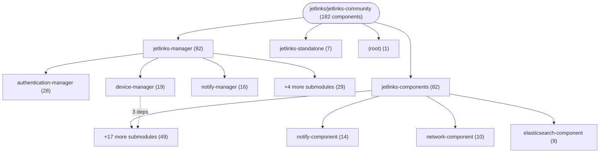

# Repository Architecture Analysis: jetlinks/jetlinks-community

## Metadata
- **SHA**: `5b7dc8410b486ca65c74ac2d10b0561bccd88f63`
- **Primary Ecosystem**: Java

## Quality Metrics
- **avg_cyclomatic_complexity**: 4.71
- **component_count**: 182
- **files_analyzed**: 4438
- **framework**: Spring Boot
- **loc**: 466485
- **max_cyclomatic_complexity**: 88
- **sloc**: 303868

# Architecture: jetlinks/jetlinks-community

## Context
- **Repository**: `jetlinks/jetlinks-community`
- **SHA**: `5b7dc8410b486ca65c74ac2d10b0561bccd88f63`
- **Ecosystem**: Java
- **Framework**: Unknown

## Building Block View

## Component Details

Showing top 60 representative components out of 182 across 4 module group(s):

- **Module `jetlinks-manager`** (92 components — API_ROUTE: 38, SERVICE: 29, CONFIG: 18)
- **Module `jetlinks-components`** (82 components — MODULE: 34, CONFIG: 31, API_ROUTE: 14)
- **Module `jetlinks-standalone`** (7 components — CONFIG: 4, API_ROUTE: 2, MODULE: 1)
- **Module `(root)`** (1 components — MODULE: 1)

- **NotificationController** (`jetlinks-manager/notify-manager/src/main/java/org/jetlinks/community/notify/manager/web/NotificationController.java`): API_ROUTE (deps: NotificationService, NotifyChannelController, NotifySubscriberProperties, NotifySubscriberProviderService, NotifySubscriberService)
- **DeviceInstanceController** (`jetlinks-manager/device-manager/src/main/java/org/jetlinks/community/device/web/DeviceInstanceController.java`): API_ROUTE (deps: DeviceExcelFilterColumns, LocalDeviceInstanceService, LocalDeviceProductService, RelationService)
- **UserDetailService** (`jetlinks-manager/authentication-manager/src/main/java/org/jetlinks/community/auth/service/UserDetailService.java`): SERVICE (deps: OrganizationService, RoleService, UserSettingService)
- **AlarmConfigController** (`jetlinks-manager/rule-engine-manager/src/main/java/org/jetlinks/community/rule/engine/web/AlarmConfigController.java`): API_ROUTE (deps: AlarmConfigService, AlarmLevelService)
- **AlarmConfigService** (`jetlinks-manager/rule-engine-manager/src/main/java/org/jetlinks/community/rule/engine/service/AlarmConfigService.java`): SERVICE (deps: AlarmRecordService, SceneService)
- **AlarmRecordController** (`jetlinks-manager/rule-engine-manager/src/main/java/org/jetlinks/community/rule/engine/web/AlarmRecordController.java`): API_ROUTE (deps: AlarmHandleHistoryService, AlarmRecordService)
- **CustomAuthenticationConfiguration** (`jetlinks-manager/authentication-manager/src/main/java/org/jetlinks/community/auth/configuration/CustomAuthenticationConfiguration.java`): CONFIG (deps: AuthorizationProperties, MenuProperties)
- **DeviceManagerConfiguration** (`jetlinks-manager/device-manager/src/main/java/org/jetlinks/community/device/configuration/DeviceManagerConfiguration.java`): CONFIG (deps: DeviceDataStorageProperties, DeviceEventProperties)
- **DeviceMetadataMappingService** (`jetlinks-manager/device-manager/src/main/java/org/jetlinks/community/device/service/DeviceMetadataMappingService.java`): SERVICE (deps: LocalDeviceInstanceService, LocalDeviceProductService)
- **DeviceProductController** (`jetlinks-manager/device-manager/src/main/java/org/jetlinks/community/device/web/DeviceProductController.java`): API_ROUTE (deps: LocalDeviceInstanceService, LocalDeviceProductService)
- **GatewayDeviceController** (`jetlinks-manager/device-manager/src/main/java/org/jetlinks/community/device/web/GatewayDeviceController.java`): API_ROUTE (deps: LocalDeviceInstanceService, LocalDeviceProductService)
- **LocalDeviceInstanceService** (`jetlinks-manager/device-manager/src/main/java/org/jetlinks/community/device/service/LocalDeviceInstanceService.java`): SERVICE (deps: LocalDeviceProductService, RelationService)
- **MenuController** (`jetlinks-manager/authentication-manager/src/main/java/org/jetlinks/community/auth/web/MenuController.java`): API_ROUTE (deps: DefaultMenuService, MenuGrantService)
- **NotifierTemplateController** (`jetlinks-manager/notify-manager/src/main/java/org/jetlinks/community/notify/manager/web/NotifierTemplateController.java`): API_ROUTE (deps: NotifyConfigService, NotifyTemplateService)
- **NotifyChannelController** (`jetlinks-manager/notify-manager/src/main/java/org/jetlinks/community/notify/manager/web/NotifyChannelController.java`): API_ROUTE (deps: NotifySubscriberProperties, NotifySubscriberProviderService)
- **NotifySubscriberService** (`jetlinks-manager/notify-manager/src/main/java/org/jetlinks/community/notify/manager/service/NotifySubscriberService.java`): SERVICE (deps: NotifySubscriberProperties, NotifySubscriberProviderService)
- **RelationController** (`jetlinks-components/relation-component/src/main/java/org/jetlinks/community/relation/web/RelationController.java`): API_ROUTE (deps: RelationProperties, RelationService)
- **AffixesElasticSearchIndexStrategy** (`jetlinks-components/elasticsearch-component/elasticsearch-core/src/main/java/org/jetlinks/community/elastic/search/index/strategies/AffixesElasticSearchIndexStrategy.java`): CONFIG (deps: ElasticSearchIndexProperties)
- **CaptchaController** (`jetlinks-manager/authentication-manager/src/main/java/org/jetlinks/community/auth/captcha/CaptchaController.java`): API_ROUTE (deps: CaptchaProperties)
- **CaptchaProperties** (`jetlinks-manager/authentication-manager/src/main/java/org/jetlinks/community/auth/captcha/CaptchaProperties.java`): CONFIG (deps: ImageCaptchaProvider)
- **CertificateController** (`jetlinks-manager/network-manager/src/main/java/org/jetlinks/community/network/manager/web/CertificateController.java`): API_ROUTE (deps: CertificateService)
- **ClusterConfiguration** (`jetlinks-components/configure-component/src/main/java/org/jetlinks/community/configure/cluster/ClusterConfiguration.java`): CONFIG (deps: ClusterProperties)
- **DefaultMenuService** (`jetlinks-manager/authentication-manager/src/main/java/org/jetlinks/community/auth/service/DefaultMenuService.java`): SERVICE (deps: MenuProperties)
- **DefaultNotifyConfigManager** (`jetlinks-manager/notify-manager/src/main/java/org/jetlinks/community/notify/manager/service/DefaultNotifyConfigManager.java`): SERVICE (deps: NotifyConfigService)
- **DefaultTemplateManager** (`jetlinks-manager/notify-manager/src/main/java/org/jetlinks/community/notify/manager/service/DefaultTemplateManager.java`): SERVICE (deps: NotifyTemplateService)
- **DeviceCategoryController** (`jetlinks-manager/device-manager/src/main/java/org/jetlinks/community/device/web/DeviceCategoryController.java`): API_ROUTE (deps: DeviceCategoryService)
- **DeviceGatewayController** (`jetlinks-manager/network-manager/src/main/java/org/jetlinks/community/network/manager/web/DeviceGatewayController.java`): API_ROUTE (deps: DeviceGatewayService)
- **DeviceMessageController** (`jetlinks-manager/device-manager/src/main/java/org/jetlinks/community/device/web/DeviceMessageController.java`): API_ROUTE (deps: LocalDeviceInstanceService)
- **DeviceMetadataMappingController** (`jetlinks-manager/device-manager/src/main/java/org/jetlinks/community/device/web/DeviceMetadataMappingController.java`): API_ROUTE (deps: DeviceMetadataMappingService)
- **FileManagerController** (`jetlinks-components/io-component/src/main/java/org/jetlinks/community/io/file/web/FileManagerController.java`): API_ROUTE (deps: FileProperties)
- **JetLinksConfiguration** (`jetlinks-standalone/src/main/java/org/jetlinks/community/standalone/configuration/JetLinksConfiguration.java`): CONFIG (deps: JetLinksProperties)
- **NetworkConfigController** (`jetlinks-manager/network-manager/src/main/java/org/jetlinks/community/network/manager/web/NetworkConfigController.java`): API_ROUTE (deps: NetworkConfigService)
- **NotificationService** (`jetlinks-manager/notify-manager/src/main/java/org/jetlinks/community/notify/manager/service/NotificationService.java`): SERVICE (deps: NotificationProperties)
- **NotifierConfigController** (`jetlinks-manager/notify-manager/src/main/java/org/jetlinks/community/notify/manager/web/NotifierConfigController.java`): API_ROUTE (deps: NotifyConfigService)
- **NotifierController** (`jetlinks-manager/notify-manager/src/main/java/org/jetlinks/community/notify/manager/web/NotifierController.java`): API_ROUTE (deps: NotifyConfigService)
- **NotifySubscriberProviderService** (`jetlinks-manager/notify-manager/src/main/java/org/jetlinks/community/notify/manager/service/NotifySubscriberProviderService.java`): SERVICE (deps: NotifyChannelController)
- **OrganizationController** (`jetlinks-manager/authentication-manager/src/main/java/org/jetlinks/community/auth/web/OrganizationController.java`): API_ROUTE (deps: OrganizationService)
- **PluginDriverController** (`jetlinks-components/plugin-component/src/main/java/org/jetlinks/community/plugin/web/PluginDriverController.java`): API_ROUTE (deps: PluginDriverService)
- **ProtocolSupportController** (`jetlinks-manager/device-manager/src/main/java/org/jetlinks/community/device/web/ProtocolSupportController.java`): API_ROUTE (deps: LocalProtocolSupportService)
- **RoleController** (`jetlinks-manager/authentication-manager/src/main/java/org/jetlinks/community/auth/web/RoleController.java`): API_ROUTE (deps: RoleService)
- **RoleGroupController** (`jetlinks-manager/authentication-manager/src/main/java/org/jetlinks/community/auth/web/RoleGroupController.java`): API_ROUTE (deps: RoleGroupService)
- **RoleGroupService** (`jetlinks-manager/authentication-manager/src/main/java/org/jetlinks/community/auth/service/RoleGroupService.java`): SERVICE (deps: RoleService)
- **SceneController** (`jetlinks-manager/rule-engine-manager/src/main/java/org/jetlinks/community/rule/engine/web/SceneController.java`): API_ROUTE (deps: SceneService)
- **SystemInfoController** (`jetlinks-standalone/src/main/java/org/jetlinks/community/standalone/web/SystemInfoController.java`): API_ROUTE (deps: ApiInfoProperties)
- **ThirdPartyUserController** (`jetlinks-manager/authentication-manager/src/main/java/org/jetlinks/community/auth/web/ThirdPartyUserController.java`): API_ROUTE (deps: ThirdPartyUserBindService)
- **UserDetailController** (`jetlinks-manager/authentication-manager/src/main/java/org/jetlinks/community/auth/web/UserDetailController.java`): API_ROUTE (deps: UserDetailService)
- **UserLoginLogicInterceptor** (`jetlinks-manager/authentication-manager/src/main/java/org/jetlinks/community/auth/login/UserLoginLogicInterceptor.java`): API_ROUTE (deps: UserLoginProperties)
- **UserSettingController** (`jetlinks-manager/authentication-manager/src/main/java/org/jetlinks/community/auth/web/UserSettingController.java`): API_ROUTE (deps: UserSettingService)
- **AccessLoggerController** (`jetlinks-manager/logging-manager/src/main/java/org/jetlinks/community/logging/controller/AccessLoggerController.java`): API_ROUTE
- **AlarmHandleHistoryService** (`jetlinks-manager/rule-engine-manager/src/main/java/org/jetlinks/community/rule/engine/service/AlarmHandleHistoryService.java`): SERVICE
- **AlarmHistoryController** (`jetlinks-manager/rule-engine-manager/src/main/java/org/jetlinks/community/rule/engine/web/AlarmHistoryController.java`): API_ROUTE
- **AlarmLevelService** (`jetlinks-manager/rule-engine-manager/src/main/java/org/jetlinks/community/rule/engine/service/AlarmLevelService.java`): SERVICE
- **AlarmProperties** (`jetlinks-manager/rule-engine-manager/src/main/java/org/jetlinks/community/rule/engine/alarm/AlarmProperties.java`): CONFIG
- **AlarmRecordService** (`jetlinks-manager/rule-engine-manager/src/main/java/org/jetlinks/community/rule/engine/service/AlarmRecordService.java`): SERVICE
- **AlarmRuleBindController** (`jetlinks-manager/rule-engine-manager/src/main/java/org/jetlinks/community/rule/engine/web/AlarmRuleBindController.java`): API_ROUTE
- **AliyunSmsController** (`jetlinks-components/notify-component/notify-sms/src/main/java/org/jetlinks/community/notify/sms/aliyun/web/AliyunSmsController.java`): API_ROUTE
- **ApiInfoProperties** (`jetlinks-standalone/src/main/java/org/jetlinks/community/standalone/web/ApiInfoProperties.java`): CONFIG
- **AuthorizationProperties** (`jetlinks-manager/authentication-manager/src/main/java/org/jetlinks/community/auth/configuration/AuthorizationProperties.java`): CONFIG
- **AuthorizationSettingDetailController** (`jetlinks-manager/authentication-manager/src/main/java/org/jetlinks/community/auth/web/AuthorizationSettingDetailController.java`): API_ROUTE
- **CertificateService** (`jetlinks-manager/network-manager/src/main/java/org/jetlinks/community/network/manager/service/CertificateService.java`): SERVICE

## CI/CD Pipeline Topology

