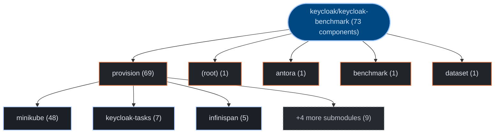

# Repository Architecture Analysis: keycloak/keycloak-benchmark

## Metadata
- **SHA**: `40f02ab18ae4c3664e325f0bc019a2b02ff0527e`
- **Primary Ecosystem**: Java

## Quality Metrics
- **ast_engine**: tree-sitter
- **avg_cognitive_complexity**: 2.73
- **avg_cyclomatic_complexity**: 2.78
- **component_count**: 73
- **dead_code_count**: 4
- **dead_code_symbols**: 4 entry(ies)
- **duplication_pct**: 58.58
- **file_complexities**: 25 entry(ies)
- **files_analyzed**: 131
- **fitness_passed**: False
- **fitness_violation_count**: 3
- **framework**: Quarkus
- **import_edges**: 100 entry(ies)
- **loc**: 11283
- **max_cognitive_complexity**: 53
- **max_cyclomatic_complexity**: 34
- **sloc**: 8646
- **test_file_count**: 20

# Architecture: keycloak/keycloak-benchmark

## Context
- **Repository**: `keycloak/keycloak-benchmark`
- **SHA**: `40f02ab18ae4c3664e325f0bc019a2b02ff0527e`
- **Ecosystem**: Java
- **Framework**: Quarkus

## Building Block View

## Component Details

Showing top 60 representative components out of 73 across 5 module group(s):

- **Module `provision`** (69 components — module: 67, MODULE: 2)
- **Module `(root)`** (1 components — MODULE: 1)
- **Module `antora`** (1 components — MODULE: 1)
- **Module `benchmark`** (1 components — MODULE: 1)
- **Module `dataset`** (1 components — MODULE: 1)

- **Chart** (`provision/chaos-mesh/network/Chart.yaml`): module
- **Chart** (`provision/infinispan/ispn-helm/Chart.yaml`): module
- **Chart** (`provision/keycloak-tasks/keycloak-image-helm/Chart.yaml`): module
- **Chart** (`provision/minikube/keycloak/Chart.yaml`): module
- **Chart** (`provision/minikube/monitoring/Chart.yaml`): module
- **Chart** (`provision/openshift/monitoring/Chart.yaml`): module
- **aurora-service** (`provision/minikube/keycloak/templates/aurora/aurora-service.yaml`): module
- **cadvisor** (`provision/minikube/monitoring/templates/cadvisor.yaml`): module
- **cadvisor-podmonitor** (`provision/minikube/monitoring/templates/cadvisor-podmonitor.yaml`): module
- **cryostat-command-service** (`provision/minikube/keycloak/templates/cryostat/cryostat-command-service.yaml`): module
- **cryostat-cr** (`provision/minikube/keycloak/templates/cryostat/cryostat-cr.yaml`): module
- **cryostat-deployment** (`provision/minikube/keycloak/templates/cryostat/cryostat-deployment.yaml`): module
- **cryostat-grafana-basic** (`provision/minikube/keycloak/templates/cryostat/cryostat-grafana-basic.yaml`): module
- **cryostat-grafana-service** (`provision/minikube/keycloak/templates/cryostat/cryostat-grafana-service.yaml`): module
- **cryostat-ingress** (`provision/minikube/keycloak/templates/cryostat/cryostat-ingress.yaml`): module
- **cryostat-jfr** (`provision/minikube/keycloak/templates/cryostat/cryostat-jfr.yaml`): module
- **cryostat-pvc** (`provision/minikube/keycloak/templates/cryostat/cryostat-pvc.yaml`): module
- **cryostat-rolebindings** (`provision/minikube/keycloak/templates/cryostat/cryostat-rolebindings.yaml`): module
- **cryostat-roles** (`provision/minikube/keycloak/templates/cryostat/cryostat-roles.yaml`): module
- **cryostat-service** (`provision/minikube/keycloak/templates/cryostat/cryostat-service.yaml`): module
- **cryostat-serviceaccount** (`provision/minikube/keycloak/templates/cryostat/cryostat-serviceaccount.yaml`): module
- **dashboards-json-configmap** (`provision/minikube/monitoring/templates/dashboards-json-configmap.yaml`): module
- **dashboards-json-configmap** (`provision/openshift/monitoring/templates/dashboards-json-configmap.yaml`): module
- **delay** (`provision/chaos-mesh/network/templates/delay.yaml`): module
- **grafana-ingress** (`provision/minikube/monitoring/templates/grafana-ingress.yaml`): module
- **graphite-configmap** (`provision/minikube/monitoring/templates/graphite-configmap.yaml`): module
- **graphite-exporter** (`provision/minikube/monitoring/templates/graphite-exporter.yaml`): module
- **graphite_mapping** (`provision/minikube/monitoring/config/graphite_mapping.yaml`): module
- **identities** (`provision/infinispan/ispn-helm/identities.yaml`): module
- **infinispan** (`provision/infinispan/ispn-helm/templates/infinispan.yaml`): module
- **infinispan-alerts** (`provision/infinispan/ispn-helm/templates/infinispan-alerts.yaml`): module
- **intellij-asciidoc-plugin-docs** (`antora/package.json`): MODULE
- **jaeger-ingress** (`provision/minikube/monitoring/templates/jaeger-ingress.yaml`): module
- **jaeger-nodeport** (`provision/minikube/monitoring/templates/jaeger-nodeport.yaml`): module
- **jaeger-pvc** (`provision/minikube/monitoring/templates/jaeger-pvc.yaml`): module
- **java-instrumentation-tool** (`provision/tlsdisableagent/java-instrumentation-tool/pom.xml`): MODULE
- **keycloak** (`provision/minikube/keycloak/templates/keycloak.yaml`): module
- **keycloak-aurora-rootcert** (`provision/minikube/keycloak/templates/keycloak-aurora-rootcert.yaml`): module
- **keycloak-benchmark** (`benchmark/pom.xml`): MODULE
- **keycloak-benchmark-crossdc-tests** (`provision/rosa-cross-dc/keycloak-benchmark-crossdc-tests/pom.xml`): MODULE
- **keycloak-benchmark-dataset** (`dataset/pom.xml`): MODULE
- **keycloak-benchmark-parent** (`pom.xml`): MODULE
- **keycloak-build-config** (`provision/keycloak-tasks/keycloak-image-helm/templates/keycloak-build-config.yaml`): module
- **keycloak-db-secret** (`provision/minikube/keycloak/templates/keycloak-db-secret.yaml`): module
- **keycloak-imagestream** (`provision/keycloak-tasks/keycloak-image-helm/templates/keycloak-imagestream.yaml`): module
- **keycloak-infinispan-configmap** (`provision/minikube/keycloak/templates/keycloak-infinispan-configmap.yaml`): module
- **keycloak-initial-admin-secret** (`provision/minikube/keycloak/templates/keycloak-initial-admin-secret.yaml`): module
- **keycloak-jfr-service** (`provision/minikube/keycloak/templates/keycloak-jfr-service.yaml`): module
- **keycloak-jvmdebug-service** (`provision/minikube/keycloak/templates/keycloak-jvmdebug-service.yaml`): module
- **keycloak-operator-build-config** (`provision/keycloak-tasks/keycloak-image-helm/templates/keycloak-operator-build-config.yaml`): module
- **keycloak-providers-configmap** (`provision/minikube/keycloak/templates/keycloak-providers-configmap.yaml`): module
- **keycloak-routes** (`provision/minikube/keycloak/templates/keycloak-routes.yaml`): module
- **keycloak-tls-secret** (`provision/minikube/keycloak/templates/keycloak-tls-secret.yaml`): module
- **keycloak-with-AWS-JDBC-wrapper** (`provision/keycloak-tasks/keycloak-image-helm/templates/keycloak-with-AWS-JDBC-wrapper.yaml`): module
- **kubebox** (`provision/minikube/monitoring/templates/kubebox.yaml`): module
- **mysql-deployment** (`provision/minikube/keycloak/templates/mysql/mysql-deployment.yaml`): module
- **mysql-service** (`provision/minikube/keycloak/templates/mysql/mysql-service.yaml`): module
- **pgexporter-queries** (`provision/minikube/keycloak/config/pgexporter-queries.yaml`): module
- **postgres-deployment** (`provision/minikube/keycloak/templates/postgres/postgres-deployment.yaml`): module
- **postgres-exporter** (`provision/minikube/keycloak/templates/postgres/postgres-exporter.yaml`): module

## 6-Dimension Repository Scorecard

- **Overall Grade**: `F` (39.45/100)
- **Technical Debt Score**: 60.55
- **Estimated Remediation Effort**: 213.85h

| Dimension | Grade | Score | Weight | Details |
| :--- | :---: | :---: | :---: | :--- |
| Code Quality | `F` | 42.00 | 0.20 | avg_cc=2.78, max_cc=34, duplication=58.58%, dead_code=4 |
| Dependency Health | `B` | 85.00 | 0.15 | dependencies=35, outdated=0, vulnerable=0, has_lockfile=False |
| Maintainability | `F` | 52.00 | 0.15 | avg_cognitive=2.73, max_cognitive=53, fitness_violations=3, oversized_files=1 |
| Pipeline Health | `F` | 0.00 | 0.15 | workflows=30, operational_antipatterns=81, parallel_branches=True |
| Security | `F` | 0.00 | 0.20 | vulnerabilities=0, secrets=1, pipeline_security_findings=80 |
| Test Coverage | `C` | 70.00 | 0.15 | coverage=unavailable, ci_test_job=True, test_files_detected=True |

## Architecture Fitness & Workspace Boundaries

- **[MEDIUM] `ATRUSS-ARCH-005` (COMPLEXITY_THRESHOLD)**: Repository duplication_pct (58.58) exceeds policy threshold (15.0).
- **[MEDIUM] `ATRUSS-ARCH-005` (COMPLEXITY_THRESHOLD)**: Repository max_cognitive_complexity (53.0) exceeds policy threshold (25.0).
- **[MEDIUM] `ATRUSS-ARCH-005` (COMPLEXITY_THRESHOLD)**: Repository max_cyclomatic_complexity (34.0) exceeds policy threshold (20.0).

## Supply Chain Dependencies, Vulnerabilities & Secrets

- **Dependencies Parsed**: 35 | **Vulnerabilities**: 0 | **Secrets**: 1

### Secret Findings (Redacted)
- **[HIGH] `ATRUSS-SEC-005`** at `provision/minikube/keycloak/templates/keycloak-tls-secret.yaml:5` (`tls.key: LS0t***REDACTED***`)

### Inventory Sample
- `com.jayway.jsonpath:json-path` `2.9.0` (Maven, `provision/rosa-cross-dc/keycloak-benchmark-crossdc-tests/pom.xml`)
- `commons-io:commons-io` `2.15.1` (Maven, `dataset/pom.xml`)
- `io.fabric8:openshift-client` `7.3.1` (Maven, `provision/rosa-cross-dc/keycloak-benchmark-crossdc-tests/pom.xml`)
- `io.gatling:gatling-app` `3.11.5` (Maven, `benchmark/pom.xml`)
- `org.apache.httpcomponents:httpclient` `*` (Maven, `provision/rosa-cross-dc/keycloak-benchmark-crossdc-tests/pom.xml`)
- `org.awaitility:awaitility` `4.2.0` (Maven, `dataset/pom.xml`)
- `org.codehaus.janino:janino` `3.1.8` (Maven, `benchmark/pom.xml`)
- `org.infinispan:infinispan-client-rest` `*` (Maven, `provision/rosa-cross-dc/keycloak-benchmark-crossdc-tests/pom.xml`)
- `org.javassist:javassist` `3.25.0-GA` (Maven, `provision/tlsdisableagent/java-instrumentation-tool/pom.xml`)
- `org.junit.jupiter:junit-jupiter-engine` `*` (Maven, `dataset/pom.xml`)
- `org.junit.jupiter:junit-jupiter-engine` `*` (Maven, `provision/rosa-cross-dc/keycloak-benchmark-crossdc-tests/pom.xml`)
- `org.keycloak:keycloak-admin-client` `*` (Maven, `provision/rosa-cross-dc/keycloak-benchmark-crossdc-tests/pom.xml`)
- `org.keycloak:keycloak-benchmark-dataset` `999.0.0-SNAPSHOT` (Maven, `benchmark/pom.xml`)
- `org.keycloak:keycloak-core` `*` (Maven, `dataset/pom.xml`)
- `org.keycloak:keycloak-model-infinispan` `*` (Maven, `dataset/pom.xml`)
- `org.keycloak:keycloak-model-infinispan` `*` (Maven, `provision/rosa-cross-dc/keycloak-benchmark-crossdc-tests/pom.xml`)
- `org.keycloak:keycloak-quarkus-server` `*` (Maven, `dataset/pom.xml`)
- `org.keycloak:keycloak-server-spi` `*` (Maven, `dataset/pom.xml`)
- `org.keycloak:keycloak-server-spi-private` `*` (Maven, `dataset/pom.xml`)
- `org.keycloak:keycloak-services` `*` (Maven, `dataset/pom.xml`)
- `software.amazon.awssdk:cloudwatch` `2.20.43` (Maven, `provision/rosa-cross-dc/keycloak-benchmark-crossdc-tests/pom.xml`)
- `software.amazon.awssdk:elasticloadbalancingv2` `2.20.43` (Maven, `provision/rosa-cross-dc/keycloak-benchmark-crossdc-tests/pom.xml`)
- `software.amazon.awssdk:globalaccelerator` `2.20.43` (Maven, `provision/rosa-cross-dc/keycloak-benchmark-crossdc-tests/pom.xml`)
- `matplotlib` `3.8.0` (PyPI, `benchmark/src/main/python/requirements.txt`)
- `pandas` `2.2.2` (PyPI, `benchmark/src/main/python/requirements.txt`)
- `playwright` `1.45.1` (PyPI, `benchmark/src/main/python/requirements.txt`)
- `requests` `2.32.3` (PyPI, `benchmark/src/main/python/requirements.txt`)
- `typing_extensions` `4.7.1` (PyPI, `benchmark/src/main/python/requirements.txt`)
- `@antora/cli` `3.2.1` (npm, `antora/package.json`)
- `@antora/collector-extension` `1.0.3` (npm, `antora/package.json`)
- ... (+5 more dependencies)

## Section 7: Code-to-Cloud Deployment Traceability

```mermaid
flowchart LR
    classDef atlasCategory fill:#212428,stroke:#E87A48,stroke-width:1.5px,color:#dfe3eb
    classDef atlasWorkflow fill:#1b2026,stroke:#a3c9ff,stroke-width:1.5px,color:#dfe3eb
    classDef atlasJob fill:#171c22,stroke:#8d9199,stroke-width:1px,color:#dfe3eb
    classDef atlasTarget fill:#005227,stroke:#8bd99b,stroke-width:1.5px,color:#a7f6b6
    subgraph code_modules["Code Modules"]
        mod_antora["antora"]:::atlasCategory
        mod_benchmark["benchmark"]:::atlasCategory
        mod_benchmark_src_main_python["benchmark/src/main/python"]:::atlasCategory
        mod_dataset["dataset"]:::atlasCategory
        mod_provision_infinispan_ispn_helm["provision/infinispan/ispn-helm"]:::atlasCategory
        mod_provision_minikube_keycloak["provision/minikube/keycloak"]:::atlasCategory
        mod_provision_minikube_monitoring["provision/minikube/monitoring"]:::atlasCategory
        mod_provision_openshift_monitoring["provision/openshift/monitoring"]:::atlasCategory
        mod_provision_rosa_cross_dc_keycloak_benchmark_crossdc_tests["provision/rosa-cross-dc/keycloak-benchmark-crossdc-tests"]:::atlasCategory
    end
    subgraph build_artifacts["Build Artifacts / Containers"]
        art_provision_opentofu_modules_aws_accelerator_main_tf["provision/opentofu/modules/aws/accelerator/main.tf"]:::atlasWorkflow
    end
    subgraph ci_jobs["CI/CD Jobs"]
        job_docs_ci_yml_build["docs-ci.yml#build"]:::atlasJob
        job_docs_pages_yml_build["docs-pages.yml#build"]:::atlasJob
        job_docs_pages_yml_github_pages["docs-pages.yml#github-pages"]:::atlasJob
        job_keycloak_chaos_benchmark_yml_run["keycloak-chaos-benchmark.yml#run"]:::atlasJob
        job_keycloak_multi_site_health_check_yml_run["keycloak-multi-site-health-check.yml#run"]:::atlasJob
        job_keycloak_scalability_benchmark_yml_run["keycloak-scalability-benchmark.yml#run"]:::atlasJob
        job_oc_namespace_delete_yml_run["oc-namespace-delete.yml#run"]:::atlasJob
        job_provision_minikube_yml_build["provision-minikube.yml#build"]:::atlasJob
        job_rosa_multi_az_clusters_deploy_yml_deploy_keycloak["rosa-multi-az-clusters-deploy.yml#deploy-keycloak"]:::atlasJob
        job_rosa_multi_az_clusters_undeploy_yml_clear_keycloak_and_infinispan_deployment_with_aurora["rosa-multi-az-clusters-undeploy.yml#clear-keycloak-and-infinispan-deployment-with-aurora"]:::atlasJob
        job_rosa_multi_az_clusters_single_site_deploy_yml_single_site_deploy["rosa-multi-az-clusters_single-site-deploy.yml#single-site-deploy"]:::atlasJob
        job_rosa_multi_az_clusters_single_site_undeploy_yml_single_site_undeploy["rosa-multi-az-clusters_single-site-undeploy.yml#single-site-undeploy"]:::atlasJob
        job_rosa_multi_cluster_benchmark_yml_run["rosa-multi-cluster-benchmark.yml#run"]:::atlasJob
        job_rosa_run_crossdc_func_tests_yml_run_tests["rosa-run-crossdc-func-tests.yml#run-tests"]:::atlasJob
        job_rosa_scheduled_run_yml_check_benchmark_results["rosa-scheduled-run.yml#check-benchmark-results"]:::atlasJob
        job_rosa_single_cluster_benchmark_yml_run["rosa-single-cluster-benchmark.yml#run"]:::atlasJob
        job_rosa_stretched_cluster_yml_monitoring["rosa-stretched-cluster.yml#monitoring"]:::atlasJob
        job_snapshot_yml_build["snapshot.yml#build"]:::atlasJob
    end
    subgraph runtime_envs["Runtime Environments"]
        env_azure["azure"]:::atlasTarget
        env_github_pages["github-pages"]:::atlasTarget
        env_kubernetes["kubernetes"]:::atlasTarget
    end
    job_docs_ci_yml_build -->|DEPLOYS_TO| env_github_pages
    job_docs_pages_yml_build -->|DEPLOYS_TO| env_github_pages
    job_docs_pages_yml_github_pages -->|DEPLOYS_TO| env_github_pages
    job_keycloak_multi_site_health_check_yml_run -->|DEPLOYS_TO| env_kubernetes
    job_provision_minikube_yml_build -->|DEPLOYS_TO| env_azure
    job_provision_minikube_yml_build -->|DEPLOYS_TO| env_kubernetes
    job_rosa_run_crossdc_func_tests_yml_run_tests -->|DEPLOYS_TO| env_kubernetes
    mod_antora -->|BUILT_BY| job_docs_ci_yml_build
    mod_antora -->|BUILT_BY| job_docs_pages_yml_build
    mod_benchmark -->|BUILT_BY| job_rosa_multi_cluster_benchmark_yml_run
    mod_benchmark -->|BUILT_BY| job_rosa_run_crossdc_func_tests_yml_run_tests
    mod_benchmark -->|BUILT_BY| job_rosa_scheduled_run_yml_check_benchmark_results
    mod_benchmark -->|BUILT_BY| job_rosa_single_cluster_benchmark_yml_run
    mod_benchmark -->|DEPLOYED_BY| job_keycloak_chaos_benchmark_yml_run
    mod_benchmark -->|DEPLOYED_BY| job_keycloak_scalability_benchmark_yml_run
    mod_benchmark -->|DEPLOYED_BY| job_snapshot_yml_build
    mod_benchmark_src_main_python -->|PACKAGED_BY| art_provision_opentofu_modules_aws_accelerator_main_tf
    mod_dataset -->|DEPLOYED_BY| job_provision_minikube_yml_build
    mod_dataset -->|DEPLOYED_BY| job_snapshot_yml_build
    mod_provision_infinispan_ispn_helm -->|BUILT_BY| job_rosa_multi_cluster_benchmark_yml_run
    mod_provision_minikube_keycloak -->|DEPLOYED_BY| job_provision_minikube_yml_build
    mod_provision_minikube_monitoring -->|DEPLOYED_BY| job_provision_minikube_yml_build
    mod_provision_openshift_monitoring -->|BUILT_BY| job_oc_namespace_delete_yml_run
    mod_provision_openshift_monitoring -->|BUILT_BY| job_rosa_stretched_cluster_yml_monitoring
    mod_provision_rosa_cross_dc_keycloak_benchmark_crossdc_tests -->|BUILT_BY| job_keycloak_multi_site_health_check_yml_run
    mod_provision_rosa_cross_dc_keycloak_benchmark_crossdc_tests -->|BUILT_BY| job_rosa_run_crossdc_func_tests_yml_run_tests
    mod_provision_rosa_cross_dc_keycloak_benchmark_crossdc_tests -->|DEPLOYED_BY| job_rosa_multi_az_clusters_deploy_yml_deploy_keycloak
    mod_provision_rosa_cross_dc_keycloak_benchmark_crossdc_tests -->|DEPLOYED_BY| job_rosa_multi_az_clusters_undeploy_yml_clear_keycloak_and_infinispan_deployment_with_aurora
    mod_provision_rosa_cross_dc_keycloak_benchmark_crossdc_tests -->|DEPLOYED_BY| job_rosa_multi_az_clusters_single_site_deploy_yml_single_site_deploy
    mod_provision_rosa_cross_dc_keycloak_benchmark_crossdc_tests -->|DEPLOYED_BY| job_rosa_multi_az_clusters_single_site_undeploy_yml_single_site_undeploy
```

- `docs-ci.yml#build` (ci_job) --[DEPLOYS_TO]--> `github-pages` (environment)
- `docs-pages.yml#build` (ci_job) --[DEPLOYS_TO]--> `github-pages` (environment)
- `docs-pages.yml#github-pages` (ci_job) --[DEPLOYS_TO]--> `github-pages` (environment)
- `keycloak-multi-site-health-check.yml#run` (ci_job) --[DEPLOYS_TO]--> `kubernetes` (environment)
- `provision-minikube.yml#build` (ci_job) --[DEPLOYS_TO]--> `azure` (environment)
- `provision-minikube.yml#build` (ci_job) --[DEPLOYS_TO]--> `kubernetes` (environment)
- `rosa-run-crossdc-func-tests.yml#run-tests` (ci_job) --[DEPLOYS_TO]--> `kubernetes` (environment)
- `antora` (code_module) --[BUILT_BY]--> `docs-ci.yml#build` (ci_job)
- `antora` (code_module) --[BUILT_BY]--> `docs-pages.yml#build` (ci_job)
- `benchmark` (code_module) --[BUILT_BY]--> `rosa-multi-cluster-benchmark.yml#run` (ci_job)
- `benchmark` (code_module) --[BUILT_BY]--> `rosa-run-crossdc-func-tests.yml#run-tests` (ci_job)
- `benchmark` (code_module) --[BUILT_BY]--> `rosa-scheduled-run.yml#check-benchmark-results` (ci_job)
- `benchmark` (code_module) --[BUILT_BY]--> `rosa-single-cluster-benchmark.yml#run` (ci_job)
- `benchmark` (code_module) --[DEPLOYED_BY]--> `keycloak-chaos-benchmark.yml#run` (ci_job)
- `benchmark` (code_module) --[DEPLOYED_BY]--> `keycloak-scalability-benchmark.yml#run` (ci_job)
- `benchmark` (code_module) --[DEPLOYED_BY]--> `snapshot.yml#build` (ci_job)
- `benchmark/src/main/python` (code_module) --[PACKAGED_BY]--> `provision/opentofu/modules/aws/accelerator/main.tf` (iac)
- `dataset` (code_module) --[DEPLOYED_BY]--> `provision-minikube.yml#build` (ci_job)
- `dataset` (code_module) --[DEPLOYED_BY]--> `snapshot.yml#build` (ci_job)
- `provision/infinispan/ispn-helm` (code_module) --[BUILT_BY]--> `rosa-multi-cluster-benchmark.yml#run` (ci_job)
- `provision/minikube/keycloak` (code_module) --[DEPLOYED_BY]--> `provision-minikube.yml#build` (ci_job)
- `provision/minikube/monitoring` (code_module) --[DEPLOYED_BY]--> `provision-minikube.yml#build` (ci_job)
- `provision/openshift/monitoring` (code_module) --[BUILT_BY]--> `oc-namespace-delete.yml#run` (ci_job)
- `provision/openshift/monitoring` (code_module) --[BUILT_BY]--> `rosa-stretched-cluster.yml#monitoring` (ci_job)
- `provision/rosa-cross-dc/keycloak-benchmark-crossdc-tests` (code_module) --[BUILT_BY]--> `keycloak-multi-site-health-check.yml#run` (ci_job)
- `provision/rosa-cross-dc/keycloak-benchmark-crossdc-tests` (code_module) --[BUILT_BY]--> `rosa-run-crossdc-func-tests.yml#run-tests` (ci_job)
- `provision/rosa-cross-dc/keycloak-benchmark-crossdc-tests` (code_module) --[DEPLOYED_BY]--> `rosa-multi-az-clusters-deploy.yml#deploy-keycloak` (ci_job)
- `provision/rosa-cross-dc/keycloak-benchmark-crossdc-tests` (code_module) --[DEPLOYED_BY]--> `rosa-multi-az-clusters-undeploy.yml#clear-keycloak-and-infinispan-deployment-with-aurora` (ci_job)
- `provision/rosa-cross-dc/keycloak-benchmark-crossdc-tests` (code_module) --[DEPLOYED_BY]--> `rosa-multi-az-clusters_single-site-deploy.yml#single-site-deploy` (ci_job)
- `provision/rosa-cross-dc/keycloak-benchmark-crossdc-tests` (code_module) --[DEPLOYED_BY]--> `rosa-multi-az-clusters_single-site-undeploy.yml#single-site-undeploy` (ci_job)

## CI/CD Pipeline Topology

```mermaid
graph TD;
  classDef atlasRoot fill:#004882,stroke:#a3c9ff,stroke-width:2px,color:#d3e4ff
  classDef atlasCategory fill:#212428,stroke:#E87A48,stroke-width:1.5px,color:#dfe3eb
  classDef atlasWorkflow fill:#1b2026,stroke:#a3c9ff,stroke-width:1.5px,color:#dfe3eb
  classDef atlasJob fill:#171c22,stroke:#8d9199,stroke-width:1px,color:#dfe3eb
  classDef atlasTarget fill:#005227,stroke:#8bd99b,stroke-width:1.5px,color:#a7f6b6
  classDef atlasAlert fill:#93000a,stroke:#ffb4ab,stroke-width:1.5px,color:#ffdad6
  classDef atlasMore fill:#252a31,stroke:#8d9199,stroke-dasharray:4 4,color:#c3c6cf
  pipeline_root(["keycloak/keycloak-benchmark (30 workflows)"]):::atlasRoot
  subgraph sg_grp_0_Scheduled___Manual["Scheduled & Manual (20 workflows · 56 jobs)"]
    direction TB
    subgraph sg_wf_2_ROSA_Scheduled_Delete["ROSA Scheduled Delete (5 jobs)"]
      direction TB
      wf_2_ROSA_Scheduled_Delete(["Trigger: ROSA Scheduled Delete"]):::atlasWorkflow
      job_2_accelerator_delete["accelerator-delete"]:::atlasJob
      job_2_rosa_delete["rosa-delete"]:::atlasJob
      job_2_aurora_delete["aurora-delete"]:::atlasJob
      wf_2_ROSA_Scheduled_Delete --> job_2_accelerator_delete
      job_2_accelerator_delete --> job_2_rosa_delete
      job_2_rosa_delete --> job_2_aurora_delete
    end
    pipeline_root --> wf_2_ROSA_Scheduled_Delete
    subgraph sg_wf_18_Multi_AZ_Clusters___Delete_ROSA_Clusters_and_Aurora["Multi-AZ Clusters - Delete ROSA Clusters and Aurora (4 jobs)"]
      direction TB
      wf_18_Multi_AZ_Clusters___Delete_ROSA_Clusters_and_Aurora(["Trigger: Multi-AZ Clusters - Delete ROSA Clusters and Aurora"]):::atlasWorkflow
      job_18_loadbalancer["loadbalancer"]:::atlasJob
      job_18_cluster1["cluster1"]:::atlasJob
      job_18_cluster2["cluster2"]:::atlasJob
      wf_18_Multi_AZ_Clusters___Delete_ROSA_Clusters_and_Aurora --> job_18_loadbalancer
      job_18_loadbalancer --> job_18_cluster1
      job_18_loadbalancer --> job_18_cluster2
    end
    pipeline_root --> wf_18_Multi_AZ_Clusters___Delete_ROSA_Clusters_and_Aurora
    subgraph sg_wf_20_Multi_AZ_Clusters___Run_Tests["Multi-AZ Clusters - Run Tests (16 jobs)"]
      direction TB
      wf_20_Multi_AZ_Clusters___Run_Tests(["Trigger: Multi-AZ Clusters - Run Tests"]):::atlasWorkflow
      job_20_create_rosa_clusters["create-rosa-clusters"]:::atlasJob
      job_20_keycloak_deploy_active_active["keycloak-deploy-active-active"]:::atlasJob
      job_20_run_active_active_health_checks_after_deploy["run-active-active-health-checks-after-deploy"]:::atlasJob
      wf_20_Multi_AZ_Clusters___Run_Tests --> job_20_create_rosa_clusters
      job_20_create_rosa_clusters --> job_20_keycloak_deploy_active_active
      job_20_keycloak_deploy_active_active --> job_20_run_active_active_health_checks_after_deploy
    end
    pipeline_root --> wf_20_Multi_AZ_Clusters___Run_Tests
    subgraph sg_wf_26_ROSA_Scheduled_Run["ROSA Scheduled Run (5 jobs)"]
      direction TB
      wf_26_ROSA_Scheduled_Run(["Trigger: ROSA Scheduled Run"]):::atlasWorkflow
      job_26_meta["meta"]:::atlasJob
      job_26_rosa_multi_az_clusters_run_tests["rosa-multi-az-clusters-run-tests"]:::atlasJob
      job_26_rosa_stretched_cluster["rosa-stretched-cluster"]:::atlasJob
      wf_26_ROSA_Scheduled_Run --> job_26_meta
      job_26_meta --> job_26_rosa_multi_az_clusters_run_tests
      job_26_meta --> job_26_rosa_stretched_cluster
    end
    pipeline_root --> wf_26_ROSA_Scheduled_Run
    subgraph sg_wf_28_ROSA_Stretched_Cluster["ROSA Stretched Cluster (7 jobs)"]
      direction TB
      wf_28_ROSA_Stretched_Cluster(["Trigger: ROSA Stretched Cluster"]):::atlasWorkflow
      job_28_meta["meta"]:::atlasJob
      job_28_cluster["cluster"]:::atlasJob
      job_28_monitoring["monitoring"]:::atlasJob
      wf_28_ROSA_Stretched_Cluster --> job_28_meta
      job_28_meta --> job_28_cluster
      job_28_meta --> job_28_monitoring
      job_28_cluster --> job_28_monitoring
    end
    pipeline_root --> wf_28_ROSA_Stretched_Cluster
  end
  subgraph sg_grp_1_Release___Deploy["Release & Deploy (9 workflows · 10 jobs)"]
    direction TB
    subgraph sg_wf_4_Create_release_branch["Create release branch (1 jobs)"]
      direction TB
      wf_4_Create_release_branch(["Trigger: Create release branch"]):::atlasWorkflow
      job_4_create_release_branch["create-release-branch"]:::atlasJob
      wf_4_Create_release_branch --> job_4_create_release_branch
    end
    pipeline_root --> wf_4_Create_release_branch
    wf_6_Publishing_Documentation_Site["Publishing Documentation Site (2 jobs)"]:::atlasWorkflow
    pipeline_root --> wf_6_Publishing_Documentation_Site
    wf_9_Keycloak___Create_deployment["Keycloak - Create deployment (1 jobs)"]:::atlasWorkflow
    pipeline_root --> wf_9_Keycloak___Create_deployment
    wf_10_Keycloak___Delete_deployment["Keycloak - Delete deployment (1 jobs)"]:::atlasWorkflow
    pipeline_root --> wf_10_Keycloak___Delete_deployment
  end
  subgraph sg_grp_2_CI___Verification["CI & Verification (1 workflows · 1 jobs)"]
    direction TB
    wf_5_Testing_Documentation_Site["Testing Documentation Site (1 jobs)"]:::atlasWorkflow
    pipeline_root --> wf_5_Testing_Documentation_Site
  end
  wf_more["+20 more workflows"]:::atlasMore
  pipeline_root --> wf_more
```

