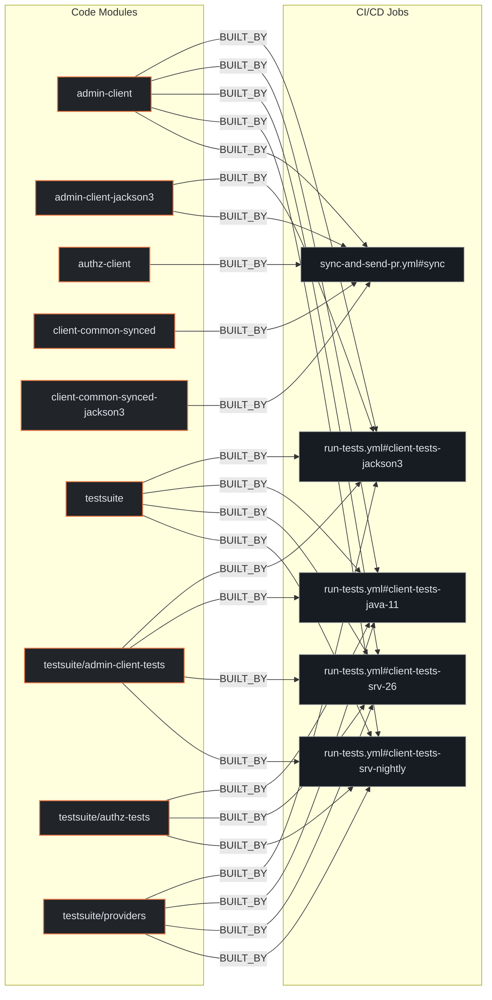

# Repository Architecture Analysis: keycloak/keycloak-client

## Metadata
- **SHA**: `332a5deae89555d4d8adc1a7108def58fb405e65`
- **Primary Ecosystem**: Java

## Quality Metrics
- **ast_engine**: tree-sitter
- **avg_cognitive_complexity**: 0.72
- **avg_cyclomatic_complexity**: 1.51
- **component_count**: 15
- **dead_code_count**: 15
- **dead_code_symbols**: 15 entry(ies)
- **duplication_pct**: 92.79
- **file_complexities**: 25 entry(ies)
- **files_analyzed**: 596
- **fitness_passed**: False
- **fitness_violation_count**: 3
- **framework**: Java Maven/Gradle
- **import_edges**: 100 entry(ies)
- **loc**: 86021
- **max_cognitive_complexity**: 82
- **max_cyclomatic_complexity**: 45
- **sloc**: 54761
- **test_file_count**: 127

# Architecture: keycloak/keycloak-client

## Context
- **Repository**: `keycloak/keycloak-client`
- **SHA**: `332a5deae89555d4d8adc1a7108def58fb405e65`
- **Ecosystem**: Java
- **Framework**: Java Maven/Gradle

## Building Block View

```mermaid
graph TD;
  classDef atlasRoot fill:#004882,stroke:#a3c9ff,stroke-width:2px,color:#d3e4ff
  classDef atlasCategory fill:#212428,stroke:#E87A48,stroke-width:1.5px,color:#dfe3eb
  classDef atlasWorkflow fill:#1b2026,stroke:#a3c9ff,stroke-width:1.5px,color:#dfe3eb
  classDef atlasJob fill:#171c22,stroke:#8d9199,stroke-width:1px,color:#dfe3eb
  classDef atlasTarget fill:#005227,stroke:#8bd99b,stroke-width:1.5px,color:#a7f6b6
  classDef atlasAlert fill:#93000a,stroke:#ffb4ab,stroke-width:1.5px,color:#ffdad6
  classDef atlasMore fill:#252a31,stroke:#8d9199,stroke-dasharray:4 4,color:#c3c6cf
    keycloak_admin_client["keycloak-admin-client : MODULE"]:::atlasJob
    keycloak_admin_client_jackson3["keycloak-admin-client-jackson3 : MODULE"]:::atlasJob
    keycloak_authz_client["keycloak-authz-client : MODULE"]:::atlasJob
    keycloak_client_common_synced["keycloak-client-common-synced : MODULE"]:::atlasJob
    keycloak_client_common_synced_jackson3["keycloak-client-common-synced-jackson3 : MODULE"]:::atlasJob
    keycloak_client_guides["keycloak-client-guides : MODULE"]:::atlasJob
    keycloak_client_guides_maven_plugin["keycloak-client-guides-maven-plugin : MODULE"]:::atlasJob
    keycloak_client_docs_parent["keycloak-client-docs-parent : MODULE"]:::atlasJob
    keycloak_policy_enforcer["keycloak-policy-enforcer : MODULE"]:::atlasJob
    keycloak_client_parent["keycloak-client-parent : MODULE"]:::atlasJob
    keycloak_admin_client_testsuite["keycloak-admin-client-testsuite : MODULE"]:::atlasJob
    keycloak_autz_client_testsuite["keycloak-autz-client-testsuite : MODULE"]:::atlasJob
    keycloak_client_testsuite_framework["keycloak-client-testsuite-framework : MODULE"]:::atlasJob
    keycloak_client_testsuite_parent["keycloak-client-testsuite-parent : MODULE"]:::atlasJob
    keycloak_client_testsuite_providers["keycloak-client-testsuite-providers : MODULE"]:::atlasJob
    repo_root(["keycloak/keycloak-client"]):::atlasRoot
    repo_root --> keycloak_admin_client
    repo_root --> keycloak_admin_client_jackson3
    repo_root --> keycloak_admin_client_testsuite
    repo_root --> keycloak_authz_client
    repo_root --> keycloak_autz_client_testsuite
    repo_root --> keycloak_client_common_synced
    repo_root --> keycloak_client_common_synced_jackson3
    repo_root --> keycloak_client_docs_parent
    repo_root --> keycloak_client_guides
    repo_root --> keycloak_client_guides_maven_plugin
    repo_root --> keycloak_client_parent
    repo_root --> keycloak_client_testsuite_framework
    repo_root --> keycloak_client_testsuite_parent
    repo_root --> keycloak_client_testsuite_providers
    repo_root --> keycloak_policy_enforcer
```

## Component Details
- **keycloak-admin-client** (`admin-client/pom.xml`): MODULE
- **keycloak-admin-client-jackson3** (`admin-client-jackson3/pom.xml`): MODULE
- **keycloak-authz-client** (`authz-client/pom.xml`): MODULE
- **keycloak-client-common-synced** (`client-common-synced/pom.xml`): MODULE
- **keycloak-client-common-synced-jackson3** (`client-common-synced-jackson3/pom.xml`): MODULE
- **keycloak-client-guides** (`docs/guides/pom.xml`): MODULE
- **keycloak-client-guides-maven-plugin** (`docs/maven-plugin/pom.xml`): MODULE
- **keycloak-client-docs-parent** (`docs/pom.xml`): MODULE
- **keycloak-policy-enforcer** (`policy-enforcer/pom.xml`): MODULE
- **keycloak-client-parent** (`pom.xml`): MODULE
- **keycloak-admin-client-testsuite** (`testsuite/admin-client-tests/pom.xml`): MODULE
- **keycloak-autz-client-testsuite** (`testsuite/authz-tests/pom.xml`): MODULE
- **keycloak-client-testsuite-framework** (`testsuite/framework/pom.xml`): MODULE
- **keycloak-client-testsuite-parent** (`testsuite/pom.xml`): MODULE
- **keycloak-client-testsuite-providers** (`testsuite/providers/pom.xml`): MODULE

## 6-Dimension Repository Scorecard

- **Overall Grade**: `F` (38.25/100)
- **Technical Debt Score**: 61.75
- **Estimated Remediation Effort**: 91.25h

| Dimension | Grade | Score | Weight | Details |
| :--- | :---: | :---: | :---: | :--- |
| Code Quality | `F` | 30.00 | 0.20 | avg_cc=1.51, max_cc=45, duplication=92.79%, dead_code=15 |
| Dependency Health | `B` | 85.00 | 0.15 | dependencies=60, outdated=0, vulnerable=0, has_lockfile=False |
| Maintainability | `F` | 37.00 | 0.15 | avg_cognitive=0.72, max_cognitive=82, fitness_violations=3, oversized_files=13 |
| Pipeline Health | `F` | 23.00 | 0.15 | workflows=7, operational_antipatterns=12, parallel_branches=True |
| Security | `F` | 0.00 | 0.20 | vulnerabilities=0, secrets=2, pipeline_security_findings=9 |
| Test Coverage | `C` | 70.00 | 0.15 | coverage=unavailable, ci_test_job=True, test_files_detected=True |

## Architecture Fitness & Workspace Boundaries

- **[MEDIUM] `ATRUSS-ARCH-005` (COMPLEXITY_THRESHOLD)**: Repository duplication_pct (92.79) exceeds policy threshold (15.0).
- **[MEDIUM] `ATRUSS-ARCH-005` (COMPLEXITY_THRESHOLD)**: Repository max_cognitive_complexity (82.0) exceeds policy threshold (25.0).
- **[MEDIUM] `ATRUSS-ARCH-005` (COMPLEXITY_THRESHOLD)**: Repository max_cyclomatic_complexity (45.0) exceeds policy threshold (20.0).

## Supply Chain Dependencies, Vulnerabilities & Secrets

- **Dependencies Parsed**: 60 | **Vulnerabilities**: 0 | **Secrets**: 2

### Secret Findings (Redacted)
- **[CRITICAL] `ATRUSS-SEC-004`** at `client-common-synced/src/main/java/org/keycloak/common/util/PemUtils.java:41` (`-----BEGIN ... PRIVATE KEY----- [REDACTED]`)
- **[CRITICAL] `ATRUSS-SEC-004`** at `client-common-synced/src/main/java/org/keycloak/common/util/PemUtils.java:43` (`-----BEGIN ... PRIVATE KEY----- [REDACTED]`)

### Inventory Sample
- `com.fasterxml.jackson.core:jackson-annotations` `*` (Maven, `admin-client/pom.xml`)
- `com.fasterxml.jackson.core:jackson-annotations` `*` (Maven, `authz-client/pom.xml`)
- `com.fasterxml.jackson.core:jackson-annotations` `*` (Maven, `client-common-synced-jackson3/pom.xml`)
- `com.fasterxml.jackson.core:jackson-annotations` `*` (Maven, `client-common-synced/pom.xml`)
- `com.fasterxml.jackson.core:jackson-core` `*` (Maven, `admin-client/pom.xml`)
- `com.fasterxml.jackson.core:jackson-core` `*` (Maven, `authz-client/pom.xml`)
- `com.fasterxml.jackson.core:jackson-core` `*` (Maven, `client-common-synced/pom.xml`)
- `com.fasterxml.jackson.core:jackson-databind` `*` (Maven, `authz-client/pom.xml`)
- `com.fasterxml.jackson.core:jackson-databind` `*` (Maven, `client-common-synced/pom.xml`)
- `com.fasterxml.jackson.datatype:jackson-datatype-jdk8` `*` (Maven, `admin-client/pom.xml`)
- `com.fasterxml.jackson.datatype:jackson-datatype-jdk8` `*` (Maven, `authz-client/pom.xml`)
- `com.fasterxml.jackson.datatype:jackson-datatype-jdk8` `*` (Maven, `client-common-synced/pom.xml`)
- `com.fasterxml.jackson.datatype:jackson-datatype-jsr310` `*` (Maven, `admin-client/pom.xml`)
- `com.fasterxml.jackson.datatype:jackson-datatype-jsr310` `*` (Maven, `authz-client/pom.xml`)
- `com.fasterxml.jackson.datatype:jackson-datatype-jsr310` `*` (Maven, `client-common-synced/pom.xml`)
- `com.fasterxml.jackson.jakarta.rs:jackson-jakarta-rs-yaml-provider` `*` (Maven, `admin-client/pom.xml`)
- `com.github.dasniko:testcontainers-keycloak` `*` (Maven, `testsuite/framework/pom.xml`)
- `commons-io:commons-io` `*` (Maven, `testsuite/framework/pom.xml`)
- `dev.resteasy.providers:resteasy-jackson-provider` `*` (Maven, `admin-client-jackson3/pom.xml`)
- `io.undertow:undertow-core` `*` (Maven, `testsuite/authz-tests/pom.xml`)
- `jakarta.servlet:jakarta.servlet-api` `*` (Maven, `policy-enforcer/pom.xml`)
- `org.apache.httpcomponents:httpclient` `*` (Maven, `authz-client/pom.xml`)
- `org.apache.logging.log4j:log4j-slf4j2-impl` `*` (Maven, `testsuite/framework/pom.xml`)
- `org.apache.maven.plugin-tools:maven-plugin-annotations` `*` (Maven, `docs/maven-plugin/pom.xml`)
- `org.apache.maven:maven-core` `*` (Maven, `docs/maven-plugin/pom.xml`)
- `org.apache.maven:maven-plugin-api` `*` (Maven, `docs/maven-plugin/pom.xml`)
- `org.eclipse.microprofile.openapi:microprofile-openapi-api` `*` (Maven, `admin-client-jackson3/pom.xml`)
- `org.eclipse.microprofile.openapi:microprofile-openapi-api` `*` (Maven, `admin-client/pom.xml`)
- `org.eclipse.microprofile.openapi:microprofile-openapi-api` `*` (Maven, `authz-client/pom.xml`)
- `org.eclipse.microprofile.openapi:microprofile-openapi-api` `*` (Maven, `client-common-synced-jackson3/pom.xml`)
- ... (+30 more dependencies)

## Section 7: Code-to-Cloud Deployment Traceability

- `admin-client` (code_module) --[BUILT_BY]--> `run-tests.yml#client-tests-jackson3` (ci_job)
- `admin-client` (code_module) --[BUILT_BY]--> `run-tests.yml#client-tests-java-11` (ci_job)
- `admin-client` (code_module) --[BUILT_BY]--> `run-tests.yml#client-tests-srv-26` (ci_job)
- `admin-client` (code_module) --[BUILT_BY]--> `run-tests.yml#client-tests-srv-nightly` (ci_job)
- `admin-client` (code_module) --[BUILT_BY]--> `sync-and-send-pr.yml#sync` (ci_job)
- `admin-client-jackson3` (code_module) --[BUILT_BY]--> `run-tests.yml#client-tests-jackson3` (ci_job)
- `admin-client-jackson3` (code_module) --[BUILT_BY]--> `sync-and-send-pr.yml#sync` (ci_job)
- `authz-client` (code_module) --[BUILT_BY]--> `sync-and-send-pr.yml#sync` (ci_job)
- `client-common-synced` (code_module) --[BUILT_BY]--> `sync-and-send-pr.yml#sync` (ci_job)
- `client-common-synced-jackson3` (code_module) --[BUILT_BY]--> `sync-and-send-pr.yml#sync` (ci_job)
- `testsuite` (code_module) --[BUILT_BY]--> `run-tests.yml#client-tests-jackson3` (ci_job)
- `testsuite` (code_module) --[BUILT_BY]--> `run-tests.yml#client-tests-java-11` (ci_job)
- `testsuite` (code_module) --[BUILT_BY]--> `run-tests.yml#client-tests-srv-26` (ci_job)
- `testsuite` (code_module) --[BUILT_BY]--> `run-tests.yml#client-tests-srv-nightly` (ci_job)
- `testsuite/admin-client-tests` (code_module) --[BUILT_BY]--> `run-tests.yml#client-tests-jackson3` (ci_job)
- `testsuite/admin-client-tests` (code_module) --[BUILT_BY]--> `run-tests.yml#client-tests-java-11` (ci_job)
- `testsuite/admin-client-tests` (code_module) --[BUILT_BY]--> `run-tests.yml#client-tests-srv-26` (ci_job)
- `testsuite/admin-client-tests` (code_module) --[BUILT_BY]--> `run-tests.yml#client-tests-srv-nightly` (ci_job)
- `testsuite/authz-tests` (code_module) --[BUILT_BY]--> `run-tests.yml#client-tests-java-11` (ci_job)
- `testsuite/authz-tests` (code_module) --[BUILT_BY]--> `run-tests.yml#client-tests-srv-26` (ci_job)
- `testsuite/authz-tests` (code_module) --[BUILT_BY]--> `run-tests.yml#client-tests-srv-nightly` (ci_job)
- `testsuite/providers` (code_module) --[BUILT_BY]--> `run-tests.yml#client-tests-jackson3` (ci_job)
- `testsuite/providers` (code_module) --[BUILT_BY]--> `run-tests.yml#client-tests-java-11` (ci_job)
- `testsuite/providers` (code_module) --[BUILT_BY]--> `run-tests.yml#client-tests-srv-26` (ci_job)
- `testsuite/providers` (code_module) --[BUILT_BY]--> `run-tests.yml#client-tests-srv-nightly` (ci_job)

## CI/CD Pipeline Topology

```mermaid
graph TD;
  classDef atlasRoot fill:#004882,stroke:#a3c9ff,stroke-width:2px,color:#d3e4ff
  classDef atlasCategory fill:#212428,stroke:#E87A48,stroke-width:1.5px,color:#dfe3eb
  classDef atlasWorkflow fill:#1b2026,stroke:#a3c9ff,stroke-width:1.5px,color:#dfe3eb
  classDef atlasJob fill:#171c22,stroke:#8d9199,stroke-width:1px,color:#dfe3eb
  classDef atlasTarget fill:#005227,stroke:#8bd99b,stroke-width:1.5px,color:#a7f6b6
  classDef atlasAlert fill:#93000a,stroke:#ffb4ab,stroke-width:1.5px,color:#ffdad6
  classDef atlasMore fill:#252a31,stroke:#8d9199,stroke-dasharray:4 4,color:#c3c6cf
  pipeline_root(["keycloak/keycloak-client (7 workflows)"]):::atlasRoot
  subgraph sg_grp_0_Scheduled___Manual["Scheduled & Manual (4 workflows · 6 jobs)"]
    direction TB
    subgraph sg_wf_0_Keycloak_Client_CI["Keycloak Client CI (2 jobs)"]
      direction TB
      wf_0_Keycloak_Client_CI(["Trigger: Keycloak Client CI"]):::atlasWorkflow
      job_0_build["build"]:::atlasJob
      job_0_client_tests["client-tests"]:::atlasJob
      wf_0_Keycloak_Client_CI --> job_0_build
      job_0_build --> job_0_client_tests
    end
    pipeline_root --> wf_0_Keycloak_Client_CI
    subgraph sg_wf_4_Scheduled_nightly_workflows["Scheduled nightly workflows (1 jobs)"]
      direction TB
      wf_4_Scheduled_nightly_workflows(["Trigger: Scheduled nightly workflows"]):::atlasWorkflow
      job_4_run_ci["run-ci"]:::atlasJob
      wf_4_Scheduled_nightly_workflows --> job_4_run_ci
    end
    pipeline_root --> wf_4_Scheduled_nightly_workflows
    subgraph sg_wf_5_Keycloak_client_sync_nightly["Keycloak client sync nightly (2 jobs)"]
      direction TB
      wf_5_Keycloak_client_sync_nightly(["Trigger: Keycloak client sync nightly"]):::atlasWorkflow
      job_5_build["build"]:::atlasJob
      job_5_client_tests["client-tests"]:::atlasJob
      wf_5_Keycloak_client_sync_nightly --> job_5_build
      job_5_build --> job_5_client_tests
    end
    pipeline_root --> wf_5_Keycloak_client_sync_nightly
    subgraph sg_wf_6_Sync_with_Keycloak_Server_and_send_PR_with_changes["Sync with Keycloak Server and send PR with changes (1 jobs)"]
      direction TB
      wf_6_Sync_with_Keycloak_Server_and_send_PR_with_changes(["Trigger: Sync with Keycloak Server and send PR with changes"]):::atlasWorkflow
      job_6_sync["sync"]:::atlasJob
      wf_6_Sync_with_Keycloak_Server_and_send_PR_with_changes --> job_6_sync
    end
    pipeline_root --> wf_6_Sync_with_Keycloak_Server_and_send_PR_with_changes
  end
  subgraph sg_grp_1_Release___Deploy["Release & Deploy (2 workflows · 2 jobs)"]
    direction TB
    subgraph sg_wf_1_Keycloak_Client_Nightly_Release["Keycloak Client Nightly Release (1 jobs)"]
      direction TB
      wf_1_Keycloak_Client_Nightly_Release(["Trigger: Keycloak Client Nightly Release"]):::atlasWorkflow
      job_1_release["release"]:::atlasJob
      wf_1_Keycloak_Client_Nightly_Release --> job_1_release
    end
    pipeline_root --> wf_1_Keycloak_Client_Nightly_Release
    subgraph sg_wf_2_Release["Release (1 jobs)"]
      direction TB
      wf_2_Release(["Trigger: Release"]):::atlasWorkflow
      job_2_release["release"]:::atlasJob
      wf_2_Release --> job_2_release
    end
    pipeline_root --> wf_2_Release
  end
  subgraph sg_grp_2_CI___Verification["CI & Verification (1 workflows · 4 jobs)"]
    direction TB
    subgraph sg_wf_3_Keycloak_Client_Tests["Keycloak Client Tests (4 jobs)"]
      direction TB
      wf_3_Keycloak_Client_Tests(["Trigger: Keycloak Client Tests"]):::atlasWorkflow
      job_3_client_tests_srv_26["client-tests-srv-26"]:::atlasJob
      job_3_client_tests_srv_nightly["client-tests-srv-nightly"]:::atlasJob
      job_3_client_tests_jackson3["client-tests-jackson3"]:::atlasJob
      wf_3_Keycloak_Client_Tests --> job_3_client_tests_srv_26
      wf_3_Keycloak_Client_Tests --> job_3_client_tests_srv_nightly
      wf_3_Keycloak_Client_Tests --> job_3_client_tests_jackson3
    end
    pipeline_root --> wf_3_Keycloak_Client_Tests
  end
```

