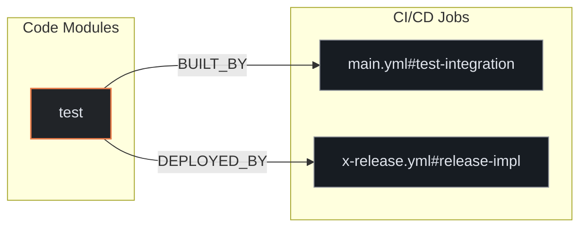
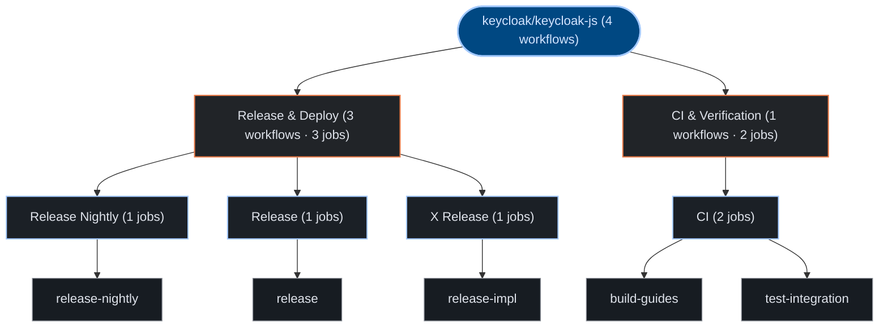

# Repository Architecture Analysis: keycloak/keycloak-js

## Metadata
- **SHA**: `be42d6adf8477153e9170dcdb98ec198f2c27a54`
- **Primary Ecosystem**: JavaScript/TypeScript

## Quality Metrics
- **ast_engine**: tree-sitter
- **avg_cognitive_complexity**: 4.61
- **avg_cyclomatic_complexity**: 3.53
- **component_count**: 3
- **dead_code_count**: 10
- **dead_code_symbols**: 10 entry(ies)
- **duplication_pct**: 63.1
- **file_complexities**: 25 entry(ies)
- **files_analyzed**: 30
- **fitness_passed**: False
- **fitness_violation_count**: 3
- **framework**: Express / Node API
- **import_edges**: 100 entry(ies)
- **loc**: 6545
- **max_cognitive_complexity**: 142
- **max_cyclomatic_complexity**: 41
- **sloc**: 4204
- **test_file_count**: 27

# Architecture: keycloak/keycloak-js

## Context
- **Repository**: `keycloak/keycloak-js`
- **SHA**: `be42d6adf8477153e9170dcdb98ec198f2c27a54`
- **Ecosystem**: JavaScript/TypeScript
- **Framework**: Express / Node API

## Building Block View

## Component Details
- **keycloak-js** (`package.json`): MODULE
- **keycloak-js-test** (`test/package.json`): MODULE
- **GET_adapter-config.json** (`test/app/app.ts`): API_ROUTE

## 6-Dimension Repository Scorecard

- **Overall Grade**: `F` (51.38/100)
- **Technical Debt Score**: 48.62
- **Estimated Remediation Effort**: 51.78h

| Dimension | Grade | Score | Weight | Details |
| :--- | :---: | :---: | :---: | :--- |
| Code Quality | `F` | 27.88 | 0.20 | avg_cc=3.53, max_cc=41, duplication=63.10%, dead_code=10 |
| Dependency Health | `A` | 100.00 | 0.15 | dependencies=117, outdated=0, vulnerable=0, has_lockfile=True |
| Maintainability | `F` | 42.00 | 0.15 | avg_cognitive=4.61, max_cognitive=142, fitness_violations=3, oversized_files=3 |
| Pipeline Health | `F` | 24.00 | 0.15 | workflows=4, operational_antipatterns=9, parallel_branches=True |
| Security | `F` | 52.00 | 0.20 | vulnerabilities=0, secrets=0, pipeline_security_findings=4 |
| Test Coverage | `C` | 70.00 | 0.15 | coverage=unavailable, ci_test_job=True, test_files_detected=True |

## Architecture Fitness & Workspace Boundaries

- **[MEDIUM] `ATRUSS-ARCH-005` (COMPLEXITY_THRESHOLD)**: Repository duplication_pct (63.1) exceeds policy threshold (15.0).
- **[MEDIUM] `ATRUSS-ARCH-005` (COMPLEXITY_THRESHOLD)**: Repository max_cognitive_complexity (142.0) exceeds policy threshold (25.0).
- **[MEDIUM] `ATRUSS-ARCH-005` (COMPLEXITY_THRESHOLD)**: Repository max_cyclomatic_complexity (41.0) exceeds policy threshold (20.0).

### Workspace Packages
- **keycloak-js-test** (`test`, react_ts_js, npm)

## Supply Chain Dependencies, Vulnerabilities & Secrets

- **Dependencies Parsed**: 117 | **Vulnerabilities**: 0 | **Secrets**: 0

### Inventory Sample
- `@keycloak/keycloak-admin-client` `26.8.1` (npm, `test/package.json`)
- `@playwright/test` `1.64.0` (npm, `test/package.json`)
- `@types/express` `5.0.6` (npm, `test/package.json`)
- `@types/node` `26.6.5` (npm, `test/package.json`)
- `express` `5.3.0` (npm, `test/package.json`)
- `jszip` `3.10.2` (npm, `package-lock.json`)
- `jszip` `3.10.2` (npm, `package.json`)
- `@keycloak/keycloak-admin-client` `26.8.1` (npm, `package-lock.json`)
- `@microsoft/kiota-abstractions` `1.0.0-preview.103` (npm, `package-lock.json`)
- `@microsoft/kiota-http-fetchlibrary` `1.0.0-preview.103` (npm, `package-lock.json`)
- `@microsoft/kiota-serialization-form` `1.0.0-preview.103` (npm, `package-lock.json`)
- `@microsoft/kiota-serialization-json` `1.0.0-preview.103` (npm, `package-lock.json`)
- `@microsoft/kiota-serialization-multipart` `1.0.0-preview.103` (npm, `package-lock.json`)
- `@microsoft/kiota-serialization-text` `1.0.0-preview.103` (npm, `package-lock.json`)
- `@opentelemetry/api` `1.9.1` (npm, `package-lock.json`)
- `@playwright/test` `1.64.0` (npm, `package-lock.json`)
- `@std-uritemplate/std-uritemplate` `2.0.11` (npm, `package-lock.json`)
- `@types/body-parser` `1.19.5` (npm, `package-lock.json`)
- `@types/connect` `3.4.38` (npm, `package-lock.json`)
- `@types/express` `5.0.6` (npm, `package-lock.json`)
- `@types/express-serve-static-core` `5.0.6` (npm, `package-lock.json`)
- `@types/http-errors` `2.0.5` (npm, `package-lock.json`)
- `@types/mime` `1.3.5` (npm, `package-lock.json`)
- `@types/node` `26.6.5` (npm, `package-lock.json`)
- `@types/qs` `6.9.18` (npm, `package-lock.json`)
- `@types/range-parser` `1.2.7` (npm, `package-lock.json`)
- `@types/send` `0.17.4` (npm, `package-lock.json`)
- `@types/serve-static` `2.2.0` (npm, `package-lock.json`)
- `accepts` `2.0.0` (npm, `package-lock.json`)
- `body-parser` `2.3.0` (npm, `package-lock.json`)
- ... (+87 more dependencies)

## Section 7: Code-to-Cloud Deployment Traceability

- `test` (code_module) --[BUILT_BY]--> `main.yml#test-integration` (ci_job)
- `test` (code_module) --[DEPLOYED_BY]--> `x-release.yml#release-impl` (ci_job)

## CI/CD Pipeline Topology

