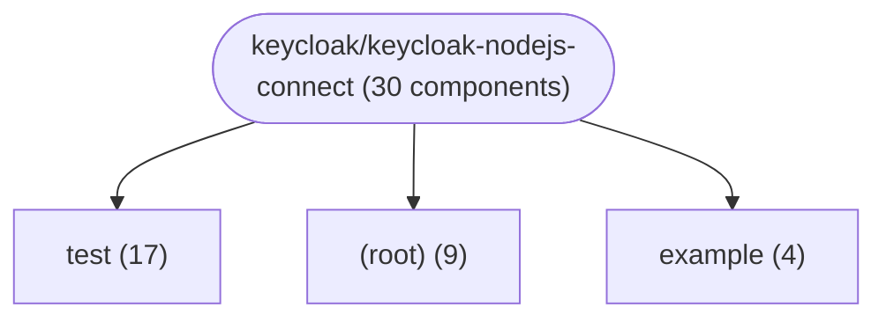
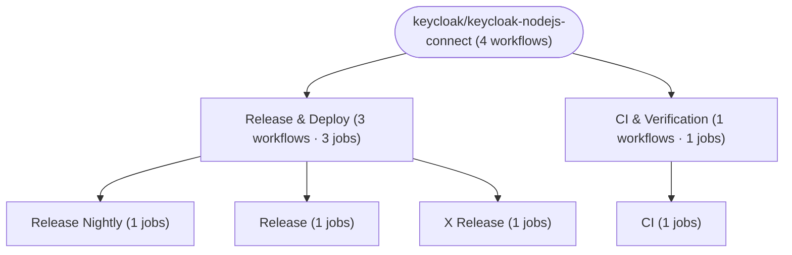

# Repository Architecture Analysis: keycloak/keycloak-nodejs-connect

## Metadata
- **SHA**: `b50534c40bbdc58e117c39e53a0103fbe7ff3896`
- **Primary Ecosystem**: JavaScript/TypeScript

## Quality Metrics
- **ast_engine**: tree-sitter
- **avg_cognitive_complexity**: 2.05
- **avg_cyclomatic_complexity**: 2.41
- **component_count**: 30
- **dead_code_count**: 0
- **dead_code_symbols**: 0 entry(ies)
- **duplication_pct**: 74.72
- **file_complexities**: 25 entry(ies)
- **files_analyzed**: 38
- **fitness_passed**: False
- **fitness_violation_count**: 1
- **framework**: Express / Node API
- **import_edges**: 100 entry(ies)
- **loc**: 5718
- **max_cognitive_complexity**: 22
- **max_cyclomatic_complexity**: 11
- **sloc**: 3635
- **test_file_count**: 29

# Architecture: keycloak/keycloak-nodejs-connect

## Context
- **Repository**: `keycloak/keycloak-nodejs-connect`
- **SHA**: `b50534c40bbdc58e117c39e53a0103fbe7ff3896`
- **Ecosystem**: JavaScript/TypeScript
- **Framework**: Express / Node API

## Building Block View

## Component Details
- **nodejs-keycloak-example** (`example/package.json`): MODULE
- **keycloak-connect** (`package.json`): MODULE
- **GET_special_:page** (`keycloak.d.ts`): API_ROUTE
- **GET_fancy_:page** (`keycloak.d.ts`): API_ROUTE
- **GET_complain** (`keycloak.d.ts`): API_ROUTE
- **GET_protected_resource** (`keycloak.d.ts`): API_ROUTE
- **GET_special_:page** (`keycloak.js`): API_ROUTE
- **GET_fancy_:page** (`keycloak.js`): API_ROUTE
- **GET_complain** (`keycloak.js`): API_ROUTE
- **GET_protected_resource** (`keycloak.js`): API_ROUTE
- **GET_root** (`example/index.js`): API_ROUTE
- **GET_login** (`example/index.js`): API_ROUTE
- **GET_protected_resource** (`example/index.js`): API_ROUTE
- **GET_root** (`test/fixtures/node-console/index.mjs`): API_ROUTE
- **GET_login** (`test/fixtures/node-console/index.mjs`): API_ROUTE
- **GET_check-sso** (`test/fixtures/node-console/index.mjs`): API_ROUTE
- **GET_restricted** (`test/fixtures/node-console/index.mjs`): API_ROUTE
- **GET_cookie** (`test/fixtures/node-console/index.mjs`): API_ROUTE
- **GET_service_public** (`test/fixtures/node-console/index.mjs`): API_ROUTE
- **GET_service_secured** (`test/fixtures/node-console/index.mjs`): API_ROUTE
- **GET_service_admin** (`test/fixtures/node-console/index.mjs`): API_ROUTE
- **GET_service_grant** (`test/fixtures/node-console/index.mjs`): API_ROUTE
- **POST_service_grant** (`test/fixtures/node-console/index.mjs`): API_ROUTE
- **GET_protected_enforcer_resource** (`test/fixtures/node-console/index.mjs`): API_ROUTE
- **POST_protected_enforcer_resource** (`test/fixtures/node-console/index.mjs`): API_ROUTE
- **DELETE_protected_enforcer_resource** (`test/fixtures/node-console/index.mjs`): API_ROUTE
- **GET_protected_enforcer_resource-view-delete** (`test/fixtures/node-console/index.mjs`): API_ROUTE
- **GET_protected_enforcer_resource-claims** (`test/fixtures/node-console/index.mjs`): API_ROUTE
- **GET_protected_enforcer_no-permission-defined** (`test/fixtures/node-console/index.mjs`): API_ROUTE
- **GET_protected_web_resource** (`test/fixtures/node-console/index.mjs`): API_ROUTE

## 6-Dimension Repository Scorecard

- **Overall Grade**: `F` (55.95/100)
- **Technical Debt Score**: 44.05
- **Estimated Remediation Effort**: 67.46h

| Dimension | Grade | Score | Weight | Details |
| :--- | :---: | :---: | :---: | :--- |
| Code Quality | `C` | 75.00 | 0.20 | avg_cc=2.41, max_cc=11, duplication=74.72%, dead_code=0 |
| Dependency Health | `A` | 100.00 | 0.15 | dependencies=765, outdated=0, vulnerable=0, has_lockfile=True |
| Maintainability | `B` | 81.00 | 0.15 | avg_cognitive=2.05, max_cognitive=22, fitness_violations=1, oversized_files=2 |
| Pipeline Health | `F` | 22.00 | 0.15 | workflows=4, operational_antipatterns=8, parallel_branches=False |
| Security | `F` | 0.00 | 0.20 | vulnerabilities=0, secrets=11, pipeline_security_findings=4 |
| Test Coverage | `C` | 70.00 | 0.15 | coverage=unavailable, ci_test_job=False, test_files_detected=True |

## Architecture Fitness & Workspace Boundaries

- **[MEDIUM] `ATRUSS-ARCH-005` (COMPLEXITY_THRESHOLD)**: Repository duplication_pct (74.72) exceeds policy threshold (15.0).

## Supply Chain Dependencies, Vulnerabilities & Secrets

- **Dependencies Parsed**: 765 | **Vulnerabilities**: 0 | **Secrets**: 11

### Secret Findings (Redacted)
- **[HIGH] `ATRUSS-SEC-005`** at `example/keycloak.json:3` (`"realm-public-key" : "MIGf***REDACTED***",`)
- **[HIGH] `ATRUSS-SEC-005`** at `example/nodejs-example-realm.json:6` (`"privateKey": "MIIC***REDACTED***",`)
- **[HIGH] `ATRUSS-SEC-005`** at `example/nodejs-example-realm.json:7` (`"publicKey": "MIGf***REDACTED***",`)
- **[HIGH] `ATRUSS-SEC-005`** at `test/fixtures/auth-utils/keycloak-with-public-key.json:4` (`"realm-public-key" : "MIIB***REDACTED***",`)
- **[HIGH] `ATRUSS-SEC-005`** at `test/fixtures/auth-utils/nodejs-test-realm.json:4264` (`"privateKey": "MIIC***REDACTED***",`)
- **[HIGH] `ATRUSS-SEC-005`** at `test/fixtures/auth-utils/nodejs-test-realm.json:4265` (`"publicKey": "MIGf***REDACTED***",`)
- **[HIGH] `ATRUSS-SEC-005`** at `test/fixtures/testrealm.json:6` (`"privateKey": "MIIC***REDACTED***",`)
- **[HIGH] `ATRUSS-SEC-005`** at `test/fixtures/testrealm.json:7` (`"publicKey": "MIGf***REDACTED***",`)
- **[HIGH] `ATRUSS-SEC-005`** at `test/utils/helper.mjs:52` (`TestVector.wrongRealmPublicKey = 'MIIB***REDACTED***'`)
- **[HIGH] `ATRUSS-SEC-005`** at `test/utils/helper.mjs:54` (`TestVector.logoutWrongKeyPairPayload = 'eyJ0***REDACTED***'`)
- **[HIGH] `ATRUSS-SEC-005`** at `test/utils/helper.mjs:57` (`TestVector.notBeforeWrongKeyPairPayload = 'eyJ0***REDACTED***'`)

### Inventory Sample
- `@keycloak/keycloak-admin-client` `26.2.4` (npm, `package-lock.json`)
- `@keycloak/keycloak-admin-client` `26.2.4` (npm, `package.json`)
- `@octokit/rest` `21.1.1` (npm, `package-lock.json`)
- `@octokit/rest` `21.1.1` (npm, `package.json`)
- `axios` `0.29.0` (npm, `package-lock.json`)
- `axios` `0.29.0` (npm, `package.json`)
- `blue-tape` `1.0.0` (npm, `package-lock.json`)
- `blue-tape` `1.0.0` (npm, `package.json`)
- `body-parser` `1.13.3` (npm, `package.json`)
- `body-parser` `1.20.3` (npm, `package-lock.json`)
- `chromedriver` `*` (npm, `package.json`)
- `chromedriver` `136.0.2` (npm, `package-lock.json`)
- `cookie-parser` `1.4.5` (npm, `package.json`)
- `cookie-parser` `1.4.7` (npm, `package-lock.json`)
- `coveralls` `3.0.1` (npm, `package.json`)
- `coveralls` `3.1.1` (npm, `package-lock.json`)
- `express` `*` (npm, `example/package.json`)
- `express` `4.14.0` (npm, `package.json`)
- `express` `4.21.2` (npm, `package-lock.json`)
- `express-session` `*` (npm, `example/package.json`)
- `express-session` `1.14.2` (npm, `package.json`)
- `express-session` `1.18.1` (npm, `package-lock.json`)
- `gunzip-maybe` `1.4.2` (npm, `package-lock.json`)
- `gunzip-maybe` `1.4.2` (npm, `package.json`)
- `hogan-express` `*` (npm, `example/package.json`)
- `hogan-express` `0.5.2` (npm, `package-lock.json`)
- `hogan-express` `0.5.2` (npm, `package.json`)
- `ink-docstrap` `1.1.4` (npm, `package.json`)
- `ink-docstrap` `1.3.2` (npm, `package-lock.json`)
- `jsdoc` `4.0.4` (npm, `package-lock.json`)
- ... (+735 more dependencies)

## CI/CD Pipeline Topology

