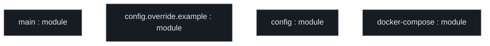
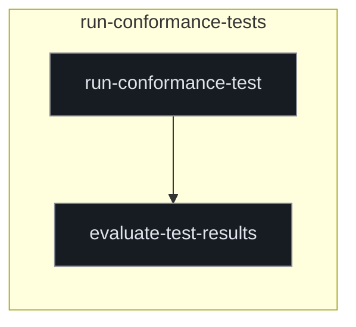

# Repository Architecture Analysis: keycloak/keycloak-oauth-sig

## Metadata
- **SHA**: `64b97d552fa6c0f85aa5a9ead64f7dd5bfd8dbdc`
- **Primary Ecosystem**: Go

## Quality Metrics
- **ast_engine**: fallback
- **avg_cognitive_complexity**: 0.0
- **avg_cyclomatic_complexity**: 0.0
- **component_count**: 8
- **dead_code_count**: 0
- **dead_code_symbols**: 0 entry(ies)
- **duplication_pct**: 0.0
- **file_complexities**: 0 entry(ies)
- **files_analyzed**: 8
- **fitness_passed**: True
- **fitness_violation_count**: 0
- **framework**: Go Service
- **import_edges**: 0 entry(ies)
- **loc**: 898
- **max_cognitive_complexity**: 0
- **max_cyclomatic_complexity**: 0
- **sloc**: 640

# Architecture: keycloak/keycloak-oauth-sig

## Context
- **Repository**: `keycloak/keycloak-oauth-sig`
- **SHA**: `64b97d552fa6c0f85aa5a9ead64f7dd5bfd8dbdc`
- **Ecosystem**: Go
- **Framework**: Go Service

## Building Block View

## Component Details
- **main** (`conformance-tests-env/spec/entities/consent-server/main.go`): module
- **main** (`conformance-tests-env/spec/entities/dpop-proof-signature-verify-server/main.go`): module
- **main** (`conformance-tests-env/spec/entities/resource-server/main.go`): module
- **main** (`conformance-tests-env/test-target/keycloak/entities/auth_entity_server/main.go`): module
- **main** (`conformance-tests-env/test-target/keycloak/entities/client_private_keys/main.go`): module
- **config.override.example** (`oid4vci-deployment/config.override.example.yaml`): module
- **config** (`oid4vci-deployment/config.yaml`): module
- **docker-compose** (`oid4vci-deployment/docker-compose.yml`): module

## 6-Dimension Repository Scorecard

- **Overall Grade**: `C` (72.35/100)
- **Technical Debt Score**: 27.65
- **Estimated Remediation Effort**: 371.41h

| Dimension | Grade | Score | Weight | Details |
| :--- | :---: | :---: | :---: | :--- |
| Code Quality | `A` | 100.00 | 0.20 | avg_cc=0.00, max_cc=0, duplication=0.00%, dead_code=0 |
| Dependency Health | `B` | 85.00 | 0.15 | dependencies=1, outdated=0, vulnerable=0, has_lockfile=False |
| Maintainability | `A` | 100.00 | 0.15 | avg_cognitive=0.00, max_cognitive=0, fitness_violations=0, oversized_files=0 |
| Pipeline Health | `A` | 94.00 | 0.15 | workflows=1, operational_antipatterns=2, parallel_branches=False |
| Security | `F` | 0.00 | 0.20 | vulnerabilities=0, secrets=180, pipeline_security_findings=3 |
| Test Coverage | `C` | 70.00 | 0.15 | coverage=unavailable, ci_test_job=True, test_files_detected=True |

## Supply Chain Dependencies, Vulnerabilities & Secrets

- **Dependencies Parsed**: 1 | **Vulnerabilities**: 0 | **Secrets**: 180

### Secret Findings (Redacted)
- **[CRITICAL] `ATRUSS-SEC-004`** at `conformance-tests-env/common/https/ca-key.pem:1` (`-----BEGIN ... PRIVATE KEY----- [REDACTED]`)
- **[CRITICAL] `ATRUSS-SEC-004`** at `conformance-tests-env/common/https/client-ca-key.pem:1` (`-----BEGIN ... PRIVATE KEY----- [REDACTED]`)
- **[CRITICAL] `ATRUSS-SEC-004`** at `conformance-tests-env/common/https/client1-key.pem:1` (`-----BEGIN ... PRIVATE KEY----- [REDACTED]`)
- **[CRITICAL] `ATRUSS-SEC-004`** at `conformance-tests-env/common/https/client2-key.pem:1` (`-----BEGIN ... PRIVATE KEY----- [REDACTED]`)
- **[CRITICAL] `ATRUSS-SEC-004`** at `conformance-tests-env/common/https/server-key.pem:1` (`-----BEGIN ... PRIVATE KEY----- [REDACTED]`)
- **[CRITICAL] `ATRUSS-SEC-004`** at `conformance-tests-env/conformance-suite/fapi-conformance-suite-configs/fapi-aus-cdr/fapi-aus-cdr-private-key-PS256-PS256-automated.json:81` (`-----BEGIN ... PRIVATE KEY----- [REDACTED]`)
- **[CRITICAL] `ATRUSS-SEC-004`** at `conformance-tests-env/conformance-suite/fapi-conformance-suite-configs/fapi-aus-cdr/fapi-aus-cdr-private-key-PS256-PS256.json:81` (`-----BEGIN ... PRIVATE KEY----- [REDACTED]`)
- **[CRITICAL] `ATRUSS-SEC-004`** at `conformance-tests-env/conformance-suite/fapi-conformance-suite-configs/fapi-aus-cdr/fapi-aus-cdr-private-key-par-PS256-PS256-automated.json:81` (`-----BEGIN ... PRIVATE KEY----- [REDACTED]`)
- **[CRITICAL] `ATRUSS-SEC-004`** at `conformance-tests-env/conformance-suite/fapi-conformance-suite-configs/fapi-aus-cdr/fapi-aus-cdr-private-key-par-PS256-PS256.json:81` (`-----BEGIN ... PRIVATE KEY----- [REDACTED]`)
- **[CRITICAL] `ATRUSS-SEC-004`** at `conformance-tests-env/conformance-suite/fapi-conformance-suite-configs/fapi-aus-cdr/fapi-aus-cdr-private-key-par-jarm-PS256-PS256-automated.json:81` (`-----BEGIN ... PRIVATE KEY----- [REDACTED]`)
- **[CRITICAL] `ATRUSS-SEC-004`** at `conformance-tests-env/conformance-suite/fapi-conformance-suite-configs/fapi-aus-cdr/fapi-aus-cdr-private-key-par-jarm-PS256-PS256.json:81` (`-----BEGIN ... PRIVATE KEY----- [REDACTED]`)
- **[CRITICAL] `ATRUSS-SEC-004`** at `conformance-tests-env/conformance-suite/fapi-conformance-suite-configs/fapi-ciba/fapi-ciba-id1-ping-mtls-ES256-ES256-automated.json:48` (`-----BEGIN ... PRIVATE KEY----- [REDACTED]`)
- **[CRITICAL] `ATRUSS-SEC-004`** at `conformance-tests-env/conformance-suite/fapi-conformance-suite-configs/fapi-ciba/fapi-ciba-id1-ping-mtls-ES256-ES256.json:48` (`-----BEGIN ... PRIVATE KEY----- [REDACTED]`)
- **[CRITICAL] `ATRUSS-SEC-004`** at `conformance-tests-env/conformance-suite/fapi-conformance-suite-configs/fapi-ciba/fapi-ciba-id1-ping-mtls-PS256-PS256-automated.json:56` (`-----BEGIN ... PRIVATE KEY----- [REDACTED]`)
- **[CRITICAL] `ATRUSS-SEC-004`** at `conformance-tests-env/conformance-suite/fapi-conformance-suite-configs/fapi-ciba/fapi-ciba-id1-ping-mtls-PS256-PS256.json:56` (`-----BEGIN ... PRIVATE KEY----- [REDACTED]`)
- **[CRITICAL] `ATRUSS-SEC-004`** at `conformance-tests-env/conformance-suite/fapi-conformance-suite-configs/fapi-ciba/fapi-ciba-id1-ping-private-key-ES256-ES256-automated.json:48` (`-----BEGIN ... PRIVATE KEY----- [REDACTED]`)
- **[CRITICAL] `ATRUSS-SEC-004`** at `conformance-tests-env/conformance-suite/fapi-conformance-suite-configs/fapi-ciba/fapi-ciba-id1-ping-private-key-ES256-ES256.json:48` (`-----BEGIN ... PRIVATE KEY----- [REDACTED]`)
- **[CRITICAL] `ATRUSS-SEC-004`** at `conformance-tests-env/conformance-suite/fapi-conformance-suite-configs/fapi-ciba/fapi-ciba-id1-ping-private-key-PS256-PS256-automated.json:33` (`-----BEGIN ... PRIVATE KEY----- [REDACTED]`)
- **[CRITICAL] `ATRUSS-SEC-004`** at `conformance-tests-env/conformance-suite/fapi-conformance-suite-configs/fapi-ciba/fapi-ciba-id1-ping-private-key-PS256-PS256.json:33` (`-----BEGIN ... PRIVATE KEY----- [REDACTED]`)
- **[CRITICAL] `ATRUSS-SEC-004`** at `conformance-tests-env/conformance-suite/fapi-conformance-suite-configs/fapi-ciba/fapi-ciba-id1-poll-mtls-ES256-ES256-automated.json:48` (`-----BEGIN ... PRIVATE KEY----- [REDACTED]`)
- **[CRITICAL] `ATRUSS-SEC-004`** at `conformance-tests-env/conformance-suite/fapi-conformance-suite-configs/fapi-ciba/fapi-ciba-id1-poll-mtls-ES256-ES256.json:48` (`-----BEGIN ... PRIVATE KEY----- [REDACTED]`)
- **[CRITICAL] `ATRUSS-SEC-004`** at `conformance-tests-env/conformance-suite/fapi-conformance-suite-configs/fapi-ciba/fapi-ciba-id1-poll-mtls-PS256-PS256-automated.json:56` (`-----BEGIN ... PRIVATE KEY----- [REDACTED]`)
- **[CRITICAL] `ATRUSS-SEC-004`** at `conformance-tests-env/conformance-suite/fapi-conformance-suite-configs/fapi-ciba/fapi-ciba-id1-poll-mtls-PS256-PS256.json:56` (`-----BEGIN ... PRIVATE KEY----- [REDACTED]`)
- **[CRITICAL] `ATRUSS-SEC-004`** at `conformance-tests-env/conformance-suite/fapi-conformance-suite-configs/fapi-ciba/fapi-ciba-id1-poll-private-key-ES256-ES256-automated.json:48` (`-----BEGIN ... PRIVATE KEY----- [REDACTED]`)
- **[CRITICAL] `ATRUSS-SEC-004`** at `conformance-tests-env/conformance-suite/fapi-conformance-suite-configs/fapi-ciba/fapi-ciba-id1-poll-private-key-ES256-ES256.json:48` (`-----BEGIN ... PRIVATE KEY----- [REDACTED]`)
- **[CRITICAL] `ATRUSS-SEC-004`** at `conformance-tests-env/conformance-suite/fapi-conformance-suite-configs/fapi-ciba/fapi-ciba-id1-poll-private-key-PS256-PS256-automated.json:33` (`-----BEGIN ... PRIVATE KEY----- [REDACTED]`)
- **[CRITICAL] `ATRUSS-SEC-004`** at `conformance-tests-env/conformance-suite/fapi-conformance-suite-configs/fapi-ciba/fapi-ciba-id1-poll-private-key-PS256-PS256.json:33` (`-----BEGIN ... PRIVATE KEY----- [REDACTED]`)
- **[CRITICAL] `ATRUSS-SEC-004`** at `conformance-tests-env/conformance-suite/fapi-conformance-suite-configs/fapi-uk-ob/fapi-uk-ob-mtls-PS256-PS256-automated.json:81` (`-----BEGIN ... PRIVATE KEY----- [REDACTED]`)
- **[CRITICAL] `ATRUSS-SEC-004`** at `conformance-tests-env/conformance-suite/fapi-conformance-suite-configs/fapi-uk-ob/fapi-uk-ob-mtls-PS256-PS256.json:81` (`-----BEGIN ... PRIVATE KEY----- [REDACTED]`)
- **[CRITICAL] `ATRUSS-SEC-004`** at `conformance-tests-env/conformance-suite/fapi-conformance-suite-configs/fapi-uk-ob/fapi-uk-ob-private-key-PS256-PS256-automated.json:81` (`-----BEGIN ... PRIVATE KEY----- [REDACTED]`)
- **[CRITICAL] `ATRUSS-SEC-004`** at `conformance-tests-env/conformance-suite/fapi-conformance-suite-configs/fapi-uk-ob/fapi-uk-ob-private-key-PS256-PS256.json:81` (`-----BEGIN ... PRIVATE KEY----- [REDACTED]`)
- **[CRITICAL] `ATRUSS-SEC-004`** at `conformance-tests-env/conformance-suite/fapi-conformance-suite-configs/fapi1-advanced/fapi1-advanced-final-with-mtls-ES256-ES256-automated.json:45` (`-----BEGIN ... PRIVATE KEY----- [REDACTED]`)
- **[CRITICAL] `ATRUSS-SEC-004`** at `conformance-tests-env/conformance-suite/fapi-conformance-suite-configs/fapi1-advanced/fapi1-advanced-final-with-mtls-ES256-ES256.json:45` (`-----BEGIN ... PRIVATE KEY----- [REDACTED]`)
- **[CRITICAL] `ATRUSS-SEC-004`** at `conformance-tests-env/conformance-suite/fapi-conformance-suite-configs/fapi1-advanced/fapi1-advanced-final-with-mtls-PS256-PS256-automated.json:53` (`-----BEGIN ... PRIVATE KEY----- [REDACTED]`)
- **[CRITICAL] `ATRUSS-SEC-004`** at `conformance-tests-env/conformance-suite/fapi-conformance-suite-configs/fapi1-advanced/fapi1-advanced-final-with-mtls-PS256-PS256.json:53` (`-----BEGIN ... PRIVATE KEY----- [REDACTED]`)
- **[CRITICAL] `ATRUSS-SEC-004`** at `conformance-tests-env/conformance-suite/fapi-conformance-suite-configs/fapi1-advanced/fapi1-advanced-final-with-private-key-ES256-ES256-automated.json:45` (`-----BEGIN ... PRIVATE KEY----- [REDACTED]`)
- **[CRITICAL] `ATRUSS-SEC-004`** at `conformance-tests-env/conformance-suite/fapi-conformance-suite-configs/fapi1-advanced/fapi1-advanced-final-with-private-key-ES256-ES256.json:45` (`-----BEGIN ... PRIVATE KEY----- [REDACTED]`)
- **[CRITICAL] `ATRUSS-SEC-004`** at `conformance-tests-env/conformance-suite/fapi-conformance-suite-configs/fapi1-advanced/fapi1-advanced-final-with-private-key-PS256-PS256-automated.json:53` (`-----BEGIN ... PRIVATE KEY----- [REDACTED]`)
- **[CRITICAL] `ATRUSS-SEC-004`** at `conformance-tests-env/conformance-suite/fapi-conformance-suite-configs/fapi1-advanced/fapi1-advanced-final-with-private-key-PS256-PS256.json:53` (`-----BEGIN ... PRIVATE KEY----- [REDACTED]`)
- **[CRITICAL] `ATRUSS-SEC-004`** at `conformance-tests-env/conformance-suite/fapi-conformance-suite-configs/fapi1-advanced/fapi1-advanced-jarm-mtls-ES256-ES256-automated.json:45` (`-----BEGIN ... PRIVATE KEY----- [REDACTED]`)

### Inventory Sample
- `github.com/lestrrat-go/jwx` `1.2.30` (golang, `conformance-tests-env/spec/entities/dpop-proof-signature-verify-server/go.mod`)

## Section 7: Code-to-Cloud Deployment Traceability

```mermaid
flowchart LR
    classDef atlasCategory fill:#212428,stroke:#E87A48,stroke-width:1.5px,color:#dfe3eb
    classDef atlasWorkflow fill:#1b2026,stroke:#a3c9ff,stroke-width:1.5px,color:#dfe3eb
    classDef atlasJob fill:#171c22,stroke:#8d9199,stroke-width:1px,color:#dfe3eb
    classDef atlasTarget fill:#005227,stroke:#8bd99b,stroke-width:1.5px,color:#a7f6b6
    subgraph code_modules["Code Modules"]
        mod_conformance_tests_env["conformance-tests-env"]:::atlasCategory
        mod_conformance_tests_env_common_api_gateway_nginx["conformance-tests-env/common/api-gateway-nginx"]:::atlasCategory
        mod_conformance_tests_env_common_load_balancer["conformance-tests-env/common/load-balancer"]:::atlasCategory
        mod_conformance_tests_env_conformance_suite_conformance_suite["conformance-tests-env/conformance-suite/conformance-suite"]:::atlasCategory
        mod_conformance_tests_env_conformance_suite_test_runner["conformance-tests-env/conformance-suite/test-runner"]:::atlasCategory
        mod_conformance_tests_env_spec_entities_consent_server["conformance-tests-env/spec/entities/consent-server"]:::atlasCategory
        mod_conformance_tests_env_spec_entities_dpop_proof_signature_verify_server["conformance-tests-env/spec/entities/dpop-proof-signature-verify-server"]:::atlasCategory
        mod_conformance_tests_env_spec_entities_resource_server["conformance-tests-env/spec/entities/resource-server"]:::atlasCategory
        mod_conformance_tests_env_test_target_keycloak_entities_auth_entity_server["conformance-tests-env/test-target/keycloak/entities/auth_entity_server"]:::atlasCategory
        mod_conformance_tests_env_test_target_keycloak_entities_client_private_keys["conformance-tests-env/test-target/keycloak/entities/client_private_keys"]:::atlasCategory
        mod_conformance_tests_env_test_target_keycloak_entities_oid4vc_crl_server["conformance-tests-env/test-target/keycloak/entities/oid4vc_crl_server"]:::atlasCategory
        mod_conformance_tests_env_test_target_keycloak_keycloak["conformance-tests-env/test-target/keycloak/keycloak"]:::atlasCategory
        mod_oid4vci_deployment["oid4vci-deployment"]:::atlasCategory
    end
    subgraph build_artifacts["Build Artifacts / Containers"]
        art_conformance_tests_env_common_api_gateway_nginx_Dockerfile["conformance-tests-env/common/api-gateway-nginx/Dockerfile"]:::atlasWorkflow
        art_conformance_tests_env_common_load_balancer_Dockerfile["conformance-tests-env/common/load-balancer/Dockerfile"]:::atlasWorkflow
        art_conformance_tests_env_conformance_suite_conformance_suite_Dockerfile["conformance-tests-env/conformance-suite/conformance-suite/Dockerfile"]:::atlasWorkflow
        art_conformance_tests_env_conformance_suite_test_runner_Dockerfile["conformance-tests-env/conformance-suite/test-runner/Dockerfile"]:::atlasWorkflow
        art_conformance_tests_env_docker_compose_yml["conformance-tests-env/docker-compose.yml"]:::atlasWorkflow
        art_conformance_tests_env_spec_entities_consent_server_Dockerfile["conformance-tests-env/spec/entities/consent-server/Dockerfile"]:::atlasWorkflow
        art_conformance_tests_env_spec_entities_dpop_proof_signature_verify_server_Dockerfile["conformance-tests-env/spec/entities/dpop-proof-signature-verify-server/Dockerfile"]:::atlasWorkflow
        art_conformance_tests_env_spec_entities_resource_server_Dockerfile["conformance-tests-env/spec/entities/resource-server/Dockerfile"]:::atlasWorkflow
        art_conformance_tests_env_test_target_keycloak_entities_auth_entity_server_Dockerfile["conformance-tests-env/test-target/keycloak/entities/auth_entity_server/Dockerfile"]:::atlasWorkflow
        art_conformance_tests_env_test_target_keycloak_entities_client_private_keys_Dockerfile["conformance-tests-env/test-target/keycloak/entities/client_private_keys/Dockerfile"]:::atlasWorkflow
        art_conformance_tests_env_test_target_keycloak_entities_oid4vc_crl_server_Dockerfile["conformance-tests-env/test-target/keycloak/entities/oid4vc_crl_server/Dockerfile"]:::atlasWorkflow
        art_conformance_tests_env_test_target_keycloak_keycloak_Dockerfile["conformance-tests-env/test-target/keycloak/keycloak/Dockerfile"]:::atlasWorkflow
        art_oid4vci_deployment_Dockerfile["oid4vci-deployment/Dockerfile"]:::atlasWorkflow
        art_oid4vci_deployment_Dockerfile_cli["oid4vci-deployment/Dockerfile.cli"]:::atlasWorkflow
        art_oid4vci_deployment_docker_compose_yml["oid4vci-deployment/docker-compose.yml"]:::atlasWorkflow
    end
    subgraph ci_jobs["CI/CD Jobs"]
        job_run_conformance_tests_yml_run_conformance_test["run-conformance-tests.yml#run-conformance-test"]:::atlasJob
    end
    mod_conformance_tests_env -->|BUILT_BY| job_run_conformance_tests_yml_run_conformance_test
    mod_conformance_tests_env -->|PACKAGED_BY| art_conformance_tests_env_docker_compose_yml
    mod_conformance_tests_env_common_api_gateway_nginx -->|PACKAGED_BY| art_conformance_tests_env_common_api_gateway_nginx_Dockerfile
    mod_conformance_tests_env_common_api_gateway_nginx -->|PACKAGED_BY| art_conformance_tests_env_docker_compose_yml
    mod_conformance_tests_env_common_load_balancer -->|PACKAGED_BY| art_conformance_tests_env_common_load_balancer_Dockerfile
    mod_conformance_tests_env_common_load_balancer -->|PACKAGED_BY| art_conformance_tests_env_docker_compose_yml
    mod_conformance_tests_env_conformance_suite_conformance_suite -->|PACKAGED_BY| art_conformance_tests_env_conformance_suite_conformance_suite_Dockerfile
    mod_conformance_tests_env_conformance_suite_conformance_suite -->|PACKAGED_BY| art_conformance_tests_env_docker_compose_yml
    mod_conformance_tests_env_conformance_suite_test_runner -->|PACKAGED_BY| art_conformance_tests_env_conformance_suite_test_runner_Dockerfile
    mod_conformance_tests_env_conformance_suite_test_runner -->|PACKAGED_BY| art_conformance_tests_env_docker_compose_yml
    mod_conformance_tests_env_spec_entities_consent_server -->|PACKAGED_BY| art_conformance_tests_env_docker_compose_yml
    mod_conformance_tests_env_spec_entities_consent_server -->|PACKAGED_BY| art_conformance_tests_env_spec_entities_consent_server_Dockerfile
    mod_conformance_tests_env_spec_entities_dpop_proof_signature_verify_server -->|PACKAGED_BY| art_conformance_tests_env_docker_compose_yml
    mod_conformance_tests_env_spec_entities_dpop_proof_signature_verify_server -->|PACKAGED_BY| art_conformance_tests_env_spec_entities_dpop_proof_signature_verify_server_Dockerfile
    mod_conformance_tests_env_spec_entities_resource_server -->|PACKAGED_BY| art_conformance_tests_env_docker_compose_yml
    mod_conformance_tests_env_spec_entities_resource_server -->|PACKAGED_BY| art_conformance_tests_env_spec_entities_dpop_proof_signature_verify_server_Dockerfile
    mod_conformance_tests_env_spec_entities_resource_server -->|PACKAGED_BY| art_conformance_tests_env_spec_entities_resource_server_Dockerfile
    mod_conformance_tests_env_spec_entities_resource_server -->|PACKAGED_BY| art_conformance_tests_env_test_target_keycloak_entities_auth_entity_server_Dockerfile
    mod_conformance_tests_env_test_target_keycloak_entities_auth_entity_server -->|PACKAGED_BY| art_conformance_tests_env_docker_compose_yml
    mod_conformance_tests_env_test_target_keycloak_entities_auth_entity_server -->|PACKAGED_BY| art_conformance_tests_env_test_target_keycloak_entities_auth_entity_server_Dockerfile
    mod_conformance_tests_env_test_target_keycloak_entities_client_private_keys -->|PACKAGED_BY| art_conformance_tests_env_docker_compose_yml
    mod_conformance_tests_env_test_target_keycloak_entities_client_private_keys -->|PACKAGED_BY| art_conformance_tests_env_test_target_keycloak_entities_client_private_keys_Dockerfile
    mod_conformance_tests_env_test_target_keycloak_entities_oid4vc_crl_server -->|PACKAGED_BY| art_conformance_tests_env_docker_compose_yml
    mod_conformance_tests_env_test_target_keycloak_entities_oid4vc_crl_server -->|PACKAGED_BY| art_conformance_tests_env_test_target_keycloak_entities_oid4vc_crl_server_Dockerfile
    mod_conformance_tests_env_test_target_keycloak_keycloak -->|PACKAGED_BY| art_conformance_tests_env_docker_compose_yml
    mod_conformance_tests_env_test_target_keycloak_keycloak -->|PACKAGED_BY| art_conformance_tests_env_spec_entities_consent_server_Dockerfile
    mod_conformance_tests_env_test_target_keycloak_keycloak -->|PACKAGED_BY| art_conformance_tests_env_spec_entities_dpop_proof_signature_verify_server_Dockerfile
    mod_conformance_tests_env_test_target_keycloak_keycloak -->|PACKAGED_BY| art_conformance_tests_env_spec_entities_resource_server_Dockerfile
    mod_conformance_tests_env_test_target_keycloak_keycloak -->|PACKAGED_BY| art_conformance_tests_env_test_target_keycloak_entities_auth_entity_server_Dockerfile
    mod_conformance_tests_env_test_target_keycloak_keycloak -->|PACKAGED_BY| art_conformance_tests_env_test_target_keycloak_entities_client_private_keys_Dockerfile
    mod_conformance_tests_env_test_target_keycloak_keycloak -->|PACKAGED_BY| art_conformance_tests_env_test_target_keycloak_keycloak_Dockerfile
    mod_conformance_tests_env_test_target_keycloak_keycloak -->|PACKAGED_BY| art_oid4vci_deployment_Dockerfile
    mod_conformance_tests_env_test_target_keycloak_keycloak -->|PACKAGED_BY| art_oid4vci_deployment_docker_compose_yml
    mod_oid4vci_deployment -->|PACKAGED_BY| art_oid4vci_deployment_Dockerfile
    mod_oid4vci_deployment -->|PACKAGED_BY| art_oid4vci_deployment_Dockerfile_cli
    mod_oid4vci_deployment -->|PACKAGED_BY| art_oid4vci_deployment_docker_compose_yml
    art_conformance_tests_env_docker_compose_yml -->|BUILT_BY| job_run_conformance_tests_yml_run_conformance_test
```

- `conformance-tests-env` (code_module) --[BUILT_BY]--> `run-conformance-tests.yml#run-conformance-test` (ci_job)
- `conformance-tests-env` (code_module) --[PACKAGED_BY]--> `conformance-tests-env/docker-compose.yml` (container)
- `conformance-tests-env/common/api-gateway-nginx` (code_module) --[PACKAGED_BY]--> `conformance-tests-env/common/api-gateway-nginx/Dockerfile` (container)
- `conformance-tests-env/common/api-gateway-nginx` (code_module) --[PACKAGED_BY]--> `conformance-tests-env/docker-compose.yml` (container)
- `conformance-tests-env/common/load-balancer` (code_module) --[PACKAGED_BY]--> `conformance-tests-env/common/load-balancer/Dockerfile` (container)
- `conformance-tests-env/common/load-balancer` (code_module) --[PACKAGED_BY]--> `conformance-tests-env/docker-compose.yml` (container)
- `conformance-tests-env/conformance-suite/conformance-suite` (code_module) --[PACKAGED_BY]--> `conformance-tests-env/conformance-suite/conformance-suite/Dockerfile` (container)
- `conformance-tests-env/conformance-suite/conformance-suite` (code_module) --[PACKAGED_BY]--> `conformance-tests-env/docker-compose.yml` (container)
- `conformance-tests-env/conformance-suite/test-runner` (code_module) --[PACKAGED_BY]--> `conformance-tests-env/conformance-suite/test-runner/Dockerfile` (container)
- `conformance-tests-env/conformance-suite/test-runner` (code_module) --[PACKAGED_BY]--> `conformance-tests-env/docker-compose.yml` (container)
- `conformance-tests-env/spec/entities/consent-server` (code_module) --[PACKAGED_BY]--> `conformance-tests-env/docker-compose.yml` (container)
- `conformance-tests-env/spec/entities/consent-server` (code_module) --[PACKAGED_BY]--> `conformance-tests-env/spec/entities/consent-server/Dockerfile` (container)
- `conformance-tests-env/spec/entities/dpop-proof-signature-verify-server` (code_module) --[PACKAGED_BY]--> `conformance-tests-env/docker-compose.yml` (container)
- `conformance-tests-env/spec/entities/dpop-proof-signature-verify-server` (code_module) --[PACKAGED_BY]--> `conformance-tests-env/spec/entities/dpop-proof-signature-verify-server/Dockerfile` (container)
- `conformance-tests-env/spec/entities/resource-server` (code_module) --[PACKAGED_BY]--> `conformance-tests-env/docker-compose.yml` (container)
- `conformance-tests-env/spec/entities/resource-server` (code_module) --[PACKAGED_BY]--> `conformance-tests-env/spec/entities/dpop-proof-signature-verify-server/Dockerfile` (container)
- `conformance-tests-env/spec/entities/resource-server` (code_module) --[PACKAGED_BY]--> `conformance-tests-env/spec/entities/resource-server/Dockerfile` (container)
- `conformance-tests-env/spec/entities/resource-server` (code_module) --[PACKAGED_BY]--> `conformance-tests-env/test-target/keycloak/entities/auth_entity_server/Dockerfile` (container)
- `conformance-tests-env/test-target/keycloak/entities/auth_entity_server` (code_module) --[PACKAGED_BY]--> `conformance-tests-env/docker-compose.yml` (container)
- `conformance-tests-env/test-target/keycloak/entities/auth_entity_server` (code_module) --[PACKAGED_BY]--> `conformance-tests-env/test-target/keycloak/entities/auth_entity_server/Dockerfile` (container)
- `conformance-tests-env/test-target/keycloak/entities/client_private_keys` (code_module) --[PACKAGED_BY]--> `conformance-tests-env/docker-compose.yml` (container)
- `conformance-tests-env/test-target/keycloak/entities/client_private_keys` (code_module) --[PACKAGED_BY]--> `conformance-tests-env/test-target/keycloak/entities/client_private_keys/Dockerfile` (container)
- `conformance-tests-env/test-target/keycloak/entities/oid4vc_crl_server` (code_module) --[PACKAGED_BY]--> `conformance-tests-env/docker-compose.yml` (container)
- `conformance-tests-env/test-target/keycloak/entities/oid4vc_crl_server` (code_module) --[PACKAGED_BY]--> `conformance-tests-env/test-target/keycloak/entities/oid4vc_crl_server/Dockerfile` (container)
- `conformance-tests-env/test-target/keycloak/keycloak` (code_module) --[PACKAGED_BY]--> `conformance-tests-env/docker-compose.yml` (container)
- `conformance-tests-env/test-target/keycloak/keycloak` (code_module) --[PACKAGED_BY]--> `conformance-tests-env/spec/entities/consent-server/Dockerfile` (container)
- `conformance-tests-env/test-target/keycloak/keycloak` (code_module) --[PACKAGED_BY]--> `conformance-tests-env/spec/entities/dpop-proof-signature-verify-server/Dockerfile` (container)
- `conformance-tests-env/test-target/keycloak/keycloak` (code_module) --[PACKAGED_BY]--> `conformance-tests-env/spec/entities/resource-server/Dockerfile` (container)
- `conformance-tests-env/test-target/keycloak/keycloak` (code_module) --[PACKAGED_BY]--> `conformance-tests-env/test-target/keycloak/entities/auth_entity_server/Dockerfile` (container)
- `conformance-tests-env/test-target/keycloak/keycloak` (code_module) --[PACKAGED_BY]--> `conformance-tests-env/test-target/keycloak/entities/client_private_keys/Dockerfile` (container)
- `conformance-tests-env/test-target/keycloak/keycloak` (code_module) --[PACKAGED_BY]--> `conformance-tests-env/test-target/keycloak/keycloak/Dockerfile` (container)
- `conformance-tests-env/test-target/keycloak/keycloak` (code_module) --[PACKAGED_BY]--> `oid4vci-deployment/Dockerfile` (container)
- `conformance-tests-env/test-target/keycloak/keycloak` (code_module) --[PACKAGED_BY]--> `oid4vci-deployment/docker-compose.yml` (container)
- `oid4vci-deployment` (code_module) --[PACKAGED_BY]--> `oid4vci-deployment/Dockerfile` (container)
- `oid4vci-deployment` (code_module) --[PACKAGED_BY]--> `oid4vci-deployment/Dockerfile.cli` (container)
- `oid4vci-deployment` (code_module) --[PACKAGED_BY]--> `oid4vci-deployment/docker-compose.yml` (container)
- `conformance-tests-env/docker-compose.yml` (container) --[BUILT_BY]--> `run-conformance-tests.yml#run-conformance-test` (ci_job)

## CI/CD Pipeline Topology

