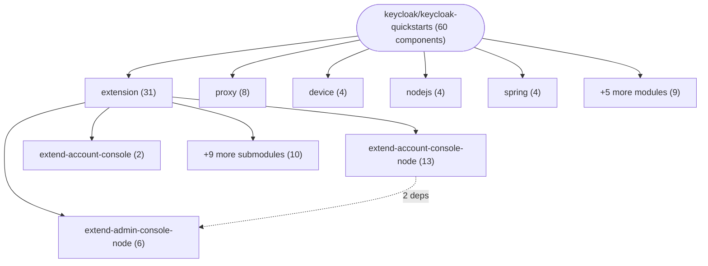
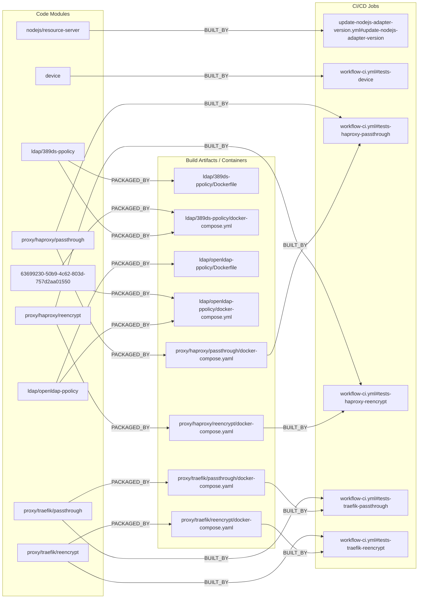
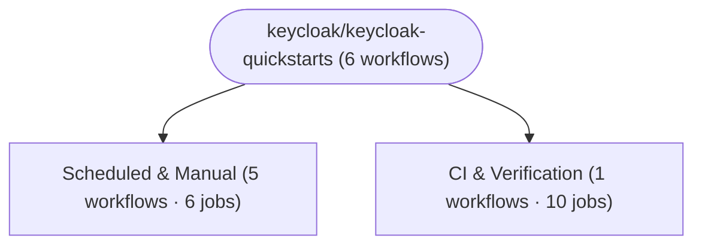

# Repository Architecture Analysis: keycloak/keycloak-quickstarts

## Metadata
- **SHA**: `03002a69bbca820d47bf3f548b36d64dcc96973a`
- **Primary Ecosystem**: Java

## Quality Metrics
- **ast_engine**: tree-sitter
- **avg_cognitive_complexity**: 0.67
- **avg_cyclomatic_complexity**: 1.26
- **component_count**: 60
- **dead_code_count**: 0
- **dead_code_symbols**: 0 entry(ies)
- **duplication_pct**: 72.74
- **file_complexities**: 25 entry(ies)
- **files_analyzed**: 124
- **fitness_passed**: False
- **fitness_violation_count**: 1
- **framework**: Spring Boot
- **import_edges**: 100 entry(ies)
- **loc**: 11027
- **max_cognitive_complexity**: 9
- **max_cyclomatic_complexity**: 7
- **sloc**: 7779
- **test_file_count**: 59

# Architecture: keycloak/keycloak-quickstarts

## Context
- **Repository**: `keycloak/keycloak-quickstarts`
- **SHA**: `03002a69bbca820d47bf3f548b36d64dcc96973a`
- **Ecosystem**: Java
- **Framework**: Spring Boot

## Building Block View

## Component Details
- **device** (`device/pom.xml`): MODULE
- **provider-action-token-authenticator** (`extension/action-token-authenticator/pom.xml`): MODULE
- **provider-action-token-required-action** (`extension/action-token-required-action/pom.xml`): MODULE
- **authenticator-example** (`extension/authenticator/pom.xml`): MODULE
- **event-listener-sysout** (`extension/event-listener-sysout/pom.xml`): MODULE
- **event-store-mem** (`extension/event-store-mem/pom.xml`): MODULE
- **extend-account-console** (`extension/extend-account-console/pom.xml`): MODULE
- **my-account-ui** (`extension/extend-account-console-node/pom.xml`): MODULE
- **extend-admin-console** (`extension/extend-admin-console/pom.xml`): MODULE
- **my-admin-ui** (`extension/extend-admin-console-node/pom.xml`): MODULE
- **extend-admin-ui** (`extension/extend-admin-console-spi/pom.xml`): MODULE
- **keycloak-user-storage-jpa** (`extension/user-storage-jpa/pom.xml`): MODULE
- **keycloak-user-storage-properties** (`extension/user-storage-simple/pom.xml`): MODULE
- **jakarta-jaxrs-resource-server** (`jakarta/jaxrs-resource-server/pom.xml`): MODULE
- **jakarta-servlet-authz-client** (`jakarta/servlet-authz-client/pom.xml`): MODULE
- **servlet-saml-service-provider** (`jakarta/servlet-saml-service-provider/pom.xml`): MODULE
- **keycloak-quickstarts-test-helper** (`misc/keycloak-quickstarts-test-helper/pom.xml`): MODULE
- **keycloak-quickstarts-misc-parent** (`misc/pom.xml`): MODULE
- **keycloak-quickstart-parent** (`pom.xml`): MODULE
- **spring-rest-authz-resource-server** (`spring/rest-authz-resource-server/pom.xml`): MODULE
- **DeviceApplication** (`device/src/main/java/org/keycloak/quickstart/DeviceApplication.java`): CONFIG
- **DeviceController** (`device/src/main/java/org/keycloak/quickstart/DeviceController.java`): API_ROUTE (deps: DeviceFlowService)
- **DeviceFlowService** (`device/src/main/java/org/keycloak/quickstart/DeviceFlowService.java`): SERVICE
- **UserEntity** (`extension/user-storage-jpa/src/main/java/org/keycloak/quickstart/storage/user/UserEntity.java`): DATA_ACCESS_LAYER
- **OAuth2ResourceServerApplication** (`spring/rest-authz-resource-server/src/main/java/org/keycloak/quickstart/OAuth2ResourceServerApplication.java`): CONFIG
- **OAuth2ResourceServerController** (`spring/rest-authz-resource-server/src/main/java/org/keycloak/quickstart/OAuth2ResourceServerController.java`): API_ROUTE
- **OAuth2ResourceServerSecurityConfiguration** (`spring/rest-authz-resource-server/src/main/java/org/keycloak/quickstart/OAuth2ResourceServerSecurityConfiguration.java`): CONFIG
- **keycloak-man** (`extension/extend-account-console/src/main/resources/theme/keycloak-man/account/src/package.json`): MODULE
- **vite-project** (`extension/extend-account-console-node/package.json`): MODULE
- **MyPage** (`extension/extend-account-console-node/src/MyPage.tsx`): UI_COMPONENT
- **PageNav** (`extension/extend-account-console-node/src/PageNav.tsx`): UI_COMPONENT (deps: ApplicationsRoute, DeviceActivityRoute, GroupsRoute, LinkedAccountsRoute, MyPageRoute, PersonalInfoRoute, ResourcesRoute, RootRoute, SigningInRoute)
- **DeviceActivityRoute** (`extension/extend-account-console-node/src/routes.tsx`): UI_COMPONENT (deps: MyPage)
- **LinkedAccountsRoute** (`extension/extend-account-console-node/src/routes.tsx`): UI_COMPONENT (deps: MyPage)
- **SigningInRoute** (`extension/extend-account-console-node/src/routes.tsx`): UI_COMPONENT (deps: MyPage)
- **ApplicationsRoute** (`extension/extend-account-console-node/src/routes.tsx`): UI_COMPONENT (deps: MyPage)
- **GroupsRoute** (`extension/extend-account-console-node/src/routes.tsx`): UI_COMPONENT (deps: MyPage)
- **ResourcesRoute** (`extension/extend-account-console-node/src/routes.tsx`): UI_COMPONENT (deps: MyPage)
- **PersonalInfoRoute** (`extension/extend-account-console-node/src/routes.tsx`): UI_COMPONENT (deps: MyPage)
- **MyPageRoute** (`extension/extend-account-console-node/src/routes.tsx`): UI_COMPONENT (deps: MyPage)
- **RootRoute** (`extension/extend-account-console-node/src/routes.tsx`): UI_COMPONENT (deps: MyPage)
- **vite-project** (`extension/extend-admin-console-node/package.json`): MODULE
- **MyComponent** (`extension/extend-admin-console-node/src/MyComponent.tsx`): UI_COMPONENT
- **PageNav** (`extension/extend-admin-console-node/src/PageNav.tsx`): UI_COMPONENT (deps: ClientsSectionRoute, RootRoute)
- **ClientsSectionRoute** (`extension/extend-admin-console-node/src/routes.tsx`): UI_COMPONENT (deps: MyComponent)
- **RootRoute** (`extension/extend-admin-console-node/src/routes.tsx`): UI_COMPONENT (deps: MyComponent)
- **spa** (`js/spa/package.json`): MODULE
- **docker-compose** (`ldap/389ds-ppolicy/docker-compose.yml`): module
- **docker-compose** (`ldap/openldap-ppolicy/docker-compose.yml`): module
- **keycloak-resource-server** (`nodejs/resource-server/package.json`): MODULE
- **GET_public** (`nodejs/resource-server/app.js`): API_ROUTE
- **GET_secured** (`nodejs/resource-server/app.js`): API_ROUTE
- **GET_admin** (`nodejs/resource-server/app.js`): API_ROUTE
- **docker-compose** (`proxy/haproxy/passthrough/docker-compose.yaml`): module
- **docker-compose** (`proxy/haproxy/reencrypt/docker-compose.yaml`): module
- **docker-compose** (`proxy/traefik/passthrough/docker-compose.yaml`): module
- **keycloak** (`proxy/traefik/passthrough/keycloak.yaml`): module
- **traefik** (`proxy/traefik/passthrough/traefik.yaml`): module
- **docker-compose** (`proxy/traefik/reencrypt/docker-compose.yaml`): module
- **keycloak** (`proxy/traefik/reencrypt/keycloak.yaml`): module
- **traefik** (`proxy/traefik/reencrypt/traefik.yaml`): module

## 6-Dimension Repository Scorecard

- **Overall Grade**: `D` (62.40/100)
- **Technical Debt Score**: 37.60
- **Estimated Remediation Effort**: 69.95h

| Dimension | Grade | Score | Weight | Details |
| :--- | :---: | :---: | :---: | :--- |
| Code Quality | `C` | 75.00 | 0.20 | avg_cc=1.26, max_cc=7, duplication=72.74%, dead_code=0 |
| Dependency Health | `A` | 100.00 | 0.15 | dependencies=917, outdated=0, vulnerable=0, has_lockfile=True |
| Maintainability | `B` | 89.00 | 0.15 | avg_cognitive=0.67, max_cognitive=9, fitness_violations=1, oversized_files=1 |
| Pipeline Health | `F` | 57.00 | 0.15 | workflows=6, operational_antipatterns=16, parallel_branches=True |
| Security | `F` | 0.00 | 0.20 | vulnerabilities=0, secrets=8, pipeline_security_findings=12 |
| Test Coverage | `C` | 70.00 | 0.15 | coverage=unavailable, ci_test_job=True, test_files_detected=True |

## Architecture Fitness & Workspace Boundaries

- **[MEDIUM] `ATRUSS-ARCH-005` (COMPLEXITY_THRESHOLD)**: Repository duplication_pct (72.74) exceeds policy threshold (15.0).

## Supply Chain Dependencies, Vulnerabilities & Secrets

- **Dependencies Parsed**: 917 | **Vulnerabilities**: 0 | **Secrets**: 8

### Secret Findings (Redacted)
- **[HIGH] `ATRUSS-SEC-005`** at `extension/action-token-authenticator/src/main/webapp/submit-back.jsp:9` (`String secret = "aSqz***REDACTED***";`)
- **[HIGH] `ATRUSS-SEC-005`** at `extension/action-token-required-action/src/main/webapp/submit-back.jsp:9` (`String secret = "aSqz***REDACTED***";`)
- **[HIGH] `ATRUSS-SEC-005`** at `extension/user-storage-jpa/src/test/resources/quickstart-realm.json:11` (`"privateKey": "MIIC***REDACTED***",`)
- **[HIGH] `ATRUSS-SEC-005`** at `extension/user-storage-jpa/src/test/resources/quickstart-realm.json:12` (`"publicKey": "MIGf***REDACTED***",`)
- **[HIGH] `ATRUSS-SEC-005`** at `extension/user-storage-simple/src/test/resources/quickstart-realm.json:11` (`"privateKey": "MIIC***REDACTED***",`)
- **[HIGH] `ATRUSS-SEC-005`** at `extension/user-storage-simple/src/test/resources/quickstart-realm.json:12` (`"publicKey": "MIGf***REDACTED***",`)
- **[HIGH] `ATRUSS-SEC-005`** at `jakarta/servlet-saml-service-provider/config/realm-import.json:54` (`"saml.signing.private.key": "MIIE***REDACTED***",`)
- **[HIGH] `ATRUSS-SEC-005`** at `jakarta/servlet-saml-service-provider/src/test/resources/quickstart-realm.json:54` (`"saml.signing.private.key": "MIIE***REDACTED***",`)

### Inventory Sample
- `com.fasterxml.jackson.core:jackson-core` `*` (Maven, `jakarta/servlet-authz-client/pom.xml`)
- `com.fasterxml.jackson.core:jackson-databind` `*` (Maven, `jakarta/servlet-authz-client/pom.xml`)
- `jakarta.servlet.jsp.jstl:jakarta.servlet.jsp.jstl-api` `3.0.0` (Maven, `jakarta/servlet-saml-service-provider/pom.xml`)
- `jakarta.servlet:jakarta.servlet-api` `6.0.0` (Maven, `jakarta/servlet-authz-client/pom.xml`)
- `jakarta.servlet:jakarta.servlet-api` `6.0.0` (Maven, `jakarta/servlet-saml-service-provider/pom.xml`)
- `jakarta.ws.rs:jakarta.ws.rs-api` `*` (Maven, `jakarta/jaxrs-resource-server/pom.xml`)
- `javax.xml.bind:jaxb-api` `*` (Maven, `extension/action-token-authenticator/pom.xml`)
- `javax.xml.bind:jaxb-api` `*` (Maven, `extension/action-token-required-action/pom.xml`)
- `javax.xml.bind:jaxb-api` `*` (Maven, `extension/event-listener-sysout/pom.xml`)
- `javax.xml.bind:jaxb-api` `*` (Maven, `extension/event-store-mem/pom.xml`)
- `javax.xml.bind:jaxb-api` `*` (Maven, `extension/user-storage-jpa/pom.xml`)
- `javax.xml.bind:jaxb-api` `*` (Maven, `extension/user-storage-simple/pom.xml`)
- `org.hamcrest:hamcrest-all` `*` (Maven, `extension/action-token-authenticator/pom.xml`)
- `org.hamcrest:hamcrest-all` `*` (Maven, `extension/action-token-required-action/pom.xml`)
- `org.hamcrest:hamcrest-all` `*` (Maven, `extension/event-listener-sysout/pom.xml`)
- `org.hamcrest:hamcrest-all` `*` (Maven, `extension/event-store-mem/pom.xml`)
- `org.jboss.arquillian.extension:arquillian-drone-webdriver` `*` (Maven, `jakarta/servlet-authz-client/pom.xml`)
- `org.jboss.arquillian.graphene:arquillian-browser-screenshooter` `*` (Maven, `extension/action-token-authenticator/pom.xml`)
- `org.jboss.arquillian.graphene:arquillian-browser-screenshooter` `*` (Maven, `extension/action-token-required-action/pom.xml`)
- `org.jboss.arquillian.graphene:arquillian-browser-screenshooter` `*` (Maven, `extension/event-listener-sysout/pom.xml`)
- `org.jboss.arquillian.graphene:arquillian-browser-screenshooter` `*` (Maven, `extension/event-store-mem/pom.xml`)
- `org.jboss.arquillian.graphene:arquillian-browser-screenshooter` `*` (Maven, `extension/user-storage-simple/pom.xml`)
- `org.jboss.arquillian.graphene:graphene-webdriver` `*` (Maven, `extension/action-token-authenticator/pom.xml`)
- `org.jboss.arquillian.graphene:graphene-webdriver` `*` (Maven, `extension/action-token-required-action/pom.xml`)
- `org.jboss.arquillian.graphene:graphene-webdriver` `*` (Maven, `extension/event-listener-sysout/pom.xml`)
- `org.jboss.arquillian.graphene:graphene-webdriver` `*` (Maven, `extension/event-store-mem/pom.xml`)
- `org.jboss.arquillian.graphene:graphene-webdriver` `*` (Maven, `extension/extend-account-console/pom.xml`)
- `org.jboss.arquillian.graphene:graphene-webdriver` `*` (Maven, `extension/extend-admin-console-spi/pom.xml`)
- `org.jboss.arquillian.graphene:graphene-webdriver` `*` (Maven, `extension/user-storage-jpa/pom.xml`)
- `org.jboss.arquillian.graphene:graphene-webdriver` `*` (Maven, `extension/user-storage-simple/pom.xml`)
- ... (+887 more dependencies)

## Section 7: Code-to-Cloud Deployment Traceability

- `63699230-50b9-4c62-803d-757d2aa01550` (code_module) --[PACKAGED_BY]--> `ldap/389ds-ppolicy/docker-compose.yml` (container)
- `63699230-50b9-4c62-803d-757d2aa01550` (code_module) --[PACKAGED_BY]--> `ldap/openldap-ppolicy/docker-compose.yml` (container)
- `device` (code_module) --[BUILT_BY]--> `workflow-ci.yml#tests-device` (ci_job)
- `ldap/389ds-ppolicy` (code_module) --[PACKAGED_BY]--> `ldap/389ds-ppolicy/Dockerfile` (container)
- `ldap/389ds-ppolicy` (code_module) --[PACKAGED_BY]--> `ldap/389ds-ppolicy/docker-compose.yml` (container)
- `ldap/openldap-ppolicy` (code_module) --[PACKAGED_BY]--> `ldap/openldap-ppolicy/Dockerfile` (container)
- `ldap/openldap-ppolicy` (code_module) --[PACKAGED_BY]--> `ldap/openldap-ppolicy/docker-compose.yml` (container)
- `nodejs/resource-server` (code_module) --[BUILT_BY]--> `update-nodejs-adapter-version.yml#update-nodejs-adapter-version` (ci_job)
- `proxy/haproxy/passthrough` (code_module) --[BUILT_BY]--> `workflow-ci.yml#tests-haproxy-passthrough` (ci_job)
- `proxy/haproxy/passthrough` (code_module) --[PACKAGED_BY]--> `proxy/haproxy/passthrough/docker-compose.yaml` (container)
- `proxy/haproxy/reencrypt` (code_module) --[BUILT_BY]--> `workflow-ci.yml#tests-haproxy-reencrypt` (ci_job)
- `proxy/haproxy/reencrypt` (code_module) --[PACKAGED_BY]--> `proxy/haproxy/reencrypt/docker-compose.yaml` (container)
- `proxy/traefik/passthrough` (code_module) --[BUILT_BY]--> `workflow-ci.yml#tests-traefik-passthrough` (ci_job)
- `proxy/traefik/passthrough` (code_module) --[PACKAGED_BY]--> `proxy/traefik/passthrough/docker-compose.yaml` (container)
- `proxy/traefik/reencrypt` (code_module) --[BUILT_BY]--> `workflow-ci.yml#tests-traefik-reencrypt` (ci_job)
- `proxy/traefik/reencrypt` (code_module) --[PACKAGED_BY]--> `proxy/traefik/reencrypt/docker-compose.yaml` (container)
- `proxy/haproxy/passthrough/docker-compose.yaml` (container) --[BUILT_BY]--> `workflow-ci.yml#tests-haproxy-passthrough` (ci_job)
- `proxy/haproxy/reencrypt/docker-compose.yaml` (container) --[BUILT_BY]--> `workflow-ci.yml#tests-haproxy-reencrypt` (ci_job)
- `proxy/traefik/passthrough/docker-compose.yaml` (container) --[BUILT_BY]--> `workflow-ci.yml#tests-traefik-passthrough` (ci_job)
- `proxy/traefik/reencrypt/docker-compose.yaml` (container) --[BUILT_BY]--> `workflow-ci.yml#tests-traefik-reencrypt` (ci_job)

## CI/CD Pipeline Topology

