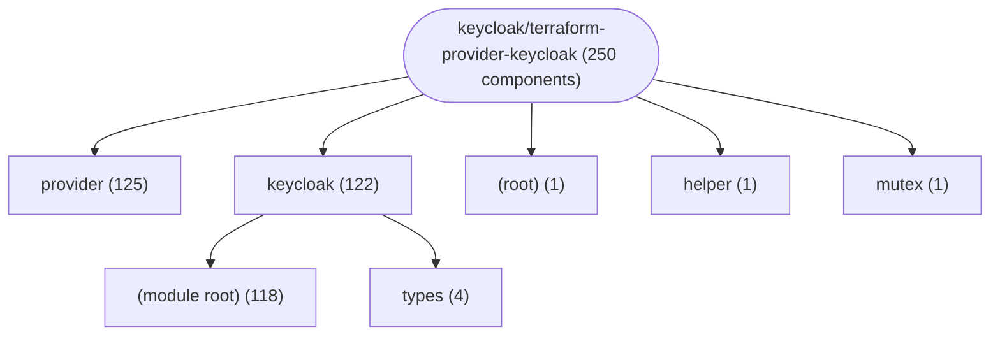
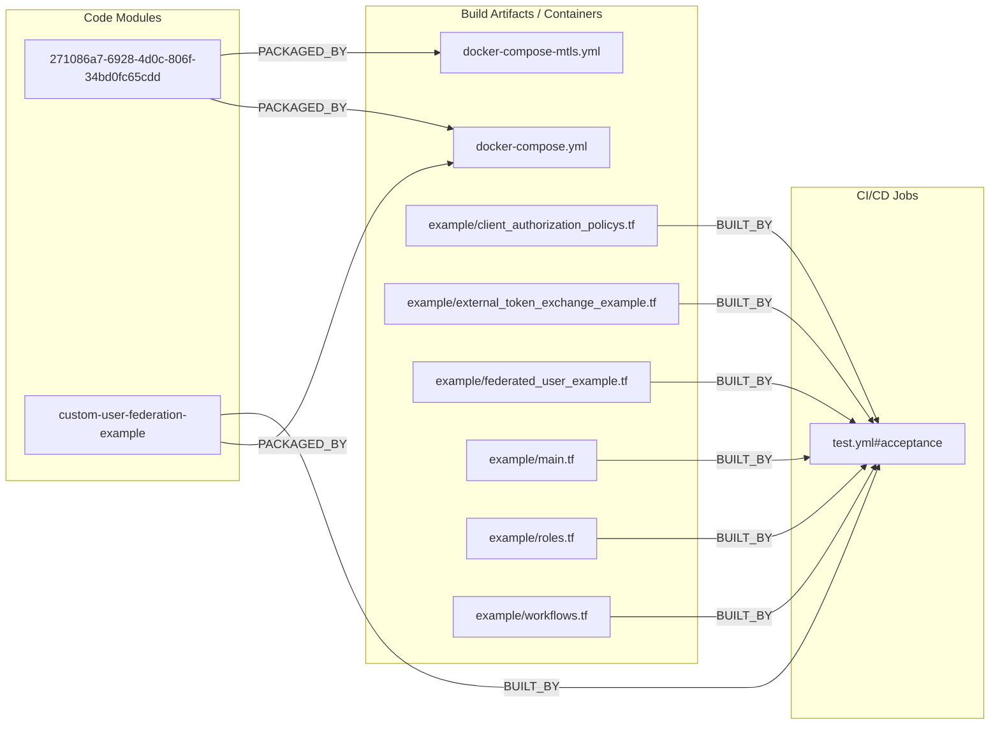
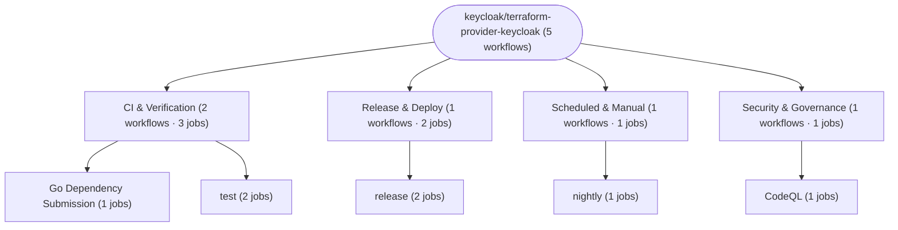

# Repository Architecture Analysis: keycloak/terraform-provider-keycloak

## Metadata
- **SHA**: `517b552af3c776d1a55533751f8310c6348c4b7b`
- **Primary Ecosystem**: Go

## Quality Metrics
- **ast_engine**: fallback
- **avg_cognitive_complexity**: 1.57
- **avg_cyclomatic_complexity**: 3.86
- **component_count**: 250
- **dead_code_count**: 0
- **dead_code_symbols**: 0 entry(ies)
- **duplication_pct**: 0.08
- **file_complexities**: 7 entry(ies)
- **files_analyzed**: 433
- **fitness_passed**: True
- **fitness_violation_count**: 0
- **framework**: Go Service
- **import_edges**: 0 entry(ies)
- **loc**: 98182
- **max_cognitive_complexity**: 9
- **max_cyclomatic_complexity**: 11
- **sloc**: 82969
- **test_file_count**: 172

# Architecture: keycloak/terraform-provider-keycloak

## Context
- **Repository**: `keycloak/terraform-provider-keycloak`
- **SHA**: `517b552af3c776d1a55533751f8310c6348c4b7b`
- **Ecosystem**: Go
- **Framework**: Go Service

## Building Block View

## Component Details

Showing top 60 representative components out of 250 across 5 module group(s):

- **Module `provider`** (125 components — module: 125)
- **Module `keycloak`** (122 components — module: 122)
- **Module `(root)`** (1 components — module: 1)
- **Module `helper`** (1 components — module: 1)
- **Module `mutex`** (1 components — module: 1)

- **authentication_execution** (`keycloak/authentication_execution.go`): module
- **authentication_execution_config** (`keycloak/authentication_execution_config.go`): module
- **authentication_execution_delete_test** (`keycloak/authentication_execution_delete_test.go`): module
- **authentication_flow** (`keycloak/authentication_flow.go`): module
- **authentication_subflow** (`keycloak/authentication_subflow.go`): module
- **client_scope_consent** (`provider/client_scope_consent.go`): module
- **component** (`keycloak/component.go`): module
- **custom_identity_provider_mapper** (`keycloak/custom_identity_provider_mapper.go`): module
- **custom_user_federation** (`keycloak/custom_user_federation.go`): module
- **custom_user_federation_test** (`keycloak/custom_user_federation_test.go`): module
- **data_source_keycloak_authentication_execution** (`provider/data_source_keycloak_authentication_execution.go`): module
- **data_source_keycloak_authentication_execution_test** (`provider/data_source_keycloak_authentication_execution_test.go`): module
- **data_source_keycloak_authentication_flow** (`provider/data_source_keycloak_authentication_flow.go`): module
- **data_source_keycloak_authentication_flow_test** (`provider/data_source_keycloak_authentication_flow_test.go`): module
- **data_source_keycloak_authentication_subflow** (`provider/data_source_keycloak_authentication_subflow.go`): module
- **data_source_keycloak_authentication_subflow_test** (`provider/data_source_keycloak_authentication_subflow_test.go`): module
- **data_source_keycloak_client_description_converter** (`provider/data_source_keycloak_client_description_converter.go`): module
- **data_source_keycloak_client_description_converter_test** (`provider/data_source_keycloak_client_description_converter_test.go`): module
- **data_source_keycloak_generic_protocol_mapper** (`provider/data_source_keycloak_generic_protocol_mapper.go`): module
- **data_source_keycloak_generic_protocol_mapper_test** (`provider/data_source_keycloak_generic_protocol_mapper_test.go`): module
- **data_source_keycloak_group** (`provider/data_source_keycloak_group.go`): module
- **data_source_keycloak_group_test** (`provider/data_source_keycloak_group_test.go`): module
- **data_source_keycloak_openid_client** (`provider/data_source_keycloak_openid_client.go`): module
- **data_source_keycloak_openid_client_authorization_policy** (`provider/data_source_keycloak_openid_client_authorization_policy.go`): module
- **data_source_keycloak_openid_client_authorization_policy_test** (`provider/data_source_keycloak_openid_client_authorization_policy_test.go`): module
- **data_source_keycloak_openid_client_authorization_scope** (`provider/data_source_keycloak_openid_client_authorization_scope.go`): module
- **data_source_keycloak_openid_client_authorization_scope_test** (`provider/data_source_keycloak_openid_client_authorization_scope_test.go`): module
- **data_source_keycloak_openid_client_scope** (`provider/data_source_keycloak_openid_client_scope.go`): module
- **data_source_keycloak_openid_client_scope_test** (`provider/data_source_keycloak_openid_client_scope_test.go`): module
- **data_source_keycloak_openid_client_service_account_user** (`provider/data_source_keycloak_openid_client_service_account_user.go`): module
- **data_source_keycloak_openid_client_service_account_user_test** (`provider/data_source_keycloak_openid_client_service_account_user_test.go`): module
- **data_source_keycloak_openid_client_test** (`provider/data_source_keycloak_openid_client_test.go`): module
- **data_source_keycloak_organization** (`provider/data_source_keycloak_organization.go`): module
- **data_source_keycloak_organization_test** (`provider/data_source_keycloak_organization_test.go`): module
- **data_source_keycloak_realm** (`provider/data_source_keycloak_realm.go`): module
- **data_source_keycloak_realm_client_registration_policy** (`provider/data_source_keycloak_realm_client_registration_policy.go`): module
- **data_source_keycloak_realm_client_registration_policy_test** (`provider/data_source_keycloak_realm_client_registration_policy_test.go`): module
- **data_source_keycloak_realm_keys** (`provider/data_source_keycloak_realm_keys.go`): module
- **data_source_keycloak_realm_keys_test** (`provider/data_source_keycloak_realm_keys_test.go`): module
- **data_source_keycloak_realm_test** (`provider/data_source_keycloak_realm_test.go`): module
- **data_source_keycloak_role** (`provider/data_source_keycloak_role.go`): module
- **data_source_keycloak_role_test** (`provider/data_source_keycloak_role_test.go`): module
- **data_source_keycloak_saml_client** (`provider/data_source_keycloak_saml_client.go`): module
- **data_source_keycloak_saml_client_installation_provider** (`provider/data_source_keycloak_saml_client_installation_provider.go`): module
- **data_source_keycloak_saml_client_installation_provider_test** (`provider/data_source_keycloak_saml_client_installation_provider_test.go`): module
- **data_source_keycloak_saml_client_scope** (`provider/data_source_keycloak_saml_client_scope.go`): module
- **data_source_keycloak_saml_client_scope_test** (`provider/data_source_keycloak_saml_client_scope_test.go`): module
- **data_source_keycloak_saml_client_test** (`provider/data_source_keycloak_saml_client_test.go`): module
- **data_source_keycloak_user** (`provider/data_source_keycloak_user.go`): module
- **data_source_keycloak_user_realm_roles** (`provider/data_source_keycloak_user_realm_roles.go`): module
- **data_source_keycloak_user_realm_roles_test** (`provider/data_source_keycloak_user_realm_roles_test.go`): module
- **data_source_keycloak_user_test** (`provider/data_source_keycloak_user_test.go`): module
- **data_source_keycloak_workflow** (`provider/data_source_keycloak_workflow.go`): module
- **default_roles** (`keycloak/default_roles.go`): module
- **diff_suppress_test** (`provider/diff_suppress_test.go`): module
- **error** (`keycloak/error.go`): module
- **error_test** (`keycloak/error_test.go`): module
- **extra_config** (`keycloak/extra_config.go`): module
- **extra_config** (`provider/extra_config.go`): module
- **fgap_permissions** (`keycloak/fgap_permissions.go`): module

## 6-Dimension Repository Scorecard

- **Overall Grade**: `D` (68.49/100)
- **Technical Debt Score**: 31.51
- **Estimated Remediation Effort**: 47.39h

| Dimension | Grade | Score | Weight | Details |
| :--- | :---: | :---: | :---: | :--- |
| Code Quality | `A` | 96.44 | 0.20 | avg_cc=3.86, max_cc=11, duplication=0.08%, dead_code=0 |
| Dependency Health | `B` | 85.00 | 0.15 | dependencies=57, outdated=0, vulnerable=0, has_lockfile=False |
| Maintainability | `A` | 100.00 | 0.15 | avg_cognitive=1.57, max_cognitive=9, fitness_violations=0, oversized_files=0 |
| Pipeline Health | `C` | 73.00 | 0.15 | workflows=5, operational_antipatterns=8, parallel_branches=False |
| Security | `F` | 0.00 | 0.20 | vulnerabilities=0, secrets=11, pipeline_security_findings=8 |
| Test Coverage | `C` | 70.00 | 0.15 | coverage=unavailable, ci_test_job=True, test_files_detected=True |

## Supply Chain Dependencies, Vulnerabilities & Secrets

- **Dependencies Parsed**: 57 | **Vulnerabilities**: 0 | **Secrets**: 11

### Secret Findings (Redacted)
- **[CRITICAL] `ATRUSS-SEC-004`** at `.github/workflows/test.yml:222` (`-----BEGIN ... PRIVATE KEY----- [REDACTED]`)
- **[CRITICAL] `ATRUSS-SEC-004`** at `provider/provider_signed_jwt_test.go:15` (`-----BEGIN ... PRIVATE KEY----- [REDACTED]`)
- **[CRITICAL] `ATRUSS-SEC-004`** at `provider/resource_keycloak_realm_keystore_rsa_test.go:545` (`-----BEGIN ... PRIVATE KEY----- [REDACTED]`)
- **[CRITICAL] `ATRUSS-SEC-004`** at `provider/resource_keycloak_saml_client.go:333` (`-----BEGIN ... PRIVATE KEY----- [REDACTED]`)
- **[CRITICAL] `ATRUSS-SEC-004`** at `provider/resource_keycloak_saml_client_test.go:643` (`-----BEGIN ... PRIVATE KEY----- [REDACTED]`)
- **[CRITICAL] `ATRUSS-SEC-004`** at `provider/testdata/saml-key.pem:1` (`-----BEGIN ... PRIVATE KEY----- [REDACTED]`)
- **[CRITICAL] `ATRUSS-SEC-004`** at `provider/testdata/tls/ca-key.pem:1` (`-----BEGIN ... PRIVATE KEY----- [REDACTED]`)
- **[CRITICAL] `ATRUSS-SEC-004`** at `provider/testdata/tls/client-key.pem:1` (`-----BEGIN ... PRIVATE KEY----- [REDACTED]`)
- **[CRITICAL] `ATRUSS-SEC-004`** at `provider/testdata/tls/server-key.pem:1` (`-----BEGIN ... PRIVATE KEY----- [REDACTED]`)
- **[CRITICAL] `ATRUSS-SEC-004`** at `provider/testdata/tls/untrusted-client-key.pem:1` (`-----BEGIN ... PRIVATE KEY----- [REDACTED]`)
- **[HIGH] `ATRUSS-SEC-005`** at `scripts/create-terraform-client.sh:11` (`KEYCLOAK_CLIENT_PUBLIC_CERT="MIIC***REDACTED***"`)

### Inventory Sample
- `org.keycloak:keycloak-model-storage` `26.8.2` (Maven, `custom-user-federation-example/build.gradle`)
- `org.keycloak:keycloak-services` `26.8.2` (Maven, `custom-user-federation-example/build.gradle`)
- `dario.cat/mergo` `1.0.2` (golang, `go.mod`)
- `github.com/golang-jwt/jwt/v5` `5.3.1` (golang, `go.mod`)
- `github.com/hashicorp/errwrap` `1.1.0` (golang, `go.mod`)
- `github.com/hashicorp/go-cty` `1.5.0` (golang, `go.mod`)
- `github.com/hashicorp/go-retryablehttp` `0.7.8` (golang, `go.mod`)
- `github.com/hashicorp/go-uuid` `1.0.4` (golang, `go.mod`)
- `github.com/hashicorp/go-version` `1.9.0` (golang, `go.mod`)
- `github.com/hashicorp/terraform-plugin-go` `0.31.0` (golang, `go.mod`)
- `github.com/hashicorp/terraform-plugin-log` `0.11.0` (golang, `go.mod`)
- `github.com/hashicorp/terraform-plugin-sdk/v2` `2.40.1` (golang, `go.mod`)
- `github.com/hashicorp/terraform-plugin-testing` `1.16.0` (golang, `go.mod`)
- `golang.org/x/net` `0.62.0` (golang, `go.mod`)
- `github.com/ProtonMail/go-crypto` `1.4.1` (golang, `go.mod`)
- `github.com/agext/levenshtein` `1.2.3` (golang, `go.mod`)
- `github.com/apparentlymart/go-textseg/v15` `15.0.0` (golang, `go.mod`)
- `github.com/apparentlymart/go-textseg/v17` `17.0.1` (golang, `go.mod`)
- `github.com/cloudflare/circl` `1.6.3` (golang, `go.mod`)
- `github.com/fatih/color` `1.19.0` (golang, `go.mod`)
- `github.com/golang/protobuf` `1.5.4` (golang, `go.mod`)
- `github.com/google/go-cmp` `0.7.0` (golang, `go.mod`)
- `github.com/hashicorp/go-checkpoint` `0.5.0` (golang, `go.mod`)
- `github.com/hashicorp/go-cleanhttp` `0.5.2` (golang, `go.mod`)
- `github.com/hashicorp/go-hclog` `1.6.3` (golang, `go.mod`)
- `github.com/hashicorp/go-multierror` `1.1.1` (golang, `go.mod`)
- `github.com/hashicorp/go-plugin` `1.8.0` (golang, `go.mod`)
- `github.com/hashicorp/hc-install` `0.9.5` (golang, `go.mod`)
- `github.com/hashicorp/hcl/v2` `2.24.0` (golang, `go.mod`)
- `github.com/hashicorp/logutils` `1.0.0` (golang, `go.mod`)
- ... (+27 more dependencies)

## Section 7: Code-to-Cloud Deployment Traceability

- `271086a7-6928-4d0c-806f-34bd0fc65cdd` (code_module) --[PACKAGED_BY]--> `docker-compose-mtls.yml` (container)
- `271086a7-6928-4d0c-806f-34bd0fc65cdd` (code_module) --[PACKAGED_BY]--> `docker-compose.yml` (container)
- `custom-user-federation-example` (code_module) --[BUILT_BY]--> `test.yml#acceptance` (ci_job)
- `custom-user-federation-example` (code_module) --[PACKAGED_BY]--> `docker-compose.yml` (container)
- `example/client_authorization_policys.tf` (iac) --[BUILT_BY]--> `test.yml#acceptance` (ci_job)
- `example/external_token_exchange_example.tf` (iac) --[BUILT_BY]--> `test.yml#acceptance` (ci_job)
- `example/federated_user_example.tf` (iac) --[BUILT_BY]--> `test.yml#acceptance` (ci_job)
- `example/main.tf` (iac) --[BUILT_BY]--> `test.yml#acceptance` (ci_job)
- `example/roles.tf` (iac) --[BUILT_BY]--> `test.yml#acceptance` (ci_job)
- `example/workflows.tf` (iac) --[BUILT_BY]--> `test.yml#acceptance` (ci_job)

## CI/CD Pipeline Topology

