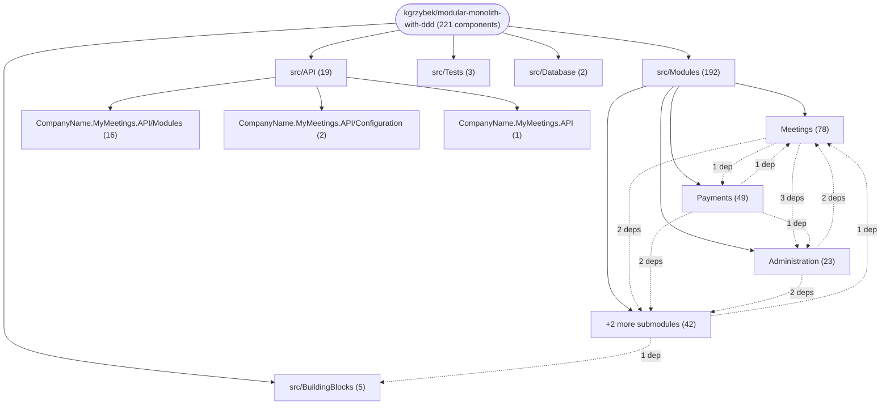

# Repository Architecture Analysis: kgrzybek/modular-monolith-with-ddd

## Metadata
- **SHA**: `91c8ef24b4cb6ef558c95d8267fa07d68c7059f8`
- **Primary Ecosystem**: .NET

## Quality Metrics
- **avg_cyclomatic_complexity**: 2.39
- **component_count**: 221
- **files_analyzed**: 2112
- **framework**: ASP.NET Core
- **loc**: 75754
- **max_cyclomatic_complexity**: 19
- **sloc**: 63534

# Architecture: kgrzybek/modular-monolith-with-ddd

## Context
- **Repository**: `kgrzybek/modular-monolith-with-ddd`
- **SHA**: `91c8ef24b4cb6ef558c95d8267fa07d68c7059f8`
- **Ecosystem**: .NET
- **Framework**: Unknown

## Building Block View

## Component Details

Showing top 60 representative components out of 221 across 5 module group(s):

- **Module `src/Modules`** (192 components — SERVICE: 141, MODULE: 35, DATA_ACCESS_LAYER: 16)
- **Module `src/API`** (19 components — API_ROUTE: 16, SERVICE: 2, MODULE: 1)
- **Module `src/BuildingBlocks`** (5 components — MODULE: 5)
- **Module `src/Tests`** (3 components — MODULE: 3)
- **Module `src/Database`** (2 components — MODULE: 2)

- **AddMeetingCommentCommandHandler** (`src/Modules/Meetings/Application/MeetingComments/AddMeetingComment/AddMeetingCommentCommandHandler.cs`): SERVICE (deps: MeetingCommentRepository, MeetingCommentingConfigurationRepository, MeetingGroupRepository, MeetingRepository)
- **AddReplyToMeetingCommentCommandHandler** (`src/Modules/Meetings/Application/MeetingComments/AddMeetingCommentReply/AddReplyToMeetingCommentCommandHandler.cs`): SERVICE (deps: MeetingCommentRepository, MeetingCommentingConfigurationRepository, MeetingGroupRepository, MeetingRepository)
- **CompanyName.MyMeetings.Modules.Meetings.Application** (`src/Modules/Meetings/Application/CompanyName.MyMeetings.Modules.Meetings.Application.csproj`): MODULE (deps: CompanyName.MyMeetings.Modules.Administration.IntegrationEvents, CompanyName.MyMeetings.Modules.Payments.IntegrationEvents, CompanyName.MyMeetings.Modules.Registrations.IntegrationEvents, CompanyName.MyMeetings.Modules.UserAccess.IntegrationEvents)
- **CompanyName.MyMeetings.Modules.Payments.Application** (`src/Modules/Payments/Application/CompanyName.MyMeetings.Modules.Payments.Application.csproj`): MODULE (deps: CompanyName.MyMeetings.Modules.Administration.IntegrationEvents, CompanyName.MyMeetings.Modules.Meetings.IntegrationEvents, CompanyName.MyMeetings.Modules.Registrations.IntegrationEvents, CompanyName.MyMeetings.Modules.UserAccess.IntegrationEvents)
- **CompanyName.MyMeetings.Modules.Administration.Application** (`src/Modules/Administration/Application/CompanyName.MyMeetings.Modules.Administration.Application.csproj`): MODULE (deps: CompanyName.MyMeetings.Modules.Meetings.IntegrationEvents, CompanyName.MyMeetings.Modules.Registrations.IntegrationEvents, CompanyName.MyMeetings.Modules.UserAccess.IntegrationEvents)
- **DisableMeetingCommentingConfigurationCommandHandler** (`src/Modules/Meetings/Application/MeetingCommentingConfigurations/DisableMeetingCommentingConfiguration/DisableMeetingCommentingConfigurationCommandHandler.cs`): SERVICE (deps: MeetingCommentingConfigurationRepository, MeetingGroupRepository, MeetingRepository)
- **EnableMeetingCommentingConfigurationCommandHandler** (`src/Modules/Meetings/Application/MeetingCommentingConfigurations/EnableMeetingCommentingConfiguration/EnableMeetingCommentingConfigurationCommandHandler.cs`): SERVICE (deps: MeetingCommentingConfigurationRepository, MeetingGroupRepository, MeetingRepository)
- **RemoveMeetingCommentCommandHandler** (`src/Modules/Meetings/Application/MeetingComments/RemoveMeetingComment/RemoveMeetingCommentCommandHandler.cs`): SERVICE (deps: MeetingCommentRepository, MeetingGroupRepository, MeetingRepository)
- **AddMeetingAttendeeCommandHandler** (`src/Modules/Meetings/Application/Meetings/AddMeetingAttendee/AddMeetingAttendeeCommandHandler.cs`): SERVICE (deps: MeetingGroupRepository, MeetingRepository)
- **CompanyName.MyMeetings.Modules.Registrations.Infrastructure** (`src/Modules/Registrations/Infrastructure/CompanyName.MyMeetings.Modules.Registrations.Infrastructure.csproj`): MODULE (deps: CompanyName.MyMeetings.Modules.UserAccess.Application, CompanyName.MyMeetings.Modules.UserAccess.Infrastructure)
- **CreateMeetingCommandHandler** (`src/Modules/Meetings/Application/Meetings/CreateMeeting/CreateMeetingCommandHandler.cs`): SERVICE (deps: MeetingGroupRepository, MeetingRepository)
- **CreateNewMeetingGroupCommandHandler** (`src/Modules/Meetings/Application/MeetingGroups/CreateNewMeetingGroup/CreateNewMeetingGroupCommandHandler.cs`): SERVICE (deps: MeetingGroupProposalRepository, MeetingGroupRepository)
- **EditMeetingCommentCommandHandler** (`src/Modules/Meetings/Application/MeetingComments/EditMeetingComment/EditMeetingCommentCommandHandler.cs`): SERVICE (deps: MeetingCommentRepository, MeetingCommentingConfigurationRepository)
- **MeetingCreatedEventHandler** (`src/Modules/Meetings/Application/MeetingCommentingConfigurations/MeetingCreatedEventHandler.cs`): SERVICE (deps: MeetingCommentingConfigurationRepository, MeetingRepository)
- **SetMeetingAttendeeRoleCommandHandler** (`src/Modules/Meetings/Application/Meetings/SetMeetingAttendeeRole/SetMeetingAttendeeRoleCommandHandler.cs`): SERVICE (deps: MeetingGroupRepository, MeetingRepository)
- **SetMeetingHostRoleCommandHandler** (`src/Modules/Meetings/Application/Meetings/SetMeetingHostRole/SetMeetingHostRoleCommandHandler.cs`): SERVICE (deps: MeetingGroupRepository, MeetingRepository)
- **SignUpMemberToWaitlistCommandHandler** (`src/Modules/Meetings/Application/Meetings/SignUpMemberToWaitlist/SignUpMemberToWaitlistCommandHandler.cs`): SERVICE (deps: MeetingGroupRepository, MeetingRepository)
- **AcceptMeetingGroupProposalCommandHandler** (`src/Modules/Administration/Application/MeetingGroupProposals/AcceptMeetingGroupProposal/AcceptMeetingGroupProposalCommandHandler.cs`): SERVICE (deps: MeetingGroupProposalRepository)
- **AcceptMeetingGroupProposalCommandHandler** (`src/Modules/Meetings/Application/MeetingGroupProposals/AcceptMeetingGroupProposal/AcceptMeetingGroupProposalCommandHandler.cs`): SERVICE (deps: MeetingGroupProposalRepository)
- **AddAdminUserCommandHandler** (`src/Modules/UserAccess/Application/Users/AddAdminUser/AddAdminUserCommandHandler.cs`): SERVICE (deps: UserRepository)
- **AddMeetingCommentLikeCommandHandler** (`src/Modules/Meetings/Application/MeetingComments/AddMeetingCommentLike/AddMeetingCommentLikeCommandHandler.cs`): SERVICE (deps: MeetingCommentRepository)
- **AddMeetingNotAttendeeCommandHandler** (`src/Modules/Meetings/Application/Meetings/AddMeetingNotAttendee/AddMeetingNotAttendeeCommandHandler.cs`): SERVICE (deps: MeetingRepository)
- **CancelMeetingCommandHandler** (`src/Modules/Meetings/Application/Meetings/CancelMeeting/CancelMeetingCommandHandler.cs`): SERVICE (deps: MeetingRepository)
- **ChangeMeetingMainAttributesCommandHandler** (`src/Modules/Meetings/Application/Meetings/ChangeMeetingMainAttributes/ChangeMeetingMainAttributesCommandHandler.cs`): SERVICE (deps: MeetingRepository)
- **ChangeNotAttendeeDecisionCommandHandler** (`src/Modules/Meetings/Application/Meetings/ChangeNotAttendeeDecision/ChangeNotAttendeeDecisionCommandHandler.cs`): SERVICE (deps: MeetingRepository)
- **ChangeSubscriptionExpirationDateForMemberCommandHandler** (`src/Modules/Meetings/Application/MemberSubscriptions/ChangeSubscriptionExpirationDateForMember/ChangeSubscriptionExpirationDateForMemberCommandHandler.cs`): SERVICE (deps: MemberSubscriptionRepository)
- **CompanyName.MyMeetings.Modules.Registrations.Application** (`src/Modules/Registrations/Application/CompanyName.MyMeetings.Modules.Registrations.Application.csproj`): MODULE (deps: CompanyName.MyMeetings.BuildingBlocks.Application)
- **CompanyName.MyMeetings.Modules.UserAccess.Application** (`src/Modules/UserAccess/Application/CompanyName.MyMeetings.Modules.UserAccess.Application.csproj`): MODULE (deps: CompanyName.MyMeetings.Modules.Meetings.IntegrationEvents)
- **ConfirmUserRegistrationCommandHandler** (`src/Modules/Registrations/Application/UserRegistrations/ConfirmUserRegistration/ConfirmUserRegistrationCommandHandler.cs`): SERVICE (deps: UserRegistrationRepository)
- **CreateMemberCommandHandler** (`src/Modules/Administration/Application/Members/CreateMember/CreateMemberCommandHandler.cs`): SERVICE (deps: MemberRepository)
- **CreateMemberCommandHandler** (`src/Modules/Meetings/Application/Members/CreateMember/CreateMemberCommandHandler.cs`): SERVICE (deps: MemberRepository)
- **CreateUserCommandHandler** (`src/Modules/UserAccess/Application/Users/CreateUser/CreateUserCommandHandler.cs`): SERVICE (deps: UserRepository)
- **EditMeetingGroupGeneralAttributesCommandHandler** (`src/Modules/Meetings/Application/MeetingGroups/EditMeetingGroupGeneralAttributes/EditMeetingGroupGeneralAttributesCommandHandler.cs`): SERVICE (deps: MeetingGroupRepository)
- **HasPermissionAuthorizationHandler** (`src/API/CompanyName.MyMeetings.API/Configuration/Authorization/HasPermissionAuthorizationHandler.cs`): SERVICE (deps: AttributeAuthorizationHandler)
- **JoinToGroupCommandHandler** (`src/Modules/Meetings/Application/MeetingGroups/JoinToGroup/JoinToGroupCommandHandler.cs`): SERVICE (deps: MeetingGroupRepository)
- **LeaveMeetingGroupCommandHandler** (`src/Modules/Meetings/Application/MeetingGroups/LeaveMeetingGroup/LeaveMeetingGroupCommandHandler.cs`): SERVICE (deps: MeetingGroupRepository)
- **MarkMeetingAttendeeFeeAsPayedCommandHandler** (`src/Modules/Meetings/Application/Meetings/MarkMeetingAttendeeFeeAsPayedCommandHandler.cs`): SERVICE (deps: MeetingRepository)
- **MeetingCommentRepository** (`src/Modules/Meetings/Infrastructure/Domain/MeetingComments/MeetingCommentRepository.cs`): DATA_ACCESS_LAYER (deps: MeetingsContext)
- **MeetingCommentingConfigurationRepository** (`src/Modules/Meetings/Infrastructure/Domain/MeetingCommentingConfigurations/MeetingCommentingConfigurationRepository.cs`): DATA_ACCESS_LAYER (deps: MeetingsContext)
- **MeetingGroupProposalRepository** (`src/Modules/Administration/Infrastructure/Domain/MeetingGroupProposals/MeetingGroupProposalRepository.cs`): DATA_ACCESS_LAYER (deps: AdministrationContext)
- **MeetingGroupProposalRepository** (`src/Modules/Meetings/Infrastructure/Domain/MeetingGroupProposals/MeetingGroupProposalRepository.cs`): DATA_ACCESS_LAYER (deps: MeetingsContext)
- **MeetingGroupRepository** (`src/Modules/Meetings/Infrastructure/Domain/MeetingGroups/MeetingGroupRepository.cs`): DATA_ACCESS_LAYER (deps: MeetingsContext)
- **MeetingMemberCommentLikeRepository** (`src/Modules/Meetings/Infrastructure/Domain/MeetingMemberCommentLikes/MeetingMemberCommentLikeRepository.cs`): DATA_ACCESS_LAYER (deps: MeetingsContext)
- **MeetingRepository** (`src/Modules/Meetings/Infrastructure/Domain/Meetings/MeetingRepository.cs`): DATA_ACCESS_LAYER (deps: MeetingsContext)
- **MemberRepository** (`src/Modules/Administration/Infrastructure/Domain/Members/MemberRepository.cs`): DATA_ACCESS_LAYER (deps: AdministrationContext)
- **MemberRepository** (`src/Modules/Meetings/Infrastructure/Domain/Members/MemberRepository.cs`): DATA_ACCESS_LAYER (deps: MeetingsContext)
- **MemberSubscriptionRepository** (`src/Modules/Meetings/Infrastructure/Domain/Members/MemberSubscriptions/MemberSubscriptionRepository.cs`): DATA_ACCESS_LAYER (deps: MeetingsContext)
- **ProposeMeetingGroupCommandHandler** (`src/Modules/Meetings/Application/MeetingGroupProposals/ProposeMeetingGroup/ProposeMeetingGroupCommandHandler.cs`): SERVICE (deps: MeetingGroupProposalRepository)
- **RegisterNewUserCommandHandler** (`src/Modules/Registrations/Application/UserRegistrations/RegisterNewUser/RegisterNewUserCommandHandler.cs`): SERVICE (deps: UserRegistrationRepository)
- **RemoveMeetingAttendeeCommandHandler** (`src/Modules/Meetings/Application/Meetings/RemoveMeetingAttendee/RemoveMeetingAttendeeCommandHandler.cs`): SERVICE (deps: MeetingRepository)
- **RequestMeetingGroupProposalVerificationCommandHandler** (`src/Modules/Administration/Application/MeetingGroupProposals/RequestMeetingGroupProposalVerification/RequestMeetingGroupProposalVerificationCommandHandler.cs`): SERVICE (deps: MeetingGroupProposalRepository)
- **SetMeetingGroupExpirationDateCommandHandler** (`src/Modules/Meetings/Application/MeetingGroups/SetMeetingGroupExpirationDate/SetMeetingGroupExpirationDateCommandHandler.cs`): SERVICE (deps: MeetingGroupRepository)
- **SignOffMemberFromWaitlistCommandHandler** (`src/Modules/Meetings/Application/Meetings/SignOffMemberFromWaitlist/SignOffMemberFromWaitlistCommandHandler.cs`): SERVICE (deps: MeetingRepository)
- **UserRegistrationRepository** (`src/Modules/Registrations/Infrastructure/Domain/UserRegistrations/UserRegistrationRepository.cs`): DATA_ACCESS_LAYER (deps: RegistrationsContext)
- **UserRepository** (`src/Modules/UserAccess/Infrastructure/Domain/Users/UserRepository.cs`): DATA_ACCESS_LAYER (deps: UserAccessContext)
- **ActivatePriceListItemCommandHandler** (`src/Modules/Payments/Application/PriceListItems/ActivatePriceListItem/ActivatePriceListItemCommandHandler.cs`): SERVICE
- **AdministrationContext** (`src/Modules/Administration/Infrastructure/AdministrationContext.cs`): DATA_ACCESS_LAYER
- **AttributeAuthorizationHandler** (`src/API/CompanyName.MyMeetings.API/Configuration/Authorization/AttributeAuthorizationHandler.cs`): SERVICE
- **AuthenticateCommandHandler** (`src/Modules/UserAccess/Application/Authentication/Authenticate/AuthenticateCommandHandler.cs`): SERVICE
- **AuthenticatedUserController** (`src/API/CompanyName.MyMeetings.API/Modules/UserAccess/AuthenticatedUserController.cs`): API_ROUTE

## CI/CD Pipeline Topology

