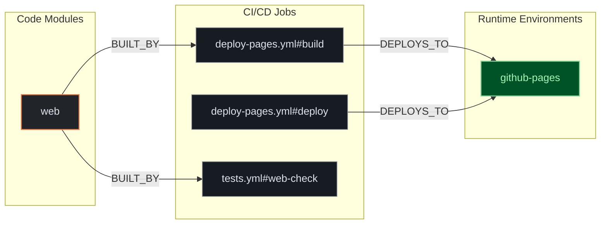
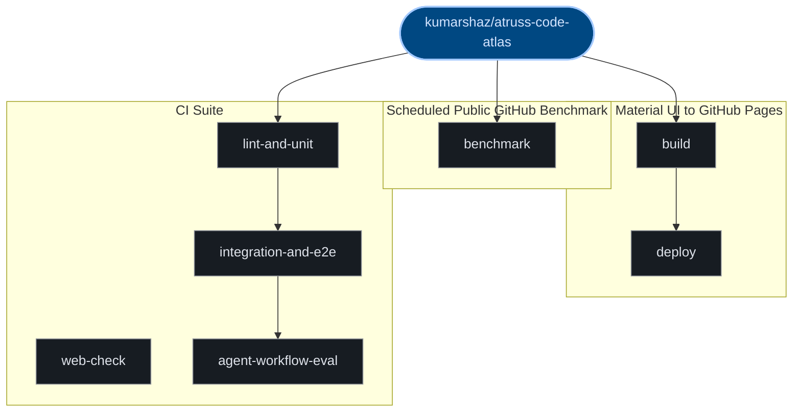

# Repository Architecture Analysis: kumarshaz/atruss-code-atlas

## Metadata
- **SHA**: `57dd5638aa381e3cc2338e713752117eaad9eebd`
- **Primary Ecosystem**: Python

## Quality Metrics
- **ast_engine**: tree-sitter
- **avg_cognitive_complexity**: 7.78
- **avg_cyclomatic_complexity**: 5.39
- **component_count**: 30
- **dead_code_count**: 3
- **dead_code_symbols**: 3 entry(ies)
- **duplication_pct**: 67.83
- **file_complexities**: 25 entry(ies)
- **files_analyzed**: 81
- **fitness_passed**: False
- **fitness_violation_count**: 3
- **framework**: Unknown
- **import_edges**: 100 entry(ies)
- **loc**: 9882
- **max_cognitive_complexity**: 81
- **max_cyclomatic_complexity**: 39
- **sloc**: 8594
- **test_file_count**: 32

# Architecture: kumarshaz/atruss-code-atlas

## Context
- **Repository**: `kumarshaz/atruss-code-atlas`
- **SHA**: `57dd5638aa381e3cc2338e713752117eaad9eebd`
- **Ecosystem**: Python
- **Framework**: Unknown

## Building Block View

## Component Details
- **version** (`src/cli/main.py`): CLI_COMMAND (deps: analyze_code, analyze_coverage, analyze_pipeline, benchmark, discover)
- **analyze_code** (`src/cli/commands/analyze_code.py`): CLI_COMMAND (deps: ExportManager, JSONExporter, MarkdownExporter, PortableArtifact)
- **analyze_coverage** (`src/cli/commands/analyze_coverage.py`): CLI_COMMAND
- **analyze_pipeline** (`src/cli/commands/analyze_pipeline.py`): CLI_COMMAND (deps: ExportManager, JSONExporter, MarkdownArchiver, MarkdownExporter, PipelineWorkflow, PortableArtifact, TopologyArchiver)
- **benchmark** (`src/cli/commands/benchmark.py`): CLI_COMMAND (deps: AnomalyRecord, BenchmarkManifest, BenchmarkRepoResult, BenchmarkSummary, CorpusEntry, DiscoveryArchiver, DiscoveryManifestItem, ExportManager, MarkdownArchiver, MarkdownExporter, PortableArtifact, TopologyArchiver, analyze_code, analyze_pipeline)
- **discover** (`src/cli/commands/discover.py`): CLI_COMMAND (deps: DiscoveryArchiver, DiscoveryManifestItem, ExportManager)
- **BaseExporter** (`src/core/exporters/base_exporter.py`): SERVICE
- **CSVExporter** (`src/core/exporters/csv_exporter.py`): SERVICE (deps: BaseExporter)
- **DiscoveryArchiver** (`src/core/exporters/discovery_exporter.py`): SERVICE (deps: DiscoveryManifestItem, ExportManager)
- **JSONExporter** (`src/core/exporters/json_exporter.py`): SERVICE (deps: BaseExporter, PortableArtifact)
- **MarkdownArchiver** (`src/core/exporters/markdown_exporter.py`): SERVICE (deps: ExportManager, PortableArtifact)
- **TopologyArchiver** (`src/core/exporters/pipeline_exporter.py`): SERVICE (deps: ExportManager)
- **YAMLExporter** (`src/core/exporters/yaml_exporter.py`): SERVICE (deps: BaseExporter)
- **ExportManager** (`src/core/utils/export_manager.py`): SERVICE
- **JSONExporter** (`src/core/utils/json_exporter.py`): SERVICE (deps: PortableArtifact)
- **MarkdownExporter** (`src/core/utils/markdown_exporter.py`): SERVICE (deps: MarkdownArchiver, PortableArtifact)
- **PipelineWorkflow** (`src/models/artifacts.py`): DATA_ACCESS_LAYER
- **PortableArtifact** (`src/models/artifacts.py`): DATA_ACCESS_LAYER
- **HarnessFixture** (`src/models/artifacts.py`): DATA_ACCESS_LAYER
- **DiscoveryManifestItem** (`src/models/artifacts.py`): DATA_ACCESS_LAYER
- **Node** (`src/models/artifacts.py`): DATA_ACCESS_LAYER
- **Edge** (`src/models/artifacts.py`): DATA_ACCESS_LAYER
- **PipelineDAG** (`src/models/artifacts.py`): DATA_ACCESS_LAYER
- **CorpusEntry** (`src/models/benchmark.py`): DATA_ACCESS_LAYER
- **BenchmarkRepoResult** (`src/models/benchmark.py`): DATA_ACCESS_LAYER
- **AnomalyRecord** (`src/models/benchmark.py`): DATA_ACCESS_LAYER
- **BenchmarkManifest** (`src/models/benchmark.py`): DATA_ACCESS_LAYER
- **BenchmarkSummary** (`src/models/benchmark.py`): DATA_ACCESS_LAYER
- **FixtureManager** (`tests/utils/fixture_manager.py`): SERVICE
- **atruss-code-atlas-web** (`web/package.json`): MODULE

## 6-Dimension Repository Scorecard

- **Overall Grade**: `D` (60.69/100)
- **Technical Debt Score**: 39.31
- **Estimated Remediation Effort**: 41.14h

| Dimension | Grade | Score | Weight | Details |
| :--- | :---: | :---: | :---: | :--- |
| Code Quality | `F` | 34.44 | 0.20 | avg_cc=5.39, max_cc=39, duplication=67.83%, dead_code=3 |
| Dependency Health | `A` | 100.00 | 0.15 | dependencies=588, outdated=0, vulnerable=0, has_lockfile=True |
| Maintainability | `F` | 38.66 | 0.15 | avg_cognitive=7.78, max_cognitive=81, fitness_violations=3, oversized_files=2 |
| Pipeline Health | `D` | 66.00 | 0.15 | workflows=3, operational_antipatterns=9, parallel_branches=True |
| Security | `D` | 63.00 | 0.20 | vulnerabilities=0, secrets=1, pipeline_security_findings=1 |
| Test Coverage | `C` | 70.00 | 0.15 | coverage=unavailable, ci_test_job=True, test_files_detected=True |

## Architecture Fitness & Workspace Boundaries

- **[MEDIUM] `ATRUSS-ARCH-005` (COMPLEXITY_THRESHOLD)**: Repository duplication_pct (67.83) exceeds policy threshold (15.0).
- **[MEDIUM] `ATRUSS-ARCH-005` (COMPLEXITY_THRESHOLD)**: Repository max_cognitive_complexity (81.0) exceeds policy threshold (25.0).
- **[MEDIUM] `ATRUSS-ARCH-005` (COMPLEXITY_THRESHOLD)**: Repository max_cyclomatic_complexity (39.0) exceeds policy threshold (20.0).

## Supply Chain Dependencies, Vulnerabilities & Secrets

- **Dependencies Parsed**: 588 | **Vulnerabilities**: 0 | **Secrets**: 1

### Secret Findings (Redacted)
- **[CRITICAL] `ATRUSS-SEC-002`** at `tests/integration/test_pipeline_dag_e2e.py:67` (`SECRET_TOKEN: "ghp_***REDACTED***"`)

### Inventory Sample
- `bandit` `1.7.8` (PyPI, `pyproject.toml`)
- `bandit` `1.7.8` (PyPI, `requirements.txt`)
- `httpx` `0.27.0` (PyPI, `pyproject.toml`)
- `httpx` `0.27.0` (PyPI, `requirements.txt`)
- `networkx` `3.2.1` (PyPI, `pyproject.toml`)
- `networkx` `3.2.1` (PyPI, `requirements.txt`)
- `pydantic` `2.7.0` (PyPI, `pyproject.toml`)
- `pydantic` `2.7.0` (PyPI, `requirements.txt`)
- `pytest` `8.1.1` (PyPI, `pyproject.toml`)
- `pytest` `8.1.1` (PyPI, `requirements.txt`)
- `pytest-asyncio` `0.23.6` (PyPI, `pyproject.toml`)
- `pytest-asyncio` `0.23.6` (PyPI, `requirements.txt`)
- `pyyaml` `6.0.1` (PyPI, `pyproject.toml`)
- `pyyaml` `6.0.1` (PyPI, `requirements.txt`)
- `radon` `6.0.1` (PyPI, `pyproject.toml`)
- `radon` `6.0.1` (PyPI, `requirements.txt`)
- `requests` `2.31.0` (PyPI, `pyproject.toml`)
- `requests` `2.31.0` (PyPI, `requirements.txt`)
- `ruff` `0.3.4` (PyPI, `pyproject.toml`)
- `ruff` `0.3.4` (PyPI, `requirements.txt`)
- `typer` `0.12.0` (PyPI, `pyproject.toml`)
- `typer` `0.12.0` (PyPI, `requirements.txt`)
- `@astrojs/starlight` `0.38.2` (npm, `web/package-lock.json`)
- `@astrojs/starlight` `0.38.2` (npm, `web/package.json`)
- `@material/web` `2.5.0` (npm, `web/package-lock.json`)
- `@material/web` `2.5.0` (npm, `web/package.json`)
- `astro` `6.0.1` (npm, `web/package.json`)
- `astro` `6.1.1` (npm, `web/package-lock.json`)
- `astro-mermaid` `2.0.1` (npm, `web/package-lock.json`)
- `astro-mermaid` `2.0.1` (npm, `web/package.json`)
- ... (+558 more dependencies)

## Section 7: Code-to-Cloud Deployment Traceability

- `deploy-pages.yml#build` (ci_job) --[DEPLOYS_TO]--> `github-pages` (environment)
- `deploy-pages.yml#deploy` (ci_job) --[DEPLOYS_TO]--> `github-pages` (environment)
- `web` (code_module) --[BUILT_BY]--> `deploy-pages.yml#build` (ci_job)
- `web` (code_module) --[BUILT_BY]--> `tests.yml#web-check` (ci_job)

## CI/CD Pipeline Topology

