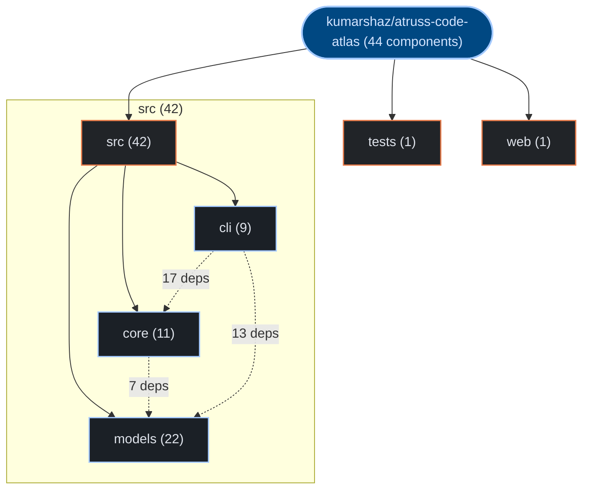
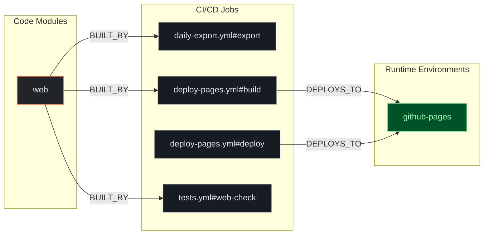
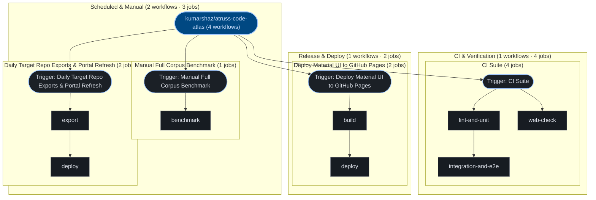

# Repository Architecture Analysis: kumarshaz/atruss-code-atlas

## Metadata
- **SHA**: `a30927cf1916fdd3deb45e95f7c5cc8a315902c1`
- **Primary Ecosystem**: Python

## Quality Metrics
- **ast_engine**: tree-sitter
- **avg_cognitive_complexity**: 10.65
- **avg_cyclomatic_complexity**: 6.86
- **component_count**: 44
- **dead_code_count**: 4
- **dead_code_symbols**: 4 entry(ies)
- **duplication_pct**: 77.37
- **file_complexities**: 25 entry(ies)
- **files_analyzed**: 110
- **fitness_passed**: False
- **fitness_violation_count**: 3
- **framework**: Unknown
- **import_edges**: 100 entry(ies)
- **loc**: 30868
- **max_cognitive_complexity**: 304
- **max_cyclomatic_complexity**: 124
- **sloc**: 27314
- **test_file_count**: 41

# Architecture: kumarshaz/atruss-code-atlas

## Context
- **Repository**: `kumarshaz/atruss-code-atlas`
- **SHA**: `a30927cf1916fdd3deb45e95f7c5cc8a315902c1`
- **Ecosystem**: Python
- **Framework**: Unknown

## Building Block View

## Component Details
- **version** (`src/cli/main.py`): CLI_COMMAND (deps: analyze_code, analyze_coverage, analyze_pipeline, benchmark, check, diff, discover)
- **analyze_code** (`src/cli/commands/analyze_code.py`): CLI_COMMAND (deps: ExportManager, JSONExporter, MarkdownExporter, PortableArtifact)
- **analyze_coverage** (`src/cli/commands/analyze_coverage.py`): CLI_COMMAND
- **analyze_pipeline** (`src/cli/commands/analyze_pipeline.py`): CLI_COMMAND (deps: ExportManager, JSONExporter, MarkdownArchiver, MarkdownExporter, PipelineWorkflow, PortableArtifact, TopologyArchiver)
- **benchmark** (`src/cli/commands/benchmark.py`): CLI_COMMAND (deps: AnomalyRecord, BenchmarkManifest, BenchmarkRepoResult, BenchmarkSummary, CorpusEntry, DiscoveryArchiver, DiscoveryManifestItem, ExportManager, MarkdownArchiver, MarkdownExporter, PortableArtifact, TopologyArchiver, analyze_code, analyze_pipeline)
- **check** (`src/cli/commands/check.py`): CLI_COMMAND (deps: ExportManager, PipelineWorkflow, PortableArtifact)
- **diff** (`src/cli/commands/diff.py`): CLI_COMMAND (deps: ExportManager)
- **discover** (`src/cli/commands/discover.py`): CLI_COMMAND (deps: DiscoveryArchiver, DiscoveryManifestItem, ExportManager)
- **mcp** (`src/cli/commands/mcp_server.py`): CLI_COMMAND
- **BaseExporter** (`src/core/exporters/base_exporter.py`): SERVICE
- **CSVExporter** (`src/core/exporters/csv_exporter.py`): SERVICE (deps: BaseExporter)
- **DiscoveryArchiver** (`src/core/exporters/discovery_exporter.py`): SERVICE (deps: DiscoveryManifestItem, ExportManager)
- **JSONExporter** (`src/core/exporters/json_exporter.py`): SERVICE (deps: BaseExporter, PortableArtifact)
- **MarkdownArchiver** (`src/core/exporters/markdown_exporter.py`): SERVICE (deps: ExportManager, PortableArtifact)
- **TopologyArchiver** (`src/core/exporters/pipeline_exporter.py`): SERVICE (deps: ExportManager)
- **SBOMExporter** (`src/core/exporters/sbom_exporter.py`): SERVICE (deps: DependencyRecord, VulnerabilityRecord)
- **YAMLExporter** (`src/core/exporters/yaml_exporter.py`): SERVICE (deps: BaseExporter)
- **ExportManager** (`src/core/utils/export_manager.py`): SERVICE
- **JSONExporter** (`src/core/utils/json_exporter.py`): SERVICE (deps: PortableArtifact)
- **MarkdownExporter** (`src/core/utils/markdown_exporter.py`): SERVICE (deps: MarkdownArchiver, PortableArtifact)
- **AntiPatternFinding** (`src/models/artifacts.py`): DATA_ACCESS_LAYER
- **FitnessViolation** (`src/models/artifacts.py`): DATA_ACCESS_LAYER
- **WorkspacePackage** (`src/models/artifacts.py`): DATA_ACCESS_LAYER
- **CrossWorkflowEdge** (`src/models/artifacts.py`): DATA_ACCESS_LAYER
- **DependencyRecord** (`src/models/artifacts.py`): DATA_ACCESS_LAYER
- **VulnerabilityRecord** (`src/models/artifacts.py`): DATA_ACCESS_LAYER
- **SecretFinding** (`src/models/artifacts.py`): DATA_ACCESS_LAYER
- **ScorecardDimension** (`src/models/artifacts.py`): DATA_ACCESS_LAYER
- **RepositoryScorecard** (`src/models/artifacts.py`): DATA_ACCESS_LAYER
- **CodeToCloudEdge** (`src/models/artifacts.py`): DATA_ACCESS_LAYER
- **PipelineWorkflow** (`src/models/artifacts.py`): DATA_ACCESS_LAYER
- **PortableArtifact** (`src/models/artifacts.py`): DATA_ACCESS_LAYER
- **HarnessFixture** (`src/models/artifacts.py`): DATA_ACCESS_LAYER
- **DiscoveryManifestItem** (`src/models/artifacts.py`): DATA_ACCESS_LAYER
- **Node** (`src/models/artifacts.py`): DATA_ACCESS_LAYER
- **Edge** (`src/models/artifacts.py`): DATA_ACCESS_LAYER
- **PipelineDAG** (`src/models/artifacts.py`): DATA_ACCESS_LAYER
- **CorpusEntry** (`src/models/benchmark.py`): DATA_ACCESS_LAYER
- **BenchmarkRepoResult** (`src/models/benchmark.py`): DATA_ACCESS_LAYER
- **AnomalyRecord** (`src/models/benchmark.py`): DATA_ACCESS_LAYER
- **BenchmarkManifest** (`src/models/benchmark.py`): DATA_ACCESS_LAYER
- **BenchmarkSummary** (`src/models/benchmark.py`): DATA_ACCESS_LAYER
- **FixtureManager** (`tests/utils/fixture_manager.py`): SERVICE
- **atruss-code-atlas-web** (`web/package.json`): MODULE

## 6-Dimension Repository Scorecard

- **Overall Grade**: `F` (48.39/100)
- **Technical Debt Score**: 51.61
- **Estimated Remediation Effort**: 208.88h

| Dimension | Grade | Score | Weight | Details |
| :--- | :---: | :---: | :---: | :--- |
| Code Quality | `F` | 26.56 | 0.20 | avg_cc=6.86, max_cc=124, duplication=77.37%, dead_code=4 |
| Dependency Health | `A` | 98.15 | 0.15 | dependencies=595, outdated=0, vulnerable=22, has_lockfile=True |
| Maintainability | `F` | 20.05 | 0.15 | avg_cognitive=10.65, max_cognitive=304, fitness_violations=3, oversized_files=14 |
| Pipeline Health | `A` | 99.00 | 0.15 | workflows=4, operational_antipatterns=1, parallel_branches=True |
| Security | `F` | 0.00 | 0.20 | vulnerabilities=91, secrets=31, pipeline_security_findings=0 |
| Test Coverage | `C` | 70.00 | 0.15 | coverage=unavailable, ci_test_job=True, test_files_detected=True |

## Architecture Fitness & Workspace Boundaries

- **[MEDIUM] `ATRUSS-ARCH-005` (COMPLEXITY_THRESHOLD)**: Repository duplication_pct (77.37) exceeds policy threshold (15.0).
- **[MEDIUM] `ATRUSS-ARCH-005` (COMPLEXITY_THRESHOLD)**: Repository max_cognitive_complexity (304.0) exceeds policy threshold (25.0).
- **[MEDIUM] `ATRUSS-ARCH-005` (COMPLEXITY_THRESHOLD)**: Repository max_cyclomatic_complexity (124.0) exceeds policy threshold (20.0).

## Supply Chain Dependencies, Vulnerabilities & Secrets

- **Dependencies Parsed**: 595 | **Vulnerabilities**: 91 | **Secrets**: 31

### Known Vulnerabilities (OSV)
- **[MEDIUM] `GHSA-26w7-cxv4-gfx2`** `astro` `6.1.1` (fixed: `none`, REACHABLE_FROM_RUNTIME)
- **[MEDIUM] `GHSA-26w7-cxv4-gfx2`** `astro` `6.0.1` (fixed: `none`, REACHABLE_FROM_RUNTIME)
- **[MEDIUM] `GHSA-2883-xcg3-v3hh`** `js-yaml` `4.1.1` (fixed: `none`, UNREACHABLE_DORMANT)
- **[MEDIUM] `GHSA-28wg-ghj8-5hjv`** `nanoid` `3.3.11` (fixed: `none`, UNREACHABLE_DORMANT)
- **[MEDIUM] `GHSA-2p49-hgcm-8545`** `svgo` `4.0.1` (fixed: `none`, UNREACHABLE_DORMANT)
- **[MEDIUM] `GHSA-2pvr-wf23-7pc7`** `astro` `6.1.1` (fixed: `none`, REACHABLE_FROM_RUNTIME)
- **[MEDIUM] `GHSA-2pvr-wf23-7pc7`** `astro` `6.0.1` (fixed: `none`, REACHABLE_FROM_RUNTIME)
- **[MEDIUM] `GHSA-2v37-7h3g-55p8`** `nanoid` `3.3.11` (fixed: `none`, UNREACHABLE_DORMANT)
- **[MEDIUM] `GHSA-376h-93r7-7g6f`** `astro` `6.1.1` (fixed: `none`, REACHABLE_FROM_RUNTIME)
- **[MEDIUM] `GHSA-376h-93r7-7g6f`** `astro` `6.0.1` (fixed: `none`, REACHABLE_FROM_RUNTIME)
- **[MEDIUM] `GHSA-4g3v-8h47-v7g6`** `astro` `6.1.1` (fixed: `none`, REACHABLE_FROM_RUNTIME)
- **[MEDIUM] `GHSA-4g3v-8h47-v7g6`** `astro` `6.0.1` (fixed: `none`, REACHABLE_FROM_RUNTIME)
- **[MEDIUM] `GHSA-4q55-j62x-fr9h`** `devalue` `5.6.4` (fixed: `none`, UNREACHABLE_DORMANT)
- **[MEDIUM] `GHSA-4vpr-x523-8j87`** `svgo` `4.0.1` (fixed: `none`, UNREACHABLE_DORMANT)
- **[MEDIUM] `GHSA-4w7w-66w2-5vf9`** `vite` `7.3.1` (fixed: `none`, UNREACHABLE_DORMANT)
- **[MEDIUM] `GHSA-52cp-r559-cp3m`** `js-yaml` `4.1.1` (fixed: `none`, UNREACHABLE_DORMANT)
- **[MEDIUM] `GHSA-587h-7wmj-h5pm`** `vite` `7.3.1` (fixed: `none`, UNREACHABLE_DORMANT)
- **[MEDIUM] `GHSA-5p4m-2wfm-xmqj`** `js-yaml` `4.1.1` (fixed: `none`, UNREACHABLE_DORMANT)
- **[MEDIUM] `GHSA-68fv-2mgg-jv7q`** `source-map-js` `1.2.1` (fixed: `none`, UNREACHABLE_DORMANT)
- **[MEDIUM] `GHSA-698v-4r3x-3vcv`** `vite` `7.3.1` (fixed: `none`, UNREACHABLE_DORMANT)
- **[MEDIUM] `GHSA-6g55-p6wh-862q`** `postcss` `8.5.8` (fixed: `none`, UNREACHABLE_DORMANT)
- **[MEDIUM] `GHSA-6jcc-5g8w-32mx`** `i18next` `23.16.8` (fixed: `none`, UNREACHABLE_DORMANT)
- **[MEDIUM] `GHSA-6w46-j5rx-g56g`** `pytest` `8.1.1` (fixed: `none`, REACHABLE_FROM_RUNTIME)
- **[MEDIUM] `GHSA-6w46-j5rx-g56g`** `pytest` `8.1.1` (fixed: `none`, REACHABLE_FROM_RUNTIME)
- **[MEDIUM] `GHSA-737v-mqg7-c878`** `defu` `6.1.4` (fixed: `none`, UNREACHABLE_DORMANT)
- **[MEDIUM] `GHSA-77vg-94rm-hx3p`** `devalue` `5.6.4` (fixed: `none`, UNREACHABLE_DORMANT)
- **[MEDIUM] `GHSA-7pw4-f3q4-r2p2`** `astro` `6.1.1` (fixed: `none`, REACHABLE_FROM_RUNTIME)
- **[MEDIUM] `GHSA-7pw4-f3q4-r2p2`** `astro` `6.0.1` (fixed: `none`, REACHABLE_FROM_RUNTIME)
- **[MEDIUM] `GHSA-7w5x-hrqm-74c2`** `smol-toml` `1.6.1` (fixed: `none`, UNREACHABLE_DORMANT)
- **[MEDIUM] `GHSA-8hv8-536x-4wqp`** `astro` `6.1.1` (fixed: `none`, REACHABLE_FROM_RUNTIME)
- **[MEDIUM] `GHSA-8hv8-536x-4wqp`** `astro` `6.0.1` (fixed: `none`, REACHABLE_FROM_RUNTIME)
- **[MEDIUM] `GHSA-98hj-9722-w3j8`** `astro` `6.1.1` (fixed: `none`, REACHABLE_FROM_RUNTIME)
- **[MEDIUM] `GHSA-98hj-9722-w3j8`** `astro` `6.0.1` (fixed: `none`, REACHABLE_FROM_RUNTIME)
- **[MEDIUM] `GHSA-9hjg-9r4m-mvj7`** `requests` `2.31.0` (fixed: `none`, REACHABLE_FROM_RUNTIME)
- **[MEDIUM] `GHSA-9hjg-9r4m-mvj7`** `requests` `2.31.0` (fixed: `none`, REACHABLE_FROM_RUNTIME)
- **[MEDIUM] `GHSA-9jrq-w75r-8gcw`** `vite` `7.3.1` (fixed: `none`, UNREACHABLE_DORMANT)
- **[MEDIUM] `GHSA-9rgm-9g3h-6x36`** `devalue` `5.6.4` (fixed: `none`, UNREACHABLE_DORMANT)
- **[MEDIUM] `GHSA-9wx4-h78v-vm56`** `requests` `2.31.0` (fixed: `none`, REACHABLE_FROM_RUNTIME)
- **[MEDIUM] `GHSA-9wx4-h78v-vm56`** `requests` `2.31.0` (fixed: `none`, REACHABLE_FROM_RUNTIME)
- **[MEDIUM] `GHSA-f23m-r3pf-42rh`** `lodash-es` `4.17.23` (fixed: `none`, UNREACHABLE_DORMANT)

### Secret Findings (Redacted)
- **[HIGH] `ATRUSS-SEC-005`** at `exports/latest/reports/bitwarden-directory-connector-analysis.json:1743` (`"APP_STORE_CONNECT_AUTH_KEY_PATH": "~/pr***REDACTED***",`)
- **[HIGH] `ATRUSS-SEC-005`** at `exports/latest/reports/bitwarden-directory-connector-analysis.json:1880` (`"APP_STORE_CONNECT_AUTH_KEY_PATH": "~/pr***REDACTED***",`)
- **[HIGH] `ATRUSS-SEC-005`** at `exports/latest/reports/getsentry-snuba-analysis.json:3646` (`"id_token_audience": "6105***REDACTED***",`)
- **[CRITICAL] `ATRUSS-SEC-004`** at `exports/latest/reports/getsentry-spotlight-analysis.json:754` (`-----BEGIN ... PRIVATE KEY----- [REDACTED]`)
- **[CRITICAL] `ATRUSS-SEC-004`** at `exports/latest/reports/getsentry-spotlight-analysis.json:1122` (`-----BEGIN ... PRIVATE KEY----- [REDACTED]`)
- **[HIGH] `ATRUSS-SEC-005`** at `exports/latest/reports/getsentry-symbolicator-analysis.json:1970` (`"id_token_audience": "6105***REDACTED***",`)
- **[HIGH] `ATRUSS-SEC-005`** at `exports/latest/reports/grafana-agento11y-analysis.json:2176` (`"repo_secrets": "CENT***REDACTED***"`)
- **[HIGH] `ATRUSS-SEC-005`** at `exports/latest/reports/grafana-agento11y-report.md:252` (`..."token":"glc_***REDACTED***","api_key":"kR7f***REDACTED***"}`)},`)`)
- **[HIGH] `ATRUSS-SEC-005`** at `exports/latest/reports/grafana-agento11y-report.md:253` (`...ecret", raw: json.RawMessage(`{"token":"glc_***REDACTED***","api_key":"kR7f***REDACTED***"}`)},`)`)
- **[HIGH] `ATRUSS-SEC-005`** at `exports/latest/reports/grafana-alloy-analysis.json:699` (`"repo_secrets": "ANTH***REDACTED***"`)
- **[HIGH] `ATRUSS-SEC-005`** at `exports/latest/reports/grafana-alloy-analysis.json:5943` (`"repo_secrets": "SLAC***REDACTED***"`)
- **[HIGH] `ATRUSS-SEC-005`** at `exports/latest/reports/grafana-beyla-analysis.json:157` (`"repo_secrets": "ANTH***REDACTED***"`)
- **[HIGH] `ATRUSS-SEC-005`** at `exports/latest/reports/grafana-beyla-analysis.json:240` (`"repo_secrets": "ANTH***REDACTED***"`)
- **[HIGH] `ATRUSS-SEC-005`** at `exports/latest/reports/grafana-beyla-analysis.json:338` (`"repo_secrets": "ANTH***REDACTED***"`)
- **[HIGH] `ATRUSS-SEC-005`** at `exports/latest/reports/grafana-gcx-analysis.json:431` (`"repo_secrets": "ANTH***REDACTED***"`)
- **[HIGH] `ATRUSS-SEC-005`** at `exports/latest/reports/grafana-gcx-analysis.json:567` (`"repo_secrets": "ANTH***REDACTED***"`)
- **[HIGH] `ATRUSS-SEC-005`** at `exports/latest/reports/grafana-grafana-ansible-collection-analysis.json:533` (`"repo_secrets": "ANSI***REDACTED***"`)
- **[HIGH] `ATRUSS-SEC-005`** at `exports/latest/reports/grafana-grafana-ansible-collection-analysis.json:1042` (`"repo_secrets": "ANSI***REDACTED***"`)
- **[HIGH] `ATRUSS-SEC-005`** at `exports/latest/reports/grafana-grafana-ansible-collection-analysis.json:1463` (`"repo_secrets": "ANSI***REDACTED***"`)
- **[HIGH] `ATRUSS-SEC-005`** at `exports/latest/reports/grafana-grafana-ansible-collection-analysis.json:1564` (`"repo_secrets": "ANSI***REDACTED***"`)
- **[HIGH] `ATRUSS-SEC-005`** at `exports/latest/reports/grafana-grafana-foundation-sdk-analysis.json:1191` (`"repo_secrets": "MAVE***REDACTED***"`)
- **[HIGH] `ATRUSS-SEC-005`** at `exports/latest/reports/grafana-helm-charts-analysis.json:586` (`"repo_secrets": "PUBL***REDACTED***"`)
- **[HIGH] `ATRUSS-SEC-005`** at `exports/latest/reports/grafana-helm-charts-analysis.json:1065` (`"repo_secrets": "GPG_***REDACTED***"`)
- **[HIGH] `ATRUSS-SEC-005`** at `exports/latest/reports/grafana-loki-analysis.json:340` (`"repo_secrets": "ANTH***REDACTED***"`)
- **[HIGH] `ATRUSS-SEC-005`** at `exports/latest/reports/grafana-loki-analysis.json:438` (`"repo_secrets": "ANTH***REDACTED***"`)
- **[HIGH] `ATRUSS-SEC-005`** at `exports/latest/reports/grafana-traces-drilldown-analysis.json:1131` (`"repo_secrets": "CROW***REDACTED***"`)
- **[HIGH] `ATRUSS-SEC-005`** at `exports/latest/reports/grafana-traces-drilldown-analysis.json:1230` (`"repo_secrets": "CROW***REDACTED***"`)
- **[HIGH] `ATRUSS-SEC-005`** at `exports/latest/reports/grafana-traces-drilldown-analysis.json:1323` (`"repo_secrets": "CROW***REDACTED***"`)
- **[CRITICAL] `ATRUSS-SEC-004`** at `exports/latest/reports/home-assistant-operating-system-analysis.json:821` (`-----BEGIN ... PRIVATE KEY----- [REDACTED]`)
- **[CRITICAL] `ATRUSS-SEC-004`** at `exports/latest/reports/keycloak-terraform-provider-keycloak-analysis.json:802` (`-----BEGIN ... PRIVATE KEY----- [REDACTED]`)
- **[HIGH] `ATRUSS-SEC-005`** at `exports/latest/reports/nextcloud-groupfolders-analysis.json:4009` (`"MINIO_ROOT_PASSWORD": "bWlu***REDACTED***",`)

### Inventory Sample
- `bandit` `1.7.8` (PyPI, `pyproject.toml`)
- `bandit` `1.7.8` (PyPI, `requirements.txt`)
- `httpx` `0.27.0` (PyPI, `pyproject.toml`)
- `httpx` `0.27.0` (PyPI, `requirements.txt`)
- `networkx` `3.2.1` (PyPI, `pyproject.toml`)
- `networkx` `3.2.1` (PyPI, `requirements.txt`)
- `pydantic` `2.7.0` (PyPI, `pyproject.toml`)
- `pydantic` `2.7.0` (PyPI, `requirements.txt`)
- `pytest` `8.1.1` (PyPI, `pyproject.toml`)
- `pytest` `8.1.1` (PyPI, `requirements.txt`)
- `pytest-asyncio` `0.23.6` (PyPI, `pyproject.toml`)
- `pytest-asyncio` `0.23.6` (PyPI, `requirements.txt`)
- `pyyaml` `6.0.1` (PyPI, `pyproject.toml`)
- `pyyaml` `6.0.1` (PyPI, `requirements.txt`)
- `radon` `6.0.1` (PyPI, `pyproject.toml`)
- `radon` `6.0.1` (PyPI, `requirements.txt`)
- `requests` `2.31.0` (PyPI, `pyproject.toml`)
- `requests` `2.31.0` (PyPI, `requirements.txt`)
- `ruff` `0.3.4` (PyPI, `pyproject.toml`)
- `ruff` `0.3.4` (PyPI, `requirements.txt`)
- `tree-sitter` `0.23.0` (PyPI, `pyproject.toml`)
- `tree-sitter` `0.23.0` (PyPI, `requirements.txt`)
- `tree-sitter-c-sharp` `0.23.0` (PyPI, `pyproject.toml`)
- `tree-sitter-c-sharp` `0.23.0` (PyPI, `requirements.txt`)
- `tree-sitter-java` `0.23.0` (PyPI, `pyproject.toml`)
- `tree-sitter-java` `0.23.0` (PyPI, `requirements.txt`)
- `tree-sitter-javascript` `0.23.0` (PyPI, `pyproject.toml`)
- `tree-sitter-javascript` `0.23.0` (PyPI, `requirements.txt`)
- `tree-sitter-python` `0.23.0` (PyPI, `pyproject.toml`)
- `tree-sitter-python` `0.23.0` (PyPI, `requirements.txt`)
- ... (+565 more dependencies)

## Section 7: Code-to-Cloud Deployment Traceability

- `deploy-pages.yml#build` (ci_job) --[DEPLOYS_TO]--> `github-pages` (environment)
- `deploy-pages.yml#deploy` (ci_job) --[DEPLOYS_TO]--> `github-pages` (environment)
- `web` (code_module) --[BUILT_BY]--> `daily-export.yml#export` (ci_job)
- `web` (code_module) --[BUILT_BY]--> `deploy-pages.yml#build` (ci_job)
- `web` (code_module) --[BUILT_BY]--> `tests.yml#web-check` (ci_job)

## CI/CD Pipeline Topology

