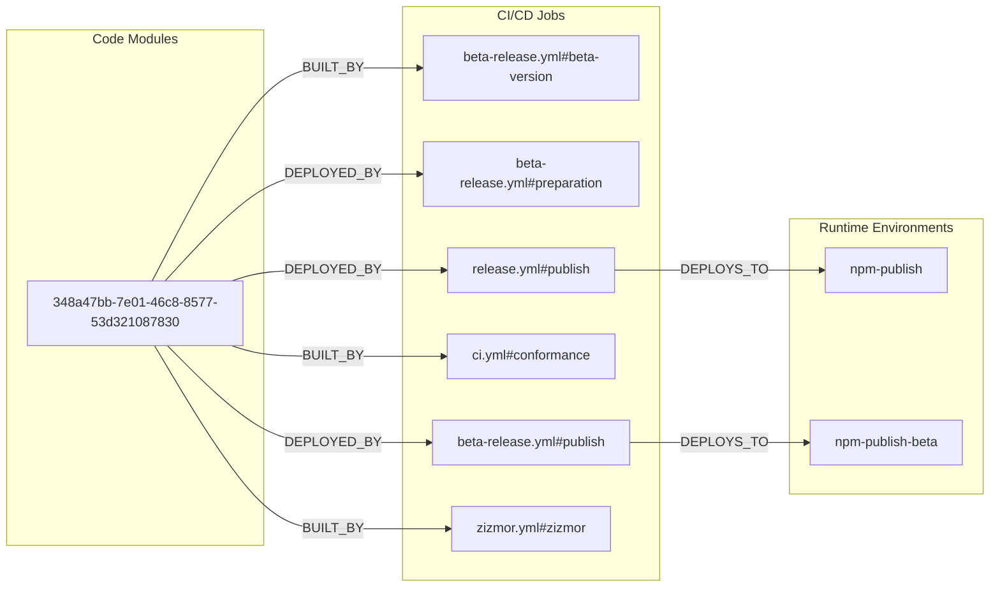
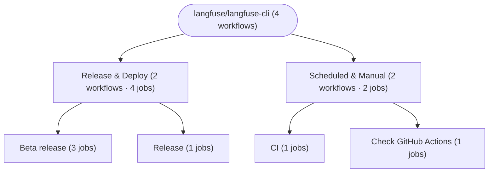

# Repository Architecture Analysis: langfuse/langfuse-cli

## Metadata
- **SHA**: `46d3bce82e695cdf1dc05c89f9f9822e4260d065`
- **Primary Ecosystem**: JavaScript/TypeScript

## Quality Metrics
- **ast_engine**: tree-sitter
- **avg_cognitive_complexity**: 6.58
- **avg_cyclomatic_complexity**: 6.05
- **component_count**: 1
- **dead_code_count**: 0
- **dead_code_symbols**: 0 entry(ies)
- **duplication_pct**: 65.53
- **file_complexities**: 25 entry(ies)
- **files_analyzed**: 60
- **fitness_passed**: False
- **fitness_violation_count**: 3
- **framework**: TypeScript
- **import_edges**: 100 entry(ies)
- **loc**: 11059
- **max_cognitive_complexity**: 128
- **max_cyclomatic_complexity**: 72
- **sloc**: 10138
- **test_file_count**: 19

# Architecture: langfuse/langfuse-cli

## Context
- **Repository**: `langfuse/langfuse-cli`
- **SHA**: `46d3bce82e695cdf1dc05c89f9f9822e4260d065`
- **Ecosystem**: JavaScript/TypeScript
- **Framework**: TypeScript

## Building Block View

## Component Details
- **@langfuse/cli** (`package.json`): MODULE

## 6-Dimension Repository Scorecard

- **Overall Grade**: `F` (41.65/100)
- **Technical Debt Score**: 58.35
- **Estimated Remediation Effort**: 61.19h

| Dimension | Grade | Score | Weight | Details |
| :--- | :---: | :---: | :---: | :--- |
| Code Quality | `F` | 37.80 | 0.20 | avg_cc=6.05, max_cc=72, duplication=65.53%, dead_code=0 |
| Dependency Health | `B` | 85.00 | 0.15 | dependencies=9, outdated=0, vulnerable=0, has_lockfile=False |
| Maintainability | `F` | 37.26 | 0.15 | avg_cognitive=6.58, max_cognitive=128, fitness_violations=3, oversized_files=3 |
| Pipeline Health | `F` | 35.00 | 0.15 | workflows=4, operational_antipatterns=10, parallel_branches=False |
| Security | `F` | 0.00 | 0.20 | vulnerabilities=0, secrets=0, pipeline_security_findings=8 |
| Test Coverage | `C` | 70.00 | 0.15 | coverage=unavailable, ci_test_job=True, test_files_detected=True |

## Architecture Fitness & Workspace Boundaries

- **[MEDIUM] `ATRUSS-ARCH-005` (COMPLEXITY_THRESHOLD)**: Repository duplication_pct (65.53) exceeds policy threshold (15.0).
- **[MEDIUM] `ATRUSS-ARCH-005` (COMPLEXITY_THRESHOLD)**: Repository max_cognitive_complexity (128.0) exceeds policy threshold (25.0).
- **[MEDIUM] `ATRUSS-ARCH-005` (COMPLEXITY_THRESHOLD)**: Repository max_cyclomatic_complexity (72.0) exceeds policy threshold (20.0).

## Supply Chain Dependencies, Vulnerabilities & Secrets

- **Dependencies Parsed**: 9 | **Vulnerabilities**: 0 | **Secrets**: 0

### Inventory Sample
- `@apidevtools/swagger-parser` `12.1.0` (npm, `package.json`)
- `@types/bun` `1.4.4` (npm, `package.json`)
- `@types/semver` `7.8.0` (npm, `package.json`)
- `ajv` `8.17.1` (npm, `package.json`)
- `ajv-formats` `3.0.1` (npm, `package.json`)
- `semver` `7.8.6` (npm, `package.json`)
- `typescript` `7.0.2` (npm, `package.json`)
- `yaml` `2.9.1` (npm, `package.json`)
- `zod` `4.6.7` (npm, `package.json`)

## Section 7: Code-to-Cloud Deployment Traceability

- `beta-release.yml#publish` (ci_job) --[DEPLOYS_TO]--> `npm-publish-beta` (environment)
- `release.yml#publish` (ci_job) --[DEPLOYS_TO]--> `npm-publish` (environment)
- `348a47bb-7e01-46c8-8577-53d321087830` (code_module) --[BUILT_BY]--> `beta-release.yml#beta-version` (ci_job)
- `348a47bb-7e01-46c8-8577-53d321087830` (code_module) --[BUILT_BY]--> `ci.yml#conformance` (ci_job)
- `348a47bb-7e01-46c8-8577-53d321087830` (code_module) --[BUILT_BY]--> `zizmor.yml#zizmor` (ci_job)
- `348a47bb-7e01-46c8-8577-53d321087830` (code_module) --[DEPLOYED_BY]--> `beta-release.yml#preparation` (ci_job)
- `348a47bb-7e01-46c8-8577-53d321087830` (code_module) --[DEPLOYED_BY]--> `beta-release.yml#publish` (ci_job)
- `348a47bb-7e01-46c8-8577-53d321087830` (code_module) --[DEPLOYED_BY]--> `release.yml#publish` (ci_job)

## CI/CD Pipeline Topology

