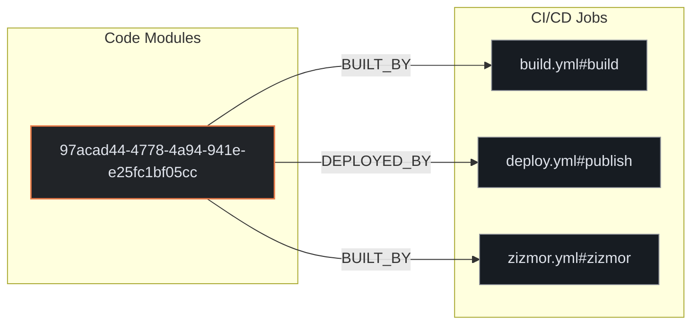
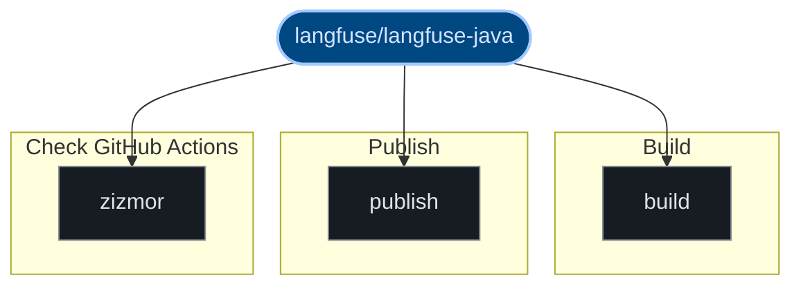

# Repository Architecture Analysis: langfuse/langfuse-java

## Metadata
- **SHA**: `e6d480ff1fb8149523b539b013b9e74aa6a4758d`
- **Primary Ecosystem**: Java

## Quality Metrics
- **ast_engine**: tree-sitter
- **avg_cognitive_complexity**: 0.49
- **avg_cyclomatic_complexity**: 1.58
- **component_count**: 1
- **dead_code_count**: 17
- **dead_code_symbols**: 17 entry(ies)
- **duplication_pct**: 98.65
- **file_complexities**: 25 entry(ies)
- **files_analyzed**: 271
- **fitness_passed**: False
- **fitness_violation_count**: 3
- **framework**: Java Maven/Gradle
- **import_edges**: 100 entry(ies)
- **loc**: 53730
- **max_cognitive_complexity**: 55
- **max_cyclomatic_complexity**: 54
- **sloc**: 38840
- **test_file_count**: 9

# Architecture: langfuse/langfuse-java

## Context
- **Repository**: `langfuse/langfuse-java`
- **SHA**: `e6d480ff1fb8149523b539b013b9e74aa6a4758d`
- **Ecosystem**: Java
- **Framework**: Java Maven/Gradle

## Building Block View

## Component Details
- **langfuse-java** (`pom.xml`): MODULE

## 6-Dimension Repository Scorecard

- **Overall Grade**: `D` (64.55/100)
- **Technical Debt Score**: 35.45
- **Estimated Remediation Effort**: 53.84h

| Dimension | Grade | Score | Weight | Details |
| :--- | :---: | :---: | :---: | :--- |
| Code Quality | `F` | 30.00 | 0.20 | avg_cc=1.58, max_cc=54, duplication=98.65%, dead_code=17 |
| Dependency Health | `B` | 85.00 | 0.15 | dependencies=9, outdated=0, vulnerable=0, has_lockfile=False |
| Maintainability | `F` | 37.00 | 0.15 | avg_cognitive=0.49, max_cognitive=55, fitness_violations=3, oversized_files=8 |
| Pipeline Health | `D` | 65.00 | 0.15 | workflows=3, operational_antipatterns=5, parallel_branches=False |
| Security | `A` | 100.00 | 0.20 | vulnerabilities=0, secrets=0, pipeline_security_findings=0 |
| Test Coverage | `C` | 70.00 | 0.15 | coverage=unavailable, ci_test_job=True, test_files_detected=True |

## Architecture Fitness & Workspace Boundaries

- **[MEDIUM] `ATRUSS-ARCH-005` (COMPLEXITY_THRESHOLD)**: Repository duplication_pct (98.65) exceeds policy threshold (15.0).
- **[MEDIUM] `ATRUSS-ARCH-005` (COMPLEXITY_THRESHOLD)**: Repository max_cognitive_complexity (55.0) exceeds policy threshold (25.0).
- **[MEDIUM] `ATRUSS-ARCH-005` (COMPLEXITY_THRESHOLD)**: Repository max_cyclomatic_complexity (54.0) exceeds policy threshold (20.0).

## Supply Chain Dependencies, Vulnerabilities & Secrets

- **Dependencies Parsed**: 9 | **Vulnerabilities**: 0 | **Secrets**: 0

### Inventory Sample
- `com.fasterxml.jackson.core:jackson-core` `2.18.6` (Maven, `pom.xml`)
- `com.fasterxml.jackson.core:jackson-databind` `2.18.6` (Maven, `pom.xml`)
- `com.fasterxml.jackson.datatype:jackson-datatype-jdk8` `2.18.6` (Maven, `pom.xml`)
- `com.fasterxml.jackson.datatype:jackson-datatype-jsr310` `2.18.6` (Maven, `pom.xml`)
- `com.squareup.okhttp3:okhttp` `4.11.0` (Maven, `pom.xml`)
- `io.github.cdimascio:dotenv-java` `3.0.2` (Maven, `pom.xml`)
- `org.assertj:assertj-core` `3.27.7` (Maven, `pom.xml`)
- `org.junit.jupiter:junit-jupiter-api` `5.9.3` (Maven, `pom.xml`)
- `org.junit.jupiter:junit-jupiter-engine` `5.9.3` (Maven, `pom.xml`)

## Section 7: Code-to-Cloud Deployment Traceability

- `97acad44-4778-4a94-941e-e25fc1bf05cc` (code_module) --[BUILT_BY]--> `build.yml#build` (ci_job)
- `97acad44-4778-4a94-941e-e25fc1bf05cc` (code_module) --[BUILT_BY]--> `zizmor.yml#zizmor` (ci_job)
- `97acad44-4778-4a94-941e-e25fc1bf05cc` (code_module) --[DEPLOYED_BY]--> `deploy.yml#publish` (ci_job)

## CI/CD Pipeline Topology

