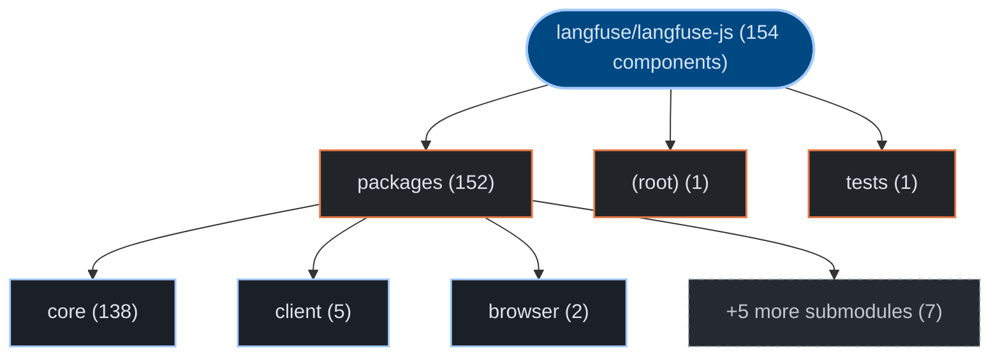
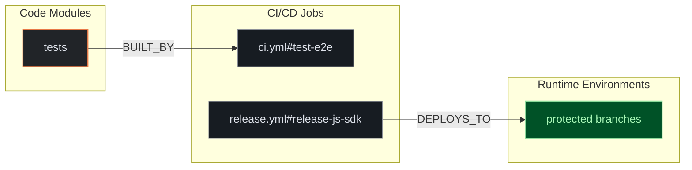

# Repository Architecture Analysis: langfuse/langfuse-js

## Metadata
- **SHA**: `280e323c3d5c1408ef0c52e83fe03e70ceb7bcb6`
- **Primary Ecosystem**: JavaScript/TypeScript

## Quality Metrics
- **ast_engine**: tree-sitter
- **avg_cognitive_complexity**: 1.76
- **avg_cyclomatic_complexity**: 3.47
- **component_count**: 154
- **dead_code_count**: 5
- **dead_code_symbols**: 5 entry(ies)
- **duplication_pct**: 86.89
- **file_complexities**: 25 entry(ies)
- **files_analyzed**: 701
- **fitness_passed**: False
- **fitness_violation_count**: 3
- **framework**: TypeScript
- **import_edges**: 100 entry(ies)
- **loc**: 70663
- **max_cognitive_complexity**: 126
- **max_cyclomatic_complexity**: 40
- **sloc**: 50831
- **test_file_count**: 51

# Architecture: langfuse/langfuse-js

## Context
- **Repository**: `langfuse/langfuse-js`
- **SHA**: `280e323c3d5c1408ef0c52e83fe03e70ceb7bcb6`
- **Ecosystem**: JavaScript/TypeScript
- **Framework**: TypeScript

## Building Block View

## Component Details

Showing top 60 representative components out of 154 across 3 module group(s):

- **Module `packages`** (152 components — API_ROUTE: 135, MODULE: 8, SERVICE: 8)
- **Module `(root)`** (1 components — MODULE: 1)
- **Module `tests`** (1 components — SERVICE: 1)

- **@langfuse/browser** (`packages/browser/package.json`): MODULE
- **@langfuse/client** (`packages/client/package.json`): MODULE
- **@langfuse/core** (`packages/core/package.json`): MODULE
- **@langfuse/langchain** (`packages/langchain/package.json`): MODULE
- **@langfuse/openai** (`packages/openai/package.json`): MODULE
- **@langfuse/otel** (`packages/otel/package.json`): MODULE
- **@langfuse/tracing** (`packages/tracing/package.json`): MODULE
- **@langfuse/vercel-ai-sdk** (`packages/vercel-ai-sdk/package.json`): MODULE
- **API_annotationQueues_index** (`packages/core/src/api/api/resources/annotationQueues/index.ts`): API_ROUTE
- **API_api_index** (`packages/core/src/api/api/index.ts`): API_ROUTE
- **API_api_index** (`packages/core/src/api/index.ts`): API_ROUTE
- **API_auth_index** (`packages/core/src/api/core/auth/index.ts`): API_ROUTE
- **API_blobStorageIntegrations_index** (`packages/core/src/api/api/resources/blobStorageIntegrations/index.ts`): API_ROUTE
- **API_client_index** (`packages/core/src/api/api/resources/annotationQueues/client/index.ts`): API_ROUTE
- **API_client_index** (`packages/core/src/api/api/resources/blobStorageIntegrations/client/index.ts`): API_ROUTE
- **API_client_index** (`packages/core/src/api/api/resources/comments/client/index.ts`): API_ROUTE
- **API_client_index** (`packages/core/src/api/api/resources/datasetItems/client/index.ts`): API_ROUTE
- **API_client_index** (`packages/core/src/api/api/resources/datasets/client/index.ts`): API_ROUTE
- **API_client_index** (`packages/core/src/api/api/resources/evaluationRules/client/index.ts`): API_ROUTE
- **API_client_index** (`packages/core/src/api/api/resources/evaluators/client/index.ts`): API_ROUTE
- **API_client_index** (`packages/core/src/api/api/resources/experiments/client/index.ts`): API_ROUTE
- **API_client_index** (`packages/core/src/api/api/resources/feedback/client/index.ts`): API_ROUTE
- **API_client_index** (`packages/core/src/api/api/resources/health/client/index.ts`): API_ROUTE
- **API_client_index** (`packages/core/src/api/api/resources/llmConnections/client/index.ts`): API_ROUTE
- **API_client_index** (`packages/core/src/api/api/resources/media/client/index.ts`): API_ROUTE
- **API_client_index** (`packages/core/src/api/api/resources/metrics/client/index.ts`): API_ROUTE
- **API_client_index** (`packages/core/src/api/api/resources/models/client/index.ts`): API_ROUTE
- **API_client_index** (`packages/core/src/api/api/resources/observations/client/index.ts`): API_ROUTE
- **API_client_index** (`packages/core/src/api/api/resources/opentelemetry/client/index.ts`): API_ROUTE
- **API_client_index** (`packages/core/src/api/api/resources/organizations/client/index.ts`): API_ROUTE
- **API_client_index** (`packages/core/src/api/api/resources/projects/client/index.ts`): API_ROUTE
- **API_client_index** (`packages/core/src/api/api/resources/promptVersion/client/index.ts`): API_ROUTE
- **API_client_index** (`packages/core/src/api/api/resources/prompts/client/index.ts`): API_ROUTE
- **API_client_index** (`packages/core/src/api/api/resources/scim/client/index.ts`): API_ROUTE
- **API_client_index** (`packages/core/src/api/api/resources/scoreConfigs/client/index.ts`): API_ROUTE
- **API_client_index** (`packages/core/src/api/api/resources/scores/client/index.ts`): API_ROUTE
- **API_client_index** (`packages/core/src/api/api/resources/skills/client/index.ts`): API_ROUTE
- **API_client_index** (`packages/core/src/api/api/resources/trace/client/index.ts`): API_ROUTE
- **API_client_index** (`packages/core/src/api/api/resources/unstable/client/index.ts`): API_ROUTE
- **API_client_index** (`packages/core/src/api/api/resources/unstable/resources/dashboardWidgets/client/index.ts`): API_ROUTE
- **API_client_index** (`packages/core/src/api/api/resources/unstable/resources/dashboards/client/index.ts`): API_ROUTE
- **API_client_index** (`packages/core/src/api/api/resources/unstable/resources/topics/client/index.ts`): API_ROUTE
- **API_comments_index** (`packages/core/src/api/api/resources/comments/index.ts`): API_ROUTE
- **API_commons_index** (`packages/core/src/api/api/resources/commons/index.ts`): API_ROUTE
- **API_core_index** (`packages/core/src/api/core/index.ts`): API_ROUTE
- **API_dashboardWidgets_index** (`packages/core/src/api/api/resources/unstable/resources/dashboardWidgets/index.ts`): API_ROUTE
- **API_dashboards_index** (`packages/core/src/api/api/resources/unstable/resources/dashboards/index.ts`): API_ROUTE
- **API_datasetItems_index** (`packages/core/src/api/api/resources/datasetItems/index.ts`): API_ROUTE
- **API_datasets_index** (`packages/core/src/api/api/resources/datasets/index.ts`): API_ROUTE
- **API_errors_index** (`packages/core/src/api/api/resources/commons/errors/index.ts`): API_ROUTE
- **API_errors_index** (`packages/core/src/api/api/resources/evaluationErrors/errors/index.ts`): API_ROUTE
- **API_errors_index** (`packages/core/src/api/api/resources/feedback/errors/index.ts`): API_ROUTE
- **API_errors_index** (`packages/core/src/api/api/resources/health/errors/index.ts`): API_ROUTE
- **API_errors_index** (`packages/core/src/api/api/resources/unstable/resources/errors/errors/index.ts`): API_ROUTE
- **API_errors_index** (`packages/core/src/api/api/resources/unstable/resources/errors/index.ts`): API_ROUTE
- **API_errors_index** (`packages/core/src/api/errors/index.ts`): API_ROUTE
- **API_evaluationCommons_index** (`packages/core/src/api/api/resources/evaluationCommons/index.ts`): API_ROUTE
- **API_evaluationErrors_index** (`packages/core/src/api/api/resources/evaluationErrors/index.ts`): API_ROUTE
- **API_evaluationRules_index** (`packages/core/src/api/api/resources/evaluationRules/index.ts`): API_ROUTE
- **API_evaluators_index** (`packages/core/src/api/api/resources/evaluators/index.ts`): API_ROUTE

## 6-Dimension Repository Scorecard

- **Overall Grade**: `F` (51.37/100)
- **Technical Debt Score**: 48.63
- **Estimated Remediation Effort**: 76.79h

| Dimension | Grade | Score | Weight | Details |
| :--- | :---: | :---: | :---: | :--- |
| Code Quality | `F` | 38.12 | 0.20 | avg_cc=3.47, max_cc=40, duplication=86.89%, dead_code=5 |
| Dependency Health | `A` | 100.00 | 0.15 | dependencies=866, outdated=0, vulnerable=0, has_lockfile=True |
| Maintainability | `F` | 37.00 | 0.15 | avg_cognitive=1.76, max_cognitive=126, fitness_violations=3, oversized_files=18 |
| Pipeline Health | `F` | 58.00 | 0.15 | workflows=7, operational_antipatterns=8, parallel_branches=True |
| Security | `F` | 20.00 | 0.20 | vulnerabilities=0, secrets=0, pipeline_security_findings=4 |
| Test Coverage | `C` | 70.00 | 0.15 | coverage=unavailable, ci_test_job=True, test_files_detected=True |

## Architecture Fitness & Workspace Boundaries

- **[MEDIUM] `ATRUSS-ARCH-005` (COMPLEXITY_THRESHOLD)**: Repository duplication_pct (86.89) exceeds policy threshold (15.0).
- **[MEDIUM] `ATRUSS-ARCH-005` (COMPLEXITY_THRESHOLD)**: Repository max_cognitive_complexity (126.0) exceeds policy threshold (25.0).
- **[MEDIUM] `ATRUSS-ARCH-005` (COMPLEXITY_THRESHOLD)**: Repository max_cyclomatic_complexity (40.0) exceeds policy threshold (20.0).

### Workspace Packages
- **@langfuse/browser** (`packages/browser`, react_ts_js, pnpm) -> internal deps: `@langfuse/core`
- **@langfuse/client** (`packages/client`, react_ts_js, pnpm) -> internal deps: `@langfuse/core, @langfuse/tracing`
- **@langfuse/core** (`packages/core`, react_ts_js, pnpm)
- **@langfuse/langchain** (`packages/langchain`, react_ts_js, pnpm) -> internal deps: `@langfuse/core, @langfuse/tracing`
- **@langfuse/openai** (`packages/openai`, react_ts_js, pnpm) -> internal deps: `@langfuse/core, @langfuse/tracing`
- **@langfuse/otel** (`packages/otel`, react_ts_js, pnpm) -> internal deps: `@langfuse/core`
- **@langfuse/tracing** (`packages/tracing`, react_ts_js, pnpm) -> internal deps: `@langfuse/core`
- **@langfuse/vercel-ai-sdk** (`packages/vercel-ai-sdk`, react_ts_js, pnpm) -> internal deps: `@langfuse/core`

## Supply Chain Dependencies, Vulnerabilities & Secrets

- **Dependencies Parsed**: 866 | **Vulnerabilities**: 0 | **Secrets**: 0

### Inventory Sample
- `@ai-sdk/anthropic` `2` (npm, `package.json`)
- `@ai-sdk/anthropic` `2.0.6` (npm, `pnpm-lock.yaml`)
- `@ai-sdk/openai` `4.0.0` (npm, `package.json`)
- `@ai-sdk/openai` `4.0.0` (npm, `pnpm-lock.yaml`)
- `@ai-sdk/otel` `1.0.44` (npm, `packages/vercel-ai-sdk/package.json`)
- `@ai-sdk/otel` `1.0.44` (npm, `pnpm-lock.yaml`)
- `@eslint/js` `9.32.0` (npm, `package.json`)
- `@eslint/js` `9.32.0` (npm, `pnpm-lock.yaml`)
- `@langchain/core` `1.2.11` (npm, `package.json`)
- `@langchain/core` `1.2.11` (npm, `packages/langchain/package.json`)
- `@langchain/core` `1.2.11` (npm, `pnpm-lock.yaml`)
- `@langchain/langgraph` `1.1.4` (npm, `package.json`)
- `@langchain/langgraph` `1.1.4` (npm, `pnpm-lock.yaml`)
- `@langchain/openai` `1.2.7` (npm, `package.json`)
- `@langchain/openai` `1.2.7` (npm, `pnpm-lock.yaml`)
- `@langfuse/core` `*` (npm, `packages/browser/package.json`)
- `@langfuse/core` `*` (npm, `packages/client/package.json`)
- `@langfuse/core` `*` (npm, `packages/langchain/package.json`)
- `@langfuse/core` `*` (npm, `packages/openai/package.json`)
- `@langfuse/core` `*` (npm, `packages/otel/package.json`)
- `@langfuse/core` `*` (npm, `packages/tracing/package.json`)
- `@langfuse/core` `*` (npm, `packages/vercel-ai-sdk/package.json`)
- `@langfuse/tracing` `*` (npm, `packages/client/package.json`)
- `@langfuse/tracing` `*` (npm, `packages/langchain/package.json`)
- `@langfuse/tracing` `*` (npm, `packages/openai/package.json`)
- `@opentelemetry/api` `1.9.1` (npm, `package.json`)
- `@opentelemetry/api` `1.9.1` (npm, `pnpm-lock.yaml`)
- `@opentelemetry/core` `2.9.0` (npm, `package.json`)
- `@opentelemetry/core` `2.9.0` (npm, `pnpm-lock.yaml`)
- `@opentelemetry/exporter-trace-otlp-http` `0.220.0` (npm, `pnpm-lock.yaml`)
- ... (+836 more dependencies)

## Section 7: Code-to-Cloud Deployment Traceability

- `release.yml#release-js-sdk` (ci_job) --[DEPLOYS_TO]--> `protected branches` (environment)
- `tests` (code_module) --[BUILT_BY]--> `ci.yml#test-e2e` (ci_job)

## CI/CD Pipeline Topology

```mermaid
graph TD;
  classDef atlasRoot fill:#004882,stroke:#a3c9ff,stroke-width:2px,color:#d3e4ff
  classDef atlasCategory fill:#212428,stroke:#E87A48,stroke-width:1.5px,color:#dfe3eb
  classDef atlasWorkflow fill:#1b2026,stroke:#a3c9ff,stroke-width:1.5px,color:#dfe3eb
  classDef atlasJob fill:#171c22,stroke:#8d9199,stroke-width:1px,color:#dfe3eb
  classDef atlasTarget fill:#005227,stroke:#8bd99b,stroke-width:1.5px,color:#a7f6b6
  classDef atlasAlert fill:#93000a,stroke:#ffb4ab,stroke-width:1.5px,color:#ffdad6
  classDef atlasMore fill:#252a31,stroke:#8d9199,stroke-dasharray:4 4,color:#c3c6cf
  pipeline_root(["langfuse/langfuse-js (7 workflows)"]):::atlasRoot
  grp_0_CI___Verification["CI & Verification (3 workflows · 3 jobs)"]:::atlasCategory
  pipeline_root --> grp_0_CI___Verification
  wf_1_CLA_gate["CLA gate (1 jobs)"]:::atlasWorkflow
  grp_0_CI___Verification --> wf_1_CLA_gate
  job_1_evaluate["evaluate"]:::atlasJob
  wf_1_CLA_gate --> job_1_evaluate
  wf_2_Claude_Review_on_Maintainer_PRs["Claude Review on Maintainer PRs (1 jobs)"]:::atlasWorkflow
  grp_0_CI___Verification --> wf_2_Claude_Review_on_Maintainer_PRs
  job_2_comment["comment"]:::atlasJob
  wf_2_Claude_Review_on_Maintainer_PRs --> job_2_comment
  wf_5_Validate_PR_Title["Validate PR Title (1 jobs)"]:::atlasWorkflow
  grp_0_CI___Verification --> wf_5_Validate_PR_Title
  job_5_validate_pr_title["validate-pr-title"]:::atlasJob
  wf_5_Validate_PR_Title --> job_5_validate_pr_title
  grp_1_Scheduled___Manual["Scheduled & Manual (2 workflows · 6 jobs)"]:::atlasCategory
  pipeline_root --> grp_1_Scheduled___Manual
  wf_0_CI["CI (5 jobs)"]:::atlasWorkflow
  grp_1_Scheduled___Manual --> wf_0_CI
  job_0_test_unit["test-unit"]:::atlasJob
  job_0_test_integration["test-integration"]:::atlasJob
  job_0_test_e2e["test-e2e"]:::atlasJob
  wf_0_CI --> job_0_test_unit
  wf_0_CI --> job_0_test_integration
  wf_0_CI --> job_0_test_e2e
  wf_6_Check_GitHub_Actions["Check GitHub Actions (1 jobs)"]:::atlasWorkflow
  grp_1_Scheduled___Manual --> wf_6_Check_GitHub_Actions
  job_6_zizmor["zizmor"]:::atlasJob
  wf_6_Check_GitHub_Actions --> job_6_zizmor
  grp_2_Release___Deploy["Release & Deploy (1 workflows · 1 jobs)"]:::atlasCategory
  pipeline_root --> grp_2_Release___Deploy
  wf_4_Release_JS_TS_SDK["Release JS/TS SDK (1 jobs)"]:::atlasWorkflow
  grp_2_Release___Deploy --> wf_4_Release_JS_TS_SDK
  job_4_release_js_sdk["release-js-sdk"]:::atlasJob
  wf_4_Release_JS_TS_SDK --> job_4_release_js_sdk
  grp_3_Security___Governance["Security & Governance (1 workflows · 1 jobs)"]:::atlasCategory
  pipeline_root --> grp_3_Security___Governance
  wf_3_CodeQL["CodeQL (1 jobs)"]:::atlasWorkflow
  grp_3_Security___Governance --> wf_3_CodeQL
  job_3_analyze["analyze"]:::atlasJob
  wf_3_CodeQL --> job_3_analyze
```

