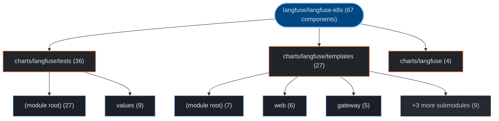
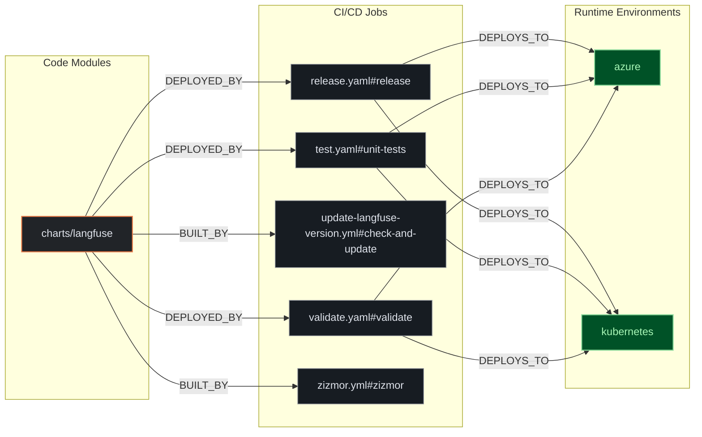
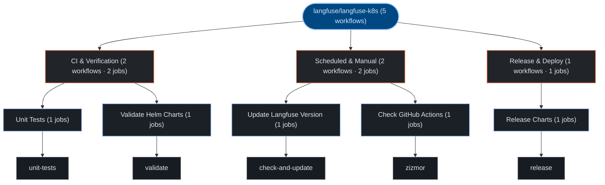

# Repository Architecture Analysis: langfuse/langfuse-k8s

## Metadata
- **SHA**: `a2d42cd4db1b50bbcca800e2d3b870a09a17d7a0`
- **Primary Ecosystem**: Container / Helm / IaC

## Quality Metrics
- **ast_engine**: fallback
- **avg_cognitive_complexity**: 0.0
- **avg_cyclomatic_complexity**: 0.0
- **component_count**: 67
- **dead_code_count**: 0
- **dead_code_symbols**: 0 entry(ies)
- **duplication_pct**: 0.0
- **file_complexities**: 0 entry(ies)
- **files_analyzed**: 67
- **fitness_passed**: True
- **fitness_violation_count**: 0
- **framework**: Helm Chart
- **import_edges**: 0 entry(ies)
- **loc**: 7678
- **max_cognitive_complexity**: 0
- **max_cyclomatic_complexity**: 0
- **sloc**: 6653
- **test_file_count**: 36

# Architecture: langfuse/langfuse-k8s

## Context
- **Repository**: `langfuse/langfuse-k8s`
- **SHA**: `a2d42cd4db1b50bbcca800e2d3b870a09a17d7a0`
- **Ecosystem**: Container / Helm / IaC
- **Framework**: Helm Chart

## Building Block View

## Component Details

Showing top 60 representative components out of 67 across 3 module group(s):

- **Module `charts/langfuse/tests`** (36 components — module: 36)
- **Module `charts/langfuse/templates`** (27 components — module: 27)
- **Module `charts/langfuse`** (4 components — module: 4)

- **Chart** (`charts/langfuse/Chart.yaml`): module
- **ai_features_test** (`charts/langfuse/tests/ai_features_test.yaml`): module
- **auth-providers_test** (`charts/langfuse/tests/auth-providers_test.yaml`): module
- **basic_test** (`charts/langfuse/tests/basic_test.yaml`): module
- **bundled-store-auth_test** (`charts/langfuse/tests/bundled-store-auth_test.yaml`): module
- **clickhouse-cluster_test** (`charts/langfuse/tests/clickhouse-cluster_test.yaml`): module
- **clickhouse-crd-preflight_test** (`charts/langfuse/tests/clickhouse-crd-preflight_test.yaml`): module
- **clickhouse-image-tag_test** (`charts/langfuse/tests/clickhouse-image-tag_test.yaml`): module
- **clickhouse-logger_test** (`charts/langfuse/tests/clickhouse-logger_test.yaml`): module
- **clickhouse-pull-secrets_test** (`charts/langfuse/tests/clickhouse-pull-secrets_test.yaml`): module
- **clickhouse-resources_test** (`charts/langfuse/tests/clickhouse-resources_test.yaml`): module
- **cluster** (`charts/langfuse/templates/clickhouse/cluster.yaml`): module
- **deployment** (`charts/langfuse/templates/gateway/deployment.yaml`): module
- **deployment** (`charts/langfuse/templates/web/deployment.yaml`): module
- **deployment** (`charts/langfuse/templates/worker/deployment.yaml`): module
- **deployment-replicas_test** (`charts/langfuse/tests/deployment-replicas_test.yaml`): module
- **downward-api-base** (`charts/langfuse/tests/values/downward-api-base.yaml`): module
- **downward-api-examples** (`charts/langfuse/tests/values/downward-api-examples.yaml`): module
- **downward-api_test** (`charts/langfuse/tests/downward-api_test.yaml`): module
- **extra-all-containers** (`charts/langfuse/tests/values/extra-all-containers.yaml`): module
- **extra-all-env** (`charts/langfuse/tests/values/extra-all-env.yaml`): module
- **extra-containers_test** (`charts/langfuse/tests/extra-containers_test.yaml`): module
- **extra-env_test** (`charts/langfuse/tests/extra-env_test.yaml`): module
- **extra-manifests** (`charts/langfuse/templates/extra-manifests.yaml`): module
- **extra-web-containers** (`charts/langfuse/tests/values/extra-web-containers.yaml`): module
- **extra-worker-containers** (`charts/langfuse/tests/values/extra-worker-containers.yaml`): module
- **gateway_test** (`charts/langfuse/tests/gateway_test.yaml`): module
- **hpa** (`charts/langfuse/templates/gateway/hpa.yaml`): module
- **hpa** (`charts/langfuse/templates/web/hpa.yaml`): module
- **hpa** (`charts/langfuse/templates/worker/hpa.yaml`): module
- **hpa-annotations** (`charts/langfuse/tests/values/hpa-annotations.yaml`): module
- **hpa_test** (`charts/langfuse/tests/hpa_test.yaml`): module
- **ingress** (`charts/langfuse/templates/gateway/ingress.yaml`): module
- **ingress** (`charts/langfuse/templates/ingress.yaml`): module
- **ingress_test** (`charts/langfuse/tests/ingress_test.yaml`): module
- **keeper** (`charts/langfuse/templates/clickhouse/keeper.yaml`): module
- **langfuse-app-secret** (`charts/langfuse/templates/langfuse-app-secret.yaml`): module
- **langfuse-app-secret_test** (`charts/langfuse/tests/langfuse-app-secret_test.yaml`): module
- **minimal-installation_test** (`charts/langfuse/tests/minimal-installation_test.yaml`): module
- **pdb** (`charts/langfuse/templates/gateway/pdb.yaml`): module
- **pdb** (`charts/langfuse/templates/web/pdb.yaml`): module
- **pdb** (`charts/langfuse/templates/worker/pdb.yaml`): module
- **pdb** (`charts/langfuse/tests/values/pdb.yaml`): module
- **postgresql-secret** (`charts/langfuse/templates/postgresql-secret.yaml`): module
- **priority-class_test** (`charts/langfuse/tests/priority-class_test.yaml`): module
- **redis-cluster_test** (`charts/langfuse/tests/redis-cluster_test.yaml`): module
- **redis-secret** (`charts/langfuse/templates/redis-secret.yaml`): module
- **release-name_test** (`charts/langfuse/tests/release-name_test.yaml`): module
- **s3-force-path-style_test** (`charts/langfuse/tests/s3-force-path-style_test.yaml`): module
- **s3-media-upload-validation_test** (`charts/langfuse/tests/s3-media-upload-validation_test.yaml`): module
- **scaled-object** (`charts/langfuse/templates/web/scaled-object.yaml`): module
- **scaled-object** (`charts/langfuse/templates/worker/scaled-object.yaml`): module
- **seaweedfs-image_test** (`charts/langfuse/tests/seaweedfs-image_test.yaml`): module
- **secret** (`charts/langfuse/templates/clickhouse/secret.yaml`): module
- **secret** (`charts/langfuse/templates/s3/secret.yaml`): module
- **service** (`charts/langfuse/templates/gateway/service.yaml`): module
- **service** (`charts/langfuse/templates/web/service.yaml`): module
- **serviceaccount** (`charts/langfuse/templates/serviceaccount.yaml`): module
- **v1-upgrade-guard_test** (`charts/langfuse/tests/v1-upgrade-guard_test.yaml`): module
- **validations** (`charts/langfuse/templates/validations.yaml`): module

## 6-Dimension Repository Scorecard

- **Overall Grade**: `C` (72.75/100)
- **Technical Debt Score**: 27.25
- **Estimated Remediation Effort**: 19.31h

| Dimension | Grade | Score | Weight | Details |
| :--- | :---: | :---: | :---: | :--- |
| Code Quality | `A` | 100.00 | 0.20 | avg_cc=0.00, max_cc=0, duplication=0.00%, dead_code=0 |
| Dependency Health | `A` | 90.00 | 0.15 | dependencies=0 (no manifests parsed) |
| Maintainability | `A` | 100.00 | 0.15 | avg_cognitive=0.00, max_cognitive=0, fitness_violations=0, oversized_files=0 |
| Pipeline Health | `F` | 25.00 | 0.15 | workflows=5, operational_antipatterns=8, parallel_branches=False |
| Security | `F` | 50.00 | 0.20 | vulnerabilities=0, secrets=2, pipeline_security_findings=0 |
| Test Coverage | `C` | 70.00 | 0.15 | coverage=unavailable, ci_test_job=True, test_files_detected=True |

## Supply Chain Dependencies, Vulnerabilities & Secrets

- **Dependencies Parsed**: 0 | **Vulnerabilities**: 0 | **Secrets**: 2

### Secret Findings (Redacted)
- **[CRITICAL] `ATRUSS-SEC-004`** at `README.md:467` (`-----BEGIN ... PRIVATE KEY----- [REDACTED]`)
- **[CRITICAL] `ATRUSS-SEC-004`** at `examples/minimal-installation/secret.yaml:39` (`-----BEGIN ... PRIVATE KEY----- [REDACTED]`)

## Section 7: Code-to-Cloud Deployment Traceability

- `release.yaml#release` (ci_job) --[DEPLOYS_TO]--> `azure` (environment)
- `release.yaml#release` (ci_job) --[DEPLOYS_TO]--> `kubernetes` (environment)
- `test.yaml#unit-tests` (ci_job) --[DEPLOYS_TO]--> `azure` (environment)
- `test.yaml#unit-tests` (ci_job) --[DEPLOYS_TO]--> `kubernetes` (environment)
- `validate.yaml#validate` (ci_job) --[DEPLOYS_TO]--> `azure` (environment)
- `validate.yaml#validate` (ci_job) --[DEPLOYS_TO]--> `kubernetes` (environment)
- `charts/langfuse` (code_module) --[BUILT_BY]--> `update-langfuse-version.yml#check-and-update` (ci_job)
- `charts/langfuse` (code_module) --[BUILT_BY]--> `zizmor.yml#zizmor` (ci_job)
- `charts/langfuse` (code_module) --[DEPLOYED_BY]--> `release.yaml#release` (ci_job)
- `charts/langfuse` (code_module) --[DEPLOYED_BY]--> `test.yaml#unit-tests` (ci_job)
- `charts/langfuse` (code_module) --[DEPLOYED_BY]--> `validate.yaml#validate` (ci_job)

## CI/CD Pipeline Topology

