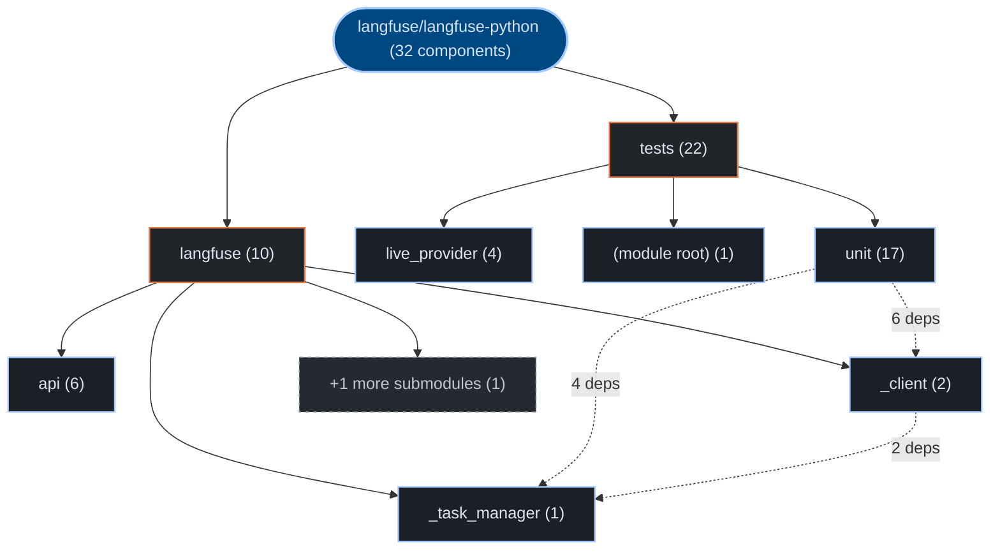
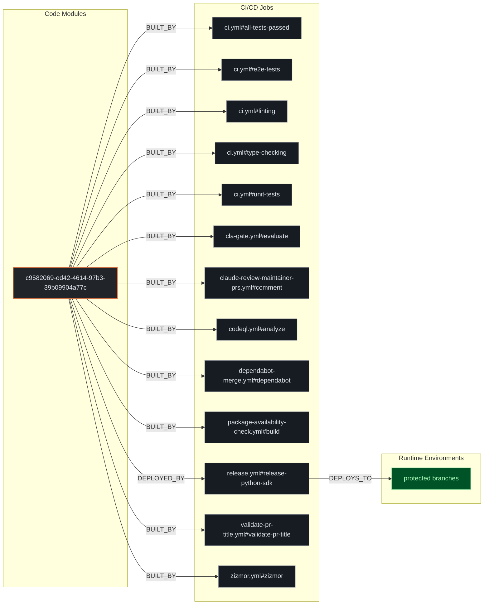

# Repository Architecture Analysis: langfuse/langfuse-python

## Metadata
- **SHA**: `077448c7a4ae8708f29e1434177bf9f3c667119b`
- **Primary Ecosystem**: Python

## Quality Metrics
- **ast_engine**: tree-sitter
- **avg_cognitive_complexity**: 2.05
- **avg_cyclomatic_complexity**: 2.57
- **component_count**: 32
- **dead_code_count**: 7
- **dead_code_symbols**: 7 entry(ies)
- **duplication_pct**: 89.95
- **file_complexities**: 25 entry(ies)
- **files_analyzed**: 595
- **fitness_passed**: False
- **fitness_violation_count**: 3
- **framework**: Unknown
- **import_edges**: 100 entry(ies)
- **loc**: 126083
- **max_cognitive_complexity**: 130
- **max_cyclomatic_complexity**: 54
- **sloc**: 104966
- **test_file_count**: 59

# Architecture: langfuse/langfuse-python

## Context
- **Repository**: `langfuse/langfuse-python`
- **SHA**: `077448c7a4ae8708f29e1434177bf9f3c667119b`
- **Ecosystem**: Python
- **Framework**: Unknown

## Building Block View

## Component Details
- **LangfuseResourceManager** (`langfuse/_client/resource_manager.py`): SERVICE (deps: MediaManager)
- **LangfuseTransformingSpanExporter** (`langfuse/_client/span_exporter.py`): SERVICE (deps: MediaManager)
- **MediaManager** (`langfuse/_task_manager/media_manager.py`): SERVICE
- **PromptCacheTaskManager** (`langfuse/_utils/prompt_cache.py`): SERVICE
- **Score_Numeric** (`langfuse/api/commons/types/score.py`): DATA_ACCESS_LAYER (deps: UniversalBaseModel)
- **Score_Categorical** (`langfuse/api/commons/types/score.py`): DATA_ACCESS_LAYER (deps: UniversalBaseModel)
- **Score_Boolean** (`langfuse/api/commons/types/score.py`): DATA_ACCESS_LAYER (deps: UniversalBaseModel)
- **Score_Correction** (`langfuse/api/commons/types/score.py`): DATA_ACCESS_LAYER (deps: UniversalBaseModel)
- **Score_Text** (`langfuse/api/commons/types/score.py`): DATA_ACCESS_LAYER (deps: UniversalBaseModel)
- **UniversalBaseModel** (`langfuse/api/core/pydantic_utilities.py`): DATA_ACCESS_LAYER
- **InMemorySpanExporter** (`tests/conftest.py`): SERVICE (deps: LangfuseResourceManager)
- **StandardizedAddress** (`tests/live_provider/test_langchain.py`): DATA_ACCESS_LAYER
- **GetWeather** (`tests/live_provider/test_langchain.py`): DATA_ACCESS_LAYER
- **StepByStepAIResponse** (`tests/live_provider/test_openai.py`): DATA_ACCESS_LAYER
- **CalendarEvent** (`tests/live_provider/test_openai.py`): DATA_ACCESS_LAYER
- **NoOpSpanExporter** (`tests/unit/test_additional_headers_simple.py`): SERVICE (deps: LangfuseResourceManager)
- **TestModel** (`tests/unit/test_json.py`): DATA_ACCESS_LAYER
- **_ExampleToolArgs** (`tests/unit/test_langchain.py`): DATA_ACCESS_LAYER
- **InMemorySpanExporter** (`tests/unit/test_mask_otel_spans.py`): SERVICE (deps: MediaManager)
- **FailsOnceSpanExporter** (`tests/unit/test_mask_otel_spans.py`): SERVICE (deps: MediaManager)
- **ParsedOutput** (`tests/unit/test_openai.py`): DATA_ACCESS_LAYER
- **ResponseFormat** (`tests/unit/test_openai_prompt_extraction.py`): DATA_ACCESS_LAYER
- **FallbackModel** (`tests/unit/test_openai_prompt_extraction.py`): DATA_ACCESS_LAYER
- **Metadata** (`tests/unit/test_openai_prompt_extraction.py`): DATA_ACCESS_LAYER
- **InMemorySpanExporter** (`tests/unit/test_otel.py`): SERVICE (deps: LangfuseResourceManager)
- **NoOpSpanExporter** (`tests/unit/test_resource_manager.py`): SERVICE (deps: LangfuseResourceManager, MediaManager)
- **FakeMediaManager** (`tests/unit/test_resource_manager.py`): SERVICE (deps: LangfuseResourceManager, MediaManager)
- **NoOpSpanExporter** (`tests/unit/test_score_consumer.py`): SERVICE (deps: LangfuseResourceManager)
- **TestBaseModel** (`tests/unit/test_serializer.py`): DATA_ACCESS_LAYER
- **SecretBaseModel** (`tests/unit/test_serializer.py`): DATA_ACCESS_LAYER
- **ModelWithFloats** (`tests/unit/test_serializer.py`): DATA_ACCESS_LAYER
- **NoOpSpanExporter** (`tests/unit/test_span_processor.py`): SERVICE (deps: InMemorySpanExporter)

## 6-Dimension Repository Scorecard

- **Overall Grade**: `F` (45.60/100)
- **Technical Debt Score**: 54.40
- **Estimated Remediation Effort**: 90.34h

| Dimension | Grade | Score | Weight | Details |
| :--- | :---: | :---: | :---: | :--- |
| Code Quality | `F` | 36.00 | 0.20 | avg_cc=2.57, max_cc=54, duplication=89.95%, dead_code=7 |
| Dependency Health | `A` | 100.00 | 0.15 | dependencies=123, outdated=0, vulnerable=0, has_lockfile=True |
| Maintainability | `F` | 37.00 | 0.15 | avg_cognitive=2.05, max_cognitive=130, fitness_violations=3, oversized_files=23 |
| Pipeline Health | `F` | 49.00 | 0.15 | workflows=9, operational_antipatterns=12, parallel_branches=True |
| Security | `F` | 0.00 | 0.20 | vulnerabilities=0, secrets=0, pipeline_security_findings=5 |
| Test Coverage | `C` | 70.00 | 0.15 | coverage=unavailable, ci_test_job=True, test_files_detected=True |

## Architecture Fitness & Workspace Boundaries

- **[MEDIUM] `ATRUSS-ARCH-005` (COMPLEXITY_THRESHOLD)**: Repository duplication_pct (89.95) exceeds policy threshold (15.0).
- **[MEDIUM] `ATRUSS-ARCH-005` (COMPLEXITY_THRESHOLD)**: Repository max_cognitive_complexity (130.0) exceeds policy threshold (25.0).
- **[MEDIUM] `ATRUSS-ARCH-005` (COMPLEXITY_THRESHOLD)**: Repository max_cyclomatic_complexity (54.0) exceeds policy threshold (20.0).

## Supply Chain Dependencies, Vulnerabilities & Secrets

- **Dependencies Parsed**: 123 | **Vulnerabilities**: 0 | **Secrets**: 0

### Inventory Sample
- `autoevals` `0.0.130` (PyPI, `pyproject.toml`)
- `autoevals` `0.0.130` (PyPI, `uv.lock`)
- `backoff` `1.10.0` (PyPI, `pyproject.toml`)
- `backoff` `2.2.1` (PyPI, `uv.lock`)
- `gevent` `24.2.1` (PyPI, `pyproject.toml`)
- `gevent` `26.9.0` (PyPI, `uv.lock`)
- `httpx` `0.15.4` (PyPI, `pyproject.toml`)
- `httpx` `0.28.1` (PyPI, `uv.lock`)
- `langchain` `1` (PyPI, `pyproject.toml`)
- `langchain` `1.2.13` (PyPI, `uv.lock`)
- `langchain-core` `1` (PyPI, `pyproject.toml`)
- `langchain-core` `1.2.22` (PyPI, `uv.lock`)
- `langchain-openai` `1` (PyPI, `pyproject.toml`)
- `langchain-openai` `1.1.12` (PyPI, `uv.lock`)
- `langgraph` `1` (PyPI, `pyproject.toml`)
- `langgraph` `1.1.3` (PyPI, `uv.lock`)
- `mypy` `1.0.0` (PyPI, `pyproject.toml`)
- `mypy` `1.19.1` (PyPI, `uv.lock`)
- `openai` `1.0.0` (PyPI, `pyproject.toml`)
- `openai` `2.29.0` (PyPI, `uv.lock`)
- `opentelemetry-api` `1.45.0` (PyPI, `pyproject.toml`)
- `opentelemetry-api` `1.45.1` (PyPI, `uv.lock`)
- `opentelemetry-exporter-otlp-proto-http` `1.45.0` (PyPI, `pyproject.toml`)
- `opentelemetry-exporter-otlp-proto-http` `1.45.0` (PyPI, `uv.lock`)
- `opentelemetry-instrumentation-threading` `0.59b0` (PyPI, `pyproject.toml`)
- `opentelemetry-instrumentation-threading` `0.66b1` (PyPI, `uv.lock`)
- `opentelemetry-sdk` `1.45.0` (PyPI, `pyproject.toml`)
- `opentelemetry-sdk` `1.45.1` (PyPI, `uv.lock`)
- `packaging` `23.2` (PyPI, `pyproject.toml`)
- `packaging` `26.0` (PyPI, `uv.lock`)
- ... (+93 more dependencies)

## Section 7: Code-to-Cloud Deployment Traceability

- `release.yml#release-python-sdk` (ci_job) --[DEPLOYS_TO]--> `protected branches` (environment)
- `c9582069-ed42-4614-97b3-39b09904a77c` (code_module) --[BUILT_BY]--> `ci.yml#all-tests-passed` (ci_job)
- `c9582069-ed42-4614-97b3-39b09904a77c` (code_module) --[BUILT_BY]--> `ci.yml#e2e-tests` (ci_job)
- `c9582069-ed42-4614-97b3-39b09904a77c` (code_module) --[BUILT_BY]--> `ci.yml#linting` (ci_job)
- `c9582069-ed42-4614-97b3-39b09904a77c` (code_module) --[BUILT_BY]--> `ci.yml#type-checking` (ci_job)
- `c9582069-ed42-4614-97b3-39b09904a77c` (code_module) --[BUILT_BY]--> `ci.yml#unit-tests` (ci_job)
- `c9582069-ed42-4614-97b3-39b09904a77c` (code_module) --[BUILT_BY]--> `cla-gate.yml#evaluate` (ci_job)
- `c9582069-ed42-4614-97b3-39b09904a77c` (code_module) --[BUILT_BY]--> `claude-review-maintainer-prs.yml#comment` (ci_job)
- `c9582069-ed42-4614-97b3-39b09904a77c` (code_module) --[BUILT_BY]--> `codeql.yml#analyze` (ci_job)
- `c9582069-ed42-4614-97b3-39b09904a77c` (code_module) --[BUILT_BY]--> `dependabot-merge.yml#dependabot` (ci_job)
- `c9582069-ed42-4614-97b3-39b09904a77c` (code_module) --[BUILT_BY]--> `package-availability-check.yml#build` (ci_job)
- `c9582069-ed42-4614-97b3-39b09904a77c` (code_module) --[BUILT_BY]--> `validate-pr-title.yml#validate-pr-title` (ci_job)
- `c9582069-ed42-4614-97b3-39b09904a77c` (code_module) --[BUILT_BY]--> `zizmor.yml#zizmor` (ci_job)
- `c9582069-ed42-4614-97b3-39b09904a77c` (code_module) --[DEPLOYED_BY]--> `release.yml#release-python-sdk` (ci_job)

## CI/CD Pipeline Topology

```mermaid
graph TD;
  classDef atlasRoot fill:#004882,stroke:#a3c9ff,stroke-width:2px,color:#d3e4ff
  classDef atlasCategory fill:#212428,stroke:#E87A48,stroke-width:1.5px,color:#dfe3eb
  classDef atlasWorkflow fill:#1b2026,stroke:#a3c9ff,stroke-width:1.5px,color:#dfe3eb
  classDef atlasJob fill:#171c22,stroke:#8d9199,stroke-width:1px,color:#dfe3eb
  classDef atlasTarget fill:#005227,stroke:#8bd99b,stroke-width:1.5px,color:#a7f6b6
  classDef atlasAlert fill:#93000a,stroke:#ffb4ab,stroke-width:1.5px,color:#ffdad6
  classDef atlasMore fill:#252a31,stroke:#8d9199,stroke-dasharray:4 4,color:#c3c6cf
  pipeline_root(["langfuse/langfuse-python (9 workflows)"]):::atlasRoot
  grp_0_CI___Verification["CI & Verification (3 workflows · 3 jobs)"]:::atlasCategory
  pipeline_root --> grp_0_CI___Verification
  wf_1_CLA_gate["CLA gate (1 jobs)"]:::atlasWorkflow
  grp_0_CI___Verification --> wf_1_CLA_gate
  job_1_evaluate["evaluate"]:::atlasJob
  wf_1_CLA_gate --> job_1_evaluate
  wf_2_Claude_Review_on_Maintainer_PRs["Claude Review on Maintainer PRs (1 jobs)"]:::atlasWorkflow
  grp_0_CI___Verification --> wf_2_Claude_Review_on_Maintainer_PRs
  job_2_comment["comment"]:::atlasJob
  wf_2_Claude_Review_on_Maintainer_PRs --> job_2_comment
  wf_7_Validate_PR_Title["Validate PR Title (1 jobs)"]:::atlasWorkflow
  grp_0_CI___Verification --> wf_7_Validate_PR_Title
  job_7_validate_pr_title["validate-pr-title"]:::atlasJob
  wf_7_Validate_PR_Title --> job_7_validate_pr_title
  grp_1_Scheduled___Manual["Scheduled & Manual (3 workflows · 7 jobs)"]:::atlasCategory
  pipeline_root --> grp_1_Scheduled___Manual
  wf_0_ci_yml["ci.yml (5 jobs)"]:::atlasWorkflow
  grp_1_Scheduled___Manual --> wf_0_ci_yml
  job_0_linting["linting"]:::atlasJob
  job_0_type_checking["type-checking"]:::atlasJob
  job_0_unit_tests["unit-tests"]:::atlasJob
  wf_0_ci_yml --> job_0_linting
  wf_0_ci_yml --> job_0_type_checking
  wf_0_ci_yml --> job_0_unit_tests
  wf_5_Check_availability_of_packages["Check availability of packages (1 jobs)"]:::atlasWorkflow
  grp_1_Scheduled___Manual --> wf_5_Check_availability_of_packages
  job_5_build["build"]:::atlasJob
  wf_5_Check_availability_of_packages --> job_5_build
  wf_8_Check_GitHub_Actions["Check GitHub Actions (1 jobs)"]:::atlasWorkflow
  grp_1_Scheduled___Manual --> wf_8_Check_GitHub_Actions
  job_8_zizmor["zizmor"]:::atlasJob
  wf_8_Check_GitHub_Actions --> job_8_zizmor
  grp_2_Security___Governance["Security & Governance (2 workflows · 2 jobs)"]:::atlasCategory
  pipeline_root --> grp_2_Security___Governance
  wf_3_CodeQL_Advanced["CodeQL Advanced (1 jobs)"]:::atlasWorkflow
  grp_2_Security___Governance --> wf_3_CodeQL_Advanced
  job_3_analyze["analyze"]:::atlasJob
  wf_3_CodeQL_Advanced --> job_3_analyze
  wf_4_Dependabot_auto_merge["Dependabot auto-merge (1 jobs)"]:::atlasWorkflow
  grp_2_Security___Governance --> wf_4_Dependabot_auto_merge
  job_4_dependabot["dependabot"]:::atlasJob
  wf_4_Dependabot_auto_merge --> job_4_dependabot
  grp_3_Release___Deploy["Release & Deploy (1 workflows · 1 jobs)"]:::atlasCategory
  pipeline_root --> grp_3_Release___Deploy
  wf_6_Release_Python_SDK["Release Python SDK (1 jobs)"]:::atlasWorkflow
  grp_3_Release___Deploy --> wf_6_Release_Python_SDK
  job_6_release_python_sdk["release-python-sdk"]:::atlasJob
  wf_6_Release_Python_SDK --> job_6_release_python_sdk
```

