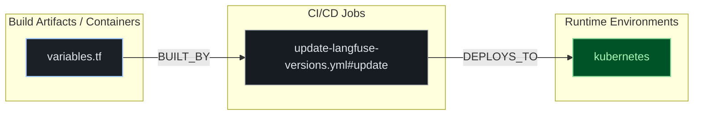
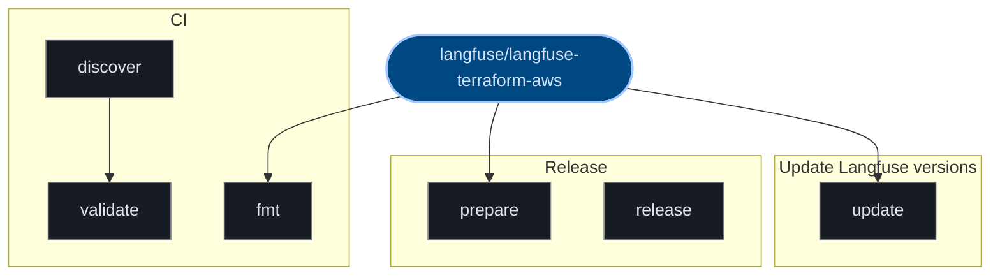

# Repository Architecture Analysis: langfuse/langfuse-terraform-aws

## Metadata
- **SHA**: `e8fce4ec41a1889739df19cd8fad0c2e7c20d6c4`
- **Primary Ecosystem**: Container / Helm / IaC

## Quality Metrics
- **ast_engine**: fallback
- **avg_cognitive_complexity**: 0.0
- **avg_cyclomatic_complexity**: 0.0
- **component_count**: 24
- **dead_code_count**: 0
- **dead_code_symbols**: 0 entry(ies)
- **duplication_pct**: 0.0
- **file_complexities**: 0 entry(ies)
- **files_analyzed**: 24
- **fitness_passed**: True
- **fitness_violation_count**: 0
- **framework**: Terraform / IaC
- **import_edges**: 0 entry(ies)
- **loc**: 3600
- **max_cognitive_complexity**: 0
- **max_cyclomatic_complexity**: 0
- **sloc**: 2842

# Architecture: langfuse/langfuse-terraform-aws

## Context
- **Repository**: `langfuse/langfuse-terraform-aws`
- **SHA**: `e8fce4ec41a1889739df19cd8fad0c2e7c20d6c4`
- **Ecosystem**: Container / Helm / IaC
- **Framework**: Terraform / IaC

## Building Block View

```mermaid
graph TD;
  classDef atlasRoot fill:#004882,stroke:#a3c9ff,stroke-width:2px,color:#d3e4ff
  classDef atlasCategory fill:#212428,stroke:#E87A48,stroke-width:1.5px,color:#dfe3eb
  classDef atlasWorkflow fill:#1b2026,stroke:#a3c9ff,stroke-width:1.5px,color:#dfe3eb
  classDef atlasJob fill:#171c22,stroke:#8d9199,stroke-width:1px,color:#dfe3eb
  classDef atlasTarget fill:#005227,stroke:#8bd99b,stroke-width:1.5px,color:#a7f6b6
  classDef atlasAlert fill:#93000a,stroke:#ffb4ab,stroke-width:1.5px,color:#ffdad6
  classDef atlasMore fill:#252a31,stroke:#8d9199,stroke-dasharray:4 4,color:#c3c6cf
    agent_sandbox["agent_sandbox : module"]:::atlasJob
    ai_features["ai_features : module"]:::atlasJob
    clickhouse["clickhouse : module"]:::atlasJob
    code_based_eval_executor["code_based_eval_executor : module"]:::atlasJob
    efs["efs : module"]:::atlasJob
    eks["eks : module"]:::atlasJob
    ingress["ingress : module"]:::atlasJob
    langfuse["langfuse : module"]:::atlasJob
    locals["locals : module"]:::atlasJob
    outputs["outputs : module"]:::atlasJob
    postgresql["postgresql : module"]:::atlasJob
    redis["redis : module"]:::atlasJob
    s3["s3 : module"]:::atlasJob
    tls_certificate["tls-certificate : module"]:::atlasJob
    variables["variables : module"]:::atlasJob
    versions["versions : module"]:::atlasJob
    vpc["vpc : module"]:::atlasJob
    vpc_isolated_execution["vpc_isolated_execution : module"]:::atlasJob
    ci["ci : module"]:::atlasJob
    release["release : module"]:::atlasJob
    update_langfuse_versions["update-langfuse-versions : module"]:::atlasJob
    external_clickhouse["external-clickhouse : module"]:::atlasJob
    external_dns["external-dns : module"]:::atlasJob
    quickstart["quickstart : module"]:::atlasJob
    repo_root(["langfuse/langfuse-terraform-aws"]):::atlasRoot
    repo_root --> agent_sandbox
    repo_root --> ai_features
    repo_root --> ci
    repo_root --> clickhouse
    repo_root --> code_based_eval_executor
    repo_root --> efs
    repo_root --> eks
    repo_root --> external_clickhouse
    repo_root --> external_dns
    repo_root --> ingress
    repo_root --> langfuse
    repo_root --> locals
    repo_root --> outputs
    repo_root --> postgresql
    repo_root --> quickstart
    repo_root --> redis
    repo_root --> release
    repo_root --> s3
    repo_root --> tls_certificate
    repo_root --> update_langfuse_versions
    repo_root --> variables
    repo_root --> versions
    repo_root --> vpc
    repo_root --> vpc_isolated_execution
```

## Component Details
- **agent_sandbox** (`agent_sandbox.tf`): module
- **ai_features** (`ai_features.tf`): module
- **clickhouse** (`clickhouse.tf`): module
- **code_based_eval_executor** (`code_based_eval_executor.tf`): module
- **efs** (`efs.tf`): module
- **eks** (`eks.tf`): module
- **ingress** (`ingress.tf`): module
- **langfuse** (`langfuse.tf`): module
- **locals** (`locals.tf`): module
- **outputs** (`outputs.tf`): module
- **postgresql** (`postgresql.tf`): module
- **redis** (`redis.tf`): module
- **s3** (`s3.tf`): module
- **tls-certificate** (`tls-certificate.tf`): module
- **variables** (`variables.tf`): module
- **versions** (`versions.tf`): module
- **vpc** (`vpc.tf`): module
- **vpc_isolated_execution** (`vpc_isolated_execution.tf`): module
- **ci** (`.github/workflows/ci.yml`): module
- **release** (`.github/workflows/release.yml`): module
- **update-langfuse-versions** (`.github/workflows/update-langfuse-versions.yml`): module
- **external-clickhouse** (`examples/external-clickhouse/external-clickhouse.tf`): module
- **external-dns** (`examples/external-dns/external-dns.tf`): module
- **quickstart** (`examples/quickstart/quickstart.tf`): module

## 6-Dimension Repository Scorecard

- **Overall Grade**: `B` (85.15/100)
- **Technical Debt Score**: 14.85
- **Estimated Remediation Effort**: 11.71h

| Dimension | Grade | Score | Weight | Details |
| :--- | :---: | :---: | :---: | :--- |
| Code Quality | `A` | 100.00 | 0.20 | avg_cc=0.00, max_cc=0, duplication=0.00%, dead_code=0 |
| Dependency Health | `A` | 90.00 | 0.15 | dependencies=0 (no manifests parsed) |
| Maintainability | `A` | 100.00 | 0.15 | avg_cognitive=0.00, max_cognitive=0, fitness_violations=0, oversized_files=0 |
| Pipeline Health | `F` | 41.00 | 0.15 | workflows=3, operational_antipatterns=9, parallel_branches=True |
| Security | `A` | 100.00 | 0.20 | vulnerabilities=0, secrets=0, pipeline_security_findings=0 |
| Test Coverage | `C` | 70.00 | 0.15 | coverage=unavailable, ci_test_job=True, test_files_detected=False |

## Section 7: Code-to-Cloud Deployment Traceability

- `update-langfuse-versions.yml#update` (ci_job) --[DEPLOYS_TO]--> `kubernetes` (environment)
- `variables.tf` (iac) --[BUILT_BY]--> `update-langfuse-versions.yml#update` (ci_job)

## CI/CD Pipeline Topology

