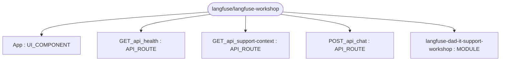
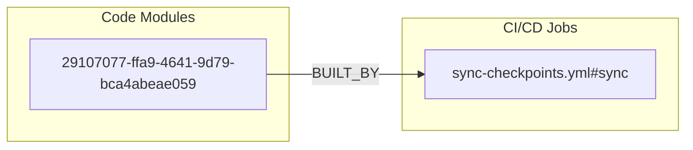
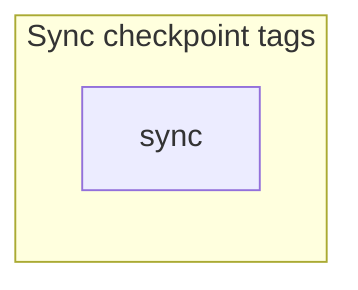

# Repository Architecture Analysis: langfuse/langfuse-workshop

## Metadata
- **SHA**: `042dda2ef978c2ec739c05b091260e7842e16c2b`
- **Primary Ecosystem**: JavaScript/TypeScript

## Quality Metrics
- **ast_engine**: tree-sitter
- **avg_cognitive_complexity**: 3.61
- **avg_cyclomatic_complexity**: 4.08
- **component_count**: 5
- **dead_code_count**: 5
- **dead_code_symbols**: 5 entry(ies)
- **duplication_pct**: 49.53
- **file_complexities**: 18 entry(ies)
- **files_analyzed**: 18
- **fitness_passed**: False
- **fitness_violation_count**: 2
- **framework**: React (Vite)
- **import_edges**: 100 entry(ies)
- **loc**: 3780
- **max_cognitive_complexity**: 36
- **max_cyclomatic_complexity**: 20
- **sloc**: 3183

# Architecture: langfuse/langfuse-workshop

## Context
- **Repository**: `langfuse/langfuse-workshop`
- **SHA**: `042dda2ef978c2ec739c05b091260e7842e16c2b`
- **Ecosystem**: JavaScript/TypeScript
- **Framework**: React (Vite)

## Building Block View

## Component Details
- **langfuse-dad-it-support-workshop** (`package.json`): MODULE
- **App** (`src/client/App.tsx`): UI_COMPONENT
- **GET_api_health** (`src/server/index.ts`): API_ROUTE
- **GET_api_support-context** (`src/server/index.ts`): API_ROUTE
- **POST_api_chat** (`src/server/index.ts`): API_ROUTE

## 6-Dimension Repository Scorecard

- **Overall Grade**: `C` (74.29/100)
- **Technical Debt Score**: 25.71
- **Estimated Remediation Effort**: 24.08h

| Dimension | Grade | Score | Weight | Details |
| :--- | :---: | :---: | :---: | :--- |
| Code Quality | `F` | 53.18 | 0.20 | avg_cc=4.08, max_cc=20, duplication=49.53%, dead_code=5 |
| Dependency Health | `A` | 100.00 | 0.15 | dependencies=427, outdated=0, vulnerable=0, has_lockfile=True |
| Maintainability | `F` | 54.00 | 0.15 | avg_cognitive=3.61, max_cognitive=36, fitness_violations=2, oversized_files=2 |
| Pipeline Health | `A` | 97.00 | 0.15 | workflows=1, operational_antipatterns=1, parallel_branches=False |
| Security | `A` | 100.00 | 0.20 | vulnerabilities=0, secrets=0, pipeline_security_findings=0 |
| Test Coverage | `F` | 40.00 | 0.15 | coverage=unavailable, ci_test_job=False, test_files_detected=False |

## Architecture Fitness & Workspace Boundaries

- **[MEDIUM] `ATRUSS-ARCH-005` (COMPLEXITY_THRESHOLD)**: Repository duplication_pct (49.53) exceeds policy threshold (15.0).
- **[MEDIUM] `ATRUSS-ARCH-005` (COMPLEXITY_THRESHOLD)**: Repository max_cognitive_complexity (36.0) exceeds policy threshold (25.0).

## Supply Chain Dependencies, Vulnerabilities & Secrets

- **Dependencies Parsed**: 427 | **Vulnerabilities**: 0 | **Secrets**: 0

### Inventory Sample
- `@langfuse/client` `*` (npm, `package.json`)
- `@langfuse/client` `5.3.0` (npm, `package-lock.json`)
- `@langfuse/openai` `*` (npm, `package.json`)
- `@langfuse/openai` `5.3.0` (npm, `package-lock.json`)
- `@langfuse/otel` `*` (npm, `package.json`)
- `@langfuse/otel` `5.3.0` (npm, `package-lock.json`)
- `@langfuse/tracing` `*` (npm, `package.json`)
- `@langfuse/tracing` `5.3.0` (npm, `package-lock.json`)
- `@opentelemetry/sdk-node` `0.218.0` (npm, `package-lock.json`)
- `@opentelemetry/sdk-node` `0.218.0` (npm, `package.json`)
- `@types/express` `*` (npm, `package.json`)
- `@types/express` `5.0.6` (npm, `package-lock.json`)
- `@types/node` `*` (npm, `package.json`)
- `@types/node` `25.7.0` (npm, `package-lock.json`)
- `@types/react` `*` (npm, `package.json`)
- `@types/react` `19.2.14` (npm, `package-lock.json`)
- `@types/react-dom` `*` (npm, `package.json`)
- `@types/react-dom` `19.2.3` (npm, `package-lock.json`)
- `@vitejs/plugin-react` `*` (npm, `package.json`)
- `@vitejs/plugin-react` `6.0.1` (npm, `package-lock.json`)
- `concurrently` `*` (npm, `package.json`)
- `concurrently` `9.2.1` (npm, `package-lock.json`)
- `dotenv` `*` (npm, `package.json`)
- `dotenv` `17.4.2` (npm, `package-lock.json`)
- `express` `*` (npm, `package.json`)
- `express` `5.2.1` (npm, `package-lock.json`)
- `openai` `*` (npm, `package.json`)
- `openai` `6.38.0` (npm, `package-lock.json`)
- `react` `*` (npm, `package.json`)
- `react` `19.2.6` (npm, `package-lock.json`)
- ... (+397 more dependencies)

## Section 7: Code-to-Cloud Deployment Traceability

- `29107077-ffa9-4641-9d79-bca4abeae059` (code_module) --[BUILT_BY]--> `sync-checkpoints.yml#sync` (ci_job)

## CI/CD Pipeline Topology

