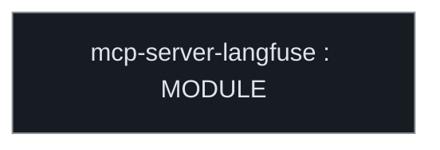

# Repository Architecture Analysis: langfuse/mcp-server-langfuse

## Metadata
- **SHA**: `a534b5a995d50c21ba45f14419246ef64d3ca6f4`
- **Primary Ecosystem**: JavaScript/TypeScript

## Quality Metrics
- **ast_engine**: tree-sitter
- **avg_cognitive_complexity**: 3.0
- **avg_cyclomatic_complexity**: 3.4
- **component_count**: 1
- **dead_code_count**: 0
- **dead_code_symbols**: 0 entry(ies)
- **duplication_pct**: 30.98
- **file_complexities**: 2 entry(ies)
- **files_analyzed**: 2
- **fitness_passed**: False
- **fitness_violation_count**: 1
- **framework**: TypeScript
- **import_edges**: 13 entry(ies)
- **loc**: 250
- **max_cognitive_complexity**: 10
- **max_cyclomatic_complexity**: 8
- **sloc**: 215

# Architecture: langfuse/mcp-server-langfuse

## Context
- **Repository**: `langfuse/mcp-server-langfuse`
- **SHA**: `a534b5a995d50c21ba45f14419246ef64d3ca6f4`
- **Ecosystem**: JavaScript/TypeScript
- **Framework**: TypeScript

## Building Block View

## Component Details
- **mcp-server-langfuse** (`package.json`): MODULE

## 6-Dimension Repository Scorecard

- **Overall Grade**: `C` (75.78/100)
- **Technical Debt Score**: 24.22
- **Estimated Remediation Effort**: 13.75h

| Dimension | Grade | Score | Weight | Details |
| :--- | :---: | :---: | :---: | :--- |
| Code Quality | `C` | 73.40 | 0.20 | avg_cc=3.40, max_cc=8, duplication=30.98%, dead_code=0 |
| Dependency Health | `A` | 100.00 | 0.15 | dependencies=28, outdated=0, vulnerable=0, has_lockfile=True |
| Maintainability | `A` | 94.00 | 0.15 | avg_cognitive=3.00, max_cognitive=10, fitness_violations=1, oversized_files=0 |
| Pipeline Health | `F` | 40.00 | 0.15 | workflows=0 |
| Security | `A` | 100.00 | 0.20 | vulnerabilities=0, secrets=0, pipeline_security_findings=0 |
| Test Coverage | `F` | 40.00 | 0.15 | coverage=unavailable, ci_test_job=False, test_files_detected=False |

## Architecture Fitness & Workspace Boundaries

- **[MEDIUM] `ATRUSS-ARCH-005` (COMPLEXITY_THRESHOLD)**: Repository duplication_pct (30.98) exceeds policy threshold (15.0).

## Supply Chain Dependencies, Vulnerabilities & Secrets

- **Dependencies Parsed**: 28 | **Vulnerabilities**: 0 | **Secrets**: 0

### Inventory Sample
- `@modelcontextprotocol/sdk` `1.5.0` (npm, `package-lock.json`)
- `@modelcontextprotocol/sdk` `1.5.0` (npm, `package.json`)
- `@types/node` `22.13.4` (npm, `package-lock.json`)
- `@types/node` `22.13.4` (npm, `package.json`)
- `langfuse` `3.35.2` (npm, `package-lock.json`)
- `langfuse` `3.35.2` (npm, `package.json`)
- `typescript` `5.7.3` (npm, `package-lock.json`)
- `typescript` `5.7.3` (npm, `package.json`)
- `zod` `3.24.2` (npm, `package-lock.json`)
- `zod` `3.24.2` (npm, `package.json`)
- `bytes` `3.1.2` (npm, `package-lock.json`)
- `content-type` `1.0.5` (npm, `package-lock.json`)
- `depd` `2.0.0` (npm, `package-lock.json`)
- `eventsource` `3.0.5` (npm, `package-lock.json`)
- `eventsource-parser` `3.0.0` (npm, `package-lock.json`)
- `http-errors` `2.0.0` (npm, `package-lock.json`)
- `iconv-lite` `0.6.3` (npm, `package-lock.json`)
- `inherits` `2.0.4` (npm, `package-lock.json`)
- `langfuse-core` `3.35.2` (npm, `package-lock.json`)
- `mustache` `4.2.0` (npm, `package-lock.json`)
- `raw-body` `3.0.0` (npm, `package-lock.json`)
- `safer-buffer` `2.1.2` (npm, `package-lock.json`)
- `setprototypeof` `1.2.0` (npm, `package-lock.json`)
- `statuses` `2.0.1` (npm, `package-lock.json`)
- `toidentifier` `1.0.1` (npm, `package-lock.json`)
- `undici-types` `6.20.0` (npm, `package-lock.json`)
- `unpipe` `1.0.0` (npm, `package-lock.json`)
- `zod-to-json-schema` `3.24.1` (npm, `package-lock.json`)

## CI/CD Pipeline Topology

