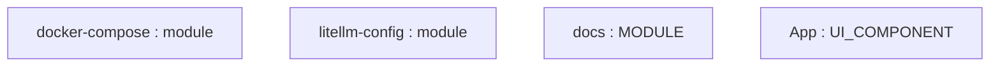
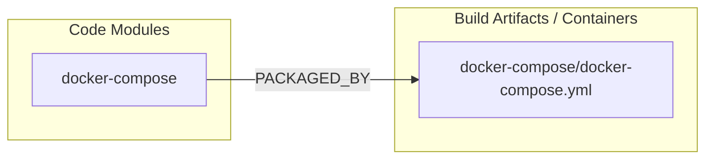
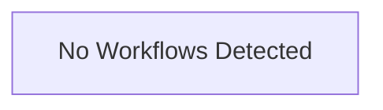

# Repository Architecture Analysis: langfuse/oss-llmops-stack

## Metadata
- **SHA**: `5af05d234cb27565e3fd7a603fd945d2e4c7ec5a`
- **Primary Ecosystem**: JavaScript/TypeScript

## Quality Metrics
- **ast_engine**: tree-sitter
- **avg_cognitive_complexity**: 3.0
- **avg_cyclomatic_complexity**: 2.78
- **component_count**: 4
- **dead_code_count**: 0
- **dead_code_symbols**: 0 entry(ies)
- **duplication_pct**: 22.66
- **file_complexities**: 8 entry(ies)
- **files_analyzed**: 10
- **fitness_passed**: False
- **fitness_violation_count**: 1
- **framework**: Next.js
- **import_edges**: 15 entry(ies)
- **loc**: 504
- **max_cognitive_complexity**: 9
- **max_cyclomatic_complexity**: 9
- **sloc**: 447

# Architecture: langfuse/oss-llmops-stack

## Context
- **Repository**: `langfuse/oss-llmops-stack`
- **SHA**: `5af05d234cb27565e3fd7a603fd945d2e4c7ec5a`
- **Ecosystem**: JavaScript/TypeScript
- **Framework**: Next.js

## Building Block View

## Component Details
- **docker-compose** (`docker-compose/docker-compose.yml`): module
- **litellm-config** (`docker-compose/litellm-config.yaml`): module
- **docs** (`docs/package.json`): MODULE
- **App** (`docs/pages/_app.jsx`): UI_COMPONENT

## 6-Dimension Repository Scorecard

- **Overall Grade**: `C` (76.10/100)
- **Technical Debt Score**: 23.90
- **Estimated Remediation Effort**: 12.01h

| Dimension | Grade | Score | Weight | Details |
| :--- | :---: | :---: | :---: | :--- |
| Code Quality | `C` | 75.00 | 0.20 | avg_cc=2.78, max_cc=9, duplication=22.66%, dead_code=0 |
| Dependency Health | `A` | 100.00 | 0.15 | dependencies=639, outdated=0, vulnerable=0, has_lockfile=True |
| Maintainability | `A` | 94.00 | 0.15 | avg_cognitive=3.00, max_cognitive=9, fitness_violations=1, oversized_files=0 |
| Pipeline Health | `F` | 40.00 | 0.15 | workflows=0 |
| Security | `A` | 100.00 | 0.20 | vulnerabilities=0, secrets=0, pipeline_security_findings=0 |
| Test Coverage | `F` | 40.00 | 0.15 | coverage=unavailable, ci_test_job=False, test_files_detected=False |

## Architecture Fitness & Workspace Boundaries

- **[MEDIUM] `ATRUSS-ARCH-005` (COMPLEXITY_THRESHOLD)**: Repository duplication_pct (22.66) exceeds policy threshold (15.0).

## Supply Chain Dependencies, Vulnerabilities & Secrets

- **Dependencies Parsed**: 639 | **Vulnerabilities**: 0 | **Secrets**: 0

### Inventory Sample
- `@tailwindcss/postcss` `4.0.6` (npm, `docs/package.json`)
- `@tailwindcss/postcss` `4.0.6` (npm, `docs/pnpm-lock.yaml`)
- `autoprefixer` `10.4.14` (npm, `docs/package.json`)
- `autoprefixer` `10.4.20` (npm, `docs/pnpm-lock.yaml`)
- `next` `15.1.2` (npm, `docs/package.json`)
- `next` `15.1.6` (npm, `docs/pnpm-lock.yaml`)
- `next-sitemap` `4.2.3` (npm, `docs/package.json`)
- `next-sitemap` `4.2.3` (npm, `docs/pnpm-lock.yaml`)
- `nextra` `3.0.15` (npm, `docs/package.json`)
- `nextra` `3.3.1` (npm, `docs/pnpm-lock.yaml`)
- `nextra-theme-docs` `3.0.15` (npm, `docs/package.json`)
- `nextra-theme-docs` `3.3.1` (npm, `docs/pnpm-lock.yaml`)
- `postcss` `8.4.24` (npm, `docs/package.json`)
- `postcss` `8.4.31` (npm, `docs/pnpm-lock.yaml`)
- `postcss` `8.5.2` (npm, `docs/pnpm-lock.yaml`)
- `posthog-js` `1.217.4` (npm, `docs/package.json`)
- `posthog-js` `1.217.4` (npm, `docs/pnpm-lock.yaml`)
- `react` `19.0.0` (npm, `docs/package.json`)
- `react` `19.0.0` (npm, `docs/pnpm-lock.yaml`)
- `react-dom` `19.0.0` (npm, `docs/package.json`)
- `react-dom` `19.0.0` (npm, `docs/pnpm-lock.yaml`)
- `tailwindcss` `3.3.2` (npm, `docs/package.json`)
- `tailwindcss` `3.4.17` (npm, `docs/pnpm-lock.yaml`)
- `tailwindcss` `4.0.6` (npm, `docs/pnpm-lock.yaml`)
- `xml2js` `0.6.2` (npm, `docs/package.json`)
- `xml2js` `0.6.2` (npm, `docs/pnpm-lock.yaml`)
- `@alloc/quick-lru` `5.2.0` (npm, `docs/pnpm-lock.yaml`)
- `@antfu/install-pkg` `1.0.0` (npm, `docs/pnpm-lock.yaml`)
- `@antfu/utils` `8.1.0` (npm, `docs/pnpm-lock.yaml`)
- `@braintree/sanitize-url` `7.1.1` (npm, `docs/pnpm-lock.yaml`)
- ... (+609 more dependencies)

## Section 7: Code-to-Cloud Deployment Traceability

- `docker-compose` (code_module) --[PACKAGED_BY]--> `docker-compose/docker-compose.yml` (container)

## CI/CD Pipeline Topology

