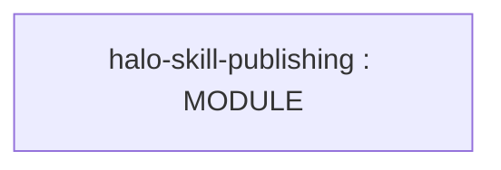
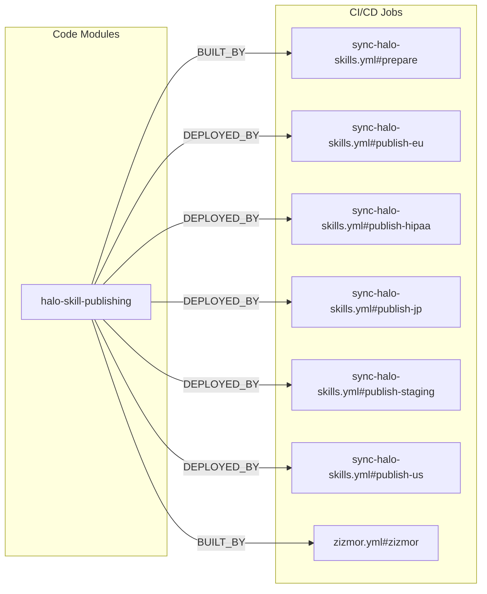
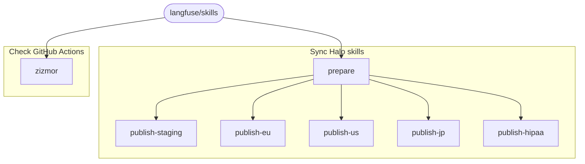

# Repository Architecture Analysis: langfuse/skills

## Metadata
- **SHA**: `f0bcb13088b490c04b3f4870bace17f6d57b199c`
- **Primary Ecosystem**: JavaScript/TypeScript

## Quality Metrics
- **ast_engine**: tree-sitter
- **avg_cognitive_complexity**: 2.33
- **avg_cyclomatic_complexity**: 5.33
- **component_count**: 1
- **dead_code_count**: 0
- **dead_code_symbols**: 0 entry(ies)
- **duplication_pct**: 0.0
- **file_complexities**: 1 entry(ies)
- **files_analyzed**: 1
- **fitness_passed**: True
- **fitness_violation_count**: 0
- **framework**: Unknown
- **import_edges**: 9 entry(ies)
- **loc**: 108
- **max_cognitive_complexity**: 5
- **max_cyclomatic_complexity**: 12
- **sloc**: 98

# Architecture: langfuse/skills

## Context
- **Repository**: `langfuse/skills`
- **SHA**: `f0bcb13088b490c04b3f4870bace17f6d57b199c`
- **Ecosystem**: JavaScript/TypeScript
- **Framework**: Unknown

## Building Block View

## Component Details
- **halo-skill-publishing** (`halo-skill-publishing/package.json`): MODULE

## 6-Dimension Repository Scorecard

- **Overall Grade**: `C` (72.04/100)
- **Technical Debt Score**: 27.96
- **Estimated Remediation Effort**: 23.49h

| Dimension | Grade | Score | Weight | Details |
| :--- | :---: | :---: | :---: | :--- |
| Code Quality | `A` | 90.68 | 0.20 | avg_cc=5.33, max_cc=12, duplication=0.00%, dead_code=0 |
| Dependency Health | `A` | 100.00 | 0.15 | dependencies=4, outdated=0, vulnerable=0, has_lockfile=True |
| Maintainability | `A` | 100.00 | 0.15 | avg_cognitive=2.33, max_cognitive=5, fitness_violations=0, oversized_files=0 |
| Pipeline Health | `F` | 36.00 | 0.15 | workflows=2, operational_antipatterns=7, parallel_branches=True |
| Security | `F` | 40.00 | 0.20 | vulnerabilities=0, secrets=0, pipeline_security_findings=5 |
| Test Coverage | `C` | 70.00 | 0.15 | coverage=unavailable, ci_test_job=True, test_files_detected=False |

## Supply Chain Dependencies, Vulnerabilities & Secrets

- **Dependencies Parsed**: 4 | **Vulnerabilities**: 0 | **Secrets**: 0

### Inventory Sample
- `@langfuse/cli` `1.3.0-beta.3` (npm, `halo-skill-publishing/package-lock.json`)
- `@langfuse/cli` `1.3.0-beta.3` (npm, `halo-skill-publishing/package.json`)
- `yaml` `2.9.0` (npm, `halo-skill-publishing/package-lock.json`)
- `yaml` `2.9.0` (npm, `halo-skill-publishing/package.json`)

## Section 7: Code-to-Cloud Deployment Traceability

- `halo-skill-publishing` (code_module) --[BUILT_BY]--> `sync-halo-skills.yml#prepare` (ci_job)
- `halo-skill-publishing` (code_module) --[BUILT_BY]--> `zizmor.yml#zizmor` (ci_job)
- `halo-skill-publishing` (code_module) --[DEPLOYED_BY]--> `sync-halo-skills.yml#publish-eu` (ci_job)
- `halo-skill-publishing` (code_module) --[DEPLOYED_BY]--> `sync-halo-skills.yml#publish-hipaa` (ci_job)
- `halo-skill-publishing` (code_module) --[DEPLOYED_BY]--> `sync-halo-skills.yml#publish-jp` (ci_job)
- `halo-skill-publishing` (code_module) --[DEPLOYED_BY]--> `sync-halo-skills.yml#publish-staging` (ci_job)
- `halo-skill-publishing` (code_module) --[DEPLOYED_BY]--> `sync-halo-skills.yml#publish-us` (ci_job)

## CI/CD Pipeline Topology

