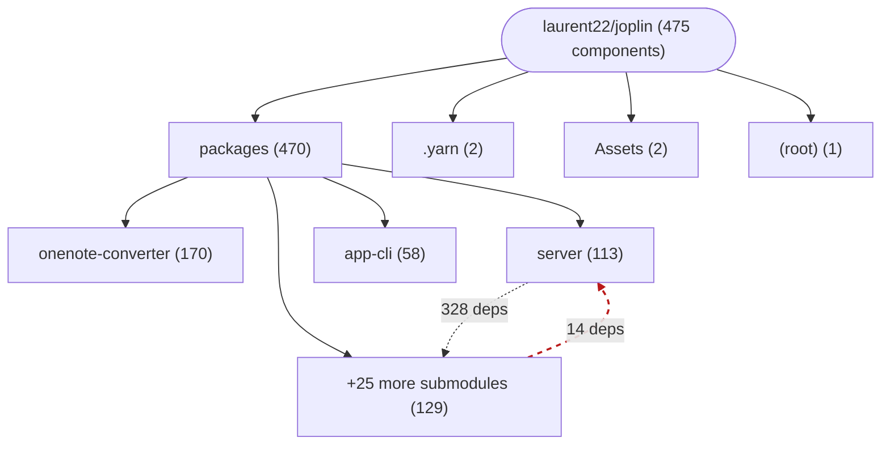
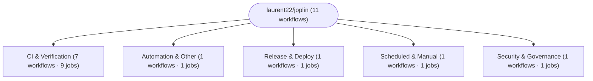

# Repository Architecture Analysis: laurent22/joplin

## Metadata
- **SHA**: `087d613c0c967a682970615260d57cfe1bd6135e`
- **Primary Ecosystem**: JavaScript/TypeScript

## Quality Metrics
- **ast_engine**: tree-sitter
- **avg_cognitive_complexity**: 2.5
- **avg_cyclomatic_complexity**: 2.47
- **component_count**: 475
- **dead_code_count**: 76
- **dead_code_symbols**: 50 entry(ies)
- **duplication_pct**: 82.22
- **file_complexities**: 25 entry(ies)
- **files_analyzed**: 4005
- **fitness_passed**: False
- **fitness_violation_count**: 243
- **framework**: React (Vite)
- **import_edges**: 100 entry(ies)
- **loc**: 499714
- **max_cognitive_complexity**: 397
- **max_cyclomatic_complexity**: 106
- **sloc**: 358263
- **test_file_count**: 2244

# Architecture: laurent22/joplin

## Context
- **Repository**: `laurent22/joplin`
- **SHA**: `087d613c0c967a682970615260d57cfe1bd6135e`
- **Ecosystem**: JavaScript/TypeScript
- **Framework**: React (Vite)

## Building Block View

## Component Details

Showing top 60 representative components out of 475 across 4 module group(s):

- **Module `packages`** (470 components — module: 169, API_ROUTE: 116, UI_COMPONENT: 63)
- **Module `.yarn`** (2 components — MODULE: 2)
- **Module `Assets`** (2 components — MODULE: 2)
- **Module `(root)`** (1 components — MODULE: 1)

- **UserModel** (`packages/server/src/models/UserModel.ts`): DATA_ACCESS_LAYER (deps: BaseModel, Day, EmailModel, ErrorUnprocessableEntity, FileController, GET_admin_users (+25 more))
- **FileController** (`packages/server/src/models/factory.ts`): API_ROUTE (deps: ApiClientModel, ApplicationModel, BackupItemModel, BaseChangeModel, ChangeModel, EmailModel (+19 more))
- **GET_signup** (`packages/server/src/routes/index/signup.ts`): API_ROUTE (deps: ErrorUnprocessableEntity, GET_admin_users, GET_admin_users_:id, GET_api_share_users, GET_api_users, GET_api_users_:id (+13 more))
- **POST_signup** (`packages/server/src/routes/index/signup.ts`): API_ROUTE (deps: ErrorUnprocessableEntity, GET_admin_users, GET_admin_users_:id, GET_api_share_users, GET_api_users, GET_api_users_:id (+13 more))
- **GET_users_:id** (`packages/server/src/routes/index/users.ts`): API_ROUTE (deps: BaseModel, Day, ErrorUnprocessableEntity, GET_stripe_:id, Hour, Minute (+10 more))
- **GET_users_:id_confirm** (`packages/server/src/routes/index/users.ts`): API_ROUTE (deps: BaseModel, Day, ErrorUnprocessableEntity, GET_stripe_:id, Hour, Minute (+10 more))
- **POST_users** (`packages/server/src/routes/index/users.ts`): API_ROUTE (deps: BaseModel, Day, ErrorUnprocessableEntity, GET_stripe_:id, Hour, Minute (+10 more))
- **POST_users_:id_confirm** (`packages/server/src/routes/index/users.ts`): API_ROUTE (deps: BaseModel, Day, ErrorUnprocessableEntity, GET_stripe_:id, Hour, Minute (+10 more))
- **GET_admin_users** (`packages/server/src/routes/admin/users.ts`): API_ROUTE (deps: BaseModel, Day, ErrorUnprocessableEntity, GET_stripe_:id, Hour, Minute (+8 more))
- **GET_admin_users_:id** (`packages/server/src/routes/admin/users.ts`): API_ROUTE (deps: BaseModel, Day, ErrorUnprocessableEntity, GET_stripe_:id, Hour, Minute (+8 more))
- **POST_admin_users** (`packages/server/src/routes/admin/users.ts`): API_ROUTE (deps: BaseModel, Day, ErrorUnprocessableEntity, GET_stripe_:id, Hour, Minute (+8 more))
- **GET_stripe_:id** (`packages/server/src/routes/index/stripe.ts`): API_ROUTE (deps: Day, ErrorUnprocessableEntity, FileController, Hour, Minute, Month (+7 more))
- **POST_stripe_:id** (`packages/server/src/routes/index/stripe.ts`): API_ROUTE (deps: Day, ErrorUnprocessableEntity, FileController, Hour, Minute, Month (+7 more))
- **ItemModel** (`packages/server/src/models/ItemModel.ts`): DATA_ACCESS_LAYER (deps: BaseChangeModel, BaseModel, ChangeModel, Day, ErrorUnprocessableEntity, FileController (+6 more))
- **SubscriptionModel** (`packages/server/src/models/SubscriptionModel.ts`): DATA_ACCESS_LAYER (deps: BaseModel, Day, ErrorUnprocessableEntity, Hour, Minute, Month (+5 more))
- **BaseChangeModel** (`packages/server/src/models/ChangeModel/BaseChangeModel.ts`): DATA_ACCESS_LAYER (deps: BaseModel, ChangeModel, Day, FileController, Hour, Minute (+4 more))
- **GET_admin_tasks** (`packages/server/src/routes/admin/tasks.ts`): API_ROUTE (deps: Day, ErrorUnprocessableEntity, Hour, Minute, Month, NotificationModel (+4 more))
- **GET_applications** (`packages/server/src/routes/index/applications.ts`): API_ROUTE (deps: ApplicationModel, BaseModel, Day, ErrorUnprocessableEntity, Hour, Minute (+4 more))
- **GET_applications_:id_confirm** (`packages/server/src/routes/index/applications.ts`): API_ROUTE (deps: ApplicationModel, BaseModel, Day, ErrorUnprocessableEntity, Hour, Minute (+4 more))
- **POST_admin_tasks** (`packages/server/src/routes/admin/tasks.ts`): API_ROUTE (deps: Day, ErrorUnprocessableEntity, Hour, Minute, Month, NotificationModel (+4 more))
- **POST_applications_:id_confirm** (`packages/server/src/routes/index/applications.ts`): API_ROUTE (deps: ApplicationModel, BaseModel, Day, ErrorUnprocessableEntity, Hour, Minute (+4 more))
- **POST_applications_:id_delete** (`packages/server/src/routes/index/applications.ts`): API_ROUTE (deps: ApplicationModel, BaseModel, Day, ErrorUnprocessableEntity, Hour, Minute (+4 more))
- **RecoveryCodeModel** (`packages/server/src/models/RecoveryCodeModel.ts`): DATA_ACCESS_LAYER (deps: BaseModel, Day, ErrorUnprocessableEntity, FileController, Hour, Minute (+4 more))
- **TaskService** (`packages/server/src/services/TaskService.ts`): SERVICE (deps: BaseService, Day, ErrorUnprocessableEntity, FileController, Hour, Minute (+4 more))
- **GET_changes** (`packages/server/src/routes/index/changes.ts`): API_ROUTE (deps: Day, ErrorUnprocessableEntity, Hour, Minute, Month, MustacheService (+3 more))
- **GET_items** (`packages/server/src/routes/index/items.ts`): API_ROUTE (deps: Day, ErrorUnprocessableEntity, Hour, Minute, Month, MustacheService (+3 more))
- **GET_items_:id_content** (`packages/server/src/routes/index/items.ts`): API_ROUTE (deps: Day, ErrorUnprocessableEntity, Hour, Minute, Month, MustacheService (+3 more))
- **ResourceService** (`packages/lib/services/ResourceService.ts`): SERVICE (deps: BaseModel, BaseService, Day, Hour, Minute, Month (+3 more))
- **SessionModel** (`packages/server/src/models/SessionModel.ts`): DATA_ACCESS_LAYER (deps: BaseModel, Day, ErrorUnprocessableEntity, Hour, Minute, Month (+3 more))
- **ShareModel** (`packages/server/src/models/ShareModel.ts`): DATA_ACCESS_LAYER (deps: BaseModel, Day, ErrorUnprocessableEntity, Hour, Minute, Month (+3 more))
- **UserItemModel** (`packages/server/src/models/UserItemModel.ts`): DATA_ACCESS_LAYER (deps: BaseModel, Day, ErrorUnprocessableEntity, Hour, Minute, Month (+3 more))
- **BaseService** (`packages/server/src/services/BaseService.ts`): SERVICE (deps: Day, FileController, Hour, Minute, Month, NotificationType (+2 more))
- **FullViewer** (`packages/pdf-viewer/FullViewer.tsx`): UI_COMPONENT (deps: CloseButton, DownloadButton, GotoInput, MessageService, OpenLinkButton, PrintButton (+2 more))
- **GET_admin_emails** (`packages/server/src/routes/admin/emails.ts`): API_ROUTE (deps: Day, Hour, Minute, Month, MustacheService, NotificationType (+2 more))
- **GET_admin_emails_:id** (`packages/server/src/routes/admin/emails.ts`): API_ROUTE (deps: Day, Hour, Minute, Month, MustacheService, NotificationType (+2 more))
- **GET_admin_reports_:id** (`packages/server/src/routes/admin/reports.ts`): API_ROUTE (deps: Day, ErrorUnprocessableEntity, Hour, Minute, Month, NotificationType (+2 more))
- **GET_admin_user_deletions** (`packages/server/src/routes/admin/user_deletions.ts`): API_ROUTE (deps: Day, ErrorUnprocessableEntity, Hour, Minute, Month, NotificationType (+2 more))
- **GET_api_items_:id** (`packages/server/src/routes/api/items.ts`): API_ROUTE (deps: BackupItemModel, BaseChangeModel, BaseModel, ChangeModel, ErrorUnprocessableEntity, ItemModel (+2 more))
- **GET_api_items_:id_children** (`packages/server/src/routes/api/items.ts`): API_ROUTE (deps: BackupItemModel, BaseChangeModel, BaseModel, ChangeModel, ErrorUnprocessableEntity, ItemModel (+2 more))
- **GET_api_items_:id_content** (`packages/server/src/routes/api/items.ts`): API_ROUTE (deps: BackupItemModel, BaseChangeModel, BaseModel, ChangeModel, ErrorUnprocessableEntity, ItemModel (+2 more))
- **GET_api_items_:id_delta** (`packages/server/src/routes/api/items.ts`): API_ROUTE (deps: BackupItemModel, BaseChangeModel, BaseModel, ChangeModel, ErrorUnprocessableEntity, ItemModel (+2 more))
- **KeyValueModel** (`packages/server/src/models/KeyValueModel.ts`): DATA_ACCESS_LAYER (deps: BaseModel, Day, Hour, Minute, Month, NotificationType (+2 more))
- **POST_admin_user_deletions** (`packages/server/src/routes/admin/user_deletions.ts`): API_ROUTE (deps: Day, ErrorUnprocessableEntity, Hour, Minute, Month, NotificationType (+2 more))
- **PUT_api_batch_items** (`packages/server/src/routes/api/batch_items.ts`): API_ROUTE (deps: GET_api_items_:id, GET_api_items_:id_children, GET_api_items_:id_content, GET_api_items_:id_delta, GET_items, GET_items_:id_content (+2 more))
- **PUT_api_items_:id_content** (`packages/server/src/routes/api/items.ts`): API_ROUTE (deps: BackupItemModel, BaseChangeModel, BaseModel, ChangeModel, ErrorUnprocessableEntity, ItemModel (+2 more))
- **UserDeletionService** (`packages/server/src/services/UserDeletionService.ts`): SERVICE (deps: BaseService, Day, Hour, Minute, Month, NotificationType (+2 more))
- **BaseModel** (`packages/lib/BaseModel.ts`): DATA_ACCESS_LAYER (deps: Day, Hour, Minute, Month, NotificationType, Second (+1 more))
- **GET_upgrade** (`packages/server/src/routes/index/upgrade.ts`): API_ROUTE (deps: ErrorUnprocessableEntity, GET_stripe_:id, NotificationModel, NotificationType, POST_stripe_:id, ShareUserModel (+1 more))
- **MiniViewerApp** (`packages/pdf-viewer/miniViewer.tsx`): UI_COMPONENT (deps: CloseButton, DownloadButton, MessageService, OpenLinkButton, PrintButton, VerticalPages (+1 more))
- **POST_upgrade** (`packages/server/src/routes/index/upgrade.ts`): API_ROUTE (deps: ErrorUnprocessableEntity, GET_stripe_:id, NotificationModel, NotificationType, POST_stripe_:id, ShareUserModel (+1 more))
- **ReportService** (`packages/lib/services/ReportService.ts`): SERVICE (deps: BaseModel, Day, Hour, Minute, Month, Second (+1 more))
- **GET_home** (`packages/server/src/routes/index/home.ts`): API_ROUTE (deps: ErrorUnprocessableEntity, GET_stripe_:id, NotificationType, POST_stripe_:id, ShareUserModel, UserModel)
- **ApplicationModel** (`packages/server/src/models/ApplicationModel.ts`): DATA_ACCESS_LAYER (deps: BaseModel, ErrorUnprocessableEntity, GET_api_application_auth_:id, NotificationModel, NotificationType)
- **ItemResourceModel** (`packages/server/src/models/ItemResourceModel.ts`): DATA_ACCESS_LAYER (deps: BackupItemModel, BaseModel, ItemModel, NotificationType, UserItemModel)
- **ChangeModel** (`packages/server/src/models/ChangeModel/ChangeModel.new.ts`): DATA_ACCESS_LAYER (deps: BaseChangeModel, BaseModel, FileController, NotificationType)
- **ChangeModel** (`packages/server/src/models/ChangeModel/ChangeModel.ts`): DATA_ACCESS_LAYER (deps: BaseModel, ErrorUnprocessableEntity, FileController, NotificationType)
- **EncryptionConfigScreen** (`packages/app-desktop/gui/EncryptionConfigScreen/EncryptionConfigScreen.tsx`): UI_COMPONENT (deps: DialogButtonRow, DialogTitle, ToggleEditorsButton, ToolbarButton)
- **GET_api_share_users** (`packages/server/src/routes/api/share_users.ts`): API_ROUTE (deps: BaseModel, ErrorUnprocessableEntity, NotificationType, ShareUserModel)
- **LockModel** (`packages/server/src/models/LockModel.ts`): DATA_ACCESS_LAYER (deps: BaseModel, ErrorUnprocessableEntity, KeyValueModel, NotificationType)
- **NoteListWrapper** (`packages/app-desktop/gui/NoteListWrapper/NoteListWrapper.tsx`): UI_COMPONENT (deps: NotificationType, ToggleEditorsButton, ToolbarButton, WindowIdContext)

## 6-Dimension Repository Scorecard

- **Overall Grade**: `F` (31.50/100)
- **Technical Debt Score**: 68.50
- **Estimated Remediation Effort**: 712.07h

| Dimension | Grade | Score | Weight | Details |
| :--- | :---: | :---: | :---: | :--- |
| Code Quality | `F` | 30.00 | 0.20 | avg_cc=2.47, max_cc=106, duplication=82.22%, dead_code=76 |
| Dependency Health | `A` | 100.00 | 0.15 | dependencies=16170, outdated=0, vulnerable=0, has_lockfile=True |
| Maintainability | `F` | 0.00 | 0.15 | avg_cognitive=2.50, max_cognitive=397, fitness_violations=243, oversized_files=15 |
| Pipeline Health | `F` | 0.00 | 0.15 | workflows=11, operational_antipatterns=19, parallel_branches=True |
| Security | `F` | 0.00 | 0.20 | vulnerabilities=0, secrets=0, pipeline_security_findings=12 |
| Test Coverage | `C` | 70.00 | 0.15 | coverage=unavailable, ci_test_job=True, test_files_detected=True |

## Architecture Fitness & Workspace Boundaries

- **[HIGH] `ATRUSS-ARCH-001` (LAYER_VIOLATION)**: API_ROUTE cannot directly import DATA_ACCESS_LAYER when SERVICE components exist. (FileController -> ApiClientModel)
- **[HIGH] `ATRUSS-ARCH-001` (LAYER_VIOLATION)**: API_ROUTE cannot directly import DATA_ACCESS_LAYER when SERVICE components exist. (FileController -> ApplicationModel)
- **[HIGH] `ATRUSS-ARCH-001` (LAYER_VIOLATION)**: API_ROUTE cannot directly import DATA_ACCESS_LAYER when SERVICE components exist. (FileController -> BackupItemModel)
- **[HIGH] `ATRUSS-ARCH-001` (LAYER_VIOLATION)**: API_ROUTE cannot directly import DATA_ACCESS_LAYER when SERVICE components exist. (FileController -> BaseChangeModel)
- **[HIGH] `ATRUSS-ARCH-001` (LAYER_VIOLATION)**: API_ROUTE cannot directly import DATA_ACCESS_LAYER when SERVICE components exist. (FileController -> ChangeModel)
- **[HIGH] `ATRUSS-ARCH-001` (LAYER_VIOLATION)**: API_ROUTE cannot directly import DATA_ACCESS_LAYER when SERVICE components exist. (FileController -> EmailModel)
- **[HIGH] `ATRUSS-ARCH-001` (LAYER_VIOLATION)**: API_ROUTE cannot directly import DATA_ACCESS_LAYER when SERVICE components exist. (FileController -> EventModel)
- **[HIGH] `ATRUSS-ARCH-001` (LAYER_VIOLATION)**: API_ROUTE cannot directly import DATA_ACCESS_LAYER when SERVICE components exist. (FileController -> ItemModel)
- **[HIGH] `ATRUSS-ARCH-001` (LAYER_VIOLATION)**: API_ROUTE cannot directly import DATA_ACCESS_LAYER when SERVICE components exist. (FileController -> ItemResourceModel)
- **[HIGH] `ATRUSS-ARCH-001` (LAYER_VIOLATION)**: API_ROUTE cannot directly import DATA_ACCESS_LAYER when SERVICE components exist. (FileController -> KeyValueModel)
- **[HIGH] `ATRUSS-ARCH-001` (LAYER_VIOLATION)**: API_ROUTE cannot directly import DATA_ACCESS_LAYER when SERVICE components exist. (FileController -> LockModel)
- **[HIGH] `ATRUSS-ARCH-001` (LAYER_VIOLATION)**: API_ROUTE cannot directly import DATA_ACCESS_LAYER when SERVICE components exist. (FileController -> NotificationModel)
- **[HIGH] `ATRUSS-ARCH-001` (LAYER_VIOLATION)**: API_ROUTE cannot directly import DATA_ACCESS_LAYER when SERVICE components exist. (FileController -> RecoveryCodeModel)
- **[HIGH] `ATRUSS-ARCH-001` (LAYER_VIOLATION)**: API_ROUTE cannot directly import DATA_ACCESS_LAYER when SERVICE components exist. (FileController -> SessionModel)
- **[HIGH] `ATRUSS-ARCH-001` (LAYER_VIOLATION)**: API_ROUTE cannot directly import DATA_ACCESS_LAYER when SERVICE components exist. (FileController -> ShareModel)
- **[HIGH] `ATRUSS-ARCH-001` (LAYER_VIOLATION)**: API_ROUTE cannot directly import DATA_ACCESS_LAYER when SERVICE components exist. (FileController -> ShareUserModel)
- **[HIGH] `ATRUSS-ARCH-001` (LAYER_VIOLATION)**: API_ROUTE cannot directly import DATA_ACCESS_LAYER when SERVICE components exist. (FileController -> StorageModel)
- **[HIGH] `ATRUSS-ARCH-001` (LAYER_VIOLATION)**: API_ROUTE cannot directly import DATA_ACCESS_LAYER when SERVICE components exist. (FileController -> StripeEventModel)
- **[HIGH] `ATRUSS-ARCH-001` (LAYER_VIOLATION)**: API_ROUTE cannot directly import DATA_ACCESS_LAYER when SERVICE components exist. (FileController -> SubscriptionModel)
- **[HIGH] `ATRUSS-ARCH-001` (LAYER_VIOLATION)**: API_ROUTE cannot directly import DATA_ACCESS_LAYER when SERVICE components exist. (FileController -> TaskStateModel)
- **[HIGH] `ATRUSS-ARCH-001` (LAYER_VIOLATION)**: API_ROUTE cannot directly import DATA_ACCESS_LAYER when SERVICE components exist. (FileController -> TokenModel)
- **[HIGH] `ATRUSS-ARCH-001` (LAYER_VIOLATION)**: API_ROUTE cannot directly import DATA_ACCESS_LAYER when SERVICE components exist. (FileController -> UserDeletionModel)
- **[HIGH] `ATRUSS-ARCH-001` (LAYER_VIOLATION)**: API_ROUTE cannot directly import DATA_ACCESS_LAYER when SERVICE components exist. (FileController -> UserItemModel)
- **[HIGH] `ATRUSS-ARCH-001` (LAYER_VIOLATION)**: API_ROUTE cannot directly import DATA_ACCESS_LAYER when SERVICE components exist. (FileController -> UserModel)
- **[HIGH] `ATRUSS-ARCH-001` (LAYER_VIOLATION)**: API_ROUTE cannot directly import DATA_ACCESS_LAYER when SERVICE components exist. (GET_admin_reports_:id -> ErrorUnprocessableEntity)
- **[HIGH] `ATRUSS-ARCH-001` (LAYER_VIOLATION)**: API_ROUTE cannot directly import DATA_ACCESS_LAYER when SERVICE components exist. (GET_admin_tasks -> ErrorUnprocessableEntity)
- **[HIGH] `ATRUSS-ARCH-001` (LAYER_VIOLATION)**: API_ROUTE cannot directly import DATA_ACCESS_LAYER when SERVICE components exist. (GET_admin_tasks -> NotificationModel)
- **[HIGH] `ATRUSS-ARCH-001` (LAYER_VIOLATION)**: API_ROUTE cannot directly import DATA_ACCESS_LAYER when SERVICE components exist. (GET_admin_user_deletions -> ErrorUnprocessableEntity)
- **[HIGH] `ATRUSS-ARCH-001` (LAYER_VIOLATION)**: API_ROUTE cannot directly import DATA_ACCESS_LAYER when SERVICE components exist. (GET_admin_users -> BaseModel)
- **[HIGH] `ATRUSS-ARCH-001` (LAYER_VIOLATION)**: API_ROUTE cannot directly import DATA_ACCESS_LAYER when SERVICE components exist. (GET_admin_users -> ErrorUnprocessableEntity)
- **[HIGH] `ATRUSS-ARCH-001` (LAYER_VIOLATION)**: API_ROUTE cannot directly import DATA_ACCESS_LAYER when SERVICE components exist. (GET_admin_users -> ShareUserModel)
- **[HIGH] `ATRUSS-ARCH-001` (LAYER_VIOLATION)**: API_ROUTE cannot directly import DATA_ACCESS_LAYER when SERVICE components exist. (GET_admin_users -> UserModel)
- **[HIGH] `ATRUSS-ARCH-001` (LAYER_VIOLATION)**: API_ROUTE cannot directly import DATA_ACCESS_LAYER when SERVICE components exist. (GET_admin_users_:id -> BaseModel)
- **[HIGH] `ATRUSS-ARCH-001` (LAYER_VIOLATION)**: API_ROUTE cannot directly import DATA_ACCESS_LAYER when SERVICE components exist. (GET_admin_users_:id -> ErrorUnprocessableEntity)
- **[HIGH] `ATRUSS-ARCH-001` (LAYER_VIOLATION)**: API_ROUTE cannot directly import DATA_ACCESS_LAYER when SERVICE components exist. (GET_admin_users_:id -> ShareUserModel)
- **[HIGH] `ATRUSS-ARCH-001` (LAYER_VIOLATION)**: API_ROUTE cannot directly import DATA_ACCESS_LAYER when SERVICE components exist. (GET_admin_users_:id -> UserModel)
- **[HIGH] `ATRUSS-ARCH-001` (LAYER_VIOLATION)**: API_ROUTE cannot directly import DATA_ACCESS_LAYER when SERVICE components exist. (GET_api_items_:id -> BackupItemModel)
- **[HIGH] `ATRUSS-ARCH-001` (LAYER_VIOLATION)**: API_ROUTE cannot directly import DATA_ACCESS_LAYER when SERVICE components exist. (GET_api_items_:id -> BaseChangeModel)
- **[HIGH] `ATRUSS-ARCH-001` (LAYER_VIOLATION)**: API_ROUTE cannot directly import DATA_ACCESS_LAYER when SERVICE components exist. (GET_api_items_:id -> BaseModel)
- **[HIGH] `ATRUSS-ARCH-001` (LAYER_VIOLATION)**: API_ROUTE cannot directly import DATA_ACCESS_LAYER when SERVICE components exist. (GET_api_items_:id -> ChangeModel)
- ... (+203 more fitness violations)

### Workspace Packages
- **joplin** (`packages/app-cli`, react_ts_js, yarn) -> internal deps: `@joplin/lib, @joplin/renderer, @joplin/tools, @joplin/utils`
- **@joplin/app-clipper** (`packages/app-clipper`, react_ts_js, yarn)
- **@joplin/app-desktop** (`packages/app-desktop`, react_ts_js, yarn) -> internal deps: `@joplin/default-plugins, @joplin/editor, @joplin/lib, @joplin/onenote-converter, @joplin/renderer, @joplin/tools, @joplin/utils`
- **@joplin/app-mobile** (`packages/app-mobile`, react_ts_js, yarn) -> internal deps: `@joplin/editor, @joplin/lib, @joplin/react-native-alarm-notification, @joplin/react-native-saf-x, @joplin/renderer, @joplin/tools, @joplin/turndown, @joplin/turndown-plugin-gfm, @joplin/utils, @joplin/whisper-voice-typing`
- **@joplin/default-plugins** (`packages/default-plugins`, react_ts_js, yarn) -> internal deps: `@joplin/utils`
- **@joplin/doc-builder** (`packages/doc-builder`, react_ts_js, yarn)
- **@joplin/editor** (`packages/editor`, react_ts_js, yarn) -> internal deps: `@joplin/fork-uslug, @joplin/lib, @joplin/utils`
- **@joplin/fork-htmlparser2** (`packages/fork-htmlparser2`, react_ts_js, yarn)
- **@joplin/fork-sax** (`packages/fork-sax`, react_ts_js, yarn)
- **@joplin/fork-uslug** (`packages/fork-uslug`, react_ts_js, yarn)
- **generate-plugin-doc** (`packages/generate-plugin-doc`, react_ts_js, yarn)
- **generator-joplin** (`packages/generator-joplin`, react_ts_js, yarn) -> internal deps: `@joplin/lib, @joplin/tools`
- **@joplin/htmlpack** (`packages/htmlpack`, react_ts_js, yarn) -> internal deps: `@joplin/fork-htmlparser2`
- **@joplin/lib** (`packages/lib`, react_ts_js, yarn) -> internal deps: `@joplin/fork-htmlparser2, @joplin/fork-sax, @joplin/fork-uslug, @joplin/htmlpack, @joplin/onenote-converter, @joplin/renderer, @joplin/turndown, @joplin/turndown-plugin-gfm, @joplin/utils`
- **@joplin/onenote-converter** (`packages/onenote-converter`, react_ts_js, yarn)
- **@joplin/pdf-viewer** (`packages/pdf-viewer`, react_ts_js, yarn) -> internal deps: `@joplin/lib`
- **@joplin/plugin-repo-cli** (`packages/plugin-repo-cli`, react_ts_js, yarn) -> internal deps: `@joplin/lib, @joplin/tools, @joplin/utils`
- **@joplin/plugins** (`packages/plugins`, react_ts_js, yarn)
- **@joplin/react-native-alarm-notification** (`packages/react-native-alarm-notification`, react_ts_js, yarn)
- **@joplin/react-native-saf-x** (`packages/react-native-saf-x`, react_ts_js, yarn)
- **@joplin/renderer** (`packages/renderer`, react_ts_js, yarn) -> internal deps: `@joplin/fork-htmlparser2, @joplin/fork-uslug, @joplin/utils`
- **@joplin/server** (`packages/server`, react_ts_js, yarn) -> internal deps: `@joplin/lib, @joplin/renderer, @joplin/tools, @joplin/utils`
- **@joplin/tools** (`packages/tools`, react_ts_js, yarn) -> internal deps: `@joplin/fork-htmlparser2, @joplin/lib, @joplin/renderer, @joplin/utils`
- **@joplin/transcribe** (`packages/transcribe`, react_ts_js, yarn) -> internal deps: `@joplin/tools, @joplin/utils`
- **@joplin/turndown** (`packages/turndown`, react_ts_js, yarn)
- **@joplin/turndown-plugin-gfm** (`packages/turndown-plugin-gfm`, react_ts_js, yarn)
- **@joplin/utils** (`packages/utils`, react_ts_js, yarn) -> internal deps: `@joplin/fork-htmlparser2`
- **@joplin/whisper-voice-typing** (`packages/whisper-voice-typing`, react_ts_js, yarn)

## Supply Chain Dependencies, Vulnerabilities & Secrets

- **Dependencies Parsed**: 16170 | **Vulnerabilities**: 0 | **Secrets**: 0

### Inventory Sample
- `androidx.appcompat:appcompat` `1.1.0` (Maven, `packages/react-native-alarm-notification/android/build.gradle`)
- `androidx.documentfile:documentfile` `1.1.0` (Maven, `packages/react-native-saf-x/android/build.gradle`)
- `com.android.tools.build:gradle` `*` (Maven, `packages/app-mobile/android/build.gradle`)
- `com.android.tools.build:gradle` `3.4.1` (Maven, `packages/react-native-alarm-notification/android/build.gradle`)
- `com.android.tools.build:gradle` `7.2.1` (Maven, `packages/react-native-saf-x/android/build.gradle`)
- `com.android.tools.build:gradle` `8.7.2` (Maven, `packages/whisper-voice-typing/android/build.gradle`)
- `com.facebook.react:hermes-android` `*` (Maven, `packages/app-mobile/android/app/build.gradle`)
- `com.facebook.react:react-android` `*` (Maven, `packages/app-mobile/android/app/build.gradle`)
- `com.facebook.react:react-android` `*` (Maven, `packages/whisper-voice-typing/android/build.gradle`)
- `com.facebook.react:react-native` `*` (Maven, `packages/react-native-alarm-notification/android/build.gradle`)
- `com.facebook.react:react-native` `*` (Maven, `packages/react-native-saf-x/android/build.gradle`)
- `com.facebook.react:react-native-gradle-plugin` `*` (Maven, `packages/app-mobile/android/build.gradle`)
- `com.facebook.react:react-native-gradle-plugin` `*` (Maven, `packages/react-native-saf-x/android/build.gradle`)
- `com.google.code.gson:gson` `2.8.8` (Maven, `packages/react-native-alarm-notification/android/build.gradle`)
- `de.undercouch:gradle-download-task` `5.0.1` (Maven, `packages/react-native-saf-x/android/build.gradle`)
- `junit:junit` `4.13.2` (Maven, `packages/react-native-alarm-notification/android/build.gradle`)
- `org.jetbrains.kotlin:kotlin-gradle-plugin` `*` (Maven, `packages/app-mobile/android/build.gradle`)
- `org.jetbrains.kotlin:kotlin-gradle-plugin` `*` (Maven, `packages/whisper-voice-typing/android/build.gradle`)
- `org.robolectric:robolectric` `4.6` (Maven, `packages/react-native-alarm-notification/android/build.gradle`)
- `askama` `0.14.0` (cargo, `packages/onenote-converter/renderer/Cargo.toml`)
- `bytes` `1.2.0` (cargo, `packages/onenote-converter/parser-utils/Cargo.toml`)
- `bytes` `1.2.0` (cargo, `packages/onenote-converter/renderer/Cargo.toml`)
- `cab` `0.6.0` (cargo, `packages/onenote-converter/renderer/Cargo.toml`)
- `color-eyre` `0.5` (cargo, `packages/onenote-converter/parser/Cargo.toml`)
- `color-eyre` `0.5` (cargo, `packages/onenote-converter/renderer/Cargo.toml`)
- `console_error_panic_hook` `0.1.7` (cargo, `packages/onenote-converter/parser/Cargo.toml`)
- `console_error_panic_hook` `0.1.7` (cargo, `packages/onenote-converter/renderer/Cargo.toml`)
- `encoding_rs` `0.8.31` (cargo, `packages/onenote-converter/parser/Cargo.toml`)
- `encoding_rs` `0.8.31` (cargo, `packages/onenote-converter/renderer/Cargo.toml`)
- `enum-primitive-derive` `0.2.2` (cargo, `packages/onenote-converter/parser/Cargo.toml`)
- ... (+16140 more dependencies)

## Section 7: Code-to-Cloud Deployment Traceability

```mermaid
flowchart LR
    subgraph code_modules["Code Modules"]
        mod__oss_scanner[".oss-scanner"]
        mod_5f0a67fd_2707_4b33_9a6d_30f58fb69552["5f0a67fd-2707-4b33-9a6d-30f58fb69552"]
        mod_Assets_TinyMCE_JoplinLists_src_main_ts["Assets/TinyMCE/JoplinLists/src/main/ts"]
        mod_packages_app_cli["packages/app-cli"]
        mod_packages_app_desktop["packages/app-desktop"]
        mod_packages_app_mobile["packages/app-mobile"]
        mod_packages_app_mobile_android["packages/app-mobile/android"]
        mod_packages_app_mobile_android_app["packages/app-mobile/android/app"]
        mod_packages_fork_htmlparser2["packages/fork-htmlparser2"]
        mod_packages_fork_sax["packages/fork-sax"]
        mod_packages_fork_uslug["packages/fork-uslug"]
        mod_packages_generator_joplin_generators_app_templates_script_publish["packages/generator-joplin/generators/app/templates/script/publish"]
        mod_packages_htmlpack["packages/htmlpack"]
        mod_packages_lib["packages/lib"]
        mod_packages_onenote_converter["packages/onenote-converter"]
        mod_packages_onenote_converter_parser["packages/onenote-converter/parser"]
        mod_packages_onenote_converter_renderer["packages/onenote-converter/renderer"]
        mod_packages_renderer["packages/renderer"]
        mod_packages_server["packages/server"]
        mod_packages_tools["packages/tools"]
        mod_packages_transcribe["packages/transcribe"]
        mod_packages_turndown["packages/turndown"]
        mod_packages_turndown_plugin_gfm["packages/turndown-plugin-gfm"]
        mod_packages_utils["packages/utils"]
    end
    subgraph build_artifacts["Build Artifacts / Containers"]
        art__oss_scanner_Dockerfile[".oss-scanner/Dockerfile"]
        art__oss_scanner_Dockerfile_dockerignore[".oss-scanner/Dockerfile.dockerignore"]
        art_Dockerfile_server["Dockerfile.server"]
        art_Dockerfile_transcribe["Dockerfile.transcribe"]
        art_Dockerfile_transcribe_gpu["Dockerfile.transcribe.gpu"]
        art_docker_compose_db_dev_yml["docker-compose.db-dev.yml"]
        art_docker_compose_server_dev_yml["docker-compose.server-dev.yml"]
        art_docker_compose_server_yml["docker-compose.server.yml"]
        art_docker_compose_transcribe_yml["docker-compose.transcribe.yml"]
    end
    subgraph ci_jobs["CI/CD Jobs"]
        job_build_android_yml_AssembleRelease["build-android.yml#AssembleRelease"]
        job_build_macos_m1_yml_Main["build-macos-m1.yml#Main"]
        job_github_actions_main_yml_ServerDockerImage["github-actions-main.yml#ServerDockerImage"]
        job_publish_sub_packages_yml_Publish["publish-sub-packages.yml#Publish"]
        job_ui_tests_yml_Main["ui-tests.yml#Main"]
        job_ui_tests_yml_Mobile["ui-tests.yml#Mobile"]
    end
    mod__oss_scanner -->|PACKAGED_BY| art__oss_scanner_Dockerfile
    mod__oss_scanner -->|PACKAGED_BY| art__oss_scanner_Dockerfile_dockerignore
    mod_5f0a67fd_2707_4b33_9a6d_30f58fb69552 -->|PACKAGED_BY| art_Dockerfile_server
    mod_5f0a67fd_2707_4b33_9a6d_30f58fb69552 -->|PACKAGED_BY| art_Dockerfile_transcribe
    mod_5f0a67fd_2707_4b33_9a6d_30f58fb69552 -->|PACKAGED_BY| art_Dockerfile_transcribe_gpu
    mod_5f0a67fd_2707_4b33_9a6d_30f58fb69552 -->|PACKAGED_BY| art_docker_compose_db_dev_yml
    mod_5f0a67fd_2707_4b33_9a6d_30f58fb69552 -->|PACKAGED_BY| art_docker_compose_server_dev_yml
    mod_5f0a67fd_2707_4b33_9a6d_30f58fb69552 -->|PACKAGED_BY| art_docker_compose_server_yml
    mod_5f0a67fd_2707_4b33_9a6d_30f58fb69552 -->|PACKAGED_BY| art_docker_compose_transcribe_yml
    mod_Assets_TinyMCE_JoplinLists_src_main_ts -->|PACKAGED_BY| art__oss_scanner_Dockerfile
    mod_Assets_TinyMCE_JoplinLists_src_main_ts -->|PACKAGED_BY| art_Dockerfile_server
    mod_Assets_TinyMCE_JoplinLists_src_main_ts -->|PACKAGED_BY| art_Dockerfile_transcribe
    mod_Assets_TinyMCE_JoplinLists_src_main_ts -->|PACKAGED_BY| art_Dockerfile_transcribe_gpu
    mod_Assets_TinyMCE_JoplinLists_src_main_ts -->|PACKAGED_BY| art_docker_compose_db_dev_yml
    mod_Assets_TinyMCE_JoplinLists_src_main_ts -->|PACKAGED_BY| art_docker_compose_server_dev_yml
    mod_Assets_TinyMCE_JoplinLists_src_main_ts -->|PACKAGED_BY| art_docker_compose_server_yml
    mod_Assets_TinyMCE_JoplinLists_src_main_ts -->|PACKAGED_BY| art_docker_compose_transcribe_yml
    mod_packages_app_cli -->|PACKAGED_BY| art__oss_scanner_Dockerfile
    mod_packages_app_cli -->|PACKAGED_BY| art_Dockerfile_server
    mod_packages_app_cli -->|PACKAGED_BY| art_Dockerfile_transcribe_gpu
    mod_packages_app_cli -->|PACKAGED_BY| art_docker_compose_db_dev_yml
    mod_packages_app_cli -->|PACKAGED_BY| art_docker_compose_server_dev_yml
    mod_packages_app_cli -->|PACKAGED_BY| art_docker_compose_server_yml
    mod_packages_app_cli -->|PACKAGED_BY| art_docker_compose_transcribe_yml
    mod_packages_app_desktop -->|BUILT_BY| job_build_macos_m1_yml_Main
    mod_packages_app_desktop -->|BUILT_BY| job_ui_tests_yml_Main
    mod_packages_app_mobile -->|BUILT_BY| job_ui_tests_yml_Mobile
    mod_packages_app_mobile -->|DEPLOYED_BY| job_build_android_yml_AssembleRelease
    mod_packages_app_mobile_android -->|DEPLOYED_BY| job_build_android_yml_AssembleRelease
    mod_packages_app_mobile_android_app -->|DEPLOYED_BY| job_build_android_yml_AssembleRelease
    mod_packages_app_mobile_android_app -->|PACKAGED_BY| art__oss_scanner_Dockerfile
    mod_packages_app_mobile_android_app -->|PACKAGED_BY| art__oss_scanner_Dockerfile_dockerignore
    mod_packages_app_mobile_android_app -->|PACKAGED_BY| art_Dockerfile_server
    mod_packages_app_mobile_android_app -->|PACKAGED_BY| art_Dockerfile_transcribe
    mod_packages_app_mobile_android_app -->|PACKAGED_BY| art_Dockerfile_transcribe_gpu
    mod_packages_app_mobile_android_app -->|PACKAGED_BY| art_docker_compose_db_dev_yml
    mod_packages_app_mobile_android_app -->|PACKAGED_BY| art_docker_compose_server_dev_yml
    mod_packages_app_mobile_android_app -->|PACKAGED_BY| art_docker_compose_server_yml
    mod_packages_fork_htmlparser2 -->|PACKAGED_BY| art_Dockerfile_server
    mod_packages_fork_sax -->|PACKAGED_BY| art_Dockerfile_server
    mod_packages_fork_uslug -->|PACKAGED_BY| art_Dockerfile_server
    mod_packages_generator_joplin_generators_app_templates_script_publish -->|PACKAGED_BY| art_Dockerfile_transcribe_gpu
    mod_packages_htmlpack -->|PACKAGED_BY| art_Dockerfile_server
    mod_packages_htmlpack -->|PACKAGED_BY| art_Dockerfile_transcribe
    mod_packages_htmlpack -->|PACKAGED_BY| art_Dockerfile_transcribe_gpu
    mod_packages_lib -->|PACKAGED_BY| art_Dockerfile_server
    mod_packages_lib -->|PACKAGED_BY| art_Dockerfile_transcribe
    mod_packages_lib -->|PACKAGED_BY| art_Dockerfile_transcribe_gpu
    mod_packages_onenote_converter -->|PACKAGED_BY| art__oss_scanner_Dockerfile
    mod_packages_onenote_converter_parser -->|PACKAGED_BY| art_Dockerfile_server
    mod_packages_onenote_converter_renderer -->|PACKAGED_BY| art__oss_scanner_Dockerfile
    mod_packages_onenote_converter_renderer -->|PACKAGED_BY| art_Dockerfile_server
    mod_packages_onenote_converter_renderer -->|PACKAGED_BY| art_Dockerfile_transcribe
    mod_packages_onenote_converter_renderer -->|PACKAGED_BY| art_Dockerfile_transcribe_gpu
    mod_packages_renderer -->|PACKAGED_BY| art__oss_scanner_Dockerfile
    mod_packages_renderer -->|PACKAGED_BY| art_Dockerfile_server
    mod_packages_renderer -->|PACKAGED_BY| art_Dockerfile_transcribe
    mod_packages_renderer -->|PACKAGED_BY| art_Dockerfile_transcribe_gpu
    mod_packages_server -->|PACKAGED_BY| art_Dockerfile_server
    mod_packages_tools -->|DEPLOYED_BY| job_publish_sub_packages_yml_Publish
    mod_packages_tools -->|PACKAGED_BY| art_Dockerfile_server
    mod_packages_tools -->|PACKAGED_BY| art_Dockerfile_transcribe
    mod_packages_tools -->|PACKAGED_BY| art_Dockerfile_transcribe_gpu
    mod_packages_transcribe -->|PACKAGED_BY| art_Dockerfile_transcribe
    mod_packages_transcribe -->|PACKAGED_BY| art_Dockerfile_transcribe_gpu
    mod_packages_transcribe -->|PACKAGED_BY| art_docker_compose_server_yml
    mod_packages_turndown -->|PACKAGED_BY| art_Dockerfile_server
    mod_packages_turndown_plugin_gfm -->|PACKAGED_BY| art_Dockerfile_server
    mod_packages_utils -->|PACKAGED_BY| art_Dockerfile_server
    mod_packages_utils -->|PACKAGED_BY| art_Dockerfile_transcribe
    mod_packages_utils -->|PACKAGED_BY| art_Dockerfile_transcribe_gpu
    art_Dockerfile_server -->|BUILT_BY| job_github_actions_main_yml_ServerDockerImage
```

- `.oss-scanner` (code_module) --[PACKAGED_BY]--> `.oss-scanner/Dockerfile` (container)
- `.oss-scanner` (code_module) --[PACKAGED_BY]--> `.oss-scanner/Dockerfile.dockerignore` (container)
- `5f0a67fd-2707-4b33-9a6d-30f58fb69552` (code_module) --[PACKAGED_BY]--> `Dockerfile.server` (container)
- `5f0a67fd-2707-4b33-9a6d-30f58fb69552` (code_module) --[PACKAGED_BY]--> `Dockerfile.transcribe` (container)
- `5f0a67fd-2707-4b33-9a6d-30f58fb69552` (code_module) --[PACKAGED_BY]--> `Dockerfile.transcribe.gpu` (container)
- `5f0a67fd-2707-4b33-9a6d-30f58fb69552` (code_module) --[PACKAGED_BY]--> `docker-compose.db-dev.yml` (container)
- `5f0a67fd-2707-4b33-9a6d-30f58fb69552` (code_module) --[PACKAGED_BY]--> `docker-compose.server-dev.yml` (container)
- `5f0a67fd-2707-4b33-9a6d-30f58fb69552` (code_module) --[PACKAGED_BY]--> `docker-compose.server.yml` (container)
- `5f0a67fd-2707-4b33-9a6d-30f58fb69552` (code_module) --[PACKAGED_BY]--> `docker-compose.transcribe.yml` (container)
- `Assets/TinyMCE/JoplinLists/src/main/ts` (code_module) --[PACKAGED_BY]--> `.oss-scanner/Dockerfile` (container)
- `Assets/TinyMCE/JoplinLists/src/main/ts` (code_module) --[PACKAGED_BY]--> `Dockerfile.server` (container)
- `Assets/TinyMCE/JoplinLists/src/main/ts` (code_module) --[PACKAGED_BY]--> `Dockerfile.transcribe` (container)
- `Assets/TinyMCE/JoplinLists/src/main/ts` (code_module) --[PACKAGED_BY]--> `Dockerfile.transcribe.gpu` (container)
- `Assets/TinyMCE/JoplinLists/src/main/ts` (code_module) --[PACKAGED_BY]--> `docker-compose.db-dev.yml` (container)
- `Assets/TinyMCE/JoplinLists/src/main/ts` (code_module) --[PACKAGED_BY]--> `docker-compose.server-dev.yml` (container)
- `Assets/TinyMCE/JoplinLists/src/main/ts` (code_module) --[PACKAGED_BY]--> `docker-compose.server.yml` (container)
- `Assets/TinyMCE/JoplinLists/src/main/ts` (code_module) --[PACKAGED_BY]--> `docker-compose.transcribe.yml` (container)
- `packages/app-cli` (code_module) --[PACKAGED_BY]--> `.oss-scanner/Dockerfile` (container)
- `packages/app-cli` (code_module) --[PACKAGED_BY]--> `Dockerfile.server` (container)
- `packages/app-cli` (code_module) --[PACKAGED_BY]--> `Dockerfile.transcribe.gpu` (container)
- `packages/app-cli` (code_module) --[PACKAGED_BY]--> `docker-compose.db-dev.yml` (container)
- `packages/app-cli` (code_module) --[PACKAGED_BY]--> `docker-compose.server-dev.yml` (container)
- `packages/app-cli` (code_module) --[PACKAGED_BY]--> `docker-compose.server.yml` (container)
- `packages/app-cli` (code_module) --[PACKAGED_BY]--> `docker-compose.transcribe.yml` (container)
- `packages/app-desktop` (code_module) --[BUILT_BY]--> `build-macos-m1.yml#Main` (ci_job)
- `packages/app-desktop` (code_module) --[BUILT_BY]--> `ui-tests.yml#Main` (ci_job)
- `packages/app-mobile` (code_module) --[BUILT_BY]--> `ui-tests.yml#Mobile` (ci_job)
- `packages/app-mobile` (code_module) --[DEPLOYED_BY]--> `build-android.yml#AssembleRelease` (ci_job)
- `packages/app-mobile/android` (code_module) --[DEPLOYED_BY]--> `build-android.yml#AssembleRelease` (ci_job)
- `packages/app-mobile/android/app` (code_module) --[DEPLOYED_BY]--> `build-android.yml#AssembleRelease` (ci_job)
- `packages/app-mobile/android/app` (code_module) --[PACKAGED_BY]--> `.oss-scanner/Dockerfile` (container)
- `packages/app-mobile/android/app` (code_module) --[PACKAGED_BY]--> `.oss-scanner/Dockerfile.dockerignore` (container)
- `packages/app-mobile/android/app` (code_module) --[PACKAGED_BY]--> `Dockerfile.server` (container)
- `packages/app-mobile/android/app` (code_module) --[PACKAGED_BY]--> `Dockerfile.transcribe` (container)
- `packages/app-mobile/android/app` (code_module) --[PACKAGED_BY]--> `Dockerfile.transcribe.gpu` (container)
- `packages/app-mobile/android/app` (code_module) --[PACKAGED_BY]--> `docker-compose.db-dev.yml` (container)
- `packages/app-mobile/android/app` (code_module) --[PACKAGED_BY]--> `docker-compose.server-dev.yml` (container)
- `packages/app-mobile/android/app` (code_module) --[PACKAGED_BY]--> `docker-compose.server.yml` (container)
- `packages/fork-htmlparser2` (code_module) --[PACKAGED_BY]--> `Dockerfile.server` (container)
- `packages/fork-sax` (code_module) --[PACKAGED_BY]--> `Dockerfile.server` (container)

## CI/CD Pipeline Topology

