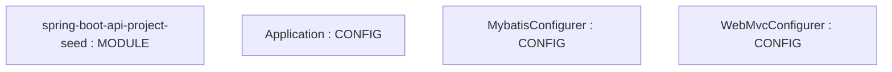

# Repository Architecture Analysis: lihengming/spring-boot-api-project-seed

## Metadata
- **SHA**: `c305af6a6bb2b698b02d731ac27218bff51c5c1c`
- **Primary Ecosystem**: Java

## Quality Metrics
- **avg_cyclomatic_complexity**: 3.08
- **component_count**: 4
- **files_analyzed**: 13
- **framework**: Spring Boot
- **loc**: 761
- **max_cyclomatic_complexity**: 17
- **sloc**: 564

# Architecture: lihengming/spring-boot-api-project-seed

## Context
- **Repository**: `lihengming/spring-boot-api-project-seed`
- **SHA**: `c305af6a6bb2b698b02d731ac27218bff51c5c1c`
- **Ecosystem**: Java
- **Framework**: Unknown

## Building Block View

## Component Details
- **spring-boot-api-project-seed** (`pom.xml`): MODULE
- **Application** (`src/main/java/com/company/project/Application.java`): CONFIG
- **MybatisConfigurer** (`src/main/java/com/company/project/configurer/MybatisConfigurer.java`): CONFIG
- **WebMvcConfigurer** (`src/main/java/com/company/project/configurer/WebMvcConfigurer.java`): CONFIG

## CI/CD Pipeline Topology

