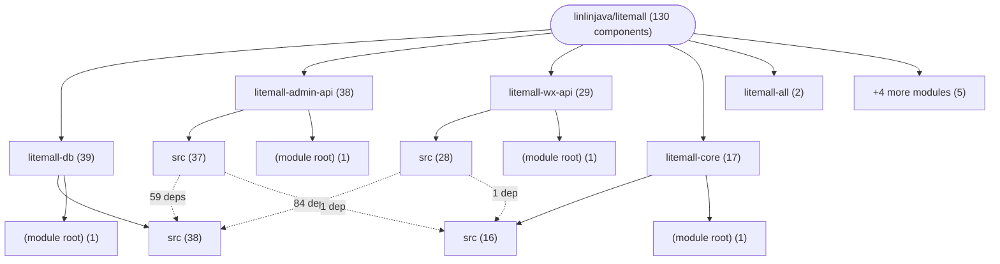
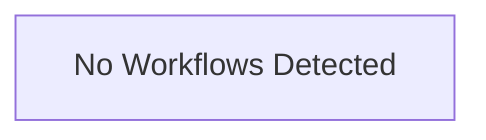

# Repository Architecture Analysis: linlinjava/litemall

## Metadata
- **SHA**: `a1ef964a718b7277925b19ea26afe78ea3a1d325`
- **Primary Ecosystem**: Java

## Quality Metrics
- **avg_cyclomatic_complexity**: 12.63
- **component_count**: 130
- **files_analyzed**: 752
- **framework**: Spring Boot
- **loc**: 240094
- **max_cyclomatic_complexity**: 4255
- **sloc**: 127807

# Architecture: linlinjava/litemall

## Context
- **Repository**: `linlinjava/litemall`
- **SHA**: `a1ef964a718b7277925b19ea26afe78ea3a1d325`
- **Ecosystem**: Java
- **Framework**: Unknown

## Building Block View

## Component Details

Showing top 60 representative components out of 130 across 9 module group(s):

- **Module `litemall-db`** (39 components — SERVICE: 37, MODULE: 1, CONFIG: 1)
- **Module `litemall-admin-api`** (38 components — API_ROUTE: 31, CONFIG: 4, SERVICE: 2)
- **Module `litemall-wx-api`** (29 components — API_ROUTE: 22, CONFIG: 3, SERVICE: 3)
- **Module `litemall-core`** (17 components — CONFIG: 13, SERVICE: 2, MODULE: 1)
- **Module `litemall-all`** (2 components — MODULE: 1, CONFIG: 1)
- **Module `litemall-all-war`** (2 components — MODULE: 1, CONFIG: 1)
- **Module `(root)`** (1 components — MODULE: 1)
- **Module `litemall-admin`** (1 components — MODULE: 1)
- **Module `litemall-vue`** (1 components — MODULE: 1)

- **WxOrderService** (`litemall-wx-api/src/main/java/org/linlinjava/litemall/wx/service/WxOrderService.java`): SERVICE (deps: CouponVerifyService, LitemallAddressService, LitemallAftersaleService, LitemallCartService, LitemallCommentService, LitemallCouponService (+9 more))
- **WxGoodsController** (`litemall-wx-api/src/main/java/org/linlinjava/litemall/wx/web/WxGoodsController.java`): API_ROUTE (deps: LitemallBrandService, LitemallCategoryService, LitemallCollectService, LitemallCommentService, LitemallFootprintService, LitemallGoodsAttributeService (+7 more))
- **AdminGoodsService** (`litemall-admin-api/src/main/java/org/linlinjava/litemall/admin/service/AdminGoodsService.java`): SERVICE (deps: LitemallBrandService, LitemallCartService, LitemallCategoryService, LitemallGoodsAttributeService, LitemallGoodsProductService, LitemallGoodsService (+2 more))
- **WxCartController** (`litemall-wx-api/src/main/java/org/linlinjava/litemall/wx/web/WxCartController.java`): API_ROUTE (deps: CouponVerifyService, LitemallAddressService, LitemallCartService, LitemallCouponService, LitemallCouponUserService, LitemallGoodsProductService (+2 more))
- **WxGrouponController** (`litemall-wx-api/src/main/java/org/linlinjava/litemall/wx/web/WxGrouponController.java`): API_ROUTE (deps: LitemallGoodsService, LitemallGrouponRulesService, LitemallGrouponService, LitemallOrderGoodsService, LitemallOrderService, LitemallUserService (+1 more))
- **WxHomeController** (`litemall-wx-api/src/main/java/org/linlinjava/litemall/wx/web/WxHomeController.java`): API_ROUTE (deps: LitemallAdService, LitemallBrandService, LitemallCategoryService, LitemallCouponService, LitemallGoodsService, LitemallTopicService (+1 more))
- **AdminOrderService** (`litemall-admin-api/src/main/java/org/linlinjava/litemall/admin/service/AdminOrderService.java`): SERVICE (deps: LitemallCommentService, LitemallCouponUserService, LitemallGoodsProductService, LitemallOrderGoodsService, LitemallOrderService, LitemallUserService)
- **WxCommentController** (`litemall-wx-api/src/main/java/org/linlinjava/litemall/wx/web/WxCommentController.java`): API_ROUTE (deps: LitemallCommentService, LitemallGoodsService, LitemallTopicService, LitemallUserService, UserInfoService)
- **WxCouponController** (`litemall-wx-api/src/main/java/org/linlinjava/litemall/wx/web/WxCouponController.java`): API_ROUTE (deps: CouponVerifyService, LitemallCartService, LitemallCouponService, LitemallCouponUserService, LitemallGrouponRulesService)
- **AdminAftersaleController** (`litemall-admin-api/src/main/java/org/linlinjava/litemall/admin/web/AdminAftersaleController.java`): API_ROUTE (deps: LitemallAftersaleService, LitemallGoodsProductService, LitemallOrderGoodsService, LitemallOrderService)
- **AdminDashbordController** (`litemall-admin-api/src/main/java/org/linlinjava/litemall/admin/web/AdminDashbordController.java`): API_ROUTE (deps: LitemallGoodsProductService, LitemallGoodsService, LitemallOrderService, LitemallUserService)
- **AdminAuthController** (`litemall-admin-api/src/main/java/org/linlinjava/litemall/admin/web/AdminAuthController.java`): API_ROUTE (deps: LitemallAdminService, LitemallPermissionService, LitemallRoleService)
- **AdminGrouponController** (`litemall-admin-api/src/main/java/org/linlinjava/litemall/admin/web/AdminGrouponController.java`): API_ROUTE (deps: LitemallGoodsService, LitemallGrouponRulesService, LitemallGrouponService)
- **AdminNoticeController** (`litemall-admin-api/src/main/java/org/linlinjava/litemall/admin/web/AdminNoticeController.java`): API_ROUTE (deps: LitemallAdminService, LitemallNoticeAdminService, LitemallNoticeService)
- **AdminProfileController** (`litemall-admin-api/src/main/java/org/linlinjava/litemall/admin/web/AdminProfileController.java`): API_ROUTE (deps: LitemallAdminService, LitemallNoticeAdminService, LitemallNoticeService)
- **AdminRoleController** (`litemall-admin-api/src/main/java/org/linlinjava/litemall/admin/web/AdminRoleController.java`): API_ROUTE (deps: LitemallAdminService, LitemallPermissionService, LitemallRoleService)
- **CouponVerifyService** (`litemall-db/src/main/java/org/linlinjava/litemall/db/service/CouponVerifyService.java`): SERVICE (deps: LitemallCouponService, LitemallCouponUserService, LitemallGoodsService)
- **WxAftersaleController** (`litemall-wx-api/src/main/java/org/linlinjava/litemall/wx/web/WxAftersaleController.java`): API_ROUTE (deps: LitemallAftersaleService, LitemallOrderGoodsService, LitemallOrderService)
- **WxCollectController** (`litemall-wx-api/src/main/java/org/linlinjava/litemall/wx/web/WxCollectController.java`): API_ROUTE (deps: LitemallCollectService, LitemallGoodsService, LitemallTopicService)
- **WxGrouponRuleService** (`litemall-wx-api/src/main/java/org/linlinjava/litemall/wx/service/WxGrouponRuleService.java`): SERVICE (deps: LitemallGoodsService, LitemallGrouponRulesService, LitemallGrouponService)
- **WxTopicController** (`litemall-wx-api/src/main/java/org/linlinjava/litemall/wx/web/WxTopicController.java`): API_ROUTE (deps: LitemallCollectService, LitemallGoodsService, LitemallTopicService)
- **AdminAddressController** (`litemall-admin-api/src/main/java/org/linlinjava/litemall/admin/web/AdminAddressController.java`): API_ROUTE (deps: LitemallAddressService, LitemallRegionService)
- **AdminCouponController** (`litemall-admin-api/src/main/java/org/linlinjava/litemall/admin/web/AdminCouponController.java`): API_ROUTE (deps: LitemallCouponService, LitemallCouponUserService)
- **AdminTopicController** (`litemall-admin-api/src/main/java/org/linlinjava/litemall/admin/web/AdminTopicController.java`): API_ROUTE (deps: LitemallGoodsService, LitemallTopicService)
- **CouponAssignService** (`litemall-db/src/main/java/org/linlinjava/litemall/db/service/CouponAssignService.java`): SERVICE (deps: LitemallCouponService, LitemallCouponUserService)
- **WxAddressController** (`litemall-wx-api/src/main/java/org/linlinjava/litemall/wx/web/WxAddressController.java`): API_ROUTE (deps: LitemallAddressService, LitemallRegionService)
- **WxAuthController** (`litemall-wx-api/src/main/java/org/linlinjava/litemall/wx/web/WxAuthController.java`): API_ROUTE (deps: CouponAssignService, LitemallUserService)
- **WxFeedbackController** (`litemall-wx-api/src/main/java/org/linlinjava/litemall/wx/web/WxFeedbackController.java`): API_ROUTE (deps: LitemallFeedbackService, LitemallUserService)
- **WxFootprintController** (`litemall-wx-api/src/main/java/org/linlinjava/litemall/wx/web/WxFootprintController.java`): API_ROUTE (deps: LitemallFootprintService, LitemallGoodsService)
- **WxSearchController** (`litemall-wx-api/src/main/java/org/linlinjava/litemall/wx/web/WxSearchController.java`): API_ROUTE (deps: LitemallKeywordService, LitemallSearchHistoryService)
- **AdminAdController** (`litemall-admin-api/src/main/java/org/linlinjava/litemall/admin/web/AdminAdController.java`): API_ROUTE (deps: LitemallAdService)
- **AdminAdminController** (`litemall-admin-api/src/main/java/org/linlinjava/litemall/admin/web/AdminAdminController.java`): API_ROUTE (deps: LitemallAdminService)
- **AdminBrandController** (`litemall-admin-api/src/main/java/org/linlinjava/litemall/admin/web/AdminBrandController.java`): API_ROUTE (deps: LitemallBrandService)
- **AdminCategoryController** (`litemall-admin-api/src/main/java/org/linlinjava/litemall/admin/web/AdminCategoryController.java`): API_ROUTE (deps: LitemallCategoryService)
- **AdminCollectController** (`litemall-admin-api/src/main/java/org/linlinjava/litemall/admin/web/AdminCollectController.java`): API_ROUTE (deps: LitemallCollectService)
- **AdminCommentController** (`litemall-admin-api/src/main/java/org/linlinjava/litemall/admin/web/AdminCommentController.java`): API_ROUTE (deps: LitemallCommentService)
- **AdminConfigController** (`litemall-admin-api/src/main/java/org/linlinjava/litemall/admin/web/AdminConfigController.java`): API_ROUTE (deps: LitemallSystemConfigService)
- **AdminFeedbackController** (`litemall-admin-api/src/main/java/org/linlinjava/litemall/admin/web/AdminFeedbackController.java`): API_ROUTE (deps: LitemallFeedbackService)
- **AdminFootprintController** (`litemall-admin-api/src/main/java/org/linlinjava/litemall/admin/web/AdminFootprintController.java`): API_ROUTE (deps: LitemallFootprintService)
- **AdminGoodsController** (`litemall-admin-api/src/main/java/org/linlinjava/litemall/admin/web/AdminGoodsController.java`): API_ROUTE (deps: AdminGoodsService)
- **AdminHistoryController** (`litemall-admin-api/src/main/java/org/linlinjava/litemall/admin/web/AdminHistoryController.java`): API_ROUTE (deps: LitemallSearchHistoryService)
- **AdminIssueController** (`litemall-admin-api/src/main/java/org/linlinjava/litemall/admin/web/AdminIssueController.java`): API_ROUTE (deps: LitemallIssueService)
- **AdminKeywordController** (`litemall-admin-api/src/main/java/org/linlinjava/litemall/admin/web/AdminKeywordController.java`): API_ROUTE (deps: LitemallKeywordService)
- **AdminLogController** (`litemall-admin-api/src/main/java/org/linlinjava/litemall/admin/web/AdminLogController.java`): API_ROUTE (deps: LitemallLogService)
- **AdminOrderController** (`litemall-admin-api/src/main/java/org/linlinjava/litemall/admin/web/AdminOrderController.java`): API_ROUTE (deps: AdminOrderService)
- **AdminRegionController** (`litemall-admin-api/src/main/java/org/linlinjava/litemall/admin/web/AdminRegionController.java`): API_ROUTE (deps: LitemallRegionService)
- **AdminStatController** (`litemall-admin-api/src/main/java/org/linlinjava/litemall/admin/web/AdminStatController.java`): API_ROUTE (deps: StatService)
- **AdminStorageController** (`litemall-admin-api/src/main/java/org/linlinjava/litemall/admin/web/AdminStorageController.java`): API_ROUTE (deps: LitemallStorageService)
- **AdminUserController** (`litemall-admin-api/src/main/java/org/linlinjava/litemall/admin/web/AdminUserController.java`): API_ROUTE (deps: LitemallUserService)
- **ExpressAutoConfiguration** (`litemall-core/src/main/java/org/linlinjava/litemall/core/express/config/ExpressAutoConfiguration.java`): CONFIG (deps: ExpressProperties)
- **NotifyAutoConfiguration** (`litemall-core/src/main/java/org/linlinjava/litemall/core/notify/config/NotifyAutoConfiguration.java`): CONFIG (deps: NotifyProperties)
- **StorageAutoConfiguration** (`litemall-core/src/main/java/org/linlinjava/litemall/core/storage/config/StorageAutoConfiguration.java`): CONFIG (deps: StorageProperties)
- **UserInfoService** (`litemall-wx-api/src/main/java/org/linlinjava/litemall/wx/service/UserInfoService.java`): SERVICE (deps: LitemallUserService)
- **WxBrandController** (`litemall-wx-api/src/main/java/org/linlinjava/litemall/wx/web/WxBrandController.java`): API_ROUTE (deps: LitemallBrandService)
- **WxCatalogController** (`litemall-wx-api/src/main/java/org/linlinjava/litemall/wx/web/WxCatalogController.java`): API_ROUTE (deps: LitemallCategoryService)
- **WxConfig** (`litemall-core/src/main/java/org/linlinjava/litemall/core/config/WxConfig.java`): CONFIG (deps: WxProperties)
- **WxIssueController** (`litemall-wx-api/src/main/java/org/linlinjava/litemall/wx/web/WxIssueController.java`): API_ROUTE (deps: LitemallIssueService)
- **WxOrderController** (`litemall-wx-api/src/main/java/org/linlinjava/litemall/wx/web/WxOrderController.java`): API_ROUTE (deps: WxOrderService)
- **WxStorageController** (`litemall-wx-api/src/main/java/org/linlinjava/litemall/wx/web/WxStorageController.java`): API_ROUTE (deps: LitemallStorageService)
- **WxUserController** (`litemall-wx-api/src/main/java/org/linlinjava/litemall/wx/web/WxUserController.java`): API_ROUTE (deps: LitemallOrderService)

## CI/CD Pipeline Topology

