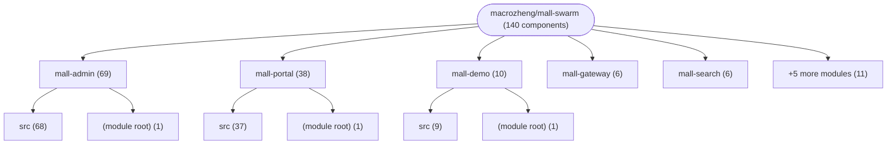
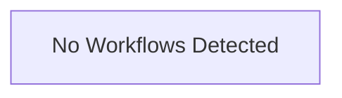

# Repository Architecture Analysis: macrozheng/mall-swarm

## Metadata
- **SHA**: `04c442fe318356bae4445a109dde7af297ce1e84`
- **Primary Ecosystem**: Java

## Quality Metrics
- **avg_cyclomatic_complexity**: 2.35
- **component_count**: 140
- **files_analyzed**: 1066
- **framework**: Spring Boot
- **loc**: 175760
- **max_cyclomatic_complexity**: 73
- **sloc**: 132476

# Architecture: macrozheng/mall-swarm

## Context
- **Repository**: `macrozheng/mall-swarm`
- **SHA**: `04c442fe318356bae4445a109dde7af297ce1e84`
- **Ecosystem**: Java
- **Framework**: Unknown

## Building Block View

## Component Details

Showing top 60 representative components out of 140 across 10 module group(s):

- **Module `mall-admin`** (69 components — API_ROUTE: 31, SERVICE: 31, CONFIG: 6)
- **Module `mall-portal`** (38 components — SERVICE: 15, API_ROUTE: 13, CONFIG: 9)
- **Module `mall-demo`** (10 components — CONFIG: 4, API_ROUTE: 4, MODULE: 1)
- **Module `mall-gateway`** (6 components — CONFIG: 5, MODULE: 1)
- **Module `mall-search`** (6 components — CONFIG: 3, MODULE: 1, API_ROUTE: 1)
- **Module `mall-auth`** (4 components — CONFIG: 2, MODULE: 1, API_ROUTE: 1)
- **Module `mall-monitor`** (3 components — CONFIG: 2, MODULE: 1)
- **Module `mall-common`** (2 components — MODULE: 1, API_ROUTE: 1)
- **Module `(root)`** (1 components — MODULE: 1)
- **Module `mall-mbg`** (1 components — MODULE: 1)

- **AlipayClientConfig** (`mall-portal/src/main/java/com/macro/mall/portal/config/AlipayClientConfig.java`): CONFIG (deps: AlipayConfig)
- **AlipayController** (`mall-portal/src/main/java/com/macro/mall/portal/controller/AlipayController.java`): API_ROUTE (deps: AlipayConfig)
- **AlipayServiceImpl** (`mall-portal/src/main/java/com/macro/mall/portal/service/impl/AlipayServiceImpl.java`): SERVICE (deps: AlipayConfig)
- **OssController** (`mall-admin/src/main/java/com/macro/mall/controller/OssController.java`): API_ROUTE (deps: OssServiceImpl)
- **SaTokenConfig** (`mall-gateway/src/main/java/com/macro/mall/config/SaTokenConfig.java`): CONFIG (deps: IgnoreUrlsConfig)
- **AlipayConfig** (`mall-portal/src/main/java/com/macro/mall/portal/config/AlipayConfig.java`): CONFIG
- **AuthController** (`mall-auth/src/main/java/com/macro/mall/auth/controller/AuthController.java`): API_ROUTE
- **CmsPrefrenceAreaController** (`mall-admin/src/main/java/com/macro/mall/controller/CmsPrefrenceAreaController.java`): API_ROUTE
- **CmsPrefrenceAreaServiceImpl** (`mall-admin/src/main/java/com/macro/mall/service/impl/CmsPrefrenceAreaServiceImpl.java`): SERVICE
- **CmsSubjectController** (`mall-admin/src/main/java/com/macro/mall/controller/CmsSubjectController.java`): API_ROUTE
- **CmsSubjectServiceImpl** (`mall-admin/src/main/java/com/macro/mall/service/impl/CmsSubjectServiceImpl.java`): SERVICE
- **DemoController** (`mall-demo/src/main/java/com/macro/mall/demo/controller/DemoController.java`): API_ROUTE
- **DemoServiceImpl** (`mall-demo/src/main/java/com/macro/mall/demo/service/impl/DemoServiceImpl.java`): SERVICE
- **EsProductController** (`mall-search/src/main/java/com/macro/mall/search/controller/EsProductController.java`): API_ROUTE
- **EsProductServiceImpl** (`mall-search/src/main/java/com/macro/mall/search/service/impl/EsProductServiceImpl.java`): SERVICE
- **FeignAdminController** (`mall-demo/src/main/java/com/macro/mall/demo/controller/FeignAdminController.java`): API_ROUTE
- **FeignConfig** (`mall-demo/src/main/java/com/macro/mall/demo/config/FeignConfig.java`): CONFIG
- **FeignPortalController** (`mall-demo/src/main/java/com/macro/mall/demo/controller/FeignPortalController.java`): API_ROUTE
- **FeignSearchController** (`mall-demo/src/main/java/com/macro/mall/demo/controller/FeignSearchController.java`): API_ROUTE
- **GlobalCorsConfig** (`mall-gateway/src/main/java/com/macro/mall/config/GlobalCorsConfig.java`): CONFIG
- **GlobalExceptionHandler** (`mall-common/src/main/java/com/macro/mall/common/exception/GlobalExceptionHandler.java`): API_ROUTE
- **HomeController** (`mall-portal/src/main/java/com/macro/mall/portal/controller/HomeController.java`): API_ROUTE
- **HomeServiceImpl** (`mall-portal/src/main/java/com/macro/mall/portal/service/impl/HomeServiceImpl.java`): SERVICE
- **IgnoreUrlsConfig** (`mall-gateway/src/main/java/com/macro/mall/config/IgnoreUrlsConfig.java`): CONFIG
- **JacksonConfig** (`mall-portal/src/main/java/com/macro/mall/portal/config/JacksonConfig.java`): CONFIG
- **MallAdminApplication** (`mall-admin/src/main/java/com/macro/mall/MallAdminApplication.java`): CONFIG
- **MallAuthApplication** (`mall-auth/src/main/java/com/macro/mall/auth/MallAuthApplication.java`): CONFIG
- **MallDemoApplication** (`mall-demo/src/main/java/com/macro/mall/MallDemoApplication.java`): CONFIG
- **MallGatewayApplication** (`mall-gateway/src/main/java/com/macro/mall/MallGatewayApplication.java`): CONFIG
- **MallMonitorApplication** (`mall-monitor/src/main/java/com/macro/mall/MallMonitorApplication.java`): CONFIG
- **MallPortalApplication** (`mall-portal/src/main/java/com/macro/mall/portal/MallPortalApplication.java`): CONFIG
- **MallSearchApplication** (`mall-search/src/main/java/com/macro/mall/search/MallSearchApplication.java`): CONFIG
- **MemberAttentionController** (`mall-portal/src/main/java/com/macro/mall/portal/controller/MemberAttentionController.java`): API_ROUTE
- **MemberAttentionServiceImpl** (`mall-portal/src/main/java/com/macro/mall/portal/service/impl/MemberAttentionServiceImpl.java`): SERVICE
- **MemberCollectionServiceImpl** (`mall-portal/src/main/java/com/macro/mall/portal/service/impl/MemberCollectionServiceImpl.java`): SERVICE
- **MemberProductCollectionController** (`mall-portal/src/main/java/com/macro/mall/portal/controller/MemberProductCollectionController.java`): API_ROUTE
- **MemberReadHistoryController** (`mall-portal/src/main/java/com/macro/mall/portal/controller/MemberReadHistoryController.java`): API_ROUTE
- **MemberReadHistoryServiceImpl** (`mall-portal/src/main/java/com/macro/mall/portal/service/impl/MemberReadHistoryServiceImpl.java`): SERVICE
- **MinioController** (`mall-admin/src/main/java/com/macro/mall/controller/MinioController.java`): API_ROUTE
- **MyBatisConfig** (`mall-admin/src/main/java/com/macro/mall/config/MyBatisConfig.java`): CONFIG
- **MyBatisConfig** (`mall-demo/src/main/java/com/macro/mall/demo/config/MyBatisConfig.java`): CONFIG
- **MyBatisConfig** (`mall-portal/src/main/java/com/macro/mall/portal/config/MyBatisConfig.java`): CONFIG
- **MyBatisConfig** (`mall-search/src/main/java/com/macro/mall/search/config/MyBatisConfig.java`): CONFIG
- **OmsCartItemController** (`mall-portal/src/main/java/com/macro/mall/portal/controller/OmsCartItemController.java`): API_ROUTE
- **OmsCartItemServiceImpl** (`mall-portal/src/main/java/com/macro/mall/portal/service/impl/OmsCartItemServiceImpl.java`): SERVICE
- **OmsCompanyAddressController** (`mall-admin/src/main/java/com/macro/mall/controller/OmsCompanyAddressController.java`): API_ROUTE
- **OmsCompanyAddressServiceImpl** (`mall-admin/src/main/java/com/macro/mall/service/impl/OmsCompanyAddressServiceImpl.java`): SERVICE
- **OmsOrderController** (`mall-admin/src/main/java/com/macro/mall/controller/OmsOrderController.java`): API_ROUTE
- **OmsOrderReturnApplyController** (`mall-admin/src/main/java/com/macro/mall/controller/OmsOrderReturnApplyController.java`): API_ROUTE
- **OmsOrderReturnApplyServiceImpl** (`mall-admin/src/main/java/com/macro/mall/service/impl/OmsOrderReturnApplyServiceImpl.java`): SERVICE
- **OmsOrderReturnReasonController** (`mall-admin/src/main/java/com/macro/mall/controller/OmsOrderReturnReasonController.java`): API_ROUTE
- **OmsOrderReturnReasonServiceImpl** (`mall-admin/src/main/java/com/macro/mall/service/impl/OmsOrderReturnReasonServiceImpl.java`): SERVICE
- **OmsOrderServiceImpl** (`mall-admin/src/main/java/com/macro/mall/service/impl/OmsOrderServiceImpl.java`): SERVICE
- **OmsOrderSettingController** (`mall-admin/src/main/java/com/macro/mall/controller/OmsOrderSettingController.java`): API_ROUTE
- **OmsOrderSettingServiceImpl** (`mall-admin/src/main/java/com/macro/mall/service/impl/OmsOrderSettingServiceImpl.java`): SERVICE
- **OmsPortalOrderController** (`mall-portal/src/main/java/com/macro/mall/portal/controller/OmsPortalOrderController.java`): API_ROUTE
- **OmsPortalOrderReturnApplyController** (`mall-portal/src/main/java/com/macro/mall/portal/controller/OmsPortalOrderReturnApplyController.java`): API_ROUTE
- **OmsPortalOrderReturnApplyServiceImpl** (`mall-portal/src/main/java/com/macro/mall/portal/service/impl/OmsPortalOrderReturnApplyServiceImpl.java`): SERVICE
- **OmsPortalOrderServiceImpl** (`mall-portal/src/main/java/com/macro/mall/portal/service/impl/OmsPortalOrderServiceImpl.java`): SERVICE
- **OmsPromotionServiceImpl** (`mall-portal/src/main/java/com/macro/mall/portal/service/impl/OmsPromotionServiceImpl.java`): SERVICE

## CI/CD Pipeline Topology

