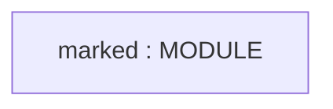
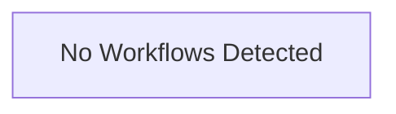

# Repository Architecture Analysis: markedjs/marked

## Metadata
- **SHA**: `738ebebc835ebc97fe82e3321bc7f91f638c531f`
- **Primary Ecosystem**: JavaScript/TypeScript

## Quality Metrics
- **avg_cyclomatic_complexity**: 23.27
- **component_count**: 1
- **files_analyzed**: 41
- **framework**: TypeScript
- **loc**: 11839
- **max_cyclomatic_complexity**: 191
- **sloc**: 10068

# Architecture: markedjs/marked

## Context
- **Repository**: `markedjs/marked`
- **SHA**: `738ebebc835ebc97fe82e3321bc7f91f638c531f`
- **Ecosystem**: JavaScript/TypeScript
- **Framework**: Unknown

## Building Block View

## Component Details
- **marked** (`package.json`): MODULE

## CI/CD Pipeline Topology

