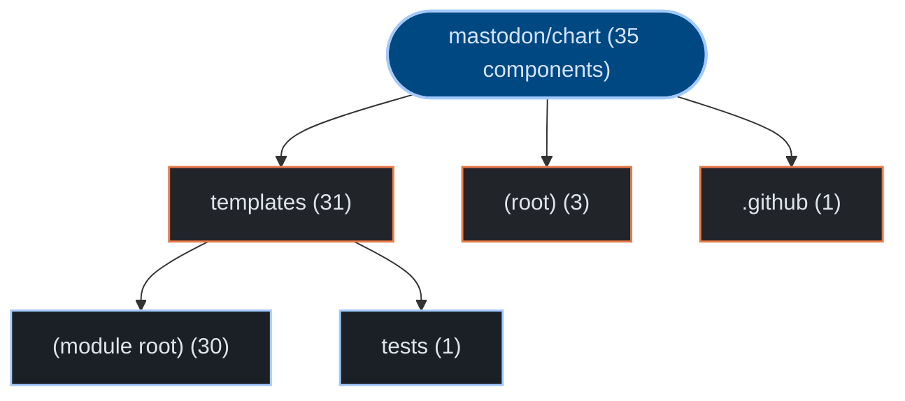
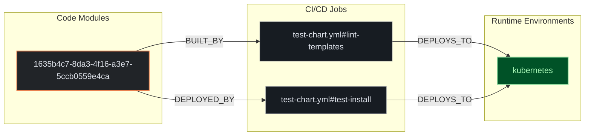
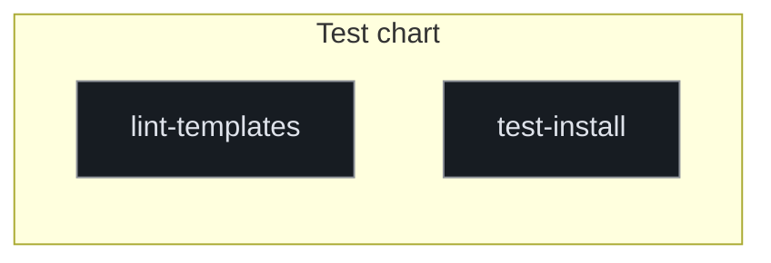

# Repository Architecture Analysis: mastodon/chart

## Metadata
- **SHA**: `7b553728474820d5e44dfcef5f91612aed9bafa4`
- **Primary Ecosystem**: Container / Helm / IaC

## Quality Metrics
- **ast_engine**: fallback
- **avg_cognitive_complexity**: 0.0
- **avg_cyclomatic_complexity**: 0.0
- **component_count**: 35
- **dead_code_count**: 0
- **dead_code_symbols**: 0 entry(ies)
- **duplication_pct**: 0.0
- **file_complexities**: 0 entry(ies)
- **files_analyzed**: 35
- **fitness_passed**: True
- **fitness_violation_count**: 0
- **framework**: Helm Chart
- **import_edges**: 0 entry(ies)
- **loc**: 3521
- **max_cognitive_complexity**: 0
- **max_cyclomatic_complexity**: 0
- **sloc**: 2825
- **test_file_count**: 1

# Architecture: mastodon/chart

## Context
- **Repository**: `mastodon/chart`
- **SHA**: `7b553728474820d5e44dfcef5f91612aed9bafa4`
- **Ecosystem**: Container / Helm / IaC
- **Framework**: Helm Chart

## Building Block View

## Component Details
- **Chart** (`Chart.yaml`): module
- **dev-values** (`dev-values.yaml`): module
- **values** (`values.yaml`): module
- **test-chart** (`.github/workflows/test-chart.yml`): module
- **_statsd** (`templates/_statsd.yaml`): module
- **configmap-env** (`templates/configmap-env.yaml`): module
- **cronjob-media-remove** (`templates/cronjob-media-remove.yaml`): module
- **deployment-sidekiq** (`templates/deployment-sidekiq.yaml`): module
- **deployment-streaming** (`templates/deployment-streaming.yaml`): module
- **deployment-web** (`templates/deployment-web.yaml`): module
- **httproute-streaming** (`templates/httproute-streaming.yaml`): module
- **httproute** (`templates/httproute.yaml`): module
- **ingress-streaming** (`templates/ingress-streaming.yml`): module
- **ingress** (`templates/ingress.yaml`): module
- **job-assets-copy** (`templates/job-assets-copy.yaml`): module
- **job-create-admin** (`templates/job-create-admin.yaml`): module
- **job-db-migrate** (`templates/job-db-migrate.yaml`): module
- **job-db-pre-migrate** (`templates/job-db-pre-migrate.yaml`): module
- **job-db-prepare** (`templates/job-db-prepare.yaml`): module
- **job-deploy-search** (`templates/job-deploy-search.yaml`): module
- **pdb-streaming** (`templates/pdb-streaming.yaml`): module
- **pdb-web** (`templates/pdb-web.yaml`): module
- **pvc-assets** (`templates/pvc-assets.yaml`): module
- **pvc-system** (`templates/pvc-system.yaml`): module
- **secret-prepare** (`templates/secret-prepare.yml`): module
- **secret-redis-preinstall** (`templates/secret-redis-preinstall.yaml`): module
- **secret-redis** (`templates/secret-redis.yaml`): module
- **secret-smtp-bulk** (`templates/secret-smtp-bulk.yaml`): module
- **secret-smtp** (`templates/secret-smtp.yaml`): module
- **secrets** (`templates/secrets.yaml`): module
- **service-streaming** (`templates/service-streaming.yaml`): module
- **service-web** (`templates/service-web.yaml`): module
- **serviceaccount** (`templates/serviceaccount.yaml`): module
- **statsd-exporter-mappings** (`templates/statsd-exporter-mappings.yaml`): module
- **test-connection** (`templates/tests/test-connection.yaml`): module

## 6-Dimension Repository Scorecard

- **Overall Grade**: `B` (88.60/100)
- **Technical Debt Score**: 11.40
- **Estimated Remediation Effort**: 7.35h

| Dimension | Grade | Score | Weight | Details |
| :--- | :---: | :---: | :---: | :--- |
| Code Quality | `A` | 100.00 | 0.20 | avg_cc=0.00, max_cc=0, duplication=0.00%, dead_code=0 |
| Dependency Health | `A` | 90.00 | 0.15 | dependencies=0 (no manifests parsed) |
| Maintainability | `A` | 100.00 | 0.15 | avg_cognitive=0.00, max_cognitive=0, fitness_violations=0, oversized_files=0 |
| Pipeline Health | `A` | 96.00 | 0.15 | workflows=1, operational_antipatterns=2, parallel_branches=True |
| Security | `C` | 76.00 | 0.20 | vulnerabilities=0, secrets=0, pipeline_security_findings=2 |
| Test Coverage | `C` | 70.00 | 0.15 | coverage=unavailable, ci_test_job=True, test_files_detected=True |

## Section 7: Code-to-Cloud Deployment Traceability

- `test-chart.yml#lint-templates` (ci_job) --[DEPLOYS_TO]--> `kubernetes` (environment)
- `test-chart.yml#test-install` (ci_job) --[DEPLOYS_TO]--> `kubernetes` (environment)
- `1635b4c7-8da3-4f16-a3e7-5ccb0559e4ca` (code_module) --[BUILT_BY]--> `test-chart.yml#lint-templates` (ci_job)
- `1635b4c7-8da3-4f16-a3e7-5ccb0559e4ca` (code_module) --[DEPLOYED_BY]--> `test-chart.yml#test-install` (ci_job)

## CI/CD Pipeline Topology

