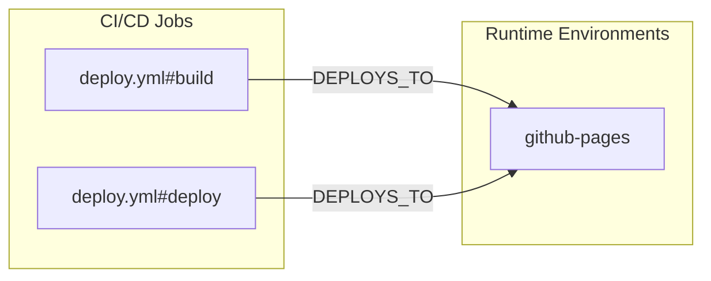
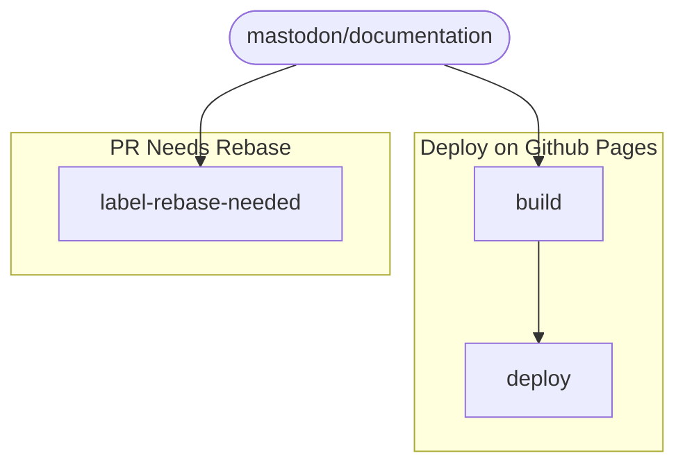

# Repository Architecture Analysis: mastodon/documentation

## Metadata
- **SHA**: `431e64f8a31b4e25d602d6ce6e2b56e9fdf3b7b9`
- **Primary Ecosystem**: JavaScript/TypeScript

## Quality Metrics
- **ast_engine**: tree-sitter
- **avg_cognitive_complexity**: 0.0
- **avg_cyclomatic_complexity**: 1.0
- **component_count**: 0
- **dead_code_count**: 0
- **dead_code_symbols**: 0 entry(ies)
- **duplication_pct**: 0.0
- **file_complexities**: 1 entry(ies)
- **files_analyzed**: 1
- **fitness_passed**: True
- **fitness_violation_count**: 0
- **framework**: Unknown
- **import_edges**: 0 entry(ies)
- **loc**: 13
- **max_cognitive_complexity**: 0
- **max_cyclomatic_complexity**: 1
- **sloc**: 10

## 6-Dimension Repository Scorecard

- **Overall Grade**: `D` (66.35/100)
- **Technical Debt Score**: 33.65
- **Estimated Remediation Effort**: 36.41h

| Dimension | Grade | Score | Weight | Details |
| :--- | :---: | :---: | :---: | :--- |
| Code Quality | `A` | 100.00 | 0.20 | avg_cc=1.00, max_cc=1, duplication=0.00%, dead_code=0 |
| Dependency Health | `A` | 90.00 | 0.15 | dependencies=0 (no manifests parsed) |
| Maintainability | `A` | 100.00 | 0.15 | avg_cognitive=0.00, max_cognitive=0, fitness_violations=0, oversized_files=0 |
| Pipeline Health | `C` | 79.00 | 0.15 | workflows=2, operational_antipatterns=4, parallel_branches=False |
| Security | `F` | 0.00 | 0.20 | vulnerabilities=0, secrets=11, pipeline_security_findings=2 |
| Test Coverage | `F` | 40.00 | 0.15 | coverage=unavailable, ci_test_job=False, test_files_detected=False |

## Supply Chain Dependencies, Vulnerabilities & Secrets

- **Dependencies Parsed**: 0 | **Vulnerabilities**: 0 | **Secrets**: 11

### Secret Findings (Redacted)
- **[HIGH] `ATRUSS-SEC-005`** at `content/en/entities/Instance.md:88` (`"public_key": "BCk-***REDACTED***"`)
- **[HIGH] `ATRUSS-SEC-005`** at `content/en/entities/Token.md:19` (`"access_token": "ZA-Y***REDACTED***",`)
- **[HIGH] `ATRUSS-SEC-005`** at `content/en/entities/WebPushSubscription.md:33` (`"server_key": "BCk-***REDACTED***"`)
- **[HIGH] `ATRUSS-SEC-005`** at `content/en/methods/apps.md:98` (`"client_secret": "ZEaF***REDACTED***",`)
- **[HIGH] `ATRUSS-SEC-005`** at `content/en/methods/apps.md:117` (`"client_secret": "ZEaF***REDACTED***",`)
- **[HIGH] `ATRUSS-SEC-005`** at `content/en/methods/apps.md:179` (`"vapid_key": "BMAI***REDACTED***",`)
- **[HIGH] `ATRUSS-SEC-005`** at `content/en/methods/instance.md:112` (`"public_key": "BCk-***REDACTED***"`)
- **[HIGH] `ATRUSS-SEC-005`** at `content/en/methods/oauth.md:158` (`"access_token": "ZA-Y***REDACTED***",`)
- **[HIGH] `ATRUSS-SEC-005`** at `content/en/methods/push.md:129` (`"server_key": "BCk-***REDACTED***"`)
- **[HIGH] `ATRUSS-SEC-005`** at `content/en/methods/push.md:179` (`"server_key": "BCk-***REDACTED***"`)
- **[HIGH] `ATRUSS-SEC-005`** at `content/en/methods/push.md:281` (`"server_key": "BCk-***REDACTED***"`)

## Section 7: Code-to-Cloud Deployment Traceability

- `deploy.yml#build` (ci_job) --[DEPLOYS_TO]--> `github-pages` (environment)
- `deploy.yml#deploy` (ci_job) --[DEPLOYS_TO]--> `github-pages` (environment)

## CI/CD Pipeline Topology

