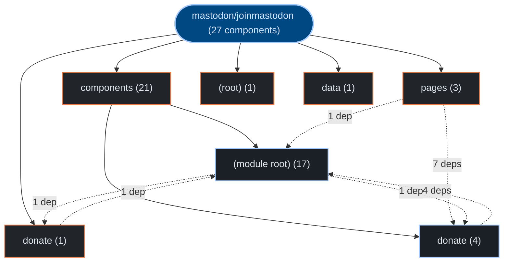
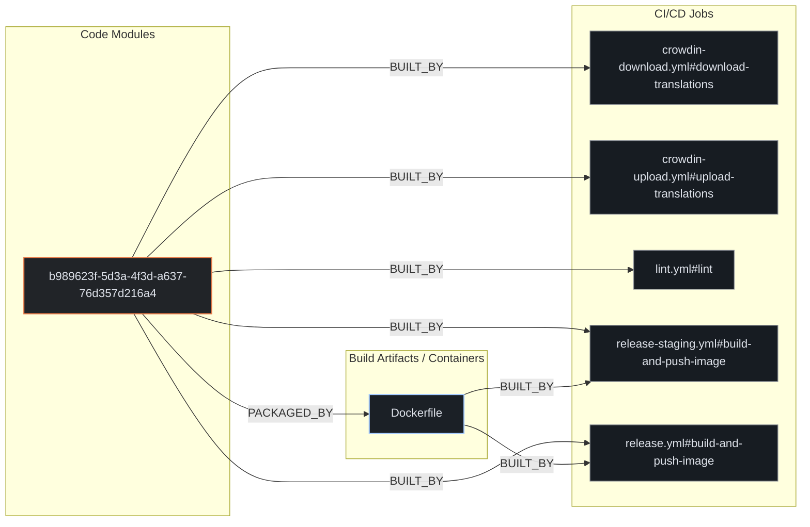

# Repository Architecture Analysis: mastodon/joinmastodon

## Metadata
- **SHA**: `9fc722c2276c3e33e6274d1e89dff49e477fbaa7`
- **Primary Ecosystem**: JavaScript/TypeScript

## Quality Metrics
- **ast_engine**: tree-sitter
- **avg_cognitive_complexity**: 2.55
- **avg_cyclomatic_complexity**: 2.89
- **component_count**: 27
- **dead_code_count**: 4
- **dead_code_symbols**: 4 entry(ies)
- **duplication_pct**: 78.11
- **file_complexities**: 25 entry(ies)
- **files_analyzed**: 93
- **fitness_passed**: False
- **fitness_violation_count**: 2
- **framework**: Next.js
- **import_edges**: 100 entry(ies)
- **loc**: 11500
- **max_cognitive_complexity**: 40
- **max_cyclomatic_complexity**: 19
- **sloc**: 10675

# Architecture: mastodon/joinmastodon

## Context
- **Repository**: `mastodon/joinmastodon`
- **SHA**: `9fc722c2276c3e33e6274d1e89dff49e477fbaa7`
- **Ecosystem**: JavaScript/TypeScript
- **Framework**: Next.js

## Building Block View

## Component Details
- **joinmastodon** (`package.json`): MODULE
- **AppCard** (`components/AppCard.tsx`): UI_COMPONENT
- **AppHero** (`components/AppHero.tsx`): UI_COMPONENT
- **AppsGrid** (`components/AppsGrid.tsx`): UI_COMPONENT (deps: AppCard, Category, SelectMenu)
- **BasicPage** (`components/BasicPage.tsx`): UI_COMPONENT
- **Button** (`components/Button.tsx`): UI_COMPONENT
- **Category** (`components/Category.tsx`): UI_COMPONENT
- **DonateTabs** (`components/DonateTabs.tsx`): UI_COMPONENT (deps: DonatePopup)
- **Footer** (`components/Footer.tsx`): UI_COMPONENT
- **IconCard** (`components/IconCard.tsx`): UI_COMPONENT
- **Input** (`components/Input.tsx`): UI_COMPONENT
- **Layout** (`components/Layout.tsx`): UI_COMPONENT (deps: DonateFooter, Footer)
- **MenuToggle** (`components/MenuToggle.tsx`): UI_COMPONENT
- **PolicyPage** (`components/PolicyPage.tsx`): UI_COMPONENT
- **RoadmapStatus** (`components/RoadmapStatus.tsx`): UI_COMPONENT
- **SelectMenu** (`components/SelectMenu.tsx`): UI_COMPONENT
- **SkeletonText** (`components/SkeletonText.tsx`): UI_COMPONENT
- **TestimonialCard** (`components/TestimonialCard.tsx`): UI_COMPONENT
- **DonateCheckout** (`components/donate/DonateCheckout.tsx`): UI_COMPONENT (deps: Button, Input)
- **DonateFooter** (`components/donate/DonateFooter.tsx`): UI_COMPONENT
- **DonateWidget** (`components/donate/DonateWidget.tsx`): UI_COMPONENT (deps: Button, Input)
- **DonateWrapper** (`components/donate/DonateWrapper.tsx`): UI_COMPONENT
- **SalesScheduleLink** (`data/hosting.ts`): UI_COMPONENT
- **DonatePopup** (`donate/DonatePopup.tsx`): UI_COMPONENT (deps: Button)
- **DonateCheckoutPage** (`pages/donate/checkout.tsx`): UI_COMPONENT (deps: DonateCheckout, DonateFooter, DonateWrapper)
- **DonateCompletePage** (`pages/donate/complete.tsx`): UI_COMPONENT (deps: Button, DonateWrapper)
- **DonatePage** (`pages/donate/index.tsx`): UI_COMPONENT (deps: DonateFooter, DonateWidget, DonateWrapper)

## 6-Dimension Repository Scorecard

- **Overall Grade**: `F` (49.45/100)
- **Technical Debt Score**: 50.55
- **Estimated Remediation Effort**: 56.76h

| Dimension | Grade | Score | Weight | Details |
| :--- | :---: | :---: | :---: | :--- |
| Code Quality | `D` | 61.00 | 0.20 | avg_cc=2.89, max_cc=19, duplication=78.11%, dead_code=4 |
| Dependency Health | `B` | 85.00 | 0.15 | dependencies=47, outdated=0, vulnerable=0, has_lockfile=False |
| Maintainability | `F` | 43.00 | 0.15 | avg_cognitive=2.55, max_cognitive=40, fitness_violations=2, oversized_files=4 |
| Pipeline Health | `F` | 45.00 | 0.15 | workflows=5, operational_antipatterns=7, parallel_branches=False |
| Security | `F` | 4.00 | 0.20 | vulnerabilities=0, secrets=0, pipeline_security_findings=8 |
| Test Coverage | `C` | 70.00 | 0.15 | coverage=unavailable, ci_test_job=False, test_files_detected=True |

## Architecture Fitness & Workspace Boundaries

- **[MEDIUM] `ATRUSS-ARCH-005` (COMPLEXITY_THRESHOLD)**: Repository duplication_pct (78.11) exceeds policy threshold (15.0).
- **[MEDIUM] `ATRUSS-ARCH-005` (COMPLEXITY_THRESHOLD)**: Repository max_cognitive_complexity (40.0) exceeds policy threshold (25.0).

## Supply Chain Dependencies, Vulnerabilities & Secrets

- **Dependencies Parsed**: 47 | **Vulnerabilities**: 0 | **Secrets**: 0

### Inventory Sample
- `@eslint/eslintrc` `3.3.6` (npm, `package.json`)
- `@formatjs/cli` `6.16.16` (npm, `package.json`)
- `@headlessui/react` `2.2.10` (npm, `package.json`)
- `@stripe/react-stripe-js` `3.10.0` (npm, `package.json`)
- `@stripe/stripe-js` `7.9.0` (npm, `package.json`)
- `@svgr/webpack` `8.1.0` (npm, `package.json`)
- `@tanstack/react-query` `5.101.4` (npm, `package.json`)
- `@tanstack/react-query-devtools` `5.101.4` (npm, `package.json`)
- `@types/lodash` `4.17.25` (npm, `package.json`)
- `@types/node` `24.13.3` (npm, `package.json`)
- `@types/react` `19.2.18` (npm, `package.json`)
- `@types/react-dom` `19.2.4` (npm, `package.json`)
- `@typescript-eslint/eslint-plugin` `8.67.0` (npm, `package.json`)
- `@typescript-eslint/parser` `8.67.0` (npm, `package.json`)
- `autoprefixer` `10.5.4` (npm, `package.json`)
- `blurhash` `2.0.5` (npm, `package.json`)
- `classnames` `2.5.1` (npm, `package.json`)
- `cookie` `1.1.1` (npm, `package.json`)
- `dotenv` `17.0.0` (npm, `package.json`)
- `eslint` `9` (npm, `package.json`)
- `eslint-config-next` `16.3.5` (npm, `package.json`)
- `eslint-config-prettier` `10.1.8` (npm, `package.json`)
- `gray-matter` `4.0.3` (npm, `package.json`)
- `husky` `9.1.7` (npm, `package.json`)
- `javascript-stringify` `2.1.0` (npm, `package.json`)
- `keen-slider` `6.8.6` (npm, `package.json`)
- `lint-staged` `17.0.0` (npm, `package.json`)
- `lodash` `4.18.1` (npm, `package.json`)
- `next` `16.0.0` (npm, `package.json`)
- `node-gyp` `13.0.1` (npm, `package.json`)
- ... (+17 more dependencies)

## Section 7: Code-to-Cloud Deployment Traceability

- `b989623f-5d3a-4f3d-a637-76d357d216a4` (code_module) --[BUILT_BY]--> `crowdin-download.yml#download-translations` (ci_job)
- `b989623f-5d3a-4f3d-a637-76d357d216a4` (code_module) --[BUILT_BY]--> `crowdin-upload.yml#upload-translations` (ci_job)
- `b989623f-5d3a-4f3d-a637-76d357d216a4` (code_module) --[BUILT_BY]--> `lint.yml#lint` (ci_job)
- `b989623f-5d3a-4f3d-a637-76d357d216a4` (code_module) --[BUILT_BY]--> `release-staging.yml#build-and-push-image` (ci_job)
- `b989623f-5d3a-4f3d-a637-76d357d216a4` (code_module) --[BUILT_BY]--> `release.yml#build-and-push-image` (ci_job)
- `b989623f-5d3a-4f3d-a637-76d357d216a4` (code_module) --[PACKAGED_BY]--> `Dockerfile` (container)
- `Dockerfile` (container) --[BUILT_BY]--> `release-staging.yml#build-and-push-image` (ci_job)
- `Dockerfile` (container) --[BUILT_BY]--> `release.yml#build-and-push-image` (ci_job)

## CI/CD Pipeline Topology

```mermaid
graph TD;
  classDef atlasRoot fill:#004882,stroke:#a3c9ff,stroke-width:2px,color:#d3e4ff
  classDef atlasCategory fill:#212428,stroke:#E87A48,stroke-width:1.5px,color:#dfe3eb
  classDef atlasWorkflow fill:#1b2026,stroke:#a3c9ff,stroke-width:1.5px,color:#dfe3eb
  classDef atlasJob fill:#171c22,stroke:#8d9199,stroke-width:1px,color:#dfe3eb
  classDef atlasTarget fill:#005227,stroke:#8bd99b,stroke-width:1.5px,color:#a7f6b6
  classDef atlasAlert fill:#93000a,stroke:#ffb4ab,stroke-width:1.5px,color:#ffdad6
  classDef atlasMore fill:#252a31,stroke:#8d9199,stroke-dasharray:4 4,color:#c3c6cf
  pipeline_root(["mastodon/joinmastodon (5 workflows)"]):::atlasRoot
  subgraph sg_grp_0_CI___Verification["CI & Verification (2 workflows · 2 jobs)"]
    direction TB
    subgraph sg_wf_1_Crowdin___Upload_translations["Crowdin / Upload translations (1 jobs)"]
      direction TB
      wf_1_Crowdin___Upload_translations(["Trigger: Crowdin / Upload translations"]):::atlasWorkflow
      job_1_upload_translations["upload-translations"]:::atlasJob
      wf_1_Crowdin___Upload_translations --> job_1_upload_translations
    end
    pipeline_root --> wf_1_Crowdin___Upload_translations
    subgraph sg_wf_2_Lint_files["Lint files (1 jobs)"]
      direction TB
      wf_2_Lint_files(["Trigger: Lint files"]):::atlasWorkflow
      job_2_lint["lint"]:::atlasJob
      wf_2_Lint_files --> job_2_lint
    end
    pipeline_root --> wf_2_Lint_files
  end
  subgraph sg_grp_1_Release___Deploy["Release & Deploy (2 workflows · 2 jobs)"]
    direction TB
    subgraph sg_wf_3_Release_Docker_image_to_staging["Release Docker image to staging (1 jobs)"]
      direction TB
      wf_3_Release_Docker_image_to_staging(["Trigger: Release Docker image to staging"]):::atlasWorkflow
      job_3_build_and_push_image["build-and-push-image"]:::atlasJob
      wf_3_Release_Docker_image_to_staging --> job_3_build_and_push_image
    end
    pipeline_root --> wf_3_Release_Docker_image_to_staging
    subgraph sg_wf_4_Release_Docker_image["Release Docker image (1 jobs)"]
      direction TB
      wf_4_Release_Docker_image(["Trigger: Release Docker image"]):::atlasWorkflow
      job_4_build_and_push_image["build-and-push-image"]:::atlasJob
      wf_4_Release_Docker_image --> job_4_build_and_push_image
    end
    pipeline_root --> wf_4_Release_Docker_image
  end
  subgraph sg_grp_2_Scheduled___Manual["Scheduled & Manual (1 workflows · 1 jobs)"]
    direction TB
    subgraph sg_wf_0_Crowdin___Download_translations["Crowdin / Download translations (1 jobs)"]
      direction TB
      wf_0_Crowdin___Download_translations(["Trigger: Crowdin / Download translations"]):::atlasWorkflow
      job_0_download_translations["download-translations"]:::atlasJob
      wf_0_Crowdin___Download_translations --> job_0_download_translations
    end
    pipeline_root --> wf_0_Crowdin___Download_translations
  end
```

