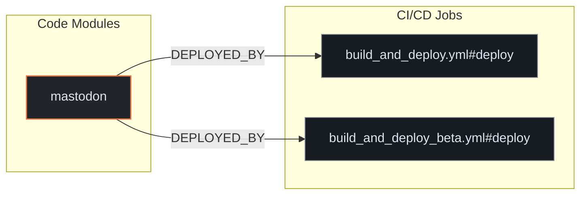
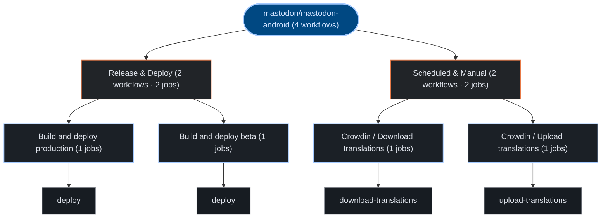

# Repository Architecture Analysis: mastodon/mastodon-android

## Metadata
- **SHA**: `9ae49ec403719a8894903e011a9ad71c91c71c0d`
- **Primary Ecosystem**: Java

## Quality Metrics
- **ast_engine**: tree-sitter
- **avg_cognitive_complexity**: 2.43
- **avg_cyclomatic_complexity**: 2.33
- **component_count**: 0
- **dead_code_count**: 23
- **dead_code_symbols**: 23 entry(ies)
- **duplication_pct**: 85.45
- **file_complexities**: 25 entry(ies)
- **files_analyzed**: 588
- **fitness_passed**: False
- **fitness_violation_count**: 3
- **framework**: Spring Boot
- **import_edges**: 100 entry(ies)
- **loc**: 72083
- **max_cognitive_complexity**: 136
- **max_cyclomatic_complexity**: 63
- **sloc**: 60539
- **test_file_count**: 3

## 6-Dimension Repository Scorecard

- **Overall Grade**: `F` (40.20/100)
- **Technical Debt Score**: 59.80
- **Estimated Remediation Effort**: 91.79h

| Dimension | Grade | Score | Weight | Details |
| :--- | :---: | :---: | :---: | :--- |
| Code Quality | `F` | 30.00 | 0.20 | avg_cc=2.33, max_cc=63, duplication=85.45%, dead_code=23 |
| Dependency Health | `B` | 85.00 | 0.15 | dependencies=22, outdated=0, vulnerable=0, has_lockfile=False |
| Maintainability | `F` | 37.00 | 0.15 | avg_cognitive=2.43, max_cognitive=136, fitness_violations=3, oversized_files=17 |
| Pipeline Health | `F` | 36.00 | 0.15 | workflows=4, operational_antipatterns=8, parallel_branches=False |
| Security | `F` | 0.00 | 0.20 | vulnerabilities=0, secrets=0, pipeline_security_findings=11 |
| Test Coverage | `C` | 70.00 | 0.15 | coverage=unavailable, ci_test_job=False, test_files_detected=True |

## Architecture Fitness & Workspace Boundaries

- **[MEDIUM] `ATRUSS-ARCH-005` (COMPLEXITY_THRESHOLD)**: Repository duplication_pct (85.45) exceeds policy threshold (15.0).
- **[MEDIUM] `ATRUSS-ARCH-005` (COMPLEXITY_THRESHOLD)**: Repository max_cognitive_complexity (136.0) exceeds policy threshold (25.0).
- **[MEDIUM] `ATRUSS-ARCH-005` (COMPLEXITY_THRESHOLD)**: Repository max_cyclomatic_complexity (63.0) exceeds policy threshold (20.0).

## Supply Chain Dependencies, Vulnerabilities & Secrets

- **Dependencies Parsed**: 22 | **Vulnerabilities**: 0 | **Secrets**: 0

### Inventory Sample
- `androidx.annotation:annotation` `1.3.0` (Maven, `mastodon/build.gradle`)
- `com.android.tools.build:gradle` `8.13.2` (Maven, `build.gradle`)
- `com.google.android.libraries.mapsplatform.secrets-gradle-plugin:secrets-gradle-plugin` `2.0.1` (Maven, `build.gradle`)
- `com.google.code.gson:gson` `2.8.9` (Maven, `mastodon/build.gradle`)
- `com.google.zxing:core` `3.5.3` (Maven, `mastodon/build.gradle`)
- `com.squareup.okhttp3:okhttp` `3.14.9` (Maven, `mastodon/build.gradle`)
- `com.squareup:otto` `1.3.8` (Maven, `mastodon/build.gradle`)
- `de.psdev:async-otto` `1.0.3` (Maven, `mastodon/build.gradle`)
- `junit:junit` `4.13.2` (Maven, `mastodon/build.gradle`)
- `me.grishka.appkit:appkit` `1.5.3` (Maven, `mastodon/build.gradle`)
- `me.grishka.litex:browser` `1.4.0` (Maven, `mastodon/build.gradle`)
- `me.grishka.litex:dynamicanimation` `1.1.0-alpha03` (Maven, `mastodon/build.gradle`)
- `me.grishka.litex:palette` `1.0.0` (Maven, `mastodon/build.gradle`)
- `me.grishka.litex:recyclerview` `1.2.1.1` (Maven, `mastodon/build.gradle`)
- `me.grishka.litex:swiperefreshlayout` `1.2.0-beta01` (Maven, `mastodon/build.gradle`)
- `me.grishka.litex:viewpager` `1.0.0` (Maven, `mastodon/build.gradle`)
- `me.grishka.litex:viewpager2` `1.0.0` (Maven, `mastodon/build.gradle`)
- `org.jsoup:jsoup` `1.14.3` (Maven, `mastodon/build.gradle`)
- `org.microg:safe-parcel` `1.5.0` (Maven, `mastodon/build.gradle`)
- `org.parceler:parceler` `1.1.12` (Maven, `mastodon/build.gradle`)
- `org.parceler:parceler-api` `1.1.12` (Maven, `mastodon/build.gradle`)
- `fastlane` `*` (gem, `Gemfile`)

## Section 7: Code-to-Cloud Deployment Traceability

- `mastodon` (code_module) --[DEPLOYED_BY]--> `build_and_deploy.yml#deploy` (ci_job)
- `mastodon` (code_module) --[DEPLOYED_BY]--> `build_and_deploy_beta.yml#deploy` (ci_job)

## CI/CD Pipeline Topology

