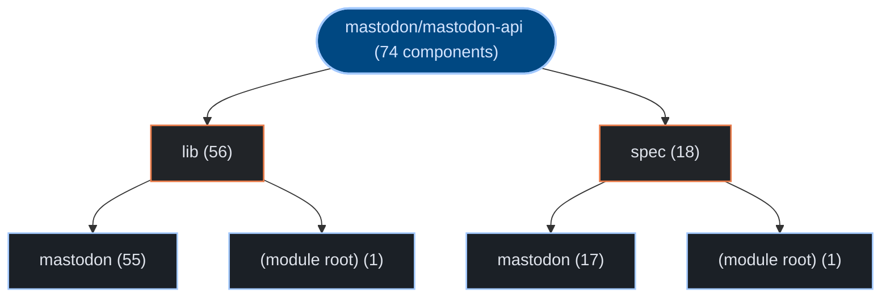
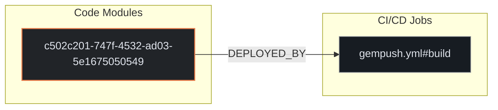
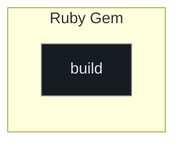

# Repository Architecture Analysis: mastodon/mastodon-api

## Metadata
- **SHA**: `60b0ed09c3b979cbeb833db0a320b30e1b022a1e`
- **Primary Ecosystem**: Ruby

## Quality Metrics
- **ast_engine**: fallback
- **avg_cognitive_complexity**: 0.0
- **avg_cyclomatic_complexity**: 0.0
- **component_count**: 74
- **dead_code_count**: 0
- **dead_code_symbols**: 0 entry(ies)
- **duplication_pct**: 0.0
- **file_complexities**: 0 entry(ies)
- **files_analyzed**: 74
- **fitness_passed**: True
- **fitness_violation_count**: 0
- **framework**: Ruby
- **import_edges**: 0 entry(ies)
- **loc**: 2909
- **max_cognitive_complexity**: 0
- **max_cyclomatic_complexity**: 0
- **sloc**: 1841

# Architecture: mastodon/mastodon-api

## Context
- **Repository**: `mastodon/mastodon-api`
- **SHA**: `60b0ed09c3b979cbeb833db0a320b30e1b022a1e`
- **Ecosystem**: Ruby
- **Framework**: Ruby

## Building Block View

## Component Details

Showing top 60 representative components out of 74 across 2 module group(s):

- **Module `lib`** (56 components — module: 56)
- **Module `spec`** (18 components — module: 18)

- **access_token** (`lib/mastodon/access_token.rb`): module
- **account** (`lib/mastodon/account.rb`): module
- **accounts** (`lib/mastodon/rest/accounts.rb`): module
- **accounts_spec** (`spec/mastodon/rest/accounts_spec.rb`): module
- **api** (`lib/mastodon/rest/api.rb`): module
- **app** (`lib/mastodon/app.rb`): module
- **app** (`lib/mastodon/entities/app.rb`): module
- **apps** (`lib/mastodon/rest/apps.rb`): module
- **apps_spec** (`spec/mastodon/rest/apps_spec.rb`): module
- **base** (`lib/mastodon/base.rb`): module
- **card** (`lib/mastodon/card.rb`): module
- **client** (`lib/mastodon/client.rb`): module
- **client** (`lib/mastodon/rest/client.rb`): module
- **client** (`lib/mastodon/streaming/client.rb`): module
- **client_spec** (`spec/mastodon/client_spec.rb`): module
- **client_spec** (`spec/mastodon/streaming/client_spec.rb`): module
- **collection** (`lib/mastodon/collection.rb`): module
- **connection** (`lib/mastodon/streaming/connection.rb`): module
- **connection_spec** (`spec/mastodon/streaming/connection_spec.rb`): module
- **conversation** (`lib/mastodon/conversation.rb`): module
- **conversations** (`lib/mastodon/rest/conversations.rb`): module
- **custom_emojis** (`lib/mastodon/rest/custom_emojis.rb`): module
- **domain_blocks** (`lib/mastodon/rest/domain_blocks.rb`): module
- **emoji** (`lib/mastodon/emoji.rb`): module
- **endorsements** (`lib/mastodon/rest/endorsements.rb`): module
- **error** (`lib/mastodon/error.rb`): module
- **field** (`lib/mastodon/field.rb`): module
- **filter** (`lib/mastodon/filter.rb`): module
- **filters** (`lib/mastodon/rest/filters.rb`): module
- **filters_change** (`lib/mastodon/streaming/events/filters_change.rb`): module
- **hashtag** (`lib/mastodon/entities/hashtag.rb`): module
- **hashtag** (`lib/mastodon/hashtag.rb`): module
- **headers** (`lib/mastodon/headers.rb`): module
- **instance** (`lib/mastodon/instance.rb`): module
- **instances** (`lib/mastodon/rest/instances.rb`): module
- **instances_spec** (`spec/mastodon/rest/instances_spec.rb`): module
- **list** (`lib/mastodon/list.rb`): module
- **lists** (`lib/mastodon/rest/lists.rb`): module
- **mastodon** (`lib/mastodon.rb`): module
- **media** (`lib/mastodon/entities/media.rb`): module
- **media** (`lib/mastodon/media.rb`): module
- **media** (`lib/mastodon/rest/media.rb`): module
- **media_spec** (`spec/mastodon/media_spec.rb`): module
- **media_spec** (`spec/mastodon/rest/media_spec.rb`): module
- **mention** (`lib/mastodon/entities/mention.rb`): module
- **message_parser** (`lib/mastodon/streaming/message_parser.rb`): module
- **message_parser_spec** (`spec/mastodon/streaming/message_parser_spec.rb`): module
- **notification** (`lib/mastodon/notification.rb`): module
- **notifications** (`lib/mastodon/rest/notifications.rb`): module
- **notifications_spec** (`spec/mastodon/rest/notifications_spec.rb`): module
- **relationship** (`lib/mastodon/relationship.rb`): module
- **relationships** (`lib/mastodon/rest/relationships.rb`): module
- **relationships_spec** (`spec/mastodon/rest/relationships_spec.rb`): module
- **reports** (`lib/mastodon/rest/reports.rb`): module
- **request** (`lib/mastodon/rest/request.rb`): module
- **response** (`lib/mastodon/streaming/response.rb`): module
- **response_spec** (`spec/mastodon/streaming/response_spec.rb`): module
- **results** (`lib/mastodon/results.rb`): module
- **scheduled_status** (`lib/mastodon/scheduled_status.rb`): module
- **scheduled_statuses** (`lib/mastodon/rest/scheduled_statuses.rb`): module

## 6-Dimension Repository Scorecard

- **Overall Grade**: `B` (85.15/100)
- **Technical Debt Score**: 14.85
- **Estimated Remediation Effort**: 7.71h

| Dimension | Grade | Score | Weight | Details |
| :--- | :---: | :---: | :---: | :--- |
| Code Quality | `A` | 100.00 | 0.20 | avg_cc=0.00, max_cc=0, duplication=0.00%, dead_code=0 |
| Dependency Health | `A` | 100.00 | 0.15 | dependencies=10, outdated=0, vulnerable=0, has_lockfile=False |
| Maintainability | `A` | 100.00 | 0.15 | avg_cognitive=0.00, max_cognitive=0, fitness_violations=0, oversized_files=0 |
| Pipeline Health | `C` | 77.00 | 0.15 | workflows=1, operational_antipatterns=2, parallel_branches=False |
| Security | `B` | 88.00 | 0.20 | vulnerabilities=0, secrets=0, pipeline_security_findings=1 |
| Test Coverage | `F` | 40.00 | 0.15 | coverage=unavailable, ci_test_job=False, test_files_detected=False |

## Supply Chain Dependencies, Vulnerabilities & Secrets

- **Dependencies Parsed**: 10 | **Vulnerabilities**: 0 | **Secrets**: 0

### Inventory Sample
- `fuubar` `*` (gem, `Gemfile`)
- `pry` `*` (gem, `Gemfile`)
- `rake` `*` (gem, `Gemfile`)
- `rspec` `3.0` (gem, `Gemfile`)
- `rubocop` `*` (gem, `Gemfile`)
- `simplecov` `*` (gem, `Gemfile`)
- `timecop` `*` (gem, `Gemfile`)
- `webmock` `*` (gem, `Gemfile`)
- `yard` `*` (gem, `Gemfile`)
- `yardstick` `*` (gem, `Gemfile`)

## Section 7: Code-to-Cloud Deployment Traceability

- `c502c201-747f-4532-ad03-5e1675050549` (code_module) --[DEPLOYED_BY]--> `gempush.yml#build` (ci_job)

## CI/CD Pipeline Topology

