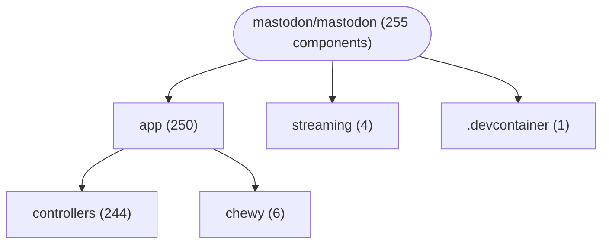
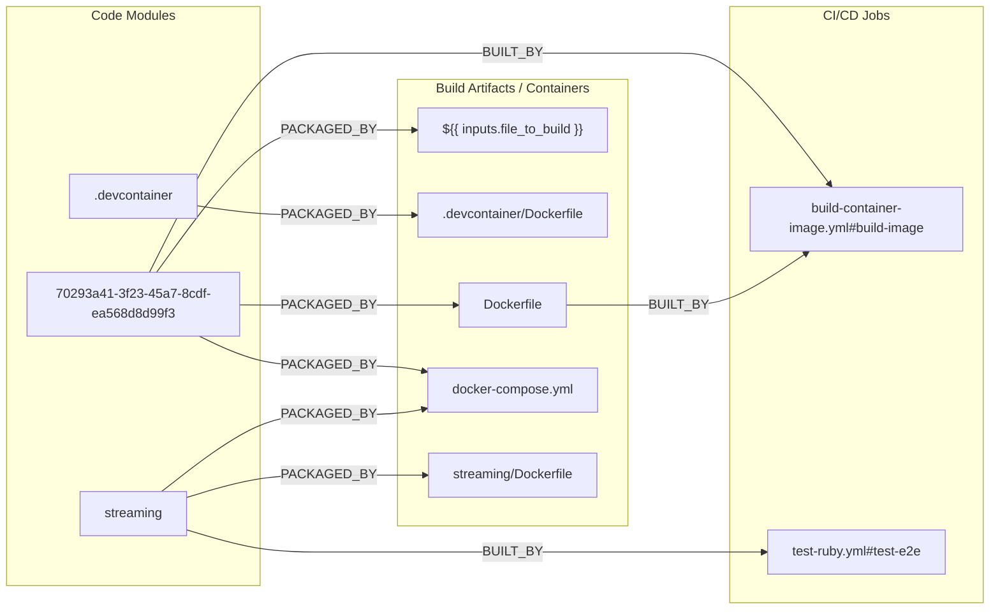
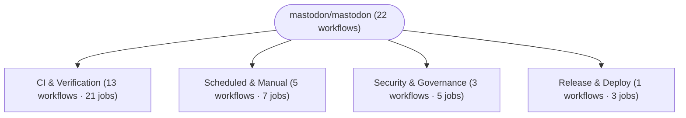

# Repository Architecture Analysis: mastodon/mastodon

## Metadata
- **SHA**: `296ca2874f3b7c02e79d2041b54f352a392f17ba`
- **Primary Ecosystem**: Ruby

## Quality Metrics
- **ast_engine**: tree-sitter
- **avg_cognitive_complexity**: 14.35
- **avg_cyclomatic_complexity**: 5.55
- **component_count**: 255
- **dead_code_count**: 0
- **dead_code_symbols**: 0 entry(ies)
- **duplication_pct**: 0.43
- **file_complexities**: 9 entry(ies)
- **files_analyzed**: 3369
- **fitness_passed**: False
- **fitness_violation_count**: 2
- **framework**: Ruby on Rails
- **import_edges**: 40 entry(ies)
- **loc**: 198442
- **max_cognitive_complexity**: 287
- **max_cyclomatic_complexity**: 110
- **sloc**: 148598
- **test_file_count**: 34

# Architecture: mastodon/mastodon

## Context
- **Repository**: `mastodon/mastodon`
- **SHA**: `296ca2874f3b7c02e79d2041b54f352a392f17ba`
- **Ecosystem**: Ruby
- **Framework**: Ruby on Rails

## Building Block View

## Component Details

Showing top 60 representative components out of 255 across 3 module group(s):

- **Module `app`** (250 components — module: 250)
- **Module `streaming`** (4 components — API_ROUTE: 3, MODULE: 1)
- **Module `.devcontainer`** (1 components — module: 1)

- **@mastodon/streaming** (`streaming/package.json`): MODULE
- **GET_api_v1_streaming_health** (`streaming/index.js`): API_ROUTE
- **GET_favicon.ico** (`streaming/index.js`): API_ROUTE
- **GET_metrics** (`streaming/index.js`): API_ROUTE
- **about_controller** (`app/controllers/about_controller.rb`): module
- **about_controller** (`app/controllers/admin/settings/about_controller.rb`): module
- **account_actions_controller** (`app/controllers/admin/account_actions_controller.rb`): module
- **account_actions_controller** (`app/controllers/api/v1/admin/account_actions_controller.rb`): module
- **account_moderation_notes_controller** (`app/controllers/admin/account_moderation_notes_controller.rb`): module
- **accounts_controller** (`app/controllers/accounts_controller.rb`): module
- **accounts_controller** (`app/controllers/admin/accounts_controller.rb`): module
- **accounts_controller** (`app/controllers/admin/email_subscriptions/accounts_controller.rb`): module
- **accounts_controller** (`app/controllers/api/v1/accounts_controller.rb`): module
- **accounts_controller** (`app/controllers/api/v1/admin/accounts_controller.rb`): module
- **accounts_controller** (`app/controllers/api/v1/lists/accounts_controller.rb`): module
- **accounts_index** (`app/chewy/accounts_index.rb`): module
- **action_logs_controller** (`app/controllers/admin/action_logs_controller.rb`): module
- **actions_controller** (`app/controllers/admin/reports/actions_controller.rb`): module
- **activity_controller** (`app/controllers/api/v1/instances/activity_controller.rb`): module
- **additional_footer_texts_controller** (`app/controllers/admin/email_subscriptions/additional_footer_texts_controller.rb`): module
- **announcements_controller** (`app/controllers/admin/announcements_controller.rb`): module
- **announcements_controller** (`app/controllers/api/v1/announcements_controller.rb`): module
- **annual_reports_controller** (`app/controllers/api/v1/annual_reports_controller.rb`): module
- **appeals_controller** (`app/controllers/admin/disputes/appeals_controller.rb`): module
- **appearance_controller** (`app/controllers/admin/settings/appearance_controller.rb`): module
- **application_controller** (`app/controllers/application_controller.rb`): module
- **approvals_controller** (`app/controllers/admin/trends/approvals_controller.rb`): module
- **apps_controller** (`app/controllers/api/v1/apps_controller.rb`): module
- **authorize_interactions_controller** (`app/controllers/authorize_interactions_controller.rb`): module
- **avatars_controller** (`app/controllers/api/v1/profile/avatars_controller.rb`): module
- **backfill_requests_controller** (`app/controllers/api/fasp/data_sharing/v0/backfill_requests_controller.rb`): module
- **backups_controller** (`app/controllers/backups_controller.rb`): module
- **base_controller** (`app/controllers/activitypub/base_controller.rb`): module
- **base_controller** (`app/controllers/admin/base_controller.rb`): module
- **base_controller** (`app/controllers/api/base_controller.rb`): module
- **base_controller** (`app/controllers/api/fasp/base_controller.rb`): module
- **base_controller** (`app/controllers/api/v1/accounts/base_controller.rb`): module
- **base_controller** (`app/controllers/api/v1/instances/base_controller.rb`): module
- **base_controller** (`app/controllers/api/v1/statuses/base_controller.rb`): module
- **base_controller** (`app/controllers/api/v1/timelines/base_controller.rb`): module
- **blocks_controller** (`app/controllers/api/v1/blocks_controller.rb`): module
- **bookmarks_controller** (`app/controllers/api/v1/bookmarks_controller.rb`): module
- **bookmarks_controller** (`app/controllers/api/v1/statuses/bookmarks_controller.rb`): module
- **branding_controller** (`app/controllers/admin/settings/branding_controller.rb`): module
- **callbacks_controller** (`app/controllers/admin/fasp/debug/callbacks_controller.rb`): module
- **canonical_email_blocks_controller** (`app/controllers/api/v1/admin/canonical_email_blocks_controller.rb`): module
- **capability_activations_controller** (`app/controllers/admin/fasp/capability_activations_controller.rb`): module
- **change_emails_controller** (`app/controllers/admin/change_emails_controller.rb`): module
- **collection_items_controller** (`app/controllers/api/v1/collection_items_controller.rb`): module
- **collection_items_controller** (`app/controllers/collection_items_controller.rb`): module
- **collections_controller** (`app/controllers/activitypub/collections_controller.rb`): module
- **collections_controller** (`app/controllers/admin/collections_controller.rb`): module
- **collections_controller** (`app/controllers/api/v1/collections_controller.rb`): module
- **collections_controller** (`app/controllers/collections_controller.rb`): module
- **compose** (`.devcontainer/compose.yaml`): module
- **confirmations_controller** (`app/controllers/admin/confirmations_controller.rb`): module
- **confirmations_controller** (`app/controllers/api/v1/emails/confirmations_controller.rb`): module
- **content_retention_controller** (`app/controllers/admin/settings/content_retention_controller.rb`): module
- **contexts_controller** (`app/controllers/activitypub/contexts_controller.rb`): module
- **contexts_controller** (`app/controllers/api/v1/statuses/contexts_controller.rb`): module

## 6-Dimension Repository Scorecard

- **Overall Grade**: `F` (44.78/100)
- **Technical Debt Score**: 55.22
- **Estimated Remediation Effort**: 62.89h

| Dimension | Grade | Score | Weight | Details |
| :--- | :---: | :---: | :---: | :--- |
| Code Quality | `D` | 64.16 | 0.20 | avg_cc=5.55, max_cc=110, duplication=0.43%, dead_code=0 |
| Dependency Health | `B` | 85.00 | 0.15 | dependencies=316, outdated=0, vulnerable=0, has_lockfile=False |
| Maintainability | `F` | 33.00 | 0.15 | avg_cognitive=14.35, max_cognitive=287, fitness_violations=2, oversized_files=1 |
| Pipeline Health | `F` | 25.00 | 0.15 | workflows=22, operational_antipatterns=21, parallel_branches=True |
| Security | `F` | 0.00 | 0.20 | vulnerabilities=0, secrets=4, pipeline_security_findings=17 |
| Test Coverage | `C` | 70.00 | 0.15 | coverage=unavailable, ci_test_job=True, test_files_detected=True |

## Architecture Fitness & Workspace Boundaries

- **[MEDIUM] `ATRUSS-ARCH-005` (COMPLEXITY_THRESHOLD)**: Repository max_cognitive_complexity (287.0) exceeds policy threshold (25.0).
- **[MEDIUM] `ATRUSS-ARCH-005` (COMPLEXITY_THRESHOLD)**: Repository max_cyclomatic_complexity (110.0) exceeds policy threshold (20.0).

### Workspace Packages
- **@mastodon/streaming** (`streaming`, react_ts_js, yarn)

## Supply Chain Dependencies, Vulnerabilities & Secrets

- **Dependencies Parsed**: 316 | **Vulnerabilities**: 0 | **Secrets**: 4

### Secret Findings (Redacted)
- **[HIGH] `ATRUSS-SEC-005`** at `.env.development:2` (`ACTIVE_RECORD_ENCRYPTION_DETERMINISTIC_KEY=fkSx***REDACTED***`)
- **[HIGH] `ATRUSS-SEC-005`** at `.env.development:3` (`ACTIVE_RECORD_ENCRYPTION_KEY_DERIVATION_SALT=r0hv***REDACTED***`)
- **[HIGH] `ATRUSS-SEC-005`** at `.env.development:4` (`ACTIVE_RECORD_ENCRYPTION_PRIMARY_KEY=PhdF***REDACTED***`)
- **[HIGH] `ATRUSS-SEC-005`** at `app/javascript/mastodon/locales/th.json:417` (`"keyboard_shortcuts.toggle_hidden": "แสดง***REDACTED***",`)

### Inventory Sample
- `active_model_serializers` `0.10` (gem, `Gemfile`)
- `addressable` `2.8` (gem, `Gemfile`)
- `annotaterb` `4.13` (gem, `Gemfile`)
- `aws-sdk-core` `*` (gem, `Gemfile`)
- `aws-sdk-s3` `1.123` (gem, `Gemfile`)
- `base58` `0.2.3` (gem, `Gemfile`)
- `better_errors` `2.9` (gem, `Gemfile`)
- `binding_of_caller` `*` (gem, `Gemfile`)
- `bloom_fit` `1.2` (gem, `Gemfile`)
- `blurhash` `0.1` (gem, `Gemfile`)
- `bootsnap` `*` (gem, `Gemfile`)
- `brakeman` `8.0` (gem, `Gemfile`)
- `browser` `*` (gem, `Gemfile`)
- `bundler-audit` `0.9` (gem, `Gemfile`)
- `capybara` `3.39` (gem, `Gemfile`)
- `capybara-playwright-driver` `*` (gem, `Gemfile`)
- `charlock_holmes` `0.7.7` (gem, `Gemfile`)
- `chewy` `*` (gem, `Gemfile`)
- `climate_control` `*` (gem, `Gemfile`)
- `cocoon` `1.2` (gem, `Gemfile`)
- `color_diff` `0.1` (gem, `Gemfile`)
- `concurrent-ruby` `*` (gem, `Gemfile`)
- `connection_pool` `*` (gem, `Gemfile`)
- `csv` `3.2` (gem, `Gemfile`)
- `database_cleaner-active_record` `*` (gem, `Gemfile`)
- `debug` `1.8` (gem, `Gemfile`)
- `devise` `*` (gem, `Gemfile`)
- `devise-two-factor` `*` (gem, `Gemfile`)
- `devise_pam_authenticatable2` `9.2` (gem, `Gemfile`)
- `discard` `2.0` (gem, `Gemfile`)
- ... (+286 more dependencies)

## Section 7: Code-to-Cloud Deployment Traceability

- `.devcontainer` (code_module) --[PACKAGED_BY]--> `.devcontainer/Dockerfile` (container)
- `70293a41-3f23-45a7-8cdf-ea568d8d99f3` (code_module) --[BUILT_BY]--> `build-container-image.yml#build-image` (ci_job)
- `70293a41-3f23-45a7-8cdf-ea568d8d99f3` (code_module) --[PACKAGED_BY]--> `${{ inputs.file_to_build }}` (container)
- `70293a41-3f23-45a7-8cdf-ea568d8d99f3` (code_module) --[PACKAGED_BY]--> `Dockerfile` (container)
- `70293a41-3f23-45a7-8cdf-ea568d8d99f3` (code_module) --[PACKAGED_BY]--> `docker-compose.yml` (container)
- `streaming` (code_module) --[BUILT_BY]--> `test-ruby.yml#test-e2e` (ci_job)
- `streaming` (code_module) --[PACKAGED_BY]--> `docker-compose.yml` (container)
- `streaming` (code_module) --[PACKAGED_BY]--> `streaming/Dockerfile` (container)
- `Dockerfile` (container) --[BUILT_BY]--> `build-container-image.yml#build-image` (ci_job)

## CI/CD Pipeline Topology

