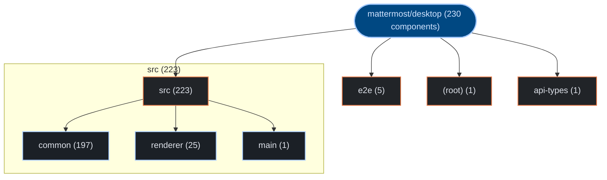
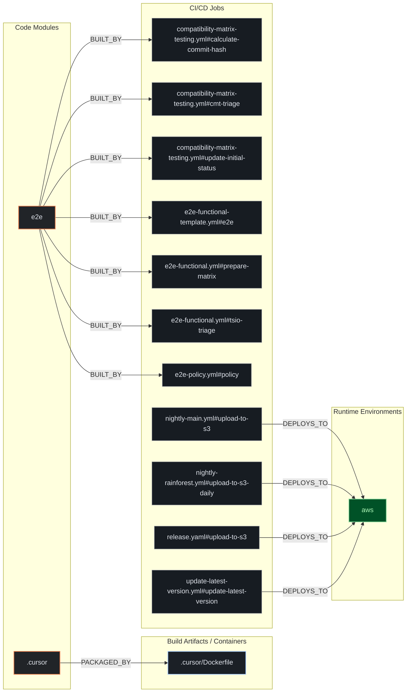

# Repository Architecture Analysis: mattermost/desktop

## Metadata
- **SHA**: `da9e5ada4051cef83e0f6ed1bd05c1c9e23d849e`
- **Primary Ecosystem**: JavaScript/TypeScript

## Quality Metrics
- **ast_engine**: tree-sitter
- **avg_cognitive_complexity**: 3.32
- **avg_cyclomatic_complexity**: 3.4
- **component_count**: 230
- **dead_code_count**: 22
- **dead_code_symbols**: 22 entry(ies)
- **duplication_pct**: 86.4
- **file_complexities**: 25 entry(ies)
- **files_analyzed**: 548
- **fitness_passed**: False
- **fitness_violation_count**: 3
- **framework**: React (Vite)
- **import_edges**: 100 entry(ies)
- **loc**: 89923
- **max_cognitive_complexity**: 108
- **max_cyclomatic_complexity**: 107
- **sloc**: 73755
- **test_file_count**: 201

# Architecture: mattermost/desktop

## Context
- **Repository**: `mattermost/desktop`
- **SHA**: `da9e5ada4051cef83e0f6ed1bd05c1c9e23d849e`
- **Ecosystem**: JavaScript/TypeScript
- **Framework**: React (Vite)

## Building Block View

## Component Details

Showing top 60 representative components out of 230 across 4 module group(s):

- **Module `src`** (223 components — UI_COMPONENT: 222, SERVICE: 1)
- **Module `e2e`** (5 components — UI_COMPONENT: 4, MODULE: 1)
- **Module `(root)`** (1 components — MODULE: 1)
- **Module `api-types`** (1 components — MODULE: 1)

- **NotificationSetting** (`src/renderer/components/SettingsModal/components/NotificationSetting.tsx`): UI_COMPONENT (deps: CheckSetting, RadioSetting)
- **SpellCheckerSetting** (`src/renderer/components/SettingsModal/components/SpellCheckerSetting.tsx`): UI_COMPONENT (deps: CheckSetting, SelectSetting)
- **SessionAttributesSetting** (`src/renderer/components/SettingsModal/components/SessionAttributesSetting.tsx`): UI_COMPONENT (deps: CheckSetting)
- **UpdatesSetting** (`src/renderer/components/SettingsModal/components/UpdatesSetting.tsx`): UI_COMPONENT (deps: CheckSetting)
- **@mattermost/desktop-api** (`api-types/package.json`): MODULE
- **ACTIVE_TAB_CHANGED** (`src/common/communication.ts`): UI_COMPONENT
- **ADD_SERVER** (`src/common/communication.ts`): UI_COMPONENT
- **APP_MENU_WILL_CLOSE** (`src/common/communication.ts`): UI_COMPONENT
- **BOOKMARK_BAR_ITEM_SELECTORS** (`e2e/helpers/channelMenu.ts`): UI_COMPONENT
- **BOOKMARK_BAR_LINK_SELECTORS** (`e2e/helpers/channelMenu.ts`): UI_COMPONENT
- **BROWSER_HISTORY_PUSH** (`src/common/communication.ts`): UI_COMPONENT
- **BROWSER_HISTORY_STATUS_UPDATED** (`src/common/communication.ts`): UI_COMPONENT
- **BasePage** (`src/renderer/components/BasePage/BasePage.tsx`): UI_COMPONENT
- **CALLS_ERROR** (`src/common/communication.ts`): UI_COMPONENT
- **CALLS_JOINED_CALL** (`src/common/communication.ts`): UI_COMPONENT
- **CALLS_JOIN_CALL** (`src/common/communication.ts`): UI_COMPONENT
- **CALLS_JOIN_REQUEST** (`src/common/communication.ts`): UI_COMPONENT
- **CALLS_LEAVE_CALL** (`src/common/communication.ts`): UI_COMPONENT
- **CALLS_LINK_CLICK** (`src/common/communication.ts`): UI_COMPONENT
- **CALLS_POPOUT_FOCUS** (`src/common/communication.ts`): UI_COMPONENT
- **CALLS_WIDGET_OPEN_STOP_RECORDING_MODAL** (`src/common/communication.ts`): UI_COMPONENT
- **CALLS_WIDGET_OPEN_THREAD** (`src/common/communication.ts`): UI_COMPONENT
- **CALLS_WIDGET_OPEN_USER_SETTINGS** (`src/common/communication.ts`): UI_COMPONENT
- **CALLS_WIDGET_RESIZE** (`src/common/communication.ts`): UI_COMPONENT
- **CALLS_WIDGET_SHARE_SCREEN** (`src/common/communication.ts`): UI_COMPONENT
- **CAN_POPOUT** (`src/common/communication.ts`): UI_COMPONENT
- **CAN_USE_POPOUT_OPTION** (`src/common/communication.ts`): UI_COMPONENT
- **CHECK_FOR_UPDATES** (`src/common/communication.ts`): UI_COMPONENT
- **CLEAR_CACHE_AND_RELOAD** (`src/common/communication.ts`): UI_COMPONENT
- **CLOSE_DOWNLOADS_DROPDOWN** (`src/common/communication.ts`): UI_COMPONENT
- **CLOSE_DOWNLOADS_DROPDOWN_MENU** (`src/common/communication.ts`): UI_COMPONENT
- **CLOSE_SERVERS_DROPDOWN** (`src/common/communication.ts`): UI_COMPONENT
- **CLOSE_TAB** (`src/common/communication.ts`): UI_COMPONENT
- **COPY_LINK_SELECTORS** (`e2e/helpers/channelMenu.ts`): UI_COMPONENT
- **CREATE_NEW_TAB** (`src/common/communication.ts`): UI_COMPONENT
- **CREATE_NEW_WINDOW** (`src/common/communication.ts`): UI_COMPONENT
- **CertificateStore** (`src/main/security/certificateStore.ts`): SERVICE
- **CheckSetting** (`src/renderer/components/SettingsModal/components/CheckSetting.tsx`): UI_COMPONENT
- **ConnectionErrorView** (`src/renderer/components/ConnectionErrorView.tsx`): UI_COMPONENT
- **DARK_MODE_CHANGE** (`src/common/communication.ts`): UI_COMPONENT
- **DESKTOP_SOURCES_MODAL_REQUEST** (`src/common/communication.ts`): UI_COMPONENT
- **DEVELOPER_MODE_UPDATED** (`src/common/communication.ts`): UI_COMPONENT
- **DOUBLE_CLICK_ON_WINDOW** (`src/common/communication.ts`): UI_COMPONENT
- **DOWNLOADS_DROPDOWN_FOCUSED** (`src/common/communication.ts`): UI_COMPONENT
- **DOWNLOADS_DROPDOWN_MENU_CANCEL_DOWNLOAD** (`src/common/communication.ts`): UI_COMPONENT
- **DOWNLOADS_DROPDOWN_MENU_CLEAR_FILE** (`src/common/communication.ts`): UI_COMPONENT
- **DOWNLOADS_DROPDOWN_MENU_OPEN_FILE** (`src/common/communication.ts`): UI_COMPONENT
- **DOWNLOADS_DROPDOWN_MENU_SHOW_FILE_IN_FOLDER** (`src/common/communication.ts`): UI_COMPONENT
- **DOWNLOADS_DROPDOWN_OPEN_FILE** (`src/common/communication.ts`): UI_COMPONENT
- **DOWNLOAD_UPDATE_MANUALLY** (`src/common/communication.ts`): UI_COMPONENT
- **DestructiveConfirmationModal** (`src/renderer/components/DestructiveConfirmModal.tsx`): UI_COMPONENT
- **DeveloperModeIndicator** (`src/renderer/components/DeveloperModeIndicator/DeveloperModeIndicator.tsx`): UI_COMPONENT
- **DownloadSetting** (`src/renderer/components/SettingsModal/components/DownloadSetting.tsx`): UI_COMPONENT
- **EDIT_SERVER** (`src/common/communication.ts`): UI_COMPONENT
- **EMIT_CONFIGURATION** (`src/common/communication.ts`): UI_COMPONENT
- **EXIT_FULLSCREEN** (`src/common/communication.ts`): UI_COMPONENT
- **ErrorView** (`src/renderer/components/ErrorView/ErrorView.tsx`): UI_COMPONENT
- **FOCUS_THREE_DOT_MENU** (`src/common/communication.ts`): UI_COMPONENT
- **GET_ACTIVE_TAB_FOR_SERVER** (`src/common/communication.ts`): UI_COMPONENT
- **GET_APP_INFO** (`src/common/communication.ts`): UI_COMPONENT

## 6-Dimension Repository Scorecard

- **Overall Grade**: `F` (36.73/100)
- **Technical Debt Score**: 63.27
- **Estimated Remediation Effort**: 172.10h

| Dimension | Grade | Score | Weight | Details |
| :--- | :---: | :---: | :---: | :--- |
| Code Quality | `F` | 28.40 | 0.20 | avg_cc=3.40, max_cc=107, duplication=86.40%, dead_code=22 |
| Dependency Health | `A` | 100.00 | 0.15 | dependencies=1819, outdated=0, vulnerable=0, has_lockfile=True |
| Maintainability | `F` | 37.00 | 0.15 | avg_cognitive=3.32, max_cognitive=108, fitness_violations=3, oversized_files=8 |
| Pipeline Health | `F` | 0.00 | 0.15 | workflows=26, operational_antipatterns=69, parallel_branches=True |
| Security | `F` | 0.00 | 0.20 | vulnerabilities=0, secrets=4, pipeline_security_findings=48 |
| Test Coverage | `C` | 70.00 | 0.15 | coverage=unavailable, ci_test_job=True, test_files_detected=True |

## Architecture Fitness & Workspace Boundaries

- **[MEDIUM] `ATRUSS-ARCH-005` (COMPLEXITY_THRESHOLD)**: Repository duplication_pct (86.4) exceeds policy threshold (15.0).
- **[MEDIUM] `ATRUSS-ARCH-005` (COMPLEXITY_THRESHOLD)**: Repository max_cognitive_complexity (108.0) exceeds policy threshold (25.0).
- **[MEDIUM] `ATRUSS-ARCH-005` (COMPLEXITY_THRESHOLD)**: Repository max_cyclomatic_complexity (107.0) exceeds policy threshold (20.0).

## Supply Chain Dependencies, Vulnerabilities & Secrets

- **Dependencies Parsed**: 1819 | **Vulnerabilities**: 0 | **Secrets**: 4

### Secret Findings (Redacted)
- **[HIGH] `ATRUSS-SEC-005`** at `i18n/ja.json:200` (`"renderer.components.configureServer.error.basicAuthRequired": "このサー***REDACTED***",`)
- **[HIGH] `ATRUSS-SEC-005`** at `i18n/ja.json:202` (`"renderer.components.configureServer.error.preAuthRequired": "このサー***REDACTED***",`)
- **[HIGH] `ATRUSS-SEC-005`** at `i18n/zh-CN.json:204` (`"renderer.components.configureServer.error.basicAuthRequired": "此服务器***REDACTED***",`)
- **[HIGH] `ATRUSS-SEC-005`** at `i18n/zh-CN.json:207` (`"renderer.components.configureServer.error.preAuthRequired": "此服务器***REDACTED***",`)

### Inventory Sample
- `@babel/preset-env` `7.24.0` (npm, `package-lock.json`)
- `@babel/preset-env` `7.24.0` (npm, `package.json`)
- `@babel/preset-react` `7.23.3` (npm, `package-lock.json`)
- `@babel/preset-react` `7.23.3` (npm, `package.json`)
- `@babel/preset-typescript` `7.23.3` (npm, `package-lock.json`)
- `@babel/preset-typescript` `7.23.3` (npm, `package.json`)
- `@electron/fuses` `1.8.0` (npm, `package-lock.json`)
- `@electron/fuses` `1.8.0` (npm, `package.json`)
- `@emotion/react` `11.11.4` (npm, `package-lock.json`)
- `@emotion/react` `11.11.4` (npm, `package.json`)
- `@floating-ui/react` `0.26.28` (npm, `package-lock.json`)
- `@floating-ui/react` `0.26.28` (npm, `package.json`)
- `@mattermost/compass-icons` `0.1.45` (npm, `package-lock.json`)
- `@mattermost/compass-icons` `0.1.45` (npm, `package.json`)
- `@mattermost/desktop-api` `*` (npm, `package.json`)
- `@mattermost/eslint-plugin` `1.1.0-0` (npm, `package-lock.json`)
- `@mattermost/eslint-plugin` `1.1.0-0` (npm, `package.json`)
- `@playwright/test` `1.64.1` (npm, `e2e/package-lock.json`)
- `@playwright/test` `1.64.1` (npm, `e2e/package.json`)
- `@sentry/electron` `7.11.0` (npm, `package-lock.json`)
- `@sentry/electron` `7.11.0` (npm, `package.json`)
- `@types/auto-launch` `5.0.5` (npm, `package-lock.json`)
- `@types/auto-launch` `5.0.5` (npm, `package.json`)
- `@types/jest` `29.4.1` (npm, `package-lock.json`)
- `@types/jest` `29.4.1` (npm, `package.json`)
- `@types/react` `17.0.43` (npm, `package-lock.json`)
- `@types/react` `17.0.43` (npm, `package.json`)
- `@types/react-beautiful-dnd` `13.1.8` (npm, `package-lock.json`)
- `@types/react-beautiful-dnd` `13.1.8` (npm, `package.json`)
- `@types/react-dom` `17.0.14` (npm, `package-lock.json`)
- ... (+1789 more dependencies)

## Section 7: Code-to-Cloud Deployment Traceability

- `nightly-main.yml#upload-to-s3` (ci_job) --[DEPLOYS_TO]--> `aws` (environment)
- `nightly-rainforest.yml#upload-to-s3-daily` (ci_job) --[DEPLOYS_TO]--> `aws` (environment)
- `release.yaml#upload-to-s3` (ci_job) --[DEPLOYS_TO]--> `aws` (environment)
- `update-latest-version.yml#update-latest-version` (ci_job) --[DEPLOYS_TO]--> `aws` (environment)
- `.cursor` (code_module) --[PACKAGED_BY]--> `.cursor/Dockerfile` (container)
- `e2e` (code_module) --[BUILT_BY]--> `compatibility-matrix-testing.yml#calculate-commit-hash` (ci_job)
- `e2e` (code_module) --[BUILT_BY]--> `compatibility-matrix-testing.yml#cmt-triage` (ci_job)
- `e2e` (code_module) --[BUILT_BY]--> `compatibility-matrix-testing.yml#update-initial-status` (ci_job)
- `e2e` (code_module) --[BUILT_BY]--> `e2e-functional-template.yml#e2e` (ci_job)
- `e2e` (code_module) --[BUILT_BY]--> `e2e-functional.yml#prepare-matrix` (ci_job)
- `e2e` (code_module) --[BUILT_BY]--> `e2e-functional.yml#tsio-triage` (ci_job)
- `e2e` (code_module) --[BUILT_BY]--> `e2e-policy.yml#policy` (ci_job)

## CI/CD Pipeline Topology

```mermaid
graph TD;
  classDef atlasRoot fill:#004882,stroke:#a3c9ff,stroke-width:2px,color:#d3e4ff
  classDef atlasCategory fill:#212428,stroke:#E87A48,stroke-width:1.5px,color:#dfe3eb
  classDef atlasWorkflow fill:#1b2026,stroke:#a3c9ff,stroke-width:1.5px,color:#dfe3eb
  classDef atlasJob fill:#171c22,stroke:#8d9199,stroke-width:1px,color:#dfe3eb
  classDef atlasTarget fill:#005227,stroke:#8bd99b,stroke-width:1.5px,color:#a7f6b6
  classDef atlasAlert fill:#93000a,stroke:#ffb4ab,stroke-width:1.5px,color:#ffdad6
  classDef atlasMore fill:#252a31,stroke:#8d9199,stroke-dasharray:4 4,color:#c3c6cf
  pipeline_root(["mattermost/desktop (26 workflows)"]):::atlasRoot
  subgraph sg_grp_0_Scheduled___Manual["Scheduled & Manual (10 workflows · 45 jobs)"]
    direction TB
    subgraph sg_wf_4_Compatibility_Matrix_Testing["Compatibility Matrix Testing (11 jobs)"]
      direction TB
      wf_4_Compatibility_Matrix_Testing(["Trigger: Compatibility Matrix Testing"]):::atlasWorkflow
      job_4_upload_cmt_server_detals["upload-cmt-server-detals"]:::atlasJob
      job_4_calculate_commit_hash["calculate-commit-hash"]:::atlasJob
      job_4_update_initial_status["update-initial-status"]:::atlasJob
      wf_4_Compatibility_Matrix_Testing --> job_4_upload_cmt_server_detals
      wf_4_Compatibility_Matrix_Testing --> job_4_calculate_commit_hash
      job_4_calculate_commit_hash --> job_4_update_initial_status
    end
    pipeline_root --> wf_4_Compatibility_Matrix_Testing
    subgraph sg_wf_8_Electron_Playwright_Tests["Electron Playwright Tests (17 jobs)"]
      direction TB
      wf_8_Electron_Playwright_Tests(["Trigger: Electron Playwright Tests"]):::atlasWorkflow
      job_8_prepare_matrix["prepare-matrix"]:::atlasJob
      job_8_update_initial_status["update-initial-status"]:::atlasJob
      job_8_e2e_linux_install["e2e-linux-install"]:::atlasJob
      wf_8_Electron_Playwright_Tests --> job_8_prepare_matrix
      job_8_prepare_matrix --> job_8_update_initial_status
      job_8_prepare_matrix --> job_8_e2e_linux_install
      job_8_update_initial_status --> job_8_e2e_linux_install
    end
    pipeline_root --> wf_8_Electron_Playwright_Tests
  end
  subgraph sg_grp_1_CI___Verification["CI & Verification (7 workflows · 14 jobs)"]
    direction TB
    subgraph sg_wf_0_build_for_pr["build-for-pr (4 jobs)"]
      direction TB
      wf_0_build_for_pr(["Trigger: build-for-pr"]):::atlasWorkflow
      job_0_build_linux_for_pr["build-linux-for-pr"]:::atlasJob
      job_0_windows_install_deps["windows-install-deps"]:::atlasJob
      job_0_build_win_for_pr["build-win-for-pr"]:::atlasJob
      wf_0_build_for_pr --> job_0_build_linux_for_pr
      wf_0_build_for_pr --> job_0_windows_install_deps
      job_0_windows_install_deps --> job_0_build_win_for_pr
    end
    pipeline_root --> wf_0_build_for_pr
    subgraph sg_wf_1_ci["ci (5 jobs)"]
      direction TB
      wf_1_ci(["Trigger: ci"]):::atlasWorkflow
      job_1_build_linux["build-linux"]:::atlasJob
      job_1_windows_install_deps["windows-install-deps"]:::atlasJob
      job_1_build_win_no_installer["build-win-no-installer"]:::atlasJob
      wf_1_ci --> job_1_build_linux
      wf_1_ci --> job_1_windows_install_deps
      job_1_windows_install_deps --> job_1_build_win_no_installer
    end
    pipeline_root --> wf_1_ci
  end
  subgraph sg_grp_2_Release___Deploy["Release & Deploy (4 workflows · 10 jobs)"]
    direction TB
    subgraph sg_wf_21_release["release (7 jobs)"]
      direction TB
      wf_21_release(["Trigger: release"]):::atlasWorkflow
      job_21_begin_notification["begin-notification"]:::atlasJob
      job_21_build_linux["build-linux"]:::atlasJob
      job_21_build_msi_installer["build-msi-installer"]:::atlasJob
      wf_21_release --> job_21_begin_notification
      job_21_begin_notification --> job_21_build_linux
      job_21_begin_notification --> job_21_build_msi_installer
    end
    pipeline_root --> wf_21_release
    subgraph sg_wf_22_Run_Release_Script["Run Release Script (1 jobs)"]
      direction TB
      wf_22_Run_Release_Script(["Trigger: Run Release Script"]):::atlasWorkflow
      job_22_run_release["run-release"]:::atlasJob
      wf_22_Run_Release_Script --> job_22_run_release
    end
    pipeline_root --> wf_22_Run_Release_Script
  end
  subgraph sg_grp_3_Automation___Other["Automation & Other (3 workflows · 3 jobs)"]
    direction TB
    wf_10_E2E_Label_Cleanup["E2E Label Cleanup (1 jobs)"]:::atlasWorkflow
    pipeline_root --> wf_10_E2E_Label_Cleanup
    wf_12_E2E_post_OS_commit_status["E2E post OS commit status (1 jobs)"]:::atlasWorkflow
    pipeline_root --> wf_12_E2E_post_OS_commit_status
  end
  subgraph sg_grp_4_Security___Governance["Security & Governance (2 workflows · 2 jobs)"]
    direction TB
    wf_3_CodeQL["CodeQL (1 jobs)"]:::atlasWorkflow
    pipeline_root --> wf_3_CodeQL
    wf_23_Scorecards_supply_chain_security["Scorecards supply-chain security (1 jobs)"]:::atlasWorkflow
    pipeline_root --> wf_23_Scorecards_supply_chain_security
  end
  wf_more["+16 more workflows"]:::atlasMore
  pipeline_root --> wf_more
```

