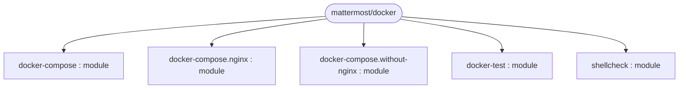
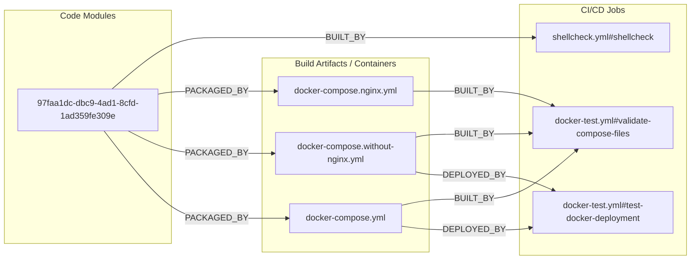
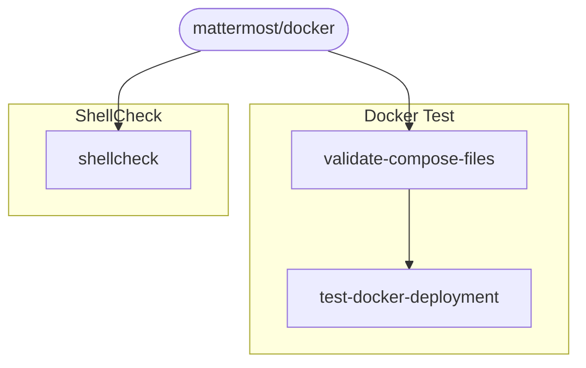

# Repository Architecture Analysis: mattermost/docker

## Metadata
- **SHA**: `12bbeda5009e1d8381be294a88d1cb69dc624290`
- **Primary Ecosystem**: Container / Helm / IaC

## Quality Metrics
- **ast_engine**: fallback
- **avg_cognitive_complexity**: 0.0
- **avg_cyclomatic_complexity**: 0.0
- **component_count**: 5
- **dead_code_count**: 0
- **dead_code_symbols**: 0 entry(ies)
- **duplication_pct**: 0.0
- **file_complexities**: 0 entry(ies)
- **files_analyzed**: 5
- **fitness_passed**: True
- **fitness_violation_count**: 0
- **framework**: Docker Compose
- **import_edges**: 0 entry(ies)
- **loc**: 208
- **max_cognitive_complexity**: 0
- **max_cyclomatic_complexity**: 0
- **sloc**: 153

# Architecture: mattermost/docker

## Context
- **Repository**: `mattermost/docker`
- **SHA**: `12bbeda5009e1d8381be294a88d1cb69dc624290`
- **Ecosystem**: Container / Helm / IaC
- **Framework**: Docker Compose

## Building Block View

## Component Details
- **docker-compose.nginx** (`docker-compose.nginx.yml`): module
- **docker-compose.without-nginx** (`docker-compose.without-nginx.yml`): module
- **docker-compose** (`docker-compose.yml`): module
- **docker-test** (`.github/workflows/docker-test.yml`): module
- **shellcheck** (`.github/workflows/shellcheck.yml`): module

## 6-Dimension Repository Scorecard

- **Overall Grade**: `B` (84.55/100)
- **Technical Debt Score**: 15.45
- **Estimated Remediation Effort**: 10.86h

| Dimension | Grade | Score | Weight | Details |
| :--- | :---: | :---: | :---: | :--- |
| Code Quality | `A` | 100.00 | 0.20 | avg_cc=0.00, max_cc=0, duplication=0.00%, dead_code=0 |
| Dependency Health | `A` | 90.00 | 0.15 | dependencies=0 (no manifests parsed) |
| Maintainability | `A` | 100.00 | 0.15 | avg_cognitive=0.00, max_cognitive=0, fitness_violations=0, oversized_files=0 |
| Pipeline Health | `B` | 85.00 | 0.15 | workflows=2, operational_antipatterns=4, parallel_branches=False |
| Security | `D` | 64.00 | 0.20 | vulnerabilities=0, secrets=0, pipeline_security_findings=3 |
| Test Coverage | `C` | 70.00 | 0.15 | coverage=unavailable, ci_test_job=True, test_files_detected=False |

## Section 7: Code-to-Cloud Deployment Traceability

- `97faa1dc-dbc9-4ad1-8cfd-1ad359fe309e` (code_module) --[BUILT_BY]--> `shellcheck.yml#shellcheck` (ci_job)
- `97faa1dc-dbc9-4ad1-8cfd-1ad359fe309e` (code_module) --[PACKAGED_BY]--> `docker-compose.nginx.yml` (container)
- `97faa1dc-dbc9-4ad1-8cfd-1ad359fe309e` (code_module) --[PACKAGED_BY]--> `docker-compose.without-nginx.yml` (container)
- `97faa1dc-dbc9-4ad1-8cfd-1ad359fe309e` (code_module) --[PACKAGED_BY]--> `docker-compose.yml` (container)
- `docker-compose.nginx.yml` (container) --[BUILT_BY]--> `docker-test.yml#validate-compose-files` (ci_job)
- `docker-compose.without-nginx.yml` (container) --[BUILT_BY]--> `docker-test.yml#validate-compose-files` (ci_job)
- `docker-compose.without-nginx.yml` (container) --[DEPLOYED_BY]--> `docker-test.yml#test-docker-deployment` (ci_job)
- `docker-compose.yml` (container) --[BUILT_BY]--> `docker-test.yml#validate-compose-files` (ci_job)
- `docker-compose.yml` (container) --[DEPLOYED_BY]--> `docker-test.yml#test-docker-deployment` (ci_job)

## CI/CD Pipeline Topology

