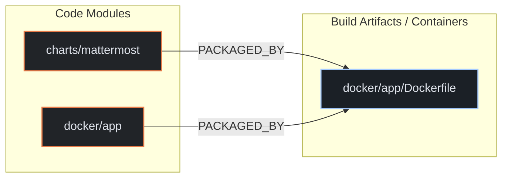
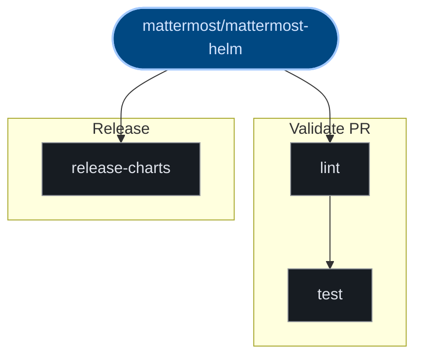

# Repository Architecture Analysis: mattermost/mattermost-helm

## Metadata
- **SHA**: `07025cf61b2fd7f656d08723acdba53de238454e`
- **Primary Ecosystem**: Container / Helm / IaC

## Quality Metrics
- **ast_engine**: fallback
- **avg_cognitive_complexity**: 0.0
- **avg_cyclomatic_complexity**: 0.0
- **component_count**: 125
- **dead_code_count**: 0
- **dead_code_symbols**: 0 entry(ies)
- **duplication_pct**: 0.0
- **file_complexities**: 0 entry(ies)
- **files_analyzed**: 125
- **fitness_passed**: True
- **fitness_violation_count**: 0
- **framework**: Helm Chart
- **import_edges**: 0 entry(ies)
- **loc**: 15499
- **max_cognitive_complexity**: 0
- **max_cyclomatic_complexity**: 0
- **sloc**: 14315
- **test_file_count**: 13

# Architecture: mattermost/mattermost-helm

## Context
- **Repository**: `mattermost/mattermost-helm`
- **SHA**: `07025cf61b2fd7f656d08723acdba53de238454e`
- **Ecosystem**: Container / Helm / IaC
- **Framework**: Helm Chart

## Building Block View

```mermaid
graph TD;
  classDef atlasRoot fill:#004882,stroke:#a3c9ff,stroke-width:2px,color:#d3e4ff
  classDef atlasCategory fill:#212428,stroke:#E87A48,stroke-width:1.5px,color:#dfe3eb
  classDef atlasWorkflow fill:#1b2026,stroke:#a3c9ff,stroke-width:1.5px,color:#dfe3eb
  classDef atlasJob fill:#171c22,stroke:#8d9199,stroke-width:1px,color:#dfe3eb
  classDef atlasTarget fill:#005227,stroke:#8bd99b,stroke-width:1.5px,color:#a7f6b6
  classDef atlasAlert fill:#93000a,stroke:#ffb4ab,stroke-width:1.5px,color:#ffdad6
  classDef atlasMore fill:#252a31,stroke:#8d9199,stroke-dasharray:4 4,color:#c3c6cf
    repo_root(["mattermost/mattermost-helm (125 components)"]):::atlasRoot
    subgraph sg_dir_0_charts_mattermost_enterprise_edition["charts/mattermost-enterprise-edition (36)"]
      direction TB
      dir_0_charts_mattermost_enterprise_edition["charts/mattermost-enterprise-edition (36)"]:::atlasCategory
      sub_0_0_charts["charts (19)"]:::atlasWorkflow
      dir_0_charts_mattermost_enterprise_edition --> sub_0_0_charts
      sub_0_1_templates["templates (13)"]:::atlasWorkflow
      dir_0_charts_mattermost_enterprise_edition --> sub_0_1_templates
      sub_0_2__module_root_["(module root) (2)"]:::atlasWorkflow
      dir_0_charts_mattermost_enterprise_edition --> sub_0_2__module_root_
      sub_0_more["+1 more submodules (2)"]:::atlasMore
      dir_0_charts_mattermost_enterprise_edition --> sub_0_more
    end
    repo_root --> dir_0_charts_mattermost_enterprise_edition
    subgraph sg_dir_1_charts_mattermost_team_edition["charts/mattermost-team-edition (16)"]
      direction TB
      dir_1_charts_mattermost_team_edition["charts/mattermost-team-edition (16)"]:::atlasCategory
      sub_1_0_templates["templates (12)"]:::atlasWorkflow
      dir_1_charts_mattermost_team_edition --> sub_1_0_templates
      sub_1_1__module_root_["(module root) (2)"]:::atlasWorkflow
      dir_1_charts_mattermost_team_edition --> sub_1_1__module_root_
      sub_1_2_ci["ci (2)"]:::atlasWorkflow
      dir_1_charts_mattermost_team_edition --> sub_1_2_ci
    end
    repo_root --> dir_1_charts_mattermost_team_edition
    subgraph sg_dir_2_charts_mattermost["charts/mattermost (14)"]
      direction TB
      dir_2_charts_mattermost["charts/mattermost (14)"]:::atlasCategory
      sub_2_0_templates["templates (10)"]:::atlasWorkflow
      dir_2_charts_mattermost --> sub_2_0_templates
      sub_2_1__module_root_["(module root) (2)"]:::atlasWorkflow
      dir_2_charts_mattermost --> sub_2_1__module_root_
      sub_2_2_ci["ci (1)"]:::atlasWorkflow
      dir_2_charts_mattermost --> sub_2_2_ci
      sub_2_more["+1 more submodules (1)"]:::atlasMore
      dir_2_charts_mattermost --> sub_2_more
    end
    repo_root --> dir_2_charts_mattermost
    subgraph sg_dir_3_charts_mattermost_calls_offloader["charts/mattermost-calls-offloader (14)"]
      direction TB
      dir_3_charts_mattermost_calls_offloader["charts/mattermost-calls-offloader (14)"]:::atlasCategory
      sub_3_0_templates["templates (12)"]:::atlasWorkflow
      dir_3_charts_mattermost_calls_offloader --> sub_3_0_templates
      sub_3_1__module_root_["(module root) (2)"]:::atlasWorkflow
      dir_3_charts_mattermost_calls_offloader --> sub_3_1__module_root_
    end
    repo_root --> dir_3_charts_mattermost_calls_offloader
    subgraph sg_dir_4_charts_mattermost_operator["charts/mattermost-operator (11)"]
      direction TB
      dir_4_charts_mattermost_operator["charts/mattermost-operator (11)"]:::atlasCategory
      sub_4_0_templates["templates (5)"]:::atlasWorkflow
      dir_4_charts_mattermost_operator --> sub_4_0_templates
      sub_4_1__module_root_["(module root) (3)"]:::atlasWorkflow
      dir_4_charts_mattermost_operator --> sub_4_1__module_root_
      sub_4_2_crds["crds (3)"]:::atlasWorkflow
      dir_4_charts_mattermost_operator --> sub_4_2_crds
    end
    repo_root --> dir_4_charts_mattermost_operator
    dir_other_modules["+4 more modules (34)"]:::atlasMore
    repo_root --> dir_other_modules
```

## Component Details

Showing top 60 representative components out of 125 across 9 module group(s):

- **Module `charts/mattermost-enterprise-edition`** (36 components — module: 36)
- **Module `charts/mattermost-team-edition`** (16 components — module: 16)
- **Module `charts/mattermost`** (14 components — module: 14)
- **Module `charts/mattermost-calls-offloader`** (14 components — module: 14)
- **Module `charts/mattermost-operator`** (11 components — module: 11)
- **Module `charts/mattermost-push-proxy`** (11 components — module: 11)
- **Module `charts/focalboard`** (8 components — module: 8)
- **Module `charts/mattermost-chaos-engine`** (8 components — module: 8)
- **Module `charts/mattermost-rtcd`** (7 components — module: 7)

- **Chart** (`charts/focalboard/Chart.yaml`): module
- **Chart** (`charts/mattermost-calls-offloader/Chart.yaml`): module
- **Chart** (`charts/mattermost-chaos-engine/Chart.yaml`): module
- **Chart** (`charts/mattermost-enterprise-edition/Chart.yaml`): module
- **Chart** (`charts/mattermost-enterprise-edition/charts/mattermost-elasticsearch/Chart.yaml`): module
- **Chart** (`charts/mattermost-enterprise-edition/charts/mattermost-grafana/Chart.yaml`): module
- **Chart** (`charts/mattermost-operator/Chart.yaml`): module
- **Chart** (`charts/mattermost-push-proxy/Chart.yaml`): module
- **Chart** (`charts/mattermost-rtcd/Chart.yaml`): module
- **Chart** (`charts/mattermost-team-edition/Chart.yaml`): module
- **Chart** (`charts/mattermost/Chart.yaml`): module
- **client** (`charts/mattermost-enterprise-edition/charts/mattermost-elasticsearch/templates/client.yaml`): module
- **clusterrole** (`charts/mattermost-operator/templates/mattermost-operator/clusterrole.yaml`): module
- **clusterrolebinding** (`charts/mattermost-operator/templates/mattermost-operator/clusterrolebinding.yaml`): module
- **configmap** (`charts/mattermost-enterprise-edition/charts/mattermost-grafana/templates/configmap.yaml`): module
- **configmap-loadtest-config** (`charts/mattermost-enterprise-edition/templates/configmap-loadtest-config.yaml`): module
- **configmap-mattermost-config** (`charts/mattermost-enterprise-edition/templates/configmap-mattermost-config.yaml`): module
- **configmap-mattermost-push-proxy** (`charts/mattermost-push-proxy/templates/configmap-mattermost-push-proxy.yaml`): module
- **crd-clusterinstallations** (`charts/mattermost-operator/crds/crd-clusterinstallations.yaml`): module
- **crd-mattermostrestoredbs** (`charts/mattermost-operator/crds/crd-mattermostrestoredbs.yaml`): module
- **crd-mattermosts** (`charts/mattermost-operator/crds/crd-mattermosts.yaml`): module
- **daemonset** (`charts/mattermost-rtcd/templates/daemonset.yaml`): module
- **dashboards-configmap** (`charts/mattermost-enterprise-edition/charts/mattermost-grafana/templates/dashboards-configmap.yaml`): module
- **data** (`charts/mattermost-enterprise-edition/charts/mattermost-elasticsearch/templates/data.yaml`): module
- **default-values** (`charts/mattermost-enterprise-edition/ci/default-values.yaml`): module
- **default-values** (`charts/mattermost-team-edition/ci/default-values.yaml`): module
- **default-values** (`charts/mattermost/ci/default-values.yaml`): module
- **deployment** (`charts/focalboard/templates/deployment.yaml`): module
- **deployment** (`charts/mattermost-calls-offloader/templates/deployment.yaml`): module
- **deployment** (`charts/mattermost-chaos-engine/templates/deployment.yaml`): module
- **deployment** (`charts/mattermost-enterprise-edition/charts/mattermost-grafana/templates/deployment.yaml`): module
- **deployment** (`charts/mattermost-operator/templates/mattermost-operator/deployment.yaml`): module
- **deployment** (`charts/mattermost-push-proxy/templates/deployment.yaml`): module
- **deployment** (`charts/mattermost-rtcd/templates/deployment.yaml`): module
- **deployment** (`charts/mattermost-team-edition/templates/deployment.yaml`): module
- **deployment-mattermost-app** (`charts/mattermost-enterprise-edition/templates/deployment-mattermost-app.yaml`): module
- **deployment-mattermost-app** (`charts/mattermost/templates/deployment-mattermost-app.yaml`): module
- **deployment-mattermost-hpa** (`charts/mattermost-enterprise-edition/templates/deployment-mattermost-hpa.yaml`): module
- **deployment-mattermost-hpa** (`charts/mattermost/templates/deployment-mattermost-hpa.yaml`): module
- **deployment-mattermost-jobserver** (`charts/mattermost-enterprise-edition/templates/deployment-mattermost-jobserver.yaml`): module
- **deployment-mattermost-jobserver** (`charts/mattermost/templates/deployment-mattermost-jobserver.yaml`): module
- **deployment-mattermost-loadtest** (`charts/mattermost-enterprise-edition/templates/deployment-mattermost-loadtest.yaml`): module
- **discovery-svc** (`charts/mattermost-enterprise-edition/charts/mattermost-elasticsearch/templates/discovery-svc.yaml`): module
- **ds-master** (`charts/mattermost-enterprise-edition/charts/mattermost-elasticsearch/templates/ds-master.yaml`): module
- **efs-pv** (`charts/mattermost-calls-offloader/templates/efs-pv.yaml`): module
- **efs-pvc** (`charts/mattermost-calls-offloader/templates/efs-pvc.yaml`): module
- **efs-storage-class** (`charts/mattermost-calls-offloader/templates/efs-storage-class.yaml`): module
- **external_secrets** (`charts/mattermost-push-proxy/templates/external_secrets.yaml`): module
- **extra-deploy** (`charts/mattermost-team-edition/templates/extra-deploy.yaml`): module
- **extra-values** (`charts/mattermost-team-edition/ci/extra-values.yaml`): module
- **hpa** (`charts/mattermost-calls-offloader/templates/hpa.yaml`): module
- **ingress** (`charts/focalboard/templates/ingress.yaml`): module
- **ingress** (`charts/mattermost-chaos-engine/templates/ingress.yaml`): module
- **ingress** (`charts/mattermost-enterprise-edition/charts/mattermost-grafana/templates/ingress.yaml`): module
- **ingress** (`charts/mattermost-push-proxy/templates/ingress.yaml`): module
- **ingress** (`charts/mattermost-rtcd/templates/ingress.yaml`): module
- **ingress** (`charts/mattermost-team-edition/templates/ingress.yaml`): module
- **ingress-mattermost-app** (`charts/mattermost-enterprise-edition/templates/ingress-mattermost-app.yaml`): module
- **ingress-mattermost-app** (`charts/mattermost/templates/ingress-mattermost-app.yaml`): module
- **init-container-values** (`charts/mattermost-enterprise-edition/ci/init-container-values.yaml`): module

## 6-Dimension Repository Scorecard

- **Overall Grade**: `B` (84.85/100)
- **Technical Debt Score**: 15.15
- **Estimated Remediation Effort**: 10.29h

| Dimension | Grade | Score | Weight | Details |
| :--- | :---: | :---: | :---: | :--- |
| Code Quality | `A` | 100.00 | 0.20 | avg_cc=0.00, max_cc=0, duplication=0.00%, dead_code=0 |
| Dependency Health | `A` | 90.00 | 0.15 | dependencies=0 (no manifests parsed) |
| Maintainability | `A` | 100.00 | 0.15 | avg_cognitive=0.00, max_cognitive=0, fitness_violations=0, oversized_files=0 |
| Pipeline Health | `C` | 71.00 | 0.15 | workflows=2, operational_antipatterns=4, parallel_branches=False |
| Security | `C` | 76.00 | 0.20 | vulnerabilities=0, secrets=0, pipeline_security_findings=2 |
| Test Coverage | `C` | 70.00 | 0.15 | coverage=unavailable, ci_test_job=True, test_files_detected=True |

## Section 7: Code-to-Cloud Deployment Traceability

- `charts/mattermost` (code_module) --[PACKAGED_BY]--> `docker/app/Dockerfile` (container)
- `docker/app` (code_module) --[PACKAGED_BY]--> `docker/app/Dockerfile` (container)

## CI/CD Pipeline Topology

