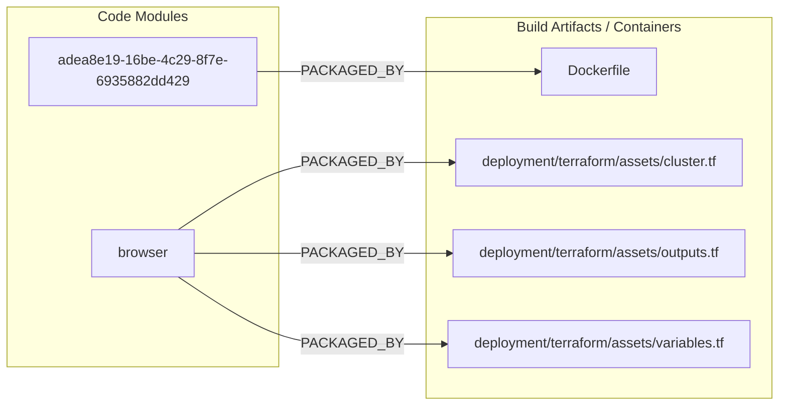
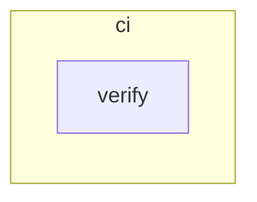

# Repository Architecture Analysis: mattermost/mattermost-load-test-ng

## Metadata
- **SHA**: `8a03489640f4bf4c752ca37bd992f0e38c06411d`
- **Primary Ecosystem**: Go

## Quality Metrics
- **ast_engine**: tree-sitter
- **avg_cognitive_complexity**: 2.54
- **avg_cyclomatic_complexity**: 3.35
- **component_count**: 218
- **dead_code_count**: 0
- **dead_code_symbols**: 0 entry(ies)
- **duplication_pct**: 5.47
- **file_complexities**: 25 entry(ies)
- **files_analyzed**: 256
- **fitness_passed**: True
- **fitness_violation_count**: 0
- **framework**: Go Service
- **import_edges**: 100 entry(ies)
- **loc**: 47549
- **max_cognitive_complexity**: 18
- **max_cyclomatic_complexity**: 19
- **sloc**: 37153
- **test_file_count**: 76

# Architecture: mattermost/mattermost-load-test-ng

## Context
- **Repository**: `mattermost/mattermost-load-test-ng`
- **SHA**: `8a03489640f4bf4c752ca37bd992f0e38c06411d`
- **Ecosystem**: Go
- **Framework**: Go Service

## Building Block View

```mermaid
graph TD;
    repo_root(["mattermost/mattermost-load-test-ng (218 components)"])
    dir_0_loadtest["loadtest (86)"]
    repo_root --> dir_0_loadtest
    sub_0_0_control["control (44)"]
    dir_0_loadtest --> sub_0_0_control
    sub_0_1_user["user (17)"]
    dir_0_loadtest --> sub_0_1_user
    sub_0_2_store["store (9)"]
    dir_0_loadtest --> sub_0_2_store
    sub_0_more["+3 more submodules (16)"]
    dir_0_loadtest --> sub_0_more
    dir_1_deployment["deployment (39)"]
    repo_root --> dir_1_deployment
    sub_1_0_terraform["terraform (31)"]
    dir_1_deployment --> sub_1_0_terraform
    sub_1_1__module_root_["(module root) (5)"]
    dir_1_deployment --> sub_1_1__module_root_
    sub_1_2_opensearch["opensearch (3)"]
    dir_1_deployment --> sub_1_2_opensearch
    dir_2_cmd["cmd (30)"]
    repo_root --> dir_2_cmd
    sub_2_0_ltctl["ltctl (10)"]
    dir_2_cmd --> sub_2_0_ltctl
    sub_2_1_metricswatcher["metricswatcher (6)"]
    dir_2_cmd --> sub_2_1_metricswatcher
    sub_2_2_ltagent["ltagent (3)"]
    dir_2_cmd --> sub_2_2_ltagent
    sub_2_more["+7 more submodules (11)"]
    dir_2_cmd --> sub_2_more
    dir_3_coordinator["coordinator (22)"]
    repo_root --> dir_3_coordinator
    sub_3_0__module_root_["(module root) (9)"]
    dir_3_coordinator --> sub_3_0__module_root_
    sub_3_1_performance["performance (8)"]
    dir_3_coordinator --> sub_3_1_performance
    sub_3_2_cluster["cluster (5)"]
    dir_3_coordinator --> sub_3_2_cluster
    dir_4_api["api (12)"]
    repo_root --> dir_4_api
    sub_4_0__module_root_["(module root) (8)"]
    dir_4_api --> sub_4_0__module_root_
    sub_4_1_client["client (4)"]
    dir_4_api --> sub_4_1_client
    dir_other_modules["+11 more modules (29)"]
    repo_root --> dir_other_modules
```

## Component Details

Showing top 60 representative components out of 218 across 16 module group(s):

- **Module `loadtest`** (86 components — module: 86)
- **Module `deployment`** (39 components — module: 39)
- **Module `cmd`** (30 components — module: 30)
- **Module `coordinator`** (22 components — module: 22)
- **Module `api`** (12 components — module: 12)
- **Module `defaults`** (10 components — module: 10)
- **Module `comparison`** (7 components — module: 7)
- **Module `version`** (3 components — module: 3)
- **Module `examples`** (2 components — module: 2)
- **Module `browser`** (1 components — MODULE: 1)
- **Module `browserlib`** (1 components — MODULE: 1)
- **Module `lambda`** (1 components — MODULE: 1)

- **@mattermost/loadtest-browser-lib** (`browserlib/package.json`): MODULE
- **actions** (`loadtest/control/actions.go`): module
- **actions** (`loadtest/control/gencontroller/actions.go`): module
- **actions** (`loadtest/control/noopcontroller/actions.go`): module
- **actions** (`loadtest/control/simplecontroller/actions.go`): module
- **actions** (`loadtest/control/simulcontroller/actions.go`): module
- **actions** (`loadtest/user/userentity/actions.go`): module
- **actions_reaction_test** (`loadtest/control/simulcontroller/actions_reaction_test.go`): module
- **actions_scroll_channel_test** (`loadtest/control/simulcontroller/actions_scroll_channel_test.go`): module
- **actions_search_group_channels_test** (`loadtest/control/simulcontroller/actions_search_group_channels_test.go`): module
- **agent** (`api/agent.go`): module
- **agent** (`api/client/agent/agent.go`): module
- **agent** (`deployment/terraform/agent.go`): module
- **agent_client_test** (`api/agent_client_test.go`): module
- **agent_test** (`api/agent_test.go`): module
- **agent_test** (`api/client/agent/agent_test.go`): module
- **api** (`coordinator/performance/prometheus/api.go`): module
- **assets** (`deployment/terraform/assets.go`): module
- **assets_test** (`deployment/terraform/assets_test.go`): module
- **bookmarks** (`loadtest/control/simulcontroller/bookmarks.go`): module
- **bookmarks** (`loadtest/user/userentity/bookmarks.go`): module
- **client** (`loadtest/user/websocket/client.go`): module
- **client_test** (`api/client_test.go`): module
- **client_test** (`loadtest/user/websocket/client_test.go`): module
- **cloudwatchlogs** (`deployment/terraform/cloudwatchlogs.go`): module
- **cloudwatchlogs_test** (`deployment/terraform/cloudwatchlogs_test.go`): module
- **cluster** (`coordinator/cluster/cluster.go`): module
- **collect** (`cmd/ltctl/collect.go`): module
- **compare** (`loadtest/report/compare.go`): module
- **compare_test** (`loadtest/report/compare_test.go`): module
- **comparison** (`cmd/ltctl/comparison.go`): module
- **comparison** (`comparison/comparison.go`): module
- **comparison_test** (`cmd/ltctl/comparison_test.go`): module
- **comparison_test** (`comparison/comparison_test.go`): module
- **config** (`cmd/metricswatcher/config/config.go`): module
- **config** (`comparison/config.go`): module
- **config** (`coordinator/cluster/config.go`): module
- **config** (`coordinator/config.go`): module
- **config** (`coordinator/performance/config.go`): module
- **config** (`coordinator/performance/prometheus/config.go`): module
- **config** (`deployment/config.go`): module
- **config** (`examples/api/config.go`): module
- **config** (`loadtest/config.go`): module
- **config** (`loadtest/control/browsercontroller/config.go`): module
- **config** (`loadtest/control/gencontroller/config.go`): module
- **config** (`loadtest/control/simplecontroller/config.go`): module
- **config** (`loadtest/control/simulcontroller/config.go`): module
- **config** (`loadtest/store/memstore/config.go`): module
- **config_test** (`comparison/config_test.go`): module
- **config_test** (`coordinator/config_test.go`): module
- **config_test** (`deployment/config_test.go`): module
- **constants** (`deployment/constants.go`): module
- **controller** (`loadtest/control/browsercontroller/controller.go`): module
- **controller** (`loadtest/control/clustercontroller/controller.go`): module
- **controller** (`loadtest/control/controller.go`): module
- **controller** (`loadtest/control/gencontroller/controller.go`): module
- **controller** (`loadtest/control/noopcontroller/controller.go`): module
- **controller** (`loadtest/control/simplecontroller/controller.go`): module
- **controller** (`loadtest/control/simulcontroller/controller.go`): module
- **controller_test** (`loadtest/control/browsercontroller/controller_test.go`): module

## 6-Dimension Repository Scorecard

- **Overall Grade**: `C` (79.98/100)
- **Technical Debt Score**: 20.02
- **Estimated Remediation Effort**: 14.10h

| Dimension | Grade | Score | Weight | Details |
| :--- | :---: | :---: | :---: | :--- |
| Code Quality | `B` | 84.39 | 0.20 | avg_cc=3.35, max_cc=19, duplication=5.47%, dead_code=0 |
| Dependency Health | `A` | 100.00 | 0.15 | dependencies=991, outdated=0, vulnerable=0, has_lockfile=True |
| Maintainability | `A` | 95.00 | 0.15 | avg_cognitive=2.54, max_cognitive=18, fitness_violations=0, oversized_files=1 |
| Pipeline Health | `A` | 97.00 | 0.15 | workflows=1, operational_antipatterns=1, parallel_branches=False |
| Security | `F` | 44.00 | 0.20 | vulnerabilities=0, secrets=2, pipeline_security_findings=1 |
| Test Coverage | `C` | 70.00 | 0.15 | coverage=unavailable, ci_test_job=True, test_files_detected=True |

## Supply Chain Dependencies, Vulnerabilities & Secrets

- **Dependencies Parsed**: 991 | **Vulnerabilities**: 0 | **Secrets**: 2

### Secret Findings (Redacted)
- **[HIGH] `ATRUSS-SEC-005`** at `deployment/terraform/assets/mattermost-realm.json:958` (`"secret": "qbdU***REDACTED***",`)
- **[HIGH] `ATRUSS-SEC-005`** at `deployment/terraform/assets/mattermost-realm.json:1087` (`"saml.signing.private.key": "MIIE***REDACTED***",`)

### Inventory Sample
- `github.com/Nerzal/gocloak/v13` `13.9.0` (golang, `go.mod`)
- `github.com/aws/aws-sdk-go-v2` `1.47.5` (golang, `go.mod`)
- `github.com/aws/aws-sdk-go-v2/config` `1.33.13` (golang, `go.mod`)
- `github.com/aws/aws-sdk-go-v2/credentials` `1.20.13` (golang, `go.mod`)
- `github.com/aws/aws-sdk-go-v2/service/cloudwatchlogs` `1.91.0` (golang, `go.mod`)
- `github.com/aws/aws-sdk-go-v2/service/ec2` `1.343.0` (golang, `go.mod`)
- `github.com/aws/aws-sdk-go-v2/service/lambda` `1.114.0` (golang, `go.mod`)
- `github.com/aws/aws-sdk-go-v2/service/rds` `1.131.2` (golang, `go.mod`)
- `github.com/aws/aws-sdk-go-v2/service/s3` `1.114.6` (golang, `go.mod`)
- `github.com/aws/aws-sdk-go-v2/service/sts` `1.51.6` (golang, `go.mod`)
- `github.com/blang/semver` `3.5.1+incompatible` (golang, `go.mod`)
- `github.com/fatih/color` `1.19.0` (golang, `go.mod`)
- `github.com/gavv/httpexpect` `2.0.0+incompatible` (golang, `go.mod`)
- `github.com/gliderlabs/ssh` `0.1.1` (golang, `go.mod`)
- `github.com/gocolly/colly/v2` `2.3.0` (golang, `go.mod`)
- `github.com/gorilla/mux` `1.8.1` (golang, `go.mod`)
- `github.com/gorilla/websocket` `1.5.3` (golang, `go.mod`)
- `github.com/grafana/alloy/syntax` `0.1.2` (golang, `go.mod`)
- `github.com/graph-gophers/graphql-go` `1.10.3` (golang, `go.mod`)
- `github.com/mattermost/mattermost-plugin-agents/loadtest/controller` `0.0.0-20261016170310-68a2cd562a09` (golang, `go.mod`)
- `github.com/mattermost/mattermost-plugin-playbooks` `1.41.1-0.20261005142514-61d434666dca` (golang, `go.mod`)
- `github.com/mattermost/mattermost/server/public` `0.6.1-0.20261030094055-e8d166d8fcc6` (golang, `go.mod`)
- `github.com/mattermost/mattermost/server/v8` `8.0.0-20261101083748-2b3fb21fe39e` (golang, `go.mod`)
- `github.com/opensearch-project/opensearch-go/v4` `4.8.1` (golang, `go.mod`)
- `github.com/pelletier/go-toml/v2` `2.4.3` (golang, `go.mod`)
- `github.com/pkg/sftp` `1.13.12` (golang, `go.mod`)
- `github.com/prometheus/client_golang` `1.25.0` (golang, `go.mod`)
- `github.com/prometheus/common` `0.73.1` (golang, `go.mod`)
- `github.com/spf13/cobra` `1.10.2` (golang, `go.mod`)
- `github.com/stretchr/testify` `1.12.1` (golang, `go.mod`)
- ... (+961 more dependencies)

## Section 7: Code-to-Cloud Deployment Traceability

- `adea8e19-16be-4c29-8f7e-6935882dd429` (code_module) --[PACKAGED_BY]--> `Dockerfile` (container)
- `browser` (code_module) --[PACKAGED_BY]--> `deployment/terraform/assets/cluster.tf` (iac)
- `browser` (code_module) --[PACKAGED_BY]--> `deployment/terraform/assets/outputs.tf` (iac)
- `browser` (code_module) --[PACKAGED_BY]--> `deployment/terraform/assets/variables.tf` (iac)

## CI/CD Pipeline Topology

