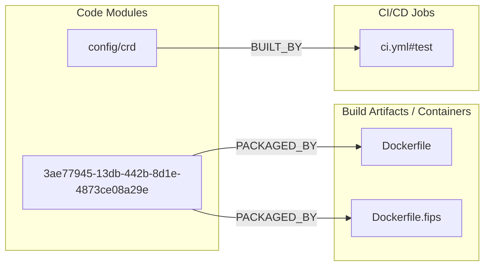
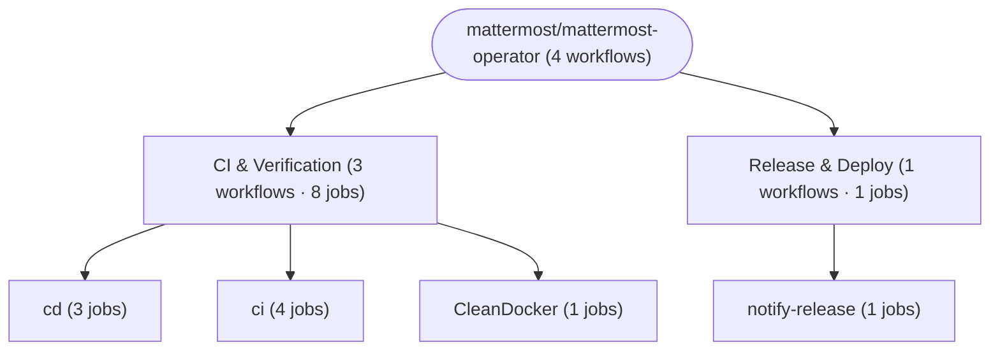

# Repository Architecture Analysis: mattermost/mattermost-operator

## Metadata
- **SHA**: `6a750b37e233cace70c29b9b9a2e176096e1ada8`
- **Primary Ecosystem**: Go

## Quality Metrics
- **ast_engine**: fallback
- **avg_cognitive_complexity**: 0.0
- **avg_cyclomatic_complexity**: 0.0
- **component_count**: 179
- **dead_code_count**: 0
- **dead_code_symbols**: 0 entry(ies)
- **duplication_pct**: 0.0
- **file_complexities**: 0 entry(ies)
- **files_analyzed**: 179
- **fitness_passed**: True
- **fitness_violation_count**: 0
- **framework**: Go Service
- **import_edges**: 0 entry(ies)
- **loc**: 36164
- **max_cognitive_complexity**: 0
- **max_cyclomatic_complexity**: 0
- **sloc**: 29877
- **test_file_count**: 41

# Architecture: mattermost/mattermost-operator

## Context
- **Repository**: `mattermost/mattermost-operator`
- **SHA**: `6a750b37e233cace70c29b9b9a2e176096e1ada8`
- **Ecosystem**: Go
- **Framework**: Go Service

## Building Block View

```mermaid
graph TD;
    repo_root(["mattermost/mattermost-operator (179 components)"])
    dir_0_pkg["pkg (86)"]
    repo_root --> dir_0_pkg
    sub_0_0_client["client (44)"]
    dir_0_pkg --> sub_0_0_client
    sub_0_1_mattermost["mattermost (17)"]
    dir_0_pkg --> sub_0_1_mattermost
    sub_0_2_database["database (12)"]
    dir_0_pkg --> sub_0_2_database
    sub_0_more["+3 more submodules (13)"]
    dir_0_pkg --> sub_0_more
    dir_1_config["config (26)"]
    repo_root --> dir_1_config
    sub_1_0_rbac["rbac (9)"]
    dir_1_config --> sub_1_0_rbac
    sub_1_1_crd["crd (7)"]
    dir_1_config --> sub_1_1_crd
    sub_1_2_samples["samples (4)"]
    dir_1_config --> sub_1_2_samples
    sub_1_more["+3 more submodules (6)"]
    dir_1_config --> sub_1_more
    dir_2_controllers["controllers (25)"]
    repo_root --> dir_2_controllers
    sub_2_0_mattermost_clusterinstallation["mattermost/clusterinstallation (14)"]
    dir_2_controllers --> sub_2_0_mattermost_clusterinstallation
    sub_2_1_mattermost_mattermost["mattermost/mattermost (8)"]
    dir_2_controllers --> sub_2_1_mattermost_mattermost
    sub_2_2_mattermost_mattermostrestoredb["mattermost/mattermostrestoredb (3)"]
    dir_2_controllers --> sub_2_2_mattermost_mattermostrestoredb
    dir_3_apis["apis (22)"]
    repo_root --> dir_3_apis
    sub_3_0_mattermost_v1beta1["mattermost/v1beta1 (13)"]
    dir_3_apis --> sub_3_0_mattermost_v1beta1
    sub_3_1_mattermost_v1alpha1["mattermost/v1alpha1 (9)"]
    dir_3_apis --> sub_3_1_mattermost_v1alpha1
    dir_4_test["test (14)"]
    repo_root --> dir_4_test
    sub_4_0_e2e_external["e2e-external (8)"]
    dir_4_test --> sub_4_0_e2e_external
    sub_4_1_e2e["e2e (5)"]
    dir_4_test --> sub_4_1_e2e
    sub_4_2__module_root_["(module root) (1)"]
    dir_4_test --> sub_4_2__module_root_
    dir_other_modules["+3 more modules (6)"]
    repo_root --> dir_other_modules
```

## Component Details

Showing top 60 representative components out of 179 across 8 module group(s):

- **Module `pkg`** (86 components — module: 86)
- **Module `config`** (26 components — module: 26)
- **Module `controllers`** (25 components — module: 25)
- **Module `apis`** (22 components — module: 22)
- **Module `test`** (14 components — module: 14)
- **Module `hack`** (3 components — module: 3)
- **Module `version`** (2 components — module: 2)
- **Module `(root)`** (1 components — module: 1)

- **apply_resource** (`test/e2e-external/apply_resource.go`): module
- **bluegreen** (`controllers/mattermost/clusterinstallation/bluegreen.go`): module
- **builtin** (`pkg/utils/builtin.go`): module
- **cainjection_in_mattermosts** (`config/crd/patches/cainjection_in_mattermosts.yaml`): module
- **canary** (`controllers/mattermost/clusterinstallation/canary.go`): module
- **clientset** (`pkg/client/clientset/versioned/clientset.go`): module
- **clientset** (`pkg/client/v1beta1/clientset/versioned/clientset.go`): module
- **clientset_generated** (`pkg/client/clientset/versioned/fake/clientset_generated.go`): module
- **clientset_generated** (`pkg/client/v1beta1/clientset/versioned/fake/clientset_generated.go`): module
- **clusterinstallation** (`pkg/client/clientset/versioned/typed/mattermost/v1alpha1/clusterinstallation.go`): module
- **clusterinstallation** (`pkg/client/informers/externalversions/mattermost/v1alpha1/clusterinstallation.go`): module
- **clusterinstallation** (`pkg/client/listers/mattermost/v1alpha1/clusterinstallation.go`): module
- **clusterinstallation_editor_role** (`config/rbac/clusterinstallation_editor_role.yaml`): module
- **clusterinstallation_sizes** (`apis/mattermost/v1alpha1/clusterinstallation_sizes.go`): module
- **clusterinstallation_test** (`apis/mattermost/v1alpha1/clusterinstallation_test.go`): module
- **clusterinstallation_types** (`apis/mattermost/v1alpha1/clusterinstallation_types.go`): module
- **clusterinstallation_utils** (`apis/mattermost/v1alpha1/clusterinstallation_utils.go`): module
- **clusterinstallation_viewer_role** (`config/rbac/clusterinstallation_viewer_role.yaml`): module
- **constants** (`pkg/mattermost/constants.go`): module
- **constants** (`test/constants.go`): module
- **controller** (`controllers/mattermost/clusterinstallation/controller.go`): module
- **controller** (`controllers/mattermost/mattermost/controller.go`): module
- **controller** (`controllers/mattermost/mattermostrestoredb/controller.go`): module
- **controller_test** (`controllers/mattermost/clusterinstallation/controller_test.go`): module
- **controller_test** (`controllers/mattermost/mattermost/controller_test.go`): module
- **conversion** (`controllers/mattermost/clusterinstallation/conversion.go`): module
- **conversion_test** (`controllers/mattermost/clusterinstallation/conversion_test.go`): module
- **create_resources** (`pkg/resources/create_resources.go`): module
- **create_resources_test** (`pkg/resources/create_resources_test.go`): module
- **database** (`controllers/mattermost/mattermost/database.go`): module
- **database** (`pkg/database/database.go`): module
- **database_external** (`pkg/mattermost/database_external.go`): module
- **database_external_test** (`pkg/mattermost/database_external_test.go`): module
- **database_mysql** (`pkg/mattermost/database_mysql.go`): module
- **database_mysql_test** (`pkg/mattermost/database_mysql_test.go`): module
- **database_test** (`pkg/database/database_test.go`): module
- **database_unmanaged** (`pkg/mattermost/database_unmanaged.go`): module
- **db_util** (`apis/mattermost/v1beta1/db_util.go`): module
- **db_util_test** (`apis/mattermost/v1beta1/db_util_test.go`): module
- **doc** (`apis/mattermost/v1alpha1/doc.go`): module
- **doc** (`pkg/client/clientset/versioned/doc.go`): module
- **doc** (`pkg/client/clientset/versioned/fake/doc.go`): module
- **doc** (`pkg/client/clientset/versioned/scheme/doc.go`): module
- **doc** (`pkg/client/clientset/versioned/typed/mattermost/v1alpha1/doc.go`): module
- **doc** (`pkg/client/clientset/versioned/typed/mattermost/v1alpha1/fake/doc.go`): module
- **doc** (`pkg/client/v1beta1/clientset/versioned/doc.go`): module
- **doc** (`pkg/client/v1beta1/clientset/versioned/fake/doc.go`): module
- **doc** (`pkg/client/v1beta1/clientset/versioned/scheme/doc.go`): module
- **doc** (`pkg/client/v1beta1/clientset/versioned/typed/mattermost/v1beta1/doc.go`): module
- **doc** (`pkg/client/v1beta1/clientset/versioned/typed/mattermost/v1beta1/fake/doc.go`): module
- **doc** (`pkg/database/mysql_operator/v1alpha1/doc.go`): module
- **env_var** (`pkg/mattermost/env_var.go`): module
- **expansion_generated** (`pkg/client/listers/mattermost/v1alpha1/expansion_generated.go`): module
- **expansion_generated** (`pkg/client/v1beta1/listers/mattermost/v1beta1/expansion_generated.go`): module
- **external_db_filestore_test** (`test/e2e-external/external_db_filestore_test.go`): module
- **factory** (`pkg/client/informers/externalversions/factory.go`): module
- **factory** (`pkg/client/v1beta1/informers/externalversions/factory.go`): module
- **factory_interfaces** (`pkg/client/informers/externalversions/internalinterfaces/factory_interfaces.go`): module
- **factory_interfaces** (`pkg/client/v1beta1/informers/externalversions/internalinterfaces/factory_interfaces.go`): module
- **fake_clusterinstallation** (`pkg/client/clientset/versioned/typed/mattermost/v1alpha1/fake/fake_clusterinstallation.go`): module

## 6-Dimension Repository Scorecard

- **Overall Grade**: `C` (79.55/100)
- **Technical Debt Score**: 20.45
- **Estimated Remediation Effort**: 15.11h

| Dimension | Grade | Score | Weight | Details |
| :--- | :---: | :---: | :---: | :--- |
| Code Quality | `A` | 100.00 | 0.20 | avg_cc=0.00, max_cc=0, duplication=0.00%, dead_code=0 |
| Dependency Health | `B` | 85.00 | 0.15 | dependencies=89, outdated=0, vulnerable=0, has_lockfile=False |
| Maintainability | `A` | 100.00 | 0.15 | avg_cognitive=0.00, max_cognitive=0, fitness_violations=0, oversized_files=0 |
| Pipeline Health | `C` | 78.00 | 0.15 | workflows=4, operational_antipatterns=9, parallel_branches=True |
| Security | `F` | 48.00 | 0.20 | vulnerabilities=0, secrets=0, pipeline_security_findings=3 |
| Test Coverage | `C` | 70.00 | 0.15 | coverage=unavailable, ci_test_job=True, test_files_detected=True |

## Supply Chain Dependencies, Vulnerabilities & Secrets

- **Dependencies Parsed**: 89 | **Vulnerabilities**: 0 | **Secrets**: 0

### Inventory Sample
- `github.com/banzaicloud/k8s-objectmatcher` `1.8.0` (golang, `go.mod`)
- `github.com/evanphx/json-patch/v5` `5.9.11` (golang, `go.mod`)
- `github.com/go-logr/logr` `1.4.4` (golang, `go.mod`)
- `github.com/mattermost/blubr` `0.1.0` (golang, `go.mod`)
- `github.com/mattn/goveralls` `0.0.12` (golang, `go.mod`)
- `github.com/mikefarah/yq/v3` `3.0.0-20201202084205-8846255d1c37` (golang, `go.mod`)
- `github.com/minio/minio-operator` `0.0.0-20200214142425-158e343f1f19` (golang, `go.mod`)
- `github.com/pborman/uuid` `1.2.1` (golang, `go.mod`)
- `github.com/pkg/errors` `0.9.1` (golang, `go.mod`)
- `github.com/sirupsen/logrus` `1.10.2` (golang, `go.mod`)
- `github.com/stretchr/testify` `1.12.1` (golang, `go.mod`)
- `github.com/vrischmann/envconfig` `1.4.1` (golang, `go.mod`)
- `golang.org/x/net` `0.62.0` (golang, `go.mod`)
- `k8s.io/api` `0.37.2` (golang, `go.mod`)
- `k8s.io/apimachinery` `0.37.2` (golang, `go.mod`)
- `k8s.io/client-go` `0.37.2` (golang, `go.mod`)
- `k8s.io/code-generator` `0.37.2` (golang, `go.mod`)
- `k8s.io/kube-openapi` `0.0.0-20260721132016-d427ff9ee9ad` (golang, `go.mod`)
- `sigs.k8s.io/controller-runtime` `0.25.2` (golang, `go.mod`)
- `sigs.k8s.io/yaml` `1.6.0` (golang, `go.mod`)
- `emperror.dev/errors` `0.8.1` (golang, `go.mod`)
- `github.com/beorn7/perks` `1.0.1` (golang, `go.mod`)
- `github.com/cespare/xxhash/v2` `2.3.0` (golang, `go.mod`)
- `github.com/davecgh/go-spew` `1.1.2-0.20180830191138-d8f796af33cc` (golang, `go.mod`)
- `github.com/emicklei/go-restful/v3` `3.14.0` (golang, `go.mod`)
- `github.com/evanphx/json-patch` `5.9.11+incompatible` (golang, `go.mod`)
- `github.com/fatih/color` `1.19.0` (golang, `go.mod`)
- `github.com/fsnotify/fsnotify` `1.10.1` (golang, `go.mod`)
- `github.com/fxamacker/cbor/v2` `2.10.0` (golang, `go.mod`)
- `github.com/go-logr/zapr` `1.3.0` (golang, `go.mod`)
- ... (+59 more dependencies)

## Section 7: Code-to-Cloud Deployment Traceability

- `3ae77945-13db-442b-8d1e-4873ce08a29e` (code_module) --[PACKAGED_BY]--> `Dockerfile` (container)
- `3ae77945-13db-442b-8d1e-4873ce08a29e` (code_module) --[PACKAGED_BY]--> `Dockerfile.fips` (container)
- `config/crd` (code_module) --[BUILT_BY]--> `ci.yml#test` (ci_job)

## CI/CD Pipeline Topology

