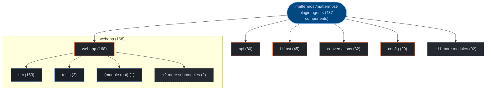
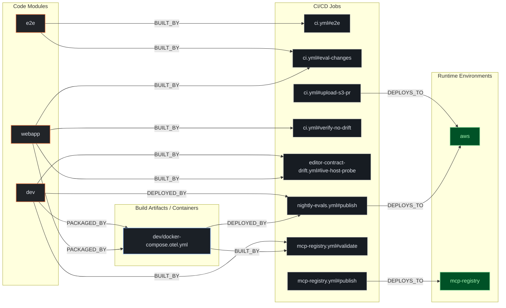

# Repository Architecture Analysis: mattermost/mattermost-plugin-agents

## Metadata
- **SHA**: `742a855776041408c1a1907012a1498d6f30a802`
- **Primary Ecosystem**: Go

## Quality Metrics
- **ast_engine**: tree-sitter
- **avg_cognitive_complexity**: 2.4
- **avg_cyclomatic_complexity**: 2.96
- **component_count**: 437
- **dead_code_count**: 2
- **dead_code_symbols**: 2 entry(ies)
- **duplication_pct**: 27.37
- **file_complexities**: 25 entry(ies)
- **files_analyzed**: 1270
- **fitness_passed**: False
- **fitness_violation_count**: 5
- **framework**: Go Gin / Echo / Fiber
- **import_edges**: 100 entry(ies)
- **loc**: 342399
- **max_cognitive_complexity**: 311
- **max_cyclomatic_complexity**: 229
- **sloc**: 275455
- **test_file_count**: 635

# Architecture: mattermost/mattermost-plugin-agents

## Context
- **Repository**: `mattermost/mattermost-plugin-agents`
- **SHA**: `742a855776041408c1a1907012a1498d6f30a802`
- **Ecosystem**: Go
- **Framework**: Go Gin / Echo / Fiber

## Building Block View

## Component Details

Showing top 60 representative components out of 437 across 16 module group(s):

- **Module `webapp`** (168 components — UI_COMPONENT: 166, MODULE: 2)
- **Module `api`** (80 components — module: 80)
- **Module `bifrost`** (45 components — module: 45)
- **Module `conversations`** (32 components — module: 32)
- **Module `config`** (20 components — module: 20)
- **Module `bots`** (19 components — module: 19)
- **Module `e2e`** (16 components — UI_COMPONENT: 15, MODULE: 1)
- **Module `conversation`** (15 components — module: 15)
- **Module `accesscontrol`** (11 components — module: 11)
- **Module `cmd`** (10 components — module: 10)
- **Module `audit`** (6 components — module: 6)
- **Module `autoreply`** (4 components — module: 4)

- **LLMBotPost** (`webapp/src/components/llmbot_post/llmbot_post.tsx`): UI_COMPONENT (deps: AGENT_CHAT_SURFACE, AgentChatSurfaceContext, BACKLOG_DRAIN_MS, COPY_FEEDBACK_MS, ControlsBarComponent, FLUSH_MAX_MS (+21 more))
- **STALE_STREAM_TIMEOUT_MS** (`webapp/src/components/llmbot_post/llmbot_post.tsx`): UI_COMPONENT (deps: AGENT_CHAT_SURFACE, AgentChatSurfaceContext, BACKLOG_DRAIN_MS, COPY_FEEDBACK_MS, ControlsBarComponent, FLUSH_MAX_MS (+21 more))
- **ChunkingOptionsConfig** (`webapp/src/components/system_console/embedding_search/chunking_options.tsx`): UI_COMPONENT (deps: BooleanItem, ComboboxItem, CompactFieldControlRow, CompactItemLabel, CopyableTextItem, FieldControlRow (+20 more))
- **NativeToolsItem** (`webapp/src/components/system_console/bot.tsx`): UI_COMPONENT (deps: BooleanItem, ChannelAccessLevelItem, Client4, ComboboxItem, CompactFieldControlRow, CompactItemLabel (+18 more))
- **OpenAICompatibleProviderConfig** (`webapp/src/components/system_console/embedding_search/provider_configs.tsx`): UI_COMPONENT (deps: BooleanItem, ComboboxItem, CompactFieldControlRow, CompactItemLabel, CopyableTextItem, FieldControlRow (+18 more))
- **OpenAIProviderConfig** (`webapp/src/components/system_console/embedding_search/provider_configs.tsx`): UI_COMPONENT (deps: BooleanItem, ComboboxItem, CompactFieldControlRow, CompactItemLabel, CopyableTextItem, FieldControlRow (+18 more))
- **ReindexSection** (`webapp/src/components/system_console/embedding_search/reindex_section.tsx`): UI_COMPONENT (deps: BooleanItem, ComboboxItem, CompactFieldControlRow, CompactItemLabel, CopyableTextItem, FieldControlRow (+18 more))
- **ChannelAccessLevelItem** (`webapp/src/components/system_console/llm_access.tsx`): UI_COMPONENT (deps: BooleanItem, ComboboxItem, CompactFieldControlRow, CompactItemLabel, CopyableTextItem, FieldControlRow (+17 more))
- **UserAccessLevelItem** (`webapp/src/components/system_console/llm_access.tsx`): UI_COMPONENT (deps: BooleanItem, ComboboxItem, CompactFieldControlRow, CompactItemLabel, CopyableTextItem, FieldControlRow (+17 more))
- **ServiceFields** (`webapp/src/components/system_console/service.tsx`): UI_COMPONENT (deps: BooleanItem, Client4, ComboboxItem, CompactFieldControlRow, CompactItemLabel, CopyableTextItem (+15 more))
- **MAX_MCP_SERVER_DESCRIPTION_LENGTH** (`webapp/src/components/system_console/mcp_server_description.tsx`): UI_COMPONENT (deps: BooleanItem, Client4, ComboboxItem, CompactFieldControlRow, CompactItemLabel, CopyableTextItem (+14 more))
- **SelectChannel** (`webapp/src/components/select.tsx`): UI_COMPONENT (deps: BooleanItem, Client4, ComboboxItem, CompactFieldControlRow, CompactItemLabel, CopyableTextItem (+14 more))
- **SelectUser** (`webapp/src/components/select.tsx`): UI_COMPONENT (deps: BooleanItem, Client4, ComboboxItem, CompactFieldControlRow, CompactItemLabel, CopyableTextItem (+14 more))
- **FloatItem** (`webapp/src/components/system_console/number_items.tsx`): UI_COMPONENT (deps: BooleanItem, ComboboxItem, CompactFieldControlRow, CompactItemLabel, CopyableTextItem, FieldControlRow (+13 more))
- **IntItem** (`webapp/src/components/system_console/number_items.tsx`): UI_COMPONENT (deps: BooleanItem, ComboboxItem, CompactFieldControlRow, CompactItemLabel, CopyableTextItem, FieldControlRow (+13 more))
- **CopyableTextItem** (`webapp/src/components/system_console/copyable_text_item.tsx`): UI_COMPONENT (deps: BooleanItem, ComboboxItem, CompactFieldControlRow, CompactItemLabel, FieldControlRow, FormRow (+12 more))
- **COPY_FEEDBACK_MS** (`webapp/src/components/llmbot_post/controls_bar.tsx`): UI_COMPONENT (deps: BUBBLE_CONTROLS_ATTRIBUTE, BUBBLE_CONTROLS_BELOW, BUBBLE_HUG_ATTRIBUTE, CHAT_COLUMN_PADDING, CHAT_CONTENT_MAX_WIDTH, CHAT_PANEL_PADDING (+4 more))
- **ControlsBarComponent** (`webapp/src/components/llmbot_post/controls_bar.tsx`): UI_COMPONENT (deps: BUBBLE_CONTROLS_ATTRIBUTE, BUBBLE_CONTROLS_BELOW, BUBBLE_HUG_ATTRIBUTE, CHAT_COLUMN_PADDING, CHAT_CONTENT_MAX_WIDTH, CHAT_PANEL_PADDING (+4 more))
- **NEW_CHAT_GREETINGS** (`webapp/src/components/agent_chat/agent_new_chat.tsx`): UI_COMPONENT (deps: BUBBLE_CONTROLS_ATTRIBUTE, BUBBLE_CONTROLS_BELOW, BUBBLE_HUG_ATTRIBUTE, CHAT_COLUMN_PADDING, CHAT_CONTENT_MAX_WIDTH, CHAT_PANEL_PADDING (+4 more))
- **PREFERENCE_CATEGORY_AGENTS** (`webapp/src/bots.tsx`): UI_COMPONENT (deps: AIThreadTitleSet, AIThreadsFailed, AIThreadsReceived, AIThreadsRequested, BotsHandler, CustomPromptsHandler (+4 more))
- **PREFERENCE_NAME_SELECTED_AGENT** (`webapp/src/bots.tsx`): UI_COMPONENT (deps: AIThreadTitleSet, AIThreadsFailed, AIThreadsReceived, AIThreadsRequested, BotsHandler, CustomPromptsHandler (+4 more))
- **SCROLLED_UP_THRESHOLD_PX** (`webapp/src/components/agent_chat/use_thread_scroll.ts`): UI_COMPONENT (deps: BUBBLE_CONTROLS_ATTRIBUTE, BUBBLE_CONTROLS_BELOW, BUBBLE_HUG_ATTRIBUTE, CHAT_COLUMN_PADDING, CHAT_CONTENT_MAX_WIDTH, CHAT_PANEL_PADDING (+4 more))
- **AIThreadTitleSet** (`webapp/src/redux.tsx`): UI_COMPONENT (deps: Client4, HNSW_DEFAULTS, PLAIN_TEXT_LINK_POLICY, RECENCY_DEFAULTS, REINDEX_DEFAULTS, REINDEX_INDEX_STRATEGY (+1 more))
- **AIThreadsFailed** (`webapp/src/redux.tsx`): UI_COMPONENT (deps: Client4, HNSW_DEFAULTS, PLAIN_TEXT_LINK_POLICY, RECENCY_DEFAULTS, REINDEX_DEFAULTS, REINDEX_INDEX_STRATEGY (+1 more))
- **AIThreadsReceived** (`webapp/src/redux.tsx`): UI_COMPONENT (deps: Client4, HNSW_DEFAULTS, PLAIN_TEXT_LINK_POLICY, RECENCY_DEFAULTS, REINDEX_DEFAULTS, REINDEX_INDEX_STRATEGY (+1 more))
- **AIThreadsRequested** (`webapp/src/redux.tsx`): UI_COMPONENT (deps: Client4, HNSW_DEFAULTS, PLAIN_TEXT_LINK_POLICY, RECENCY_DEFAULTS, REINDEX_DEFAULTS, REINDEX_INDEX_STRATEGY (+1 more))
- **BotsHandler** (`webapp/src/redux.tsx`): UI_COMPONENT (deps: Client4, HNSW_DEFAULTS, PLAIN_TEXT_LINK_POLICY, RECENCY_DEFAULTS, REINDEX_DEFAULTS, REINDEX_INDEX_STRATEGY (+1 more))
- **CitationComponent** (`webapp/src/components/citations/citation_component.tsx`): UI_COMPONENT (deps: CitationBase, CitationWrapper, HNSW_DEFAULTS, RECENCY_DEFAULTS, REINDEX_DEFAULTS, REINDEX_INDEX_STRATEGY (+1 more))
- **CustomPromptsHandler** (`webapp/src/redux.tsx`): UI_COMPONENT (deps: Client4, HNSW_DEFAULTS, PLAIN_TEXT_LINK_POLICY, RECENCY_DEFAULTS, REINDEX_DEFAULTS, REINDEX_INDEX_STRATEGY (+1 more))
- **PinnedPromptIdsHandler** (`webapp/src/redux.tsx`): UI_COMPONENT (deps: Client4, HNSW_DEFAULTS, PLAIN_TEXT_LINK_POLICY, RECENCY_DEFAULTS, REINDEX_DEFAULTS, REINDEX_INDEX_STRATEGY (+1 more))
- **SetLinkPolicyHandler** (`webapp/src/redux.tsx`): UI_COMPONENT (deps: Client4, HNSW_DEFAULTS, PLAIN_TEXT_LINK_POLICY, RECENCY_DEFAULTS, REINDEX_DEFAULTS, REINDEX_INDEX_STRATEGY (+1 more))
- **ShowCustomPromptsModalHandler** (`webapp/src/redux.tsx`): UI_COMPONENT (deps: Client4, HNSW_DEFAULTS, PLAIN_TEXT_LINK_POLICY, RECENCY_DEFAULTS, REINDEX_DEFAULTS, REINDEX_INDEX_STRATEGY (+1 more))
- **Client4** (`webapp/src/client.tsx`): UI_COMPONENT (deps: HNSW_DEFAULTS, RECENCY_DEFAULTS, REINDEX_DEFAULTS, REINDEX_INDEX_STRATEGY, VECTOR_ELEMENT_TYPE)
- **AGENTS_SUBMENU_MAX_HEIGHT** (`webapp/src/components/agents/sidebar_add_menu.tsx`): UI_COMPONENT (deps: AGENTS_ROUTE, ALL_AGENTS_PATH, NEW_AGENT_PATH, PROMPTS_PATH)
- **ChannelSummarizePopover** (`webapp/src/components/channel_summarize_popover.tsx`): UI_COMPONENT (deps: BotDropdown, BotSelectorContainer, DropdownBotSelector, SummarizeDateRangeModal)
- **AnimatedModalShell** (`webapp/src/components/animated_modal_shell.tsx`): UI_COMPONENT (deps: OPEN_POPUP_ATTRIBUTE, TooltipAboveModals, TooltipTrigger)
- **BotDropdown** (`webapp/src/components/bot_selector.tsx`): UI_COMPONENT (deps: DotMenuButton, DropdownMenu, DropdownMenuItem)
- **BotSelectorContainer** (`webapp/src/components/bot_selector.tsx`): UI_COMPONENT (deps: DotMenuButton, DropdownMenu, DropdownMenuItem)
- **DotMenuButton** (`webapp/src/components/dot_menu.tsx`): UI_COMPONENT (deps: OPEN_POPUP_ATTRIBUTE, TooltipAboveModals, TooltipTrigger)
- **DropdownBotSelector** (`webapp/src/components/bot_selector.tsx`): UI_COMPONENT (deps: DotMenuButton, DropdownMenu, DropdownMenuItem)
- **DropdownMenu** (`webapp/src/components/dot_menu.tsx`): UI_COMPONENT (deps: OPEN_POPUP_ATTRIBUTE, TooltipAboveModals, TooltipTrigger)
- **DropdownMenuItem** (`webapp/src/components/dot_menu.tsx`): UI_COMPONENT (deps: OPEN_POPUP_ATTRIBUTE, TooltipAboveModals, TooltipTrigger)
- **CONSENT_MIN_HEIGHT** (`webapp/src/components/html_artifacts/artifact_frame.tsx`): UI_COMPONENT (deps: CONSENT_ARM_DELAY_MS, NUDGE_MS)
- **DEFAULT_INLINE_HEIGHT** (`webapp/src/components/html_artifacts/artifact_frame.tsx`): UI_COMPONENT (deps: CONSENT_ARM_DELAY_MS, NUDGE_MS)
- **HEARTBEAT_HIDE_MS** (`webapp/src/components/html_artifacts/artifact_frame.tsx`): UI_COMPONENT (deps: CONSENT_ARM_DELAY_MS, NUDGE_MS)
- **HEARTBEAT_STOP_MS** (`webapp/src/components/html_artifacts/artifact_frame.tsx`): UI_COMPONENT (deps: CONSENT_ARM_DELAY_MS, NUDGE_MS)
- **MAX_INLINE_HEIGHT** (`webapp/src/components/html_artifacts/artifact_frame.tsx`): UI_COMPONENT (deps: CONSENT_ARM_DELAY_MS, NUDGE_MS)
- **MIN_INLINE_HEIGHT** (`webapp/src/components/html_artifacts/artifact_frame.tsx`): UI_COMPONENT (deps: CONSENT_ARM_DELAY_MS, NUDGE_MS)
- **MinimalReasoningContainer** (`webapp/src/components/llmbot_post/reasoning_display.tsx`): UI_COMPONENT (deps: CollapseChevron, CollapseHeaderRow)
- **ReasoningDisplay** (`webapp/src/components/llmbot_post/reasoning_display.tsx`): UI_COMPONENT (deps: CollapseChevron, CollapseHeaderRow)
- **RoundView** (`webapp/src/components/llmbot_post/round_view.tsx`): UI_COMPONENT (deps: MinimalReasoningContainer, ReasoningDisplay)
- **AutoReplyAgentPicker** (`webapp/src/components/channel_settings/autoreply_agent_picker.tsx`): UI_COMPONENT (deps: MAX_INSTRUCTIONS_RUNES)
- **AutoReplyInstructionsField** (`webapp/src/components/channel_settings/autoreply_ambient_fields.tsx`): UI_COMPONENT (deps: MAX_INSTRUCTIONS_RUNES)
- **RHS** (`webapp/src/components/rhs/rhs.tsx`): UI_COMPONENT (deps: ThreadItem)
- **THREADS_PAGE_SIZE** (`webapp/src/components/agents/agent_threads_list.tsx`): UI_COMPONENT (deps: ChatActionsDialogs)
- **AGENTS_ROUTE** (`webapp/src/components/agents/use_agents_route.ts`): UI_COMPONENT
- **AGENT_CHAT_SURFACE** (`webapp/src/components/agent_chat/agent_chat_surface_context.ts`): UI_COMPONENT
- **ALL_AGENTS_PATH** (`webapp/src/components/agents/use_agents_route.ts`): UI_COMPONENT
- **AgentChatSurfaceContext** (`webapp/src/components/agent_chat/agent_chat_surface_context.ts`): UI_COMPONENT
- **AgentMentionReminderPost** (`webapp/src/components/agent_mention_reminder_post.tsx`): UI_COMPONENT

## 6-Dimension Repository Scorecard

- **Overall Grade**: `F` (36.65/100)
- **Technical Debt Score**: 63.35
- **Estimated Remediation Effort**: 109.81h

| Dimension | Grade | Score | Weight | Details |
| :--- | :---: | :---: | :---: | :--- |
| Code Quality | `F` | 46.00 | 0.20 | avg_cc=2.96, max_cc=229, duplication=27.37%, dead_code=2 |
| Dependency Health | `A` | 100.00 | 0.15 | dependencies=1743, outdated=0, vulnerable=0, has_lockfile=True |
| Maintainability | `F` | 13.00 | 0.15 | avg_cognitive=2.40, max_cognitive=311, fitness_violations=5, oversized_files=15 |
| Pipeline Health | `F` | 0.00 | 0.15 | workflows=10, operational_antipatterns=23, parallel_branches=True |
| Security | `F` | 0.00 | 0.20 | vulnerabilities=0, secrets=11, pipeline_security_findings=13 |
| Test Coverage | `C` | 70.00 | 0.15 | coverage=unavailable, ci_test_job=True, test_files_detected=True |

## Architecture Fitness & Workspace Boundaries

- **[HIGH] `ATRUSS-ARCH-004` (CIRCULAR_DEPENDENCY)**: Circular dependency detected between architectural components. (ChannelAccessLevelItem -> NativeToolsItem -> ChannelAccessLevelItem)
- **[HIGH] `ATRUSS-ARCH-004` (CIRCULAR_DEPENDENCY)**: Circular dependency detected between architectural components. (NativeToolsItem -> UserAccessLevelItem -> NativeToolsItem)
- **[MEDIUM] `ATRUSS-ARCH-005` (COMPLEXITY_THRESHOLD)**: Repository duplication_pct (27.37) exceeds policy threshold (15.0).
- **[MEDIUM] `ATRUSS-ARCH-005` (COMPLEXITY_THRESHOLD)**: Repository max_cognitive_complexity (311.0) exceeds policy threshold (25.0).
- **[MEDIUM] `ATRUSS-ARCH-005` (COMPLEXITY_THRESHOLD)**: Repository max_cyclomatic_complexity (229.0) exceeds policy threshold (20.0).

## Supply Chain Dependencies, Vulnerabilities & Secrets

- **Dependencies Parsed**: 1743 | **Vulnerabilities**: 0 | **Secrets**: 11

### Secret Findings (Redacted)
- **[HIGH] `ATRUSS-SEC-005`** at `bifrost/errors_test.go:108` (`const apiKey = "sk-p***REDACTED***"`)
- **[CRITICAL] `ATRUSS-SEC-003`** at `bifrost/logger_test.go:152` (`message:      `provider failure: Authorization: Bearer sk-p***REDACTED***`,`)
- **[CRITICAL] `ATRUSS-SEC-003`** at `bifrost/logger_test.go:155` (`"sk-p***REDACTED***",`)
- **[CRITICAL] `ATRUSS-SEC-003`** at `bifrost/logger_test.go:207` (`Str("authorization", "Authorization: Bearer sk-p***REDACTED***").`)
- **[CRITICAL] `ATRUSS-SEC-003`** at `conversations/auto_reply_ambient_test.go:578` (`leakedKey      = "sk-p***REDACTED***"`)
- **[CRITICAL] `ATRUSS-SEC-003`** at `llm/provider_error_test.go:51` (`input:        `upstream failure: Authorization: Bearer sk-p***REDACTED***`,`)
- **[CRITICAL] `ATRUSS-SEC-003`** at `llm/provider_error_test.go:54` (`"sk-p***REDACTED***",`)
- **[CRITICAL] `ATRUSS-SEC-003`** at `llm/provider_error_test.go:59` (`input:        `provider error: leaked sk-1***REDACTED*** token`,`)
- **[CRITICAL] `ATRUSS-SEC-003`** at `llm/provider_error_test.go:62` (`"sk-1***REDACTED***",`)
- **[CRITICAL] `ATRUSS-SEC-003`** at `llm/provider_error_test.go:115` (`primaryKey := "sk-1***REDACTED***"`)
- **[HIGH] `ATRUSS-SEC-005`** at `llm/provider_error_test.go:116` (`fallbackKey := "AIza***REDACTED***"`)

### Inventory Sample
- `charm.land/bubbles/v2` `2.2.1` (golang, `cmd/evalviewer/go.mod`)
- `charm.land/bubbletea/v2` `2.1.1` (golang, `cmd/evalviewer/go.mod`)
- `charm.land/lipgloss/v2` `2.0.6` (golang, `cmd/evalviewer/go.mod`)
- `github.com/Masterminds/squirrel` `1.5.4` (golang, `go.mod`)
- `github.com/asticode/go-astisub` `0.45.0` (golang, `go.mod`)
- `github.com/blang/semver` `3.5.1+incompatible` (golang, `loadtest/controller/go.mod`)
- `github.com/gin-gonic/gin` `1.12.0` (golang, `go.mod`)
- `github.com/go-shiori/go-readability` `0.0.0-20251205110129-5db1dc9836f0` (golang, `go.mod`)
- `github.com/google/jsonschema-go` `0.4.3` (golang, `go.mod`)
- `github.com/google/uuid` `1.6.0` (golang, `go.mod`)
- `github.com/jmoiron/sqlx` `1.4.0` (golang, `go.mod`)
- `github.com/lib/pq` `1.12.3` (golang, `go.mod`)
- `github.com/mattermost/mattermost-load-test-ng` `1.33.0` (golang, `loadtest/controller/go.mod`)
- `github.com/mattermost/mattermost/server/public` `0.6.1-0.20261025013445-80c85f72c5f4` (golang, `go.mod`)
- `github.com/mattermost/mattermost/server/public` `0.6.1-0.20261025013445-80c85f72c5f4` (golang, `loadtest/controller/go.mod`)
- `github.com/mattermost/mattermost/tools/mattermost-govet` `0.0.0-20261103132713-77a94b45a35b` (golang, `go.mod`)
- `github.com/mattermost/morph` `1.1.0` (golang, `go.mod`)
- `github.com/maximhq/bifrost/core` `1.14.1` (golang, `go.mod`)
- `github.com/modelcontextprotocol/go-sdk` `1.8.0` (golang, `go.mod`)
- `github.com/nicksnyder/go-i18n/v2` `2.7.0` (golang, `go.mod`)
- `github.com/pgvector/pgvector-go` `0.4.1` (golang, `go.mod`)
- `github.com/prometheus/client_golang` `1.25.0` (golang, `go.mod`)
- `github.com/sirupsen/logrus` `1.10.2` (golang, `go.mod`)
- `github.com/spf13/cobra` `1.10.2` (golang, `cmd/evalviewer/go.mod`)
- `github.com/spf13/cobra` `1.10.2` (golang, `go.mod`)
- `github.com/stretchr/testify` `1.12.1` (golang, `go.mod`)
- `github.com/stretchr/testify` `1.12.1` (golang, `loadtest/controller/go.mod`)
- `github.com/testcontainers/testcontainers-go` `0.44.0` (golang, `go.mod`)
- `github.com/testcontainers/testcontainers-go/modules/postgres` `0.44.0` (golang, `go.mod`)
- `github.com/tmc/langchaingo` `0.1.15` (golang, `go.mod`)
- ... (+1713 more dependencies)

## Section 7: Code-to-Cloud Deployment Traceability

- `ci.yml#upload-s3-pr` (ci_job) --[DEPLOYS_TO]--> `aws` (environment)
- `mcp-registry.yml#publish` (ci_job) --[DEPLOYS_TO]--> `mcp-registry` (environment)
- `nightly-evals.yml#publish` (ci_job) --[DEPLOYS_TO]--> `aws` (environment)
- `dev` (code_module) --[BUILT_BY]--> `editor-contract-drift.yml#live-host-probe` (ci_job)
- `dev` (code_module) --[BUILT_BY]--> `mcp-registry.yml#validate` (ci_job)
- `dev` (code_module) --[DEPLOYED_BY]--> `nightly-evals.yml#publish` (ci_job)
- `dev` (code_module) --[PACKAGED_BY]--> `dev/docker-compose.otel.yml` (container)
- `e2e` (code_module) --[BUILT_BY]--> `ci.yml#e2e` (ci_job)
- `e2e` (code_module) --[BUILT_BY]--> `ci.yml#eval-changes` (ci_job)
- `webapp` (code_module) --[BUILT_BY]--> `ci.yml#eval-changes` (ci_job)
- `webapp` (code_module) --[BUILT_BY]--> `ci.yml#verify-no-drift` (ci_job)
- `webapp` (code_module) --[BUILT_BY]--> `editor-contract-drift.yml#live-host-probe` (ci_job)
- `webapp` (code_module) --[PACKAGED_BY]--> `dev/docker-compose.otel.yml` (container)
- `dev/docker-compose.otel.yml` (container) --[BUILT_BY]--> `mcp-registry.yml#validate` (ci_job)
- `dev/docker-compose.otel.yml` (container) --[DEPLOYED_BY]--> `nightly-evals.yml#publish` (ci_job)

## CI/CD Pipeline Topology

```mermaid
graph TD;
  classDef atlasRoot fill:#004882,stroke:#a3c9ff,stroke-width:2px,color:#d3e4ff
  classDef atlasCategory fill:#212428,stroke:#E87A48,stroke-width:1.5px,color:#dfe3eb
  classDef atlasWorkflow fill:#1b2026,stroke:#a3c9ff,stroke-width:1.5px,color:#dfe3eb
  classDef atlasJob fill:#171c22,stroke:#8d9199,stroke-width:1px,color:#dfe3eb
  classDef atlasTarget fill:#005227,stroke:#8bd99b,stroke-width:1.5px,color:#a7f6b6
  classDef atlasAlert fill:#93000a,stroke:#ffb4ab,stroke-width:1.5px,color:#ffdad6
  classDef atlasMore fill:#252a31,stroke:#8d9199,stroke-dasharray:4 4,color:#c3c6cf
  pipeline_root(["mattermost/mattermost-plugin-agents (10 workflows)"]):::atlasRoot
  subgraph sg_grp_0_Scheduled___Manual["Scheduled & Manual (4 workflows · 6 jobs)"]
    direction TB
    subgraph sg_wf_2_editor_contract_drift["editor-contract-drift (1 jobs)"]
      direction TB
      wf_2_editor_contract_drift(["Trigger: editor-contract-drift"]):::atlasWorkflow
      job_2_live_host_probe["live-host-probe"]:::atlasJob
      wf_2_editor_contract_drift --> job_2_live_host_probe
    end
    pipeline_root --> wf_2_editor_contract_drift
    subgraph sg_wf_4_mcp_registry["mcp-registry (2 jobs)"]
      direction TB
      wf_4_mcp_registry(["Trigger: mcp-registry"]):::atlasWorkflow
      job_4_validate["validate"]:::atlasJob
      job_4_publish["publish"]:::atlasJob
      wf_4_mcp_registry --> job_4_validate
      job_4_validate --> job_4_publish
    end
    pipeline_root --> wf_4_mcp_registry
    subgraph sg_wf_5_nightly_evals["nightly-evals (2 jobs)"]
      direction TB
      wf_5_nightly_evals(["Trigger: nightly-evals"]):::atlasWorkflow
      job_5_evals["evals"]:::atlasJob
      job_5_publish["publish"]:::atlasJob
      wf_5_nightly_evals --> job_5_evals
      job_5_evals --> job_5_publish
    end
    pipeline_root --> wf_5_nightly_evals
    subgraph sg_wf_7_PR_Test_Analysis["PR Test Analysis (1 jobs)"]
      direction TB
      wf_7_PR_Test_Analysis(["Trigger: PR Test Analysis"]):::atlasWorkflow
      job_7_analyze["analyze"]:::atlasJob
      wf_7_PR_Test_Analysis --> job_7_analyze
    end
    pipeline_root --> wf_7_PR_Test_Analysis
  end
  subgraph sg_grp_1_CI___Verification["CI & Verification (3 workflows · 14 jobs)"]
    direction TB
    subgraph sg_wf_0_ci["ci (12 jobs)"]
      direction TB
      wf_0_ci(["Trigger: ci"]):::atlasWorkflow
      job_0_e2e_build_artifact["e2e-build-artifact"]:::atlasJob
      job_0_e2e["e2e"]:::atlasJob
      job_0_plugin_tests["plugin-tests"]:::atlasJob
      wf_0_ci --> job_0_e2e_build_artifact
      job_0_e2e_build_artifact --> job_0_e2e
      wf_0_ci --> job_0_plugin_tests
    end
    pipeline_root --> wf_0_ci
    subgraph sg_wf_1_Claude_Code["Claude Code (1 jobs)"]
      direction TB
      wf_1_Claude_Code(["Trigger: Claude Code"]):::atlasWorkflow
      job_1_claude["claude"]:::atlasJob
      wf_1_Claude_Code --> job_1_claude
    end
    pipeline_root --> wf_1_Claude_Code
    subgraph sg_wf_6_PR_Test_Analysis_Override["PR Test Analysis Override (1 jobs)"]
      direction TB
      wf_6_PR_Test_Analysis_Override(["Trigger: PR Test Analysis Override"]):::atlasWorkflow
      job_6_override["override"]:::atlasJob
      wf_6_PR_Test_Analysis_Override --> job_6_override
    end
    pipeline_root --> wf_6_PR_Test_Analysis_Override
  end
  subgraph sg_grp_2_Release___Deploy["Release & Deploy (2 workflows · 2 jobs)"]
    direction TB
    subgraph sg_wf_8_release_notes_preview["release-notes-preview (1 jobs)"]
      direction TB
      wf_8_release_notes_preview(["Trigger: release-notes-preview"]):::atlasWorkflow
      job_8_preview["preview"]:::atlasJob
      wf_8_release_notes_preview --> job_8_preview
    end
    pipeline_root --> wf_8_release_notes_preview
    subgraph sg_wf_9_release_notes["release-notes (1 jobs)"]
      direction TB
      wf_9_release_notes(["Trigger: release-notes"]):::atlasWorkflow
      job_9_notes["notes"]:::atlasJob
      wf_9_release_notes --> job_9_notes
    end
    pipeline_root --> wf_9_release_notes
  end
  subgraph sg_grp_3_Automation___Other["Automation & Other (1 workflows · 1 jobs)"]
    direction TB
    subgraph sg_wf_3_evals["evals (1 jobs)"]
      direction TB
      wf_3_evals(["Trigger: evals"]):::atlasWorkflow
      job_3_evals["evals"]:::atlasJob
      wf_3_evals --> job_3_evals
    end
    pipeline_root --> wf_3_evals
  end
```

