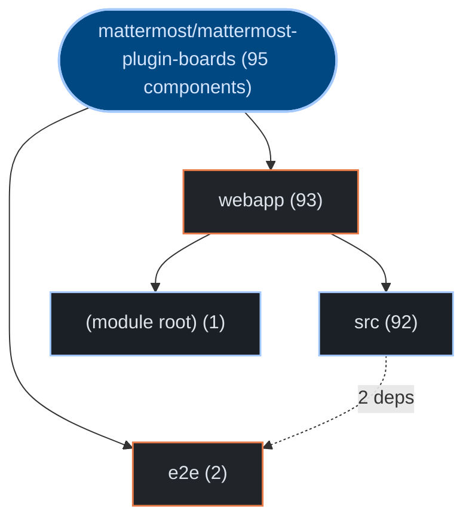
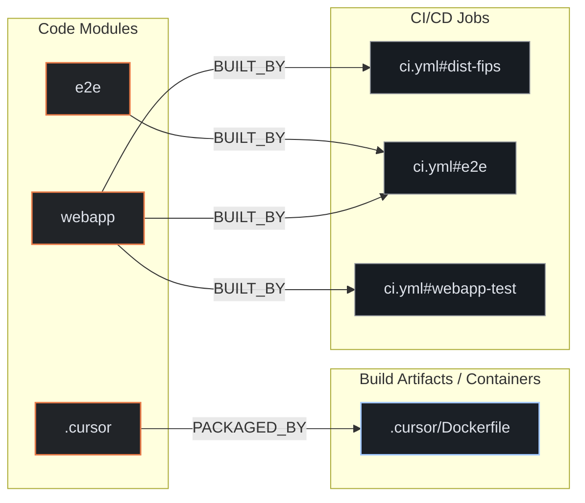

# Repository Architecture Analysis: mattermost/mattermost-plugin-boards

## Metadata
- **SHA**: `7f92224a171e00f99900823089a73ed89e91829c`
- **Primary Ecosystem**: JavaScript/TypeScript

## Quality Metrics
- **ast_engine**: tree-sitter
- **avg_cognitive_complexity**: 3.93
- **avg_cyclomatic_complexity**: 3.61
- **component_count**: 95
- **dead_code_count**: 60
- **dead_code_symbols**: 50 entry(ies)
- **duplication_pct**: 85.79
- **file_complexities**: 25 entry(ies)
- **files_analyzed**: 592
- **fitness_passed**: False
- **fitness_violation_count**: 9
- **framework**: React (Vite)
- **import_edges**: 100 entry(ies)
- **loc**: 72418
- **max_cognitive_complexity**: 147
- **max_cyclomatic_complexity**: 88
- **sloc**: 59693
- **test_file_count**: 410

# Architecture: mattermost/mattermost-plugin-boards

## Context
- **Repository**: `mattermost/mattermost-plugin-boards`
- **SHA**: `7f92224a171e00f99900823089a73ed89e91829c`
- **Ecosystem**: JavaScript/TypeScript
- **Framework**: React (Vite)

## Building Block View

## Component Details

Showing top 60 representative components out of 95 across 2 module group(s):

- **Module `webapp`** (93 components — UI_COMPONENT: 89, SERVICE: 3, MODULE: 1)
- **Module `e2e`** (2 components — MODULE: 1, UI_COMPONENT: 1)

- **ClassForManageCategoriesTourStep** (`webapp/src/components/sidebar/sidebarCategory.tsx`): UI_COMPONENT (deps: BoardIcon, CalculationOptions, ChevronDown, ChevronRight, CompassIcon, ConfirmationDialogBox (+13 more))
- **ShareBoardDialog** (`webapp/src/components/shareBoard/shareBoard.tsx`): UI_COMPONENT (deps: BoardIcon, CompassIcon, ConfirmationDialogBox, FlashMessages, Globe, KeyCodes (+10 more))
- **OnboardingBoardTitle** (`webapp/src/components/cardDetail/cardDetail.tsx`): UI_COMPONENT (deps: BoardIcon, CardDetailContext, CardDetailProvider, CardIcon, CardSkeleton, CompassIcon (+8 more))
- **OnboardingCardTitle** (`webapp/src/components/cardDetail/cardDetail.tsx`): UI_COMPONENT (deps: BoardIcon, CardDetailContext, CardDetailProvider, CardIcon, CardSkeleton, CompassIcon (+8 more))
- **CardActionsMenu** (`webapp/src/components/cardActionsMenu/cardActionsMenu.tsx`): UI_COMPONENT (deps: DeleteIcon, DuplicateIcon, FlashMessages, KeyCodes, LinkIcon, SYSTEM_ADMIN_ROLE (+5 more))
- **OnboardingCardClassName** (`webapp/src/components/kanban/kanbanCard.tsx`): UI_COMPONENT (deps: BoardIcon, CardActionsMenu, CardIcon, ConfirmationDialogBox, KeyCodes, SYSTEM_ADMIN_ROLE (+5 more))
- **BoardsUnfurl** (`webapp/src/components/boardsUnfurl/boardsUnfurl.tsx`): UI_COMPONENT (deps: BoardIcon, CardIcon, KeyCodes, OctoClient, SYSTEM_ADMIN_ROLE, ShowFullName (+4 more))
- **ContentElement** (`webapp/src/components/content/contentElement.tsx`): UI_COMPONENT (deps: CardDetailContext, CardDetailProvider, KeyCodes, SYSTEM_ADMIN_ROLE, ShowFullName, ShowNicknameFullName (+2 more))
- **KanbanColumnHeader** (`webapp/src/components/kanban/kanbanColumnHeader.tsx`): UI_COMPONENT (deps: AddIcon, BoardIcon, CalculationOptions, CardIcon, DeleteIcon, HideIcon (+2 more))
- **OctoClient** (`webapp/src/octoClient.ts`): SERVICE (deps: BoardIcon, KeyCodes, SYSTEM_ADMIN_ROLE, ShowFullName, ShowNicknameFullName, ShowUsername (+2 more))
- **EmptyResults** (`webapp/src/components/searchDialog/searchDialog.tsx`): UI_COMPONENT (deps: KeyCodes, SYSTEM_ADMIN_ROLE, Search, ShowFullName, ShowNicknameFullName, ShowUsername (+1 more))
- **EmptySearch** (`webapp/src/components/searchDialog/searchDialog.tsx`): UI_COMPONENT (deps: KeyCodes, SYSTEM_ADMIN_ROLE, Search, ShowFullName, ShowNicknameFullName, ShowUsername (+1 more))
- **WSClient** (`webapp/src/wsclient.ts`): SERVICE (deps: BoardIcon, KeyCodes, SYSTEM_ADMIN_ROLE, ShowFullName, ShowNicknameFullName, ShowUsername (+1 more))
- **DeleteBoardDialog** (`webapp/src/components/sidebar/deleteBoardDialog.tsx`): UI_COMPONENT (deps: KeyCodes, SYSTEM_ADMIN_ROLE, ShowFullName, ShowNicknameFullName, ShowUsername, TEAM_ADMIN_ROLE)
- **KanbanCalculationOptions** (`webapp/src/components/kanban/calculation/calculationOptions.tsx`): UI_COMPONENT (deps: BoardIcon, CalculationOptions, Options, OptionsIcon)
- **KanbanHiddenColumnItem** (`webapp/src/components/kanban/kanbanHiddenColumnItem.tsx`): UI_COMPONENT (deps: BoardIcon, CardIcon, ShowIcon)
- **KeyCodes** (`webapp/src/utils.ts`): UI_COMPONENT (deps: BoardIcon, CardIcon, WSClient)
- **SYSTEM_ADMIN_ROLE** (`webapp/src/utils.ts`): UI_COMPONENT (deps: BoardIcon, CardIcon, WSClient)
- **ShowFullName** (`webapp/src/utils.ts`): UI_COMPONENT (deps: BoardIcon, CardIcon, WSClient)
- **ShowNicknameFullName** (`webapp/src/utils.ts`): UI_COMPONENT (deps: BoardIcon, CardIcon, WSClient)
- **ShowUsername** (`webapp/src/utils.ts`): UI_COMPONENT (deps: BoardIcon, CardIcon, WSClient)
- **TEAM_ADMIN_ROLE** (`webapp/src/utils.ts`): UI_COMPONENT (deps: BoardIcon, CardIcon, WSClient)
- **TableCalculationOptions** (`webapp/src/components/table/calculation/tableCalculationOptions.tsx`): UI_COMPONENT (deps: CalculationOptions, Options, OptionsIcon)
- **CalculationOptions** (`webapp/src/components/calculations/options.tsx`): UI_COMPONENT (deps: BoardIcon, ChevronUp)
- **CardDetailContext** (`webapp/src/components/cardDetail/cardDetailContext.tsx`): UI_COMPONENT (deps: CardIcon, OctoClient)
- **CardDetailProvider** (`webapp/src/components/cardDetail/cardDetailContext.tsx`): UI_COMPONENT (deps: CardIcon, OctoClient)
- **Options** (`webapp/src/components/calculations/options.tsx`): UI_COMPONENT (deps: BoardIcon, ChevronUp)
- **AddIcon** (`webapp/src/widgets/icons/add.tsx`): UI_COMPONENT (deps: CompassIcon)
- **AlertIcon** (`webapp/src/widgets/icons/alert.tsx`): UI_COMPONENT (deps: CompassIcon)
- **Apps** (`webapp/src/widgets/icons/apps.tsx`): UI_COMPONENT (deps: CompassIcon)
- **BrokenFile** (`webapp/src/widgets/icons/brokenFile.tsx`): UI_COMPONENT (deps: CompassIcon)
- **Check** (`webapp/src/widgets/icons/checkIcon.tsx`): UI_COMPONENT (deps: CompassIcon)
- **ChevronDown** (`webapp/src/widgets/icons/chevronDown.tsx`): UI_COMPONENT (deps: CompassIcon)
- **ChevronRight** (`webapp/src/widgets/icons/chevronRight.tsx`): UI_COMPONENT (deps: CompassIcon)
- **ChevronUp** (`webapp/src/widgets/icons/chevronUp.tsx`): UI_COMPONENT (deps: CompassIcon)
- **CloseCircle** (`webapp/src/widgets/icons/closeCircle.tsx`): UI_COMPONENT (deps: CompassIcon)
- **CloseIcon** (`webapp/src/widgets/icons/close.tsx`): UI_COMPONENT (deps: CompassIcon)
- **CreateNewFolder** (`webapp/src/widgets/icons/newFolder.tsx`): UI_COMPONENT (deps: CompassIcon)
- **DeleteIcon** (`webapp/src/widgets/icons/delete.tsx`): UI_COMPONENT (deps: CompassIcon)
- **DropdownIcon** (`webapp/src/widgets/icons/dropdown.tsx`): UI_COMPONENT (deps: CompassIcon)
- **DuplicateIcon** (`webapp/src/widgets/icons/duplicate.tsx`): UI_COMPONENT (deps: CompassIcon)
- **EditIcon** (`webapp/src/widgets/icons/edit.tsx`): UI_COMPONENT (deps: CompassIcon)
- **Editor** (`webapp/src/components/blocksEditor/editor.tsx`): UI_COMPONENT (deps: RootInput)
- **Folder** (`webapp/src/widgets/icons/folder.tsx`): UI_COMPONENT (deps: CompassIcon)
- **Globe** (`webapp/src/widgets/icons/globe.tsx`): UI_COMPONENT (deps: CompassIcon)
- **HandRight** (`webapp/src/widgets/icons/HandRight.tsx`): UI_COMPONENT (deps: CompassIcon)
- **HelpIcon** (`webapp/src/widgets/icons/help.tsx`): UI_COMPONENT (deps: CompassIcon)
- **HoveringContext** (`webapp/src/widgets/menu/subMenuOption.tsx`): UI_COMPONENT (deps: CompassIcon)
- **LinkIcon** (`webapp/src/widgets/icons/Link.tsx`): UI_COMPONENT (deps: CompassIcon)
- **LockOutline** (`webapp/src/widgets/icons/lockOutline.tsx`): UI_COMPONENT (deps: CompassIcon)
- **LogoIcon** (`webapp/src/widgets/icons/logo.tsx`): UI_COMPONENT (deps: CompassIcon)
- **MessageIcon** (`webapp/src/widgets/icons/message.tsx`): UI_COMPONENT (deps: CompassIcon)
- **OptionsIcon** (`webapp/src/widgets/icons/options.tsx`): UI_COMPONENT (deps: CompassIcon)
- **RandomIcon** (`webapp/src/widgets/icons/random.tsx`): UI_COMPONENT (deps: CompassIcon)
- **Search** (`webapp/src/widgets/icons/search.tsx`): UI_COMPONENT (deps: CompassIcon)
- **SettingsIcon** (`webapp/src/widgets/icons/settings.tsx`): UI_COMPONENT (deps: CompassIcon)
- **Update** (`webapp/src/widgets/icons/update.tsx`): UI_COMPONENT (deps: CompassIcon)
- **AccessDeniedIllustration** (`webapp/src/svg/access-denied-illustation.tsx`): UI_COMPONENT
- **BoardIcon** (`webapp/src/widgets/icons/board.tsx`): UI_COMPONENT
- **CalendarIcon** (`webapp/src/widgets/icons/calendar.tsx`): UI_COMPONENT

## 6-Dimension Repository Scorecard

- **Overall Grade**: `F` (41.36/100)
- **Technical Debt Score**: 58.64
- **Estimated Remediation Effort**: 98.82h

| Dimension | Grade | Score | Weight | Details |
| :--- | :---: | :---: | :---: | :--- |
| Code Quality | `F` | 27.56 | 0.20 | avg_cc=3.61, max_cc=88, duplication=85.79%, dead_code=60 |
| Dependency Health | `A` | 100.00 | 0.15 | dependencies=2282, outdated=0, vulnerable=0, has_lockfile=True |
| Maintainability | `F` | 0.00 | 0.15 | avg_cognitive=3.93, max_cognitive=147, fitness_violations=9, oversized_files=8 |
| Pipeline Health | `D` | 69.00 | 0.15 | workflows=6, operational_antipatterns=11, parallel_branches=True |
| Security | `F` | 0.00 | 0.20 | vulnerabilities=0, secrets=3, pipeline_security_findings=6 |
| Test Coverage | `C` | 70.00 | 0.15 | coverage=unavailable, ci_test_job=True, test_files_detected=True |

## Architecture Fitness & Workspace Boundaries

- **[HIGH] `ATRUSS-ARCH-004` (CIRCULAR_DEPENDENCY)**: Circular dependency detected between architectural components. (KeyCodes -> WSClient -> KeyCodes)
- **[HIGH] `ATRUSS-ARCH-004` (CIRCULAR_DEPENDENCY)**: Circular dependency detected between architectural components. (SYSTEM_ADMIN_ROLE -> WSClient -> SYSTEM_ADMIN_ROLE)
- **[HIGH] `ATRUSS-ARCH-004` (CIRCULAR_DEPENDENCY)**: Circular dependency detected between architectural components. (ShowFullName -> WSClient -> ShowFullName)
- **[HIGH] `ATRUSS-ARCH-004` (CIRCULAR_DEPENDENCY)**: Circular dependency detected between architectural components. (ShowNicknameFullName -> WSClient -> ShowNicknameFullName)
- **[HIGH] `ATRUSS-ARCH-004` (CIRCULAR_DEPENDENCY)**: Circular dependency detected between architectural components. (ShowUsername -> WSClient -> ShowUsername)
- **[HIGH] `ATRUSS-ARCH-004` (CIRCULAR_DEPENDENCY)**: Circular dependency detected between architectural components. (TEAM_ADMIN_ROLE -> WSClient -> TEAM_ADMIN_ROLE)
- **[MEDIUM] `ATRUSS-ARCH-005` (COMPLEXITY_THRESHOLD)**: Repository duplication_pct (85.79) exceeds policy threshold (15.0).
- **[MEDIUM] `ATRUSS-ARCH-005` (COMPLEXITY_THRESHOLD)**: Repository max_cognitive_complexity (147.0) exceeds policy threshold (25.0).
- **[MEDIUM] `ATRUSS-ARCH-005` (COMPLEXITY_THRESHOLD)**: Repository max_cyclomatic_complexity (88.0) exceeds policy threshold (20.0).

## Supply Chain Dependencies, Vulnerabilities & Secrets

- **Dependencies Parsed**: 2282 | **Vulnerabilities**: 0 | **Secrets**: 3

### Secret Findings (Redacted)
- **[HIGH] `ATRUSS-SEC-005`** at `server/swagger/README.md:40` (`{"token":"abcd***REDACTED***"}`)
- **[HIGH] `ATRUSS-SEC-005`** at `webapp/i18n/ja.json:223` (`"RegistrationLink.confirmRegenerateToken": "実行する***REDACTED***",`)
- **[HIGH] `ATRUSS-SEC-005`** at `webapp/i18n/ja.json:234` (`"ShareBoard.confirmRegenerateToken": "実行する***REDACTED***",`)

### Inventory Sample
- `github.com/Masterminds/squirrel` `1.5.4` (golang, `go.mod`)
- `github.com/golang/mock` `1.6.0` (golang, `go.mod`)
- `github.com/gorilla/mux` `1.8.1` (golang, `go.mod`)
- `github.com/gorilla/websocket` `1.5.3` (golang, `go.mod`)
- `github.com/hashicorp/go-multierror` `1.1.1` (golang, `go.mod`)
- `github.com/krolaw/zipstream` `0.0.0-20180621105154-0a2661891f94` (golang, `go.mod`)
- `github.com/lib/pq` `1.10.9` (golang, `go.mod`)
- `github.com/mattermost/logr/v2` `2.0.22` (golang, `go.mod`)
- `github.com/mattermost/mattermost/server/public` `0.1.21` (golang, `go.mod`)
- `github.com/mattermost/mattermost/server/v8` `8.0.0-20251014075701-833e0125320d` (golang, `go.mod`)
- `github.com/mattermost/morph` `1.1.0` (golang, `go.mod`)
- `github.com/mattn/go-sqlite3` `2.0.3+incompatible` (golang, `go.mod`)
- `github.com/mgdelacroix/foundation` `0.0.0-20230510073833-0660207768ef` (golang, `go.mod`)
- `github.com/oklog/run` `1.2.0` (golang, `go.mod`)
- `github.com/pkg/errors` `0.9.1` (golang, `go.mod`)
- `github.com/prometheus/client_golang` `1.22.0` (golang, `go.mod`)
- `github.com/rivo/uniseg` `0.4.7` (golang, `go.mod`)
- `github.com/rudderlabs/analytics-go` `3.3.3+incompatible` (golang, `go.mod`)
- `github.com/sergi/go-diff` `1.3.1` (golang, `go.mod`)
- `github.com/spf13/viper` `1.21.0` (golang, `go.mod`)
- `github.com/stretchr/testify` `1.11.1` (golang, `go.mod`)
- `github.com/wiggin77/merror` `1.0.5` (golang, `go.mod`)
- `gopkg.in/yaml.v3` `3.0.1` (golang, `go.mod`)
- `@draft-js-plugins/editor` `4.1.2` (npm, `webapp/package.json`)
- `@draft-js-plugins/editor` `4.1.4` (npm, `webapp/package-lock.json`)
- `@draft-js-plugins/emoji` `4.6.0` (npm, `webapp/package.json`)
- `@draft-js-plugins/emoji` `4.6.7` (npm, `webapp/package-lock.json`)
- `@draft-js-plugins/mention` `5.1.2` (npm, `webapp/package.json`)
- `@draft-js-plugins/mention` `5.3.0` (npm, `webapp/package-lock.json`)
- `@emotion/serialize` `1.1.4` (npm, `webapp/package-lock.json`)
- ... (+2252 more dependencies)

## Section 7: Code-to-Cloud Deployment Traceability

- `.cursor` (code_module) --[PACKAGED_BY]--> `.cursor/Dockerfile` (container)
- `e2e` (code_module) --[BUILT_BY]--> `ci.yml#e2e` (ci_job)
- `webapp` (code_module) --[BUILT_BY]--> `ci.yml#dist-fips` (ci_job)
- `webapp` (code_module) --[BUILT_BY]--> `ci.yml#e2e` (ci_job)
- `webapp` (code_module) --[BUILT_BY]--> `ci.yml#webapp-test` (ci_job)

## CI/CD Pipeline Topology

```mermaid
graph TD;
  classDef atlasRoot fill:#004882,stroke:#a3c9ff,stroke-width:2px,color:#d3e4ff
  classDef atlasCategory fill:#212428,stroke:#E87A48,stroke-width:1.5px,color:#dfe3eb
  classDef atlasWorkflow fill:#1b2026,stroke:#a3c9ff,stroke-width:1.5px,color:#dfe3eb
  classDef atlasJob fill:#171c22,stroke:#8d9199,stroke-width:1px,color:#dfe3eb
  classDef atlasTarget fill:#005227,stroke:#8bd99b,stroke-width:1.5px,color:#a7f6b6
  classDef atlasAlert fill:#93000a,stroke:#ffb4ab,stroke-width:1.5px,color:#ffdad6
  classDef atlasMore fill:#252a31,stroke:#8d9199,stroke-dasharray:4 4,color:#c3c6cf
  pipeline_root(["mattermost/mattermost-plugin-boards (6 workflows)"]):::atlasRoot
  subgraph sg_grp_0_Scheduled___Manual["Scheduled & Manual (3 workflows · 8 jobs)"]
    direction TB
    subgraph sg_wf_0_Check_in_tests["Check-in tests (5 jobs)"]
      direction TB
      wf_0_Check_in_tests(["Trigger: Check-in tests"]):::atlasWorkflow
      job_0_webapp_test["webapp-test"]:::atlasJob
      job_0_server_test["server-test"]:::atlasJob
      job_0_dist["dist"]:::atlasJob
      wf_0_Check_in_tests --> job_0_webapp_test
      wf_0_Check_in_tests --> job_0_server_test
      wf_0_Check_in_tests --> job_0_dist
    end
    pipeline_root --> wf_0_Check_in_tests
    subgraph sg_wf_2_golangci_lint["golangci-lint (2 jobs)"]
      direction TB
      wf_2_golangci_lint(["Trigger: golangci-lint"]):::atlasWorkflow
      job_2_down_migrations["down-migrations"]:::atlasJob
      job_2_golangci["golangci"]:::atlasJob
      wf_2_golangci_lint --> job_2_down_migrations
      wf_2_golangci_lint --> job_2_golangci
    end
    pipeline_root --> wf_2_golangci_lint
    subgraph sg_wf_4_PR_Test_Analysis["PR Test Analysis (1 jobs)"]
      direction TB
      wf_4_PR_Test_Analysis(["Trigger: PR Test Analysis"]):::atlasWorkflow
      job_4_analyze["analyze"]:::atlasJob
      wf_4_PR_Test_Analysis --> job_4_analyze
    end
    pipeline_root --> wf_4_PR_Test_Analysis
  end
  subgraph sg_grp_1_Security___Governance["Security & Governance (2 workflows · 2 jobs)"]
    direction TB
    subgraph sg_wf_1_CodeQL["CodeQL (1 jobs)"]
      direction TB
      wf_1_CodeQL(["Trigger: CodeQL"]):::atlasWorkflow
      job_1_analyze["analyze"]:::atlasJob
      wf_1_CodeQL --> job_1_analyze
    end
    pipeline_root --> wf_1_CodeQL
    subgraph sg_wf_5_Scorecards_supply_chain_security["Scorecards supply-chain security (1 jobs)"]
      direction TB
      wf_5_Scorecards_supply_chain_security(["Trigger: Scorecards supply-chain security"]):::atlasWorkflow
      job_5_analysis["analysis"]:::atlasJob
      wf_5_Scorecards_supply_chain_security --> job_5_analysis
    end
    pipeline_root --> wf_5_Scorecards_supply_chain_security
  end
  subgraph sg_grp_2_CI___Verification["CI & Verification (1 workflows · 1 jobs)"]
    direction TB
    subgraph sg_wf_3_PR_Test_Analysis_Override["PR Test Analysis Override (1 jobs)"]
      direction TB
      wf_3_PR_Test_Analysis_Override(["Trigger: PR Test Analysis Override"]):::atlasWorkflow
      job_3_override["override"]:::atlasJob
      wf_3_PR_Test_Analysis_Override --> job_3_override
    end
    pipeline_root --> wf_3_PR_Test_Analysis_Override
  end
```

